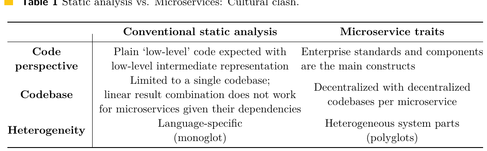
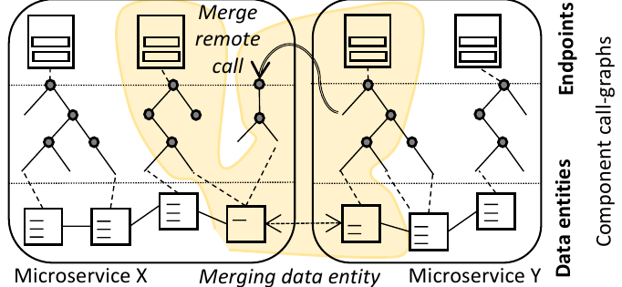
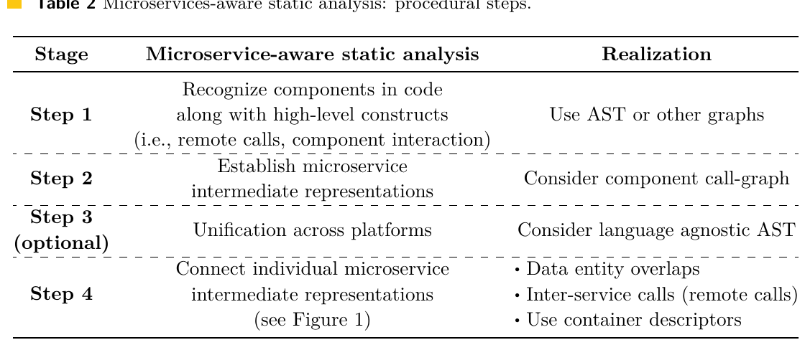
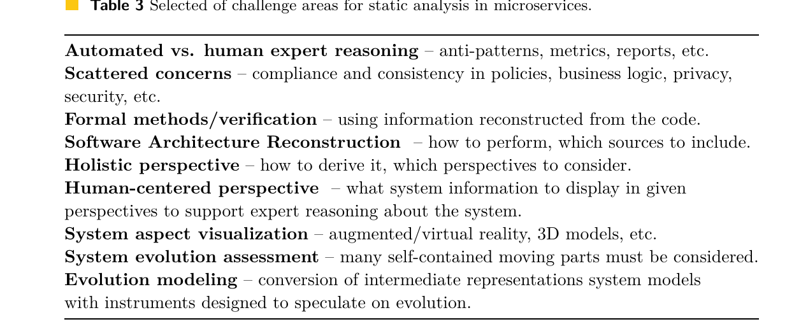
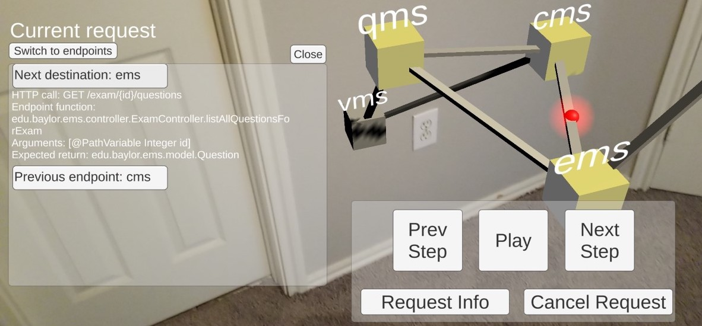
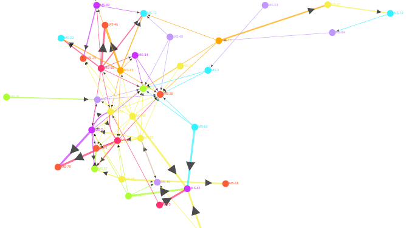
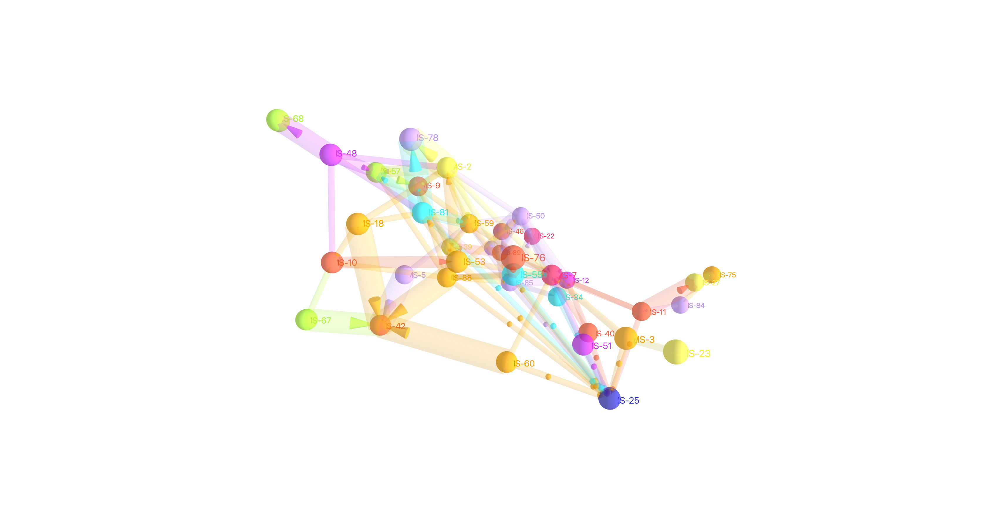
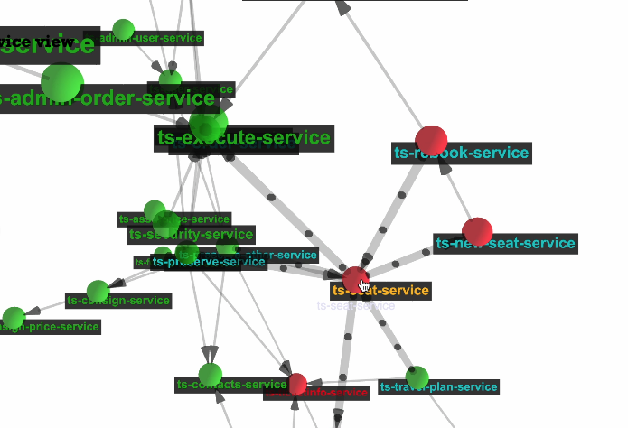

# Статический анализ, учитывающий микросервисы: возможности, пробелы и достижения

**Перевод на русский язык:** А. Н. Сенников. Неофициальный перевод; при расхождениях с оригиналом приоритет имеет оригинал. Текст перевода распространяется по лицензии [CC BY 4.0](https://creativecommons.org/licenses/by/4.0/legalcode.ru).

**Оригинальное название:** *Microservice-Aware Static Analysis: Opportunities, Gaps, and Advancements*

**Публикация:** OASIcs, том 111, статья 2, с. 2:1–2:14; Microservices 2020/2022; опубликована 19.12.2023  
**DOI:** [10.4230/OASIcs.Microservices.2020-2022.2](https://doi.org/10.4230/OASIcs.Microservices.2020-2022.2)  
**Лицензия оригинала:** [CC BY 4.0](https://creativecommons.org/licenses/by/4.0/legalcode.ru)

**Tomas Cerny ¹, Davide Taibi ²**

> ¹ Systems and Industrial Engineering, University of Arizona, Tucson, AZ, USA
> ² M3S, Faculty of Information Technology and Electrical Engineering, University of Oulu, 90570 Oulu, Finland

**2012 ACM Subject Classification:** Computer systems organization → Distributed architectures; Cloud computing; Software and its engineering → Automated static analysis

**Funding.**
Tomas Cerny: this material is based upon work supported by the National Science Foundation under Grant No. 2245287, and a grant from Red Hat Research <https://research.redhat.com>.
Davide Taibi: this material is based upon work supported by the ADOMS Grant from Ulla Tuominen Foundation and a grant from the Academy of Finland (grant n. 349488 - MuFAno).

**Copyright:** © Tomas Cerny and Davide Taibi; licensed under Creative Commons License CC-BY 4.0. Joint Post-proceedings of the Third and Fourth International Conference on Microservices (Microservices 2020/2022). Editors: Gokila Dorai, Maurizio Gabbrielli, Giulio Manzonetto, Aomar Osmani, Marco Prandini, Gianluigi Zavattaro, and Olaf Zimmerman; Article No. 2; pp. 2:1–2:14. OpenAccess Series in Informatics. Schloss Dagstuhl – Leibniz-Zentrum für Informatik, Dagstuhl Publishing, Germany.

---

## Аннотация

Микросервисная архитектура — основное средство построения облачно-ориентированных систем из небольших наборов сервисов, разрабатываемых и развёртываемых независимо. Независимый характер этой модульной архитектуры порождает и трудности, и пробелы, с которыми специалисты-практики не сталкивались в системах-монолитах. Одна из главных трудностей, связанных с децентрализацией и с независимыми микросервисами, которыми управляют отдельные команды, состоит в том, что эволюционирующая архитектура системы легко отклоняется от первоначальных планов, и её становится сложно поддерживать. В литературе этот процесс часто называют деградацией архитектуры системы. Доступных инструментов мало, особенно в контексте микросервисов. Настоящая статья ставит перед читателем вопрос о том, каким образом статический анализ мог бы способствовать разработке микросервисных систем и управлению ими — в частности, управлению деградацией архитектуры. В ней подробно рассматриваются трудности, а также изменения, необходимые традиционному анализу кода, чтобы он лучше соответствовал таким системам. Далее обсуждается, какие следствия для специалистов-практиков возникнут, когда надёжные инструменты статического анализа станут доступны.

**Ключевые слова:** микросервисная архитектура, статический анализ, рассуждение, децентрализация

---

## 1. Введение

Облачно-ориентированные системы проектируются так, чтобы в полной мере использовать возможности облачной инфраструктуры. Методология 12-факторного приложения [[46]](#ref-46) даёт рекомендации по проектированию, сборке и развёртыванию таких систем. Так, облачно-ориентированные системы строятся на микросервисной архитектуре, используют контейнеры и следуют практикам непрерывной интеграции и поставки (CD/CI).

Микросервисный архитектурный стиль — парадигма разработки систем в виде набора небольших, самодостаточных и автономных сервисов, взаимодействующих по легковесному протоколу. У каждого микросервиса собственная кодовая база с отдельной конфигурацией, что облегчает его самостоятельную децентрализованную эволюцию. Это, в свою очередь, позволяет разделить обязанности между такими ролями, как архитекторы, разработчики и инженеры DevOps. Такой стиль хорошо согласуется и с законом Конвея, согласно которому организациям следует проектировать системы по образу собственной структуры коммуникации.

Хотя функциональность в микросервисах разделена удачно, пересечения между отдельными микросервисами всё же сохраняются. У каждого микросервиса есть ограниченный контекст в рамках всей системы, и, поскольку микросервисы взаимодействуют, пересечение неизбежно. Следствия этих пересечений отражаются в кодовой базе микросервиса. Поскольку кодовая база остаётся самодостаточной, пересечение означает частично повторённые определения, обычно реализованные заново в конкретной версии фреймворка. Такое повторение может касаться определений обрабатываемых данных, инкапсулированного знания, бизнес-логики или иных механизмов применения различных политик (в частности, безопасности, ограничений, конфиденциальности и т. д.). Однако на протяжении эволюции системы это пересечение никак не контролируется, а механизмы выявления ошибок согласованности ненадёжны. Поэтому, когда любое из этих определений меняется в кодовой базе микросервиса, ничто прямо не указывает, что оно повторено в других кодовых базах.

Помимо функциональной декомпозиции, от микросервисов ожидают, что они справятся с задачей разделения аспектов (*separation of concerns*). Хотя средства здесь те же, что и в любой другой компонентной разработке, децентрализация приводит к рассеиванию различных аспектов, лишённых единого фокуса. Такое разделение аспектов может быть хорошо организовано на уровне одной кодовой базы, но может быть утрачено при децентрализации и наличии нескольких кодовых баз. Инфраструктура вроде централизованных серверов конфигурации и API-шлюза существует — в частности, чтобы обеспечить телеметрию и трейсинг, — но использовать её вопреки исходному назначению нельзя: это ведёт к антипаттернам.

Обычно мы стремимся разделять аспекты в программных системах, чтобы обеспечить лучшую читаемость и сопровождаемость [[29]](#ref-29). Можно управлять этим на микроуровне и спроектировать надёжное разделение аспектов в каждом отдельном микросервисе. Однако это относилось бы лишь к одному микросервису, а не ко всей системе. Вопрос в том, нужно ли видеть определённый аспект с точки зрения системы в целом. Если мы архитекторы, ответ, скорее всего, будет утвердительным — например, когда речь идёт об аспектах конфиденциальности в системе. Чтобы принимать обоснованные решения, разработчики должны видеть зависимые (то есть взаимодействующие) микросервисы согласованными по выбранным аспектам. Следует помнить, что при самодостаточной природе микросервиса и децентрализованном взгляде на систему каждый аспект определённого типа заново определяется и инкапсулируется в каждом микросервисе. Возможно, это одно из самых больших разочарований при переходе от систем-монолитов. Например, следствие для оценки безопасности таково: каждый микросервис приходится анализировать по отдельности. Затем извлечённое знание нужно объединять ситуативно, а это утомительный, долгий и чреватый ошибками процесс, который не масштабируется при гибкой разработке. К сожалению, в микросервисной архитектуре приходится смириться с тем, что система имеет дело с «рассеянными аспектами» [[9]](#ref-9).

В настоящей статье обсуждается, каким образом статический анализ мог бы помочь в устранении недостатков систем на основе микросервисов. Мы обращаем особое внимание на то, как будущим инструментам следует адаптироваться, чтобы лучше соответствовать специфике таких систем. Обсуждение опирается на исследования конкретных случаев и прототипы инструментов, разработанные вместе с нашими исследовательскими группами.

В оставшейся части статьи рассматриваются современные подходы к оценке облачно-ориентированных систем (раздел 2). Далее раздел 3 посвящён изменениям в инструментах статического анализа, необходимым для лучшего соответствия принципам облачно-ориентированного проектирования. Наконец, в разделе 4 обсуждаются следствия для заинтересованных сторон после того, как эти инструменты станут надёжными и доступными, а раздел 5 завершает статью[^4].

---

## 2 Современные тенденции

Чтобы справиться с различными трудностями микросервисов, исследователи часто прибегают к динамическому анализу системы. Он, несомненно, способен выявить графы зависимостей сервисов и дать более централизованный взгляд на систему.

Однако чтобы выявить эти артефакты, требуются усилия иного рода. Во-первых, выявленные артефакты не могут быть полнее, чем тесты системы или её взаимодействие. Это значит, что граф можно было бы извлечь целиком при полном покрытии тестами [[18]](#ref-18), [[38]](#ref-38). Однако такое покрытие обходится дорого и должно подстраиваться под эволюцию системы. В качестве альтернативы можно использовать трафик системы в промышленной эксплуатации, но и тогда полное покрытие системы не гарантировано. Во-вторых, мы не хотим, чтобы циклическую зависимость обнаруживали клиенты в промышленной эксплуатации, и должны стремиться проанализировать систему до передачи в промышленную среду. Динамическому анализу нужна работающая система, с которой можно взаимодействовать, чтобы выявить упомянутые артефакты, а это требует времени. Если предполагается анализировать систему при каждом новом изменении кода (коммите) в кодовой базе, потребуются значительные вычислительные мощности. Выполнение тестов также занимает время (особенно при полном покрытии).

Динамический анализ может выполняться средствами мониторинга системы (например, с помощью телеметрии <https://opentelemetry.io>) или централизованного трейсинга по логам. Трейсы формируются в ходе логирования, дополненного корреляционными идентификаторами, а записи лога могут содержать сведения о том, что разработчики добавили в систему или чем инструментировали её важные компоненты (в частности, эндпоинты). Большое преимущество этого подхода — независимость от платформы.

Однако следует признать, что микросервисы и их инфраструктура нуждаются в дополнительных расширениях для интеграции централизованного логирования и трейсинга [[8]](#ref-8). Так, необходимо ввести корреляционные идентификаторы, наладить централизацию логов, а для наиболее развитой отчётности — предусмотреть проверки работоспособности. Динамический анализ на основе телеметрии позволяет определять зависимости микросервисов по графам вызовов [[19]](#ref-19), [[43]](#ref-43), [[31]](#ref-31), а также по тепловой карте частоты обращений к эндпоинтам.

Тем не менее у динамического анализа есть ограничения. Он не может получить доступ к сведениям, существующим только в кодовых базах (например, какой компонент отвечает за бизнес-логику этого эндпоинта и т. д.) [[18]](#ref-18). Необходимо учитывать и разделение обязанностей применительно к телеметрии. У разных ролей потребности могут различаться. Разработчики хотели бы знать, не сломало ли их изменение соседние микросервисы. Однако телеметрией и централизованными логами с трейсингом управляют не разработчики, а инженеры DevOps [[4]](#ref-4). Такое разделение ролей вносит опосредованность в отчётность, многошаговость в интерпретацию и задержку между тем, что разработано, и тем, что выявлено.

Метафорой для динамического и статического анализа мог бы служить выбор между типобезопасными языками и интерпретируемыми языками без контроля типов. Разработчики, ведущие кодовую базу отдельного микросервиса, скорее всего, пользуются быстрыми проверками изменений в коде. Эти проверки основаны на статическом анализе и часто входят в интегрированные среды разработки, файлы сборки или добавляются в пайплайны CD/CI. Однако сегодня такие инструменты ограничены тем, что относятся лишь к одной кодовой базе. Возникающая трудность в том, что новым успешным инструментам придётся работать с несколькими кодовыми базами и объединять результаты, видя систему как целое, а не как отдельные фрагменты большей головоломки [[21]](#ref-21), [[34]](#ref-34).

Сравнивая статический и динамический анализ, необходимо понимать, что у этих инструментов две разные цели. Один сообщает о структурах, лежащих в основе системы, и даёт взгляд «белого ящика»; другой подробно описывает, как система работает, в рамках взгляда «чёрного ящика».

Естественно, есть и пересечения. Оба подхода позволяют определить эндпоинты системы или сами микросервисы [[18]](#ref-18). Однако здесь же проходит и граница возможностей каждого подхода. Всё, что расположено ниже уровня эндпоинтов, доступно динамическому анализу лишь при условии инструментации трейсинга [[7]](#ref-7). При этом приходится платить: инструментация кода ради дополнительного логирования сказывается на производительности. С другой стороны, всё, что расположено ниже уровня эндпоинтов, — естественная область статического анализа. Динамический же анализ, напротив, покажет, как пользователи работают с системой, какие эндпоинты популярнее других и т. д.

Можно заметить, что статический анализ находится скорее в ведении разработчиков, а динамический ближе к эксплуатации (то есть к инженерам DevOps). Всё же другим заинтересованным сторонам может понадобиться сочетание обоих подходов — например, при проведении оценки безопасности. В идеале обе точки зрения сочетаются симбиотически, давая всестороннее понимание системы и её динамики.

И всё же ни статический, ни динамический анализ не объяснят, как организована работа разработчиков и как система меняется со временем. Ответить на такой вопрос позволяет анализ репозиториев программного обеспечения (*Mining Software Repositories*, MSR): он показывает, как со временем меняется структура системы и меняется ли организация работы вокруг отдельных микросервисов. Можно собрать дополнительные сведения из сообщений системы управления версиями — возможно, связанные с задачами в системах учёта заявок. MSR часто смыкается со статическим анализом.

На вход статического анализа в первую очередь подаётся код системы (исходный код, байт-код или двоичный код) [[2]](#ref-2). В простейшем случае из исходного кода строится абстрактное синтаксическое дерево (*abstract-syntax tree*, AST), а затем оно преобразуется в другие виды графов. Далее эти структуры[^5] обходятся, чтобы выполнить заданную верификацию или сопоставить их с различными антипаттернами [[44]](#ref-44), [[13]](#ref-13). Результатом такого разбора обычно становится промежуточное представление (*intermediate representation*, IR) или модель системы, в которой и происходит рассуждение об извлечённых сведениях и структурах.

Статический анализ работает не с одним лишь кодом и его изменениями, которые поставляет MSR. В облачно-ориентированном проектировании репозиторий обычно содержит файлы сборки и файлы конфигурации контейнеров; их несложно проанализировать, чтобы определить топологию [[22]](#ref-22), [[39]](#ref-39), [[27]](#ref-27) и задействованные технологии. Будущие подходы к статическому анализу не могут обойти эти аспекты стороной.

---

## 3 Традиционный статический анализ в сравнении с микросервисными системами

Как было сказано выше, традиционный статический анализ работает с одной кодовой базой. Он определяет зависимости между различными внутренними структурами, пользуясь абстракцией, которая облегчает рассуждение о данной системе [[2]](#ref-2). Однако облачно-ориентированные системы децентрализованы, и у каждого микросервиса может быть самодостаточная кодовая база. Из-за этого различия труднее получить ожидаемый результат — понять зависимости системы или рассуждать о ней целостно, — поскольку в каждой кодовой базе могут применяться собственные фреймворк, платформа и версия библиотеки. Как следствие, к статическому анализу приходится подходить отдельно для каждой кодовой базы.

Множественность кодовых баз — не единственная трудность: результаты отдельных анализов нельзя просто линейно сложить. Вместо этого их нужно аккуратно переплести там, где они пересекаются, — в ограниченных контекстах и при взаимодействии. Распознав эти связи, новые инструменты могли бы получить виртуальную целостную точку зрения на всю систему с тонкой детализацией зависимостей между микросервисами.

Чтобы преодолеть перечисленные трудности в полиглотных системах, нужна удачная тактика. Поскольку платформ может использоваться много, неизбежно применение нескольких платформенных анализаторов. Итогом всех этих усилий должно стать единое промежуточное представление. Оно же позволит переплетать промежуточные представления микросервисов без оглядки на разнородность их платформ.

В наших исследованиях и прототипах [[45]](#ref-45), [[6]](#ref-6)[^1] и [[28]](#ref-28)[^2] мы сосредоточились на промежуточном ПО (middleware) для микросервисов, обнаружении шаблонов взаимодействия между сервисами [[35]](#ref-35), [[42]](#ref-42), [[41]](#ref-41) и на метриках для выявления связанности на основе взаимодействия между микросервисами [[1]](#ref-1), получаемых с помощью статического анализа [[33]](#ref-33).

Кроме того, мы заметили, что большинство микросервисов разрабатывается на конкретных платформенных фреймворках, которые вводят компоненты [[14]](#ref-14), [[37]](#ref-37). Например, это Spring, Java Enterprise, C# и Django. Даже если бы компоненты не применялись, сложилась бы разумная практика программирования, соблюдающая разделение аспектов на уровне кодовой базы. Ориентируясь на такую практику, мы установили, что низкоуровневый анализ кода может оказаться излишним — и всё же именно он остаётся общепринятым подходом. Вместо него следует сосредоточиться на таких компонентах, как сущности данных, репозитории, сервисы и контроллеры. Помимо этого, следует выявлять внутренние графы вызовов между компонентами и задействованные высокоуровневые структуры (в частности, удалённые вызовы процедур, REST-вызовы, регистрацию событий и т. д.). Результат имел бы вид промежуточного представления, образующего граф вызовов компонентов.

Пробелы традиционного статического анализа применительно к микросервисам[^7] сведены в таблицу 1. Мы предлагаем, чтобы статический анализ, учитывающий микросервисы, умел работать с полиглотными системами на разнородных платформах; он должен распознавать высокоуровневые структуры и компоненты, а также правильно объединять результаты по всем проанализированным кодовым базам.

### Таблица 1 Статический анализ и микросервисы: конфликт культур

|  | Традиционный статический анализ | Свойства микросервисов |
| --- | --- | --- |
| **Взгляд на код** | Ожидается простой «низкоуровневый» код с низкоуровневым промежуточным представлением | Основные конструкции — корпоративные стандарты и компоненты |
| **Кодовая база** | Ограничен одной кодовой базой; линейное объединение результатов для микросервисов не работает из-за их зависимостей | Децентрализована, со своей кодовой базой на каждый микросервис |
| **Разнородность** | Привязка к языку (моноглотность) | Разнородные части системы (полиглотность) |

---

## 4 Предлагаемая методология статического анализа, учитывающего микросервисы

Ключевое решение для статического анализа — выбрать подходящее промежуточное представление системы. Мы выбрали граф вызовов компонентов, поскольку компоненты используются на многих платформах.

Делая упор на работу с промежуточным представлением в виде графа вызовов компонентов, мы оцениваем полезность традиционных анализаторов кода, которые строят AST для выявления структуры системы. Опираясь на типы компонентов, общие для разных фреймворков, можно обнаружить сами компоненты, их свойства, особенности и связи. Однако такой подход по своей природе часто оказывается привязанным к платформе.

Тем не менее работа с AST или полученными из него графами, такими как графы потока управления, позволяет определить искомое промежуточное представление — граф вызовов компонентов для каждого микросервиса.

Первоначально мы успешно проверили этот подход на платформах Spring и Java Enterprise, использовав два системных бенчмарка [[47]](#ref-47), [[10]](#ref-10).

В последующей работе [[37]](#ref-37)[^3] мы намеревались распространить процесс на разные платформы. В результате мы предложили расширить AST до надмножества, охватывающего несколько языков, что приводит к языконезависимому AST (*Language-Agnostic AST*, LAAST). Можно добавить правила преобразования конструкций между платформами (в частности, оператора `defer` или `switch` в `if/else`).

С помощью LAAST довольно просто построить или настроить агенты сопоставления с образцом, выявляющие компоненты или структуры более высокого уровня. Так можно составить общий набор таких агентов для компонентов традиционных фреймворков. При этом разработчик может подстроить эти сопоставления под принятые соглашения об именовании и применить собственный колбэк, чтобы наполнить промежуточное представление — граф вызовов компонентов — свойствами конкретного компонента.

Этот прототип мы успешно проверили на прежних бенчмарках [[47]](#ref-47), [[10]](#ref-10) и на C++ [[20]](#ref-20), вручную подтвердив, что точность и полнота обнаружения компонентов превышают 95% [[37]](#ref-37).

Располагая промежуточным представлением каждого микросервиса в виде графа вызовов компонентов, можно перейти к переплетению этих представлений. Подход «снизу вверх» состоит в объединении задействованных моделей данных в заданных ограниченных контекстах. Горизонтальный подход предсказывает возможное межсервисное взаимодействие. Для этого нужно обнаружить удалённые вызовы к определённым эндпоинтам, выявить относительные пути, методы HTTP и параметры, а затем сопоставить их с сигнатурами эндпоинтов. Мы признаём, что распознать межсервисное взаимодействие с идеальной точностью способен только динамический анализ. И всё же в границах статического анализа это наилучшее приближение — а статический анализ и есть приближение. Впрочем, можно учесть и другие взаимодействия, основанные на событиях и брокерах.

Чтобы переплести микросервисы, сначала следует выявить пересечения по сущностям данных. С помощью сопоставляющих агентов LAAST можно выявить сущности и рассуждать об их взаимосвязях, чтобы вывести модель данных для каждого ограниченного контекста. Например, можно воспользоваться мерой сходства из обработки естественного языка — алгоритмом Ву–Палмера [[23]](#ref-23), — чтобы определить возможные соответствия между сущностями в промежуточных представлениях микросервисов. Размещение выявленных сущностей в связующем слое помогает соединить промежуточные представления друг с другом и построить карту контекстов.

Однако применимы и другие приёмы. Следующая стратегия нацелена на межсервисное взаимодействие. Мы рассматриваем возможные удалённые вызовы между микросервисами. Аналогичным образом мы работаем с LAAST, чтобы выявить эндпоинты, относительные пути, методы HTTP и параметры, а также удалённые вызовы внутри сервисов — их мы сопоставляем по методам HTTP, относительным путям и параметрам. Так можно определить дополнительные зависимости между микросервисами, которые усиливают ранее собранный связующий слой. Выполнив это для всех микросервисов, мы определяем целостное промежуточное представление системы в виде графа вызовов компонентов, которое соответствует её последнему состоянию.

Вдобавок к сказанному можно учесть и файлы конфигурации в кодовой базе. Это особенно относится к дескрипторам контейнеров, входящим в состав облачно-ориентированных кодовых баз.

Предложенное переплетение мы проверили на упомянутых выше бенчмарках [[47]](#ref-47), [[10]](#ref-10), [[20]](#ref-20) и оценили результаты вручную: в итоговой карте контекстов недоставало нескольких связей, а в межсервисном взаимодействии осталось несколько нераспознанных соединений [[6]](#ref-6). Все пропуски объясняются неоднозначностью, когда эндпоинту соответствует несколько возможных URL: этот случай мы в прототипе не предусмотрели, полагая, что каждому эндпоинту соответствует один URL.

**Рисунок 1** Пример переплетения двух микросервисов X и Y на основе удалённых вызовов и сходных сущностей данных.

### Таблица 2 Статический анализ, учитывающий микросервисы: этапы процедуры

| Этап | Статический анализ, учитывающий микросервисы | Реализация |
| --- | --- | --- |
| **Шаг 1** | Распознать компоненты в коде вместе с высокоуровневыми конструкциями (в частности, удалёнными вызовами, взаимодействием компонентов) | Использовать AST или другие графы |
| **Шаг 2** | Построить промежуточные представления микросервисов | Рассмотреть граф вызовов компонентов |
| **Шаг 3 (необязательный)** | Унифицировать представления между платформами | Рассмотреть языконезависимое AST |
| **Шаг 4** | Соединить отдельные промежуточные представления микросервисов (см. рисунок 1) | • Пересечения сущностей данных • Межсервисные (удалённые) вызовы • Дескрипторы контейнеров |

Подводя итог описанию методологии, мы выделяем важные шаги в таблице 2. Кроме того, мы иллюстрируем два упомянутых приёма переплетения на примере графов вызовов компонентов двух разных микросервисов. Это показано на рисунке 1.

---

## 5 Обсуждение следствий и проблем

Главная мотивация статического анализа — автоматизированное рассуждение и отчёты [[2]](#ref-2), а также реконструкция архитектуры системы [[45]](#ref-45). Получив возможность работать с целостной системой или с несколькими микросервисами, разработчики (в отличие от инженеров DevOps) обрели бы новое подспорье, позволяющее быстро понять влияние своих изменений [[3]](#ref-3) или узнать о вновь появившихся антипаттернах [[13]](#ref-13), [[44]](#ref-44) и о снижении значений метрик качества. В таблице 3 перечислены отдельные проблемные области.

Среди различных аспектов можно рассматривать оценку того, соответствует ли система политикам организации. Сейчас, чтобы определить соответствие, аналитикам приходится просматривать кодовую базу. При наличии целостного промежуточного представления системы такая оценка может стать проще. Отдельные политики можно было бы оценивать так же, как проверяется согласованность.

Смежное направление для обсуждения и исследования — согласованность бизнес-логики. Анализировать бизнес-логику по коду трудно, даже если известно, что сервисные компоненты должны быть инкапсулированы, а потоки управления и данных поддаются отслеживанию. Отсюда возникает вопрос о проверке согласованности между микросервисами, и он, несомненно, представляет интерес. Однако здесь нужно учитывать и то, что современные фреймворки добавляют правила через перехват методов. Например, такие фреймворки, как Drools, способны заметно сократить трудозатраты на управление бизнес-правилами; однако и они применимы лишь к одной кодовой базе. Включение сервера конфигурации в облачно-ориентированную методологию могло бы открыть путь к централизации таких правил, ныне рассеянных по системе, без вмешательства в код. Для этого достаточно было бы воспользоваться принципами порождающего программирования.

Если взглянуть на перечисленные проблемные области (согласованность бизнес-логики, политики) или на другие примеры вроде безопасности и конфиденциальности, видно, что первопричина трудностей и зависимостей — проявление рассеянных аспектов. Статический анализ способен извлечь сведения о выбранных аспектах из каждого микросервиса и поставить их рядом, чтобы централизовать точку зрения. Этого можно достичь, например, взяв граф вызовов компонентов как представление системы и дополнив его точки зрения, связанные с заданными аспектами, результатами целевого анализа кода.

### Таблица 3 Отдельные проблемные области статического анализа в микросервисах

- **Автоматизированное рассуждение в сравнении с рассуждением эксперта** — антипаттерны, метрики, отчёты и т. д.
- **Рассеянные аспекты** — соответствие и согласованность политик, бизнес-логики, конфиденциальности, безопасности и т. д.
- **Формальные методы и верификация** — с использованием сведений, восстановленных из кода.
- **Реконструкция архитектуры программного обеспечения** — как её выполнять, какие источники включать.
- **Целостная точка зрения** — как её получить, какие точки зрения учитывать.
- **Человекоориентированная точка зрения** — какие сведения отображать в заданных точках зрения, чтобы поддержать рассуждение эксперта о системе.
- **Визуализация аспектов системы** — дополненная и виртуальная реальность, 3D-модели и т. д.
- **Оценка эволюции системы** — приходится учитывать множество самодостаточных подвижных частей.
- **Моделирование эволюции** — преобразование промежуточных представлений в модели системы средствами, предназначенными для построения гипотез об эволюции.

Другое важное направление исследований — получение архитектурных точек зрения на систему, которые централизовали бы аспекты, ныне рассеянные по децентрализованным кодовым базам микросервисов. Например, архитекторам может понадобиться проанализировать карту контекстов системы или каноническую модель данных, а аналитикам нужен единый фокус для оценки безопасности и понимания всех бизнес-ограничений, действующих в системе. Все эти точки зрения необходимы, чтобы принимать обоснованные решения, отражающие текущее состояние системы, а сегодня получить их из облачно-ориентированных систем трудно.

Результаты статического анализа могут сопровождаться моделями для формальной верификации, помогающими в анализе компромиссов, планировании эволюции системы или предсказании поведения для обеспечения корректности. Например, статический анализ может извлечь промежуточное представление системы и преобразовать его в язык описания архитектуры [[30]](#ref-30), чтобы помочь экспертам мысленно расширять систему с помощью абстрактных моделей. Абстракции могли бы включать и хореографическое программирование, обеспечивающее корректный параллелизм [[15]](#ref-15), [[16]](#ref-16).

Хотя выше речь шла об автоматизированном рассуждении, необходим и человекоориентированный взгляд, предусматривающий визуальное представление, чтобы эксперты[^8] могли правильно формулировать и истолковывать различные аспекты [[3]](#ref-3). В таких представлениях эксперты могли бы определять ожидаемую согласованность и намечать архитектурную точку зрения на систему. В этом направлении сделано многое, и признано, что архитектуру можно описать через различные представления [[32]](#ref-32). Этот процесс известен как реконструкция архитектуры программного обеспечения (*Software Architecture Reconstruction*, SAR) [[36]](#ref-36). Как показано в предыдущих работах, её можно выполнить средствами статического анализа [[45]](#ref-45). И всё же для микросервисов исследователи решают эту задачу трудоёмким ручным код-ревью, оценкой потенциально устаревшей документации [[36]](#ref-36) или динамическим анализом, который даёт лишь часть необходимых сведений, структур и деталей. Реконструкция архитектуры программного обеспечения хорошо согласуется с процессом статического анализа, который мы исследовали в экспериментах.

Обычный результат реконструкции архитектуры программного обеспечения — модель системы, служащая для ответа на вопросы или просто для рассуждения. Рассуждение может быть автоматизировано — например, обнаружение нарушений согласованности или антипаттернов [[13]](#ref-13), [[44]](#ref-44). Кроме того, эти возможности можно объединить, чтобы наглядно представить отдельные архитектурные точки зрения на систему [[26]](#ref-26).

Что касается эволюции системы, то, если отслеживать межсервисные связи, исчезновение связи после обновления может свидетельствовать о проблеме с обновлением, и разработчик может быть уведомлён о влиянии этого изменения. Это заметно улучшило бы проверку соответствия и согласованности на протяжении эволюции микросервисов: сейчас она очень хрупка из-за горизонтального разделения обязанностей, когда кодовыми базами микросервисов управляют разные команды разработки. Однако конкретные стратегии для этого ещё предстоит выработать.

**Рисунок 2** Наш прототип на основе дополненной реальности (AR) для SAR и моделирования взаимодействия.

В обширном исследовании Borgner и др. [[5]](#ref-5)[^6] выявлен большой набор дополнительных проблем, с которыми специалисты-практики сталкиваются при работе с микросервисами. Статический анализ, учитывающий микросервисы, может многое дать для их решения. В этом исследовании чаще всего упоминались отсутствие системно-ориентированных точек зрения, межсервисные зависимости, координация между децентрализованными командами и трудности с устаревшей документацией. Упоминаются также трудности, связанные с интеграцией микросервисов, изменениями, нарушающими API, и т. д. Мы твёрдо убеждены, что все эти трудности можно преодолеть, внедрив надёжные инструменты статического анализа для облачно-ориентированных систем.

---

## 6 Экспериментальная оценка

Мы реализовали свою методологию в различных прототипах инструментов и подробнее оценили преимущества, ограничения и следствия статического анализа, учитывающего микросервисы, в облачно-ориентированных системах.

Например, мы обратились к реконструкции архитектуры программного обеспечения в микросервисных системах [[6]](#ref-6), [[45]](#ref-45) и смогли получить четыре архитектурные точки зрения, представляющие децентрализованную систему так, как если бы она была виртуальным монолитом. Это открывает возможность переориентировать нынешние инструменты статического анализа на работу с целостной системой.

**Рисунок 3** Наша интерактивная двумерная визуализация графа зависимостей сервисов.

**Рисунок 4** Наша интерактивная трёхмерная визуализация графа зависимостей сервисов.

Кроме того, мы использовали свою модель для автоматизированного рассуждения, чтобы обнаруживать ошибки согласованности политик доступа на разных эндпоинтах [[17]](#ref-17). Например, права доступа можно рассматривать в контексте одного микросервиса, но при взаимодействии микросервисов могут учитываться разные права, что ведёт к несогласованности и, возможно, к уязвимости.

Далее мы использовали своё промежуточное представление в виде графа вызовов компонентов вместе с архитектурными точками зрения, чтобы обнаружить одиннадцать запахов кода, специфичных для микросервисов [[44]](#ref-44).

Более того, промежуточное представление в виде графа вызовов компонентов оказалось удачной моделью для обнаружения семантических клонов среди эндпоинтов системы [[40]](#ref-40), что важно, когда разные команды заново изобретают одну и ту же функциональность, не зная, что такие эндпоинты уже есть.

Степень детализации компонентов удобна тем, кто работает с фреймворками разработки. Она хорошо согласуется с детализацией узлов графа, благодаря чему зрительная связь между моделями и кодом легко воспринимается.

Кроме того, мы исследовали и визуализацию архитектуры систем на основе микросервисов [[6]](#ref-6). Мы сочли, что устоявшиеся приёмы визуализации слишком «статичны» для нужд разработчика, и потому сосредоточились на интерактивности. Мы также предложили пересмотреть традиционные приёмы визуализации и моделирования архитектуры системы с учётом того, сколько места требуется для отображения микросервисных систем [[11]](#ref-11). Крупные и даже средние микросервисные системы, отрисованные традиционными средствами визуализации, требуют слишком много места для отображения нужных сведений. Поэтому, помимо интерактивности, мы рассмотрели трёхмерную пространственную визуализацию.

Наши прототипы для проверки концепции, известные под общим названием Microvision [[12]](#ref-12), [[11]](#ref-11), показаны на рисунке 2, где представлен один из системных бенчмарков. В крупном исследовании с участием экспертов и новичков [[3]](#ref-3) мы установили, что преимущества трёхмерной пространственной визуализации проявляются на системах среднего размера и позволяют новичкам выявлять архитектурные свойства и аномалии так же быстро, как это делают эксперты.

Однако мы начали исследовать и более пригодные для веба модели, которые можно отрисовывать в двух и трёх измерениях [[24]](#ref-24). Применительно к обнаружению антипаттернов и запахов кода мы рассмотрели и их визуализацию в этих моделях [[25]](#ref-25). На рисунках 3 и 4 показаны наши новые визуальные модели двумерных и трёхмерных графов зависимостей сервисов, а на рисунке 5 представлено выделение антипаттерна циклической зависимости в том же графе [[26]](#ref-26).

**Рисунок 5** Выделение обнаруженных антипаттернов в визуализации.

Итак, у статического анализа, учитывающего микросервисы, есть значительный потенциал для устранения нынешних пробелов и трудностей. Настоящая статья не утверждает, что статический анализ превосходит динамический. Они служат разным целям и решают разные задачи; очевидно, что совместный анализ открывает широкие возможности для исследований.

---

## 7 Заключение

В настоящей статье обсуждается статический анализ в контексте микросервисов и облачно-ориентированного проектирования. Хотя за статическим анализом признают немало достоинств, он не получил широкого распространения и не применяется для преодоления трудностей, возникающих при разработке облачно-ориентированных систем. Мы перечислили основные препятствия, мешающие статическому анализу работать с целостной системой. Мы опираемся на свои эксперименты, в которых предпринималась попытка переплести промежуточные представления микросервисов, чтобы такая работа стала возможной. Мы полагаем, что научному и промышленному сообществам следует приложить больше усилий к разработке надёжных инструментов, помогающих разработчикам лучше справляться с задачами эволюции и сопровождения систем. В дальнейшем мы планируем продолжить исследования по объединению децентрализованных систем. Мы также продолжим разрабатывать прототипы для разных языков, показывая возможность анализировать разнородные системы, чтобы обеспечить единый фокус при оценке тех или иных сведений и аспектов.

---

## Список литературы

1. Amr S Abdelfattah and Tomas Cerny. The microservice dependency matrix. *CoRR*, abs/2309.02804, 2023. doi:[10.48550/ARXIV.2309.02804](https://doi.org/10.48550/arXiv.2309.02804).

2. Amr S. Abdelfattah and Tomas Cerny. Roadmap to reasoning in microservice systems: A rapid review. *Applied Sciences*, 13(3), 2023.

3. Amr S Abdelfattah, Tomas Cerny, Davide Taibi, and Sira Vegas. Comparing 2d and augmented reality visualizations for microservice system understandability: A controlled experiment. In *2023 IEEE/ACM 31st International Conference on Program Comprehension (ICPC)*, pages 135–145, 2023. doi:[10.1109/ICPC58990.2023.00028](https://doi.org/10.1109/ICPC58990.2023.00028).

4. Abdullah Al Maruf, Alexander Bakhtin, Tomas Cerny, and Davide Taibi. Using microservice telemetry data for system dynamic analysis. In *2022 IEEE International Conference on Service-Oriented System Engineering (SOSE)*, pages 29–38. IEEE, 2022. doi:[10.1109/SOSE55356.2022.00010](https://doi.org/10.1109/SOSE55356.2022.00010).

5. J. Bogner, J. Fritzsch, S. Wagner, and A. Zimmermann. Industry practices and challenges for the evolvability assurance of microservices. *Empirical Software Engineering*, 26(5):104, 2021. doi:[10.1007/S10664-021-09999-9](https://doi.org/10.1007/s10664-021-09999-9).

6. V. Bushong, D. Das, and T. Cerny. Reconstructing the holistic architecture of microservice systems using static analysis. In *Int. Conf. on Cloud Computing and Services Science (CLOSER)*, 2022. doi:[10.5220/0011032100003200](https://doi.org/10.5220/0011032100003200).

7. Vincent Bushong, Diptal Das, and Tomas Cerny. Reconstructing the holistic architecture of microservice systems using static analysis. In *Proceedings of the 12th International Conference on Cloud Computing and Services Science - CLOSER*, pages 149–157, 2022. doi:[10.5220/0011032100003200](https://doi.org/10.5220/0011032100003200).

8. John Carnell and Illary Huaylupo Sánchez. *Spring microservices in action*. Manning Publications Co., 2nd ed. Shelter Island, NY, USA, 2021. URL: <https://www.manning.com/books/spring-microservices-in-action-second-edition>.

9. Tomas Cerny. Aspect-oriented challenges in system integration with microservices, soa and iot. *Enterprise Information Systems*, 13(4):467–489, 2019. doi:[10.1080/17517575.2018.1462406](https://doi.org/10.1080/17517575.2018.1462406).

10. Tomas Cerny. Microservice Testbed for Texas Teacher Examination, 2020. <https://github.com/cloudhubs/tms2020>, last accessed 1/2/2022. URL: <https://github.com/cloudhubs/tms2020>.

11. Tomas Cerny, Amr S. Abdelfattah, Vincent Bushong, Abdullah Al Maruf, and Davide Taibi. Microservice architecture reconstruction and visualization techniques: A review. In *2022 IEEE International Conference on Service-Oriented System Engineering (SOSE)*, pages 39–48, 2022. doi:[10.1109/SOSE55356.2022.00011](https://doi.org/10.1109/SOSE55356.2022.00011).

12. Tomas Cerny, Amr S. Abdelfattah, Vincent Bushong, Abdullah Al Maruf, and Davide Taibi. Microvision: Static analysis-based approach to visualizing microservices in augmented reality. In *2022 IEEE International Conference on Service-Oriented System Engineering (SOSE)*, pages 49–58, 2022. doi:[10.1109/SOSE55356.2022.00012](https://doi.org/10.1109/SOSE55356.2022.00012).

13. Tomas Cerny, Amr S. Abdelfattah, Abdullah Al Maruf, Andrea Janes, and Davide Taibi. Catalog and detection techniques of microservice anti-patterns and bad smells: A tertiary study. *Journal of Systems and Software*, page 111829, 2023. doi:[10.1016/J.JSS.2023.111829](https://doi.org/10.1016/j.jss.2023.111829).

14. Tomas Cerny, Jan Svacina, Dipta Das, Vincent Bushong, Miroslav Bures, Pavel Tisnovsky, Karel Frajtak, Dongwan Shin, and Jun Huang. On code analysis opportunities and challenges for enterprise systems and microservices. *IEEE Access*, 8:159449–159470, 2020. doi:[10.1109/ACCESS.2020.3019985](https://doi.org/10.1109/ACCESS.2020.3019985).

15. Luís Cruz-Filipe and Fabrizio Montesi. Procedural choreographic programming. In *Formal Techniques for Distributed Objects, Components, and Systems: 37th IFIP WG 6.1 International Conference, FORTE 2017, Held as Part of the 12th International Federated Conference on Distributed Computing Techniques, DisCoTec 2017, Neuchâtel, Switzerland, June 19-22, 2017, Proceedings 37*, pages 92–107. Springer, 2017. doi:[10.1007/978-3-319-60225-7_7](https://doi.org/10.1007/978-3-319-60225-7_7).

16. Luís Cruz-Filipe, Fabrizio Montesi, and Marco Peressotti. A formal theory of choreographic programming. *Journal of Automated Reasoning*, 67(2):21, 2023. doi:[10.1007/S10817-023-09665-3](https://doi.org/10.1007/s10817-023-09665-3).

17. D. Das, A. Walker, V. Bushong, J. Svacina, T. Cerny, and V. Matyas. On automated rbac assessment by constructing a centralized perspective for microservice mesh. *PeerJ Computer Science*, 7:e376, 2021. doi:[10.7717/PEERJ-CS.376](https://doi.org/10.7717/peerj-cs.376).

18. Amr Elsayed, Tomas Cerny, Jorge Yero Salazar, Austin Lehman, Joshua Hunter, Ashley Bickham, and Davide Taibi. End-to-end test coverage metrics in microservice systems: An automated approach. *CoRR*, abs/2308.09257, 2023. doi:[10.48550/ARXIV.2308.09257](https://doi.org/10.48550/arXiv.2308.09257).

19. Silvia Esparrachiari, Tanya Reilly, and Ashleigh Rentz. Tracking and controlling microservice dependencies. *Queue*, 16(4):10:44–10:65, aug 2018. doi:[10.1145/3277539.3277541](https://doi.org/10.1145/3277539.3277541).

20. Y. Gan, Y. Zhang, D. Cheng, A. Shetty, P. Rathi, N. Katarki, A. Bruno, J. Hu, B. Ritchken, B. Jackson, K. Hu, M. Pancholi, Y. He, B. Clancy, C. Colen, F. Wen, C. Leung, S. Wang, L. Zaruvinsky, M. Espinosa, R. Lin, Z. Liu, J. Padilla, and C. Delimitrou. An open-source benchmark suite for microservices and their hardware-software implications for cloud & edge systems. In *Int. Conf. on Architectural Support for Programming Languages and Operating Systems*, 2019. doi:[10.1145/3297858.3304013](https://doi.org/10.1145/3297858.3304013).

21. Mia E Gortney, Patrick E Harris, Tomas Cerny, Abdullah Al Maruf, Miroslav Bures, Davide Taibi, and Pavel Tisnovsky. Visualizing microservice architecture in the dynamic perspective: A systematic mapping study. *IEEE Access*, 2022. doi:[10.1109/ACCESS.2022.3221130](https://doi.org/10.1109/ACCESS.2022.3221130).

22. G. Granchelli, M. Cardarelli, P. D. Francesco, I. Malavolta, L. Iovino, and A. D. Salle. Towards recovering the software architecture of microservice-based systems. In *2017 IEEE International Conference on Software Architecture Workshops (ICSAW)*, pages 46–53, 2017. doi:[10.1109/ICSAW.2017.48](https://doi.org/10.1109/ICSAW.2017.48).

23. L. Han, A. L. Kashyap, T. Finin, J. Mayfield, and J. Weese. UMBC_EBIQUITY-CORE: Semantic textual similarity systems. In *Conf. on Lexical and Computational Semantics*, 2013. URL: <https://aclanthology.org/S13-1005/>.

24. P. Harris, M. Gortney, A.S. Abdelfattah, and Tomas Cerny. Designing a system-centered view to microservices using service dependency graphs: Elaborating on 2d and 3d visualization. In *The Recent Advances in Transdisciplinary Data Science: First Southwest Data Science Conference, SDSC 2022, Waco, TX, USA, March 25–26, 2022, Revised Selected Papers*, 2023.

25. A. Huizinga, G. Parker, A.S. Abdelfattah, X Li, T. Cerny, and D. Taibi. Detecting microservice anti-patterns using interactive service call graphs: Effort assessment. In *The Recent Advances in Transdisciplinary Data Science: First Southwest Data Science Conference, SDSC 2022, Waco, TX, USA, March 25–26, 2022, Revised Selected Papers*, 2023.

26. Austin Huizinga, Hossain Chy, Md Showkat, Harris Patrick, Parker Garrett, Mia Gortney, Cerny Tomas, Dario Amoroso d’Aragona, and Taibi Davide. Microprospect: Visualizing microservice system architecture evolution and anti-patterns. In *Software Architecture. ECSA 2023 Tracks and Workshops*, 2023.

27. A. Ibrahim, S. Bozhinoski, and A. Pretschner. Attack graph generation for microservice architecture. In *Symposium on Applied Computing*, 2019. doi:[10.1145/3297280.3297401](https://doi.org/10.1145/3297280.3297401).

28. Mohammad Rahman Imranur, Sebastiano Panichella, and Davide Taibi. A curated dataset of microservices-based systems. In *Joint Proceedings of the Summer School on Software Maintenance and Evolution*. CEUR-WS, sep 2019. URL: <http://arxiv.org/abs/1909.03249>.

29. Gregor Kiczales, John Lamping, Anurag Mendhekar, Chris Maeda, Cristina Lopes, Jean-Marc Loingtier, and John Irwin. Aspect-oriented programming. In *ECOOP’97—Object-Oriented Programming: 11th European Conference Jyväskylä, Finland, June 9–13, 1997 Proceedings 11*, pages 220–242. Springer, 1997. doi:[10.1007/BFB0053381](https://doi.org/10.1007/BFB0053381).

30. Luka Lelovic, Michael Mathews, Amr Abdelfattah, and Tomas Cerny. Microservices architecture language for describing service view. In *13th International Conference on Cloud Computing and Services Science (CLOSER 2023)*, 2023. doi:[10.5220/0011850200003488](https://doi.org/10.5220/0011850200003488).

31. S. Ma, C. Fan, Y. Chuang, W. Lee, S. Lee, and N. Hsueh. Using service dependency graph to analyze and test microservices. In *42nd Annual Computer Software and Applications Conf.*, 2018. doi:[10.1109/COMPSAC.2018.10207](https://doi.org/10.1109/COMPSAC.2018.10207).

32. Liam O’Brien, Christoph Stoermer, and Chris Verhoef. Software architecture reconstruction: Practice needs and current approaches. Technical report, Carnegie Mellon University, jan 2002. doi:[10.1184/R1/6583982.v1](https://doi.org/10.1184/R1/6583982.v1).

33. Sebastiano Panichella, Mohammad Rahman Imranur, and Davide Taibi. Structural coupling for microservices. In *11th International Conference on Cloud Computing and Services Science*, apr 2021. doi:[10.5220/0010481902800287](https://doi.org/10.5220/0010481902800287).

34. Garrett Parker, Samuel Kim, Abdullah Al Maruf, Tomas Cerny, Karel Frajtak, Pavel Tisnovsky, and Davide Taibi. Visualizing anti-patterns in microservices at runtime: A systematic mapping study. *IEEE Access*, 2023. doi:[10.1109/ACCESS.2023.3236165](https://doi.org/10.1109/ACCESS.2023.3236165).

35. Ilaria Pigazzini, Francesca Arcelli Fontana, Valentina Lenarduzzi, and Davide Taibi. Towards microservice smells detection. In *Proceedings of the 3rd International Conference on Technical Debt*, TechDebt ’20, pages 92–97, New York, NY, USA, 2020. doi:[10.1145/3387906.3388625](https://doi.org/10.1145/3387906.3388625).

36. F. Rademacher, S. Sachweh, and A. Zündorf. A modeling method for systematic architecture reconstruction of microservice-based software systems. In *Enterprise, Business-Process and Information Systems Modeling*. Springer International Publishing, 2020. doi:[10.1007/978-3-030-49418-6_21](https://doi.org/10.1007/978-3-030-49418-6_21).

37. Micah Schiewe, Jacob Curtis, Vincent Bushong, and Tomas Cerny. Advancing static code analysis with language-agnostic component identification. *IEEE Access*, 10:30743–30761, 2022. doi:[10.1109/ACCESS.2022.3160485](https://doi.org/10.1109/ACCESS.2022.3160485).

38. Sheldon Smith, Ethan Robinson, Timmy Frederiksen, Trae Stevens, Tomas Cerny, Miroslav Bures, and Davide Taibi. Benchmarks for end-to-end microservices testing. *CoRR*, abs/2306.05895, 2023. doi:[10.48550/ARXIV.2306.05895](https://doi.org/10.48550/arXiv.2306.05895).

39. J. Soldani, G. Muntoni, D. Neri, and A. Brogi. The ntosca toolchain: Mining, analyzing, and refactoring microservice-based architectures. *Sw. Practice and Experience*, 51(7):1591–1621, 2021. doi:[10.1002/SPE.2974](https://doi.org/10.1002/spe.2974).

40. Jan Svacina, Vincent Bushong, Dipta Das, and Tomás Cerný. Semantic code clone detection method for distributed enterprise systems. In Maarten van Steen, Donald Ferguson, and Claus Pahl, editors, *Proceedings of the 12th International Conference on Cloud Computing and Services Science, CLOSER 2022„ Online Streaming, April 27-29, 2022*, pages 27–37. SCITEPRESS, 2022. doi:[10.5220/0011032200003200](https://doi.org/10.5220/0011032200003200).

41. Davide Taibi and Kari Systä. A decomposition and metric-based evaluation framework for microservices. In *Cloud Computing and Services Science*, pages 133–149, Cham, 2019. Springer International Publishing. doi:[10.1007/978-3-030-49432-2_7](https://doi.org/10.1007/978-3-030-49432-2_7).

42. Davide Taibi and Kari Systä. From monolithic systems to microservices: A decomposition framework based on process mining. In *Proceedings of the 9th International Conference on Cloud Computing and Services Science - Volume 1: CLOSER,*, pages 153–164. INSTICC, SciTePress, 2019. doi:[10.5220/0007755901530164](https://doi.org/10.5220/0007755901530164).

43. J Thalheim, A Rodrigues, I.E. Akkus, P Bhatotia, Rm Chen, B. Viswanath, L. Jiao, and C. Fetzer. Sieve: Actionable insights from monitored metrics in distributed systems. In *Middleware*, 2017. doi:[10.1145/3135974.3135977](https://doi.org/10.1145/3135974.3135977).

44. A. Walker, D. Das, and T. Cerny. Automated code-smell detection in microservices through static analysis: A case study. *Applied Sciences*, 10(21), 2020. doi:[10.3390/app10217800](https://doi.org/10.3390/app10217800).

45. A. Walker, I. Laird, and T. Cerny. On automatic software architecture reconstruction of microservice applications. *Information Science and Applications*, 2021.

46. Adam Wiggins. The twelve-factor app, 2017. <https://12factor.net/>, last accessed 1/2/2022. URL: <https://12factor.net/>.

47. X. Zhou, X. Peng, T. Xie, J. Sun, C. Xu, C. Ji, and W. Zhao. Benchmarking microservice systems for software engineering research. In *40th Int. Conf.Software Engineering: Comp.*, 2018. doi:[10.1145/3183440.3194991](https://doi.org/10.1145/3183440.3194991).

---

[^1]: <https://cloudhubs.ecs.baylor.edu/prophet/>
[^2]: MicroDepGraph <https://github.com/clowee/MicroDepGraph>
[^3]: <https://github.com/cloudhubs/source-code-parser>

[^4]: Примечание переводчика: нумерация разделов в обзоре структуры не совпадает с фактической — следствия обсуждаются в разделе 5, заключение содержится в разделе 7. Нумерация оригинала сохранена без изменений.

[^5]: Примечание переводчика: в оригинале «these phrases» — очевидная опечатка: обходятся построенные структуры (дерево и графы), а не «фразы».

[^6]: Примечание переводчика: в оригинале «Borgner et al.»; в списке литературы источник [[5]](#ref-5) значится за J. Bogner.

[^7]: Примечание переводчика: в оригинале «when placed into a contract with microservices» — по смыслу «contrast»: речь о сопоставлении подходов, а не о договоре.

[^8]: Примечание переводчика: в оригинале «to properly articulate and interpret various concerns, but human experts» — по смыслу «by human experts»: аспекты формулируют и истолковывают эксперты-люди, а визуальное представление им в этом помогает.
