# Покрытие тестами в микросервисных системах: автоматизированный подход к метрикам покрытия E2E и API-тестами

**Перевод на русский язык:** А. Н. Сенников. Неофициальный перевод; при расхождениях с оригиналом приоритет имеет оригинал. Текст перевода распространяется по лицензии [CC BY 4.0](https://creativecommons.org/licenses/by/4.0/legalcode.ru).

**Оригинальное название:** *Test Coverage in Microservice Systems: An Automated Approach to E2E and API Test Coverage Metrics*

**Amr S. Abdelfattah ¹,\***, **Tomas Cerny ²,\***, **Jorge Yero ¹**, **Eunjee Song ¹**, **Davide Taibi ³**

> ¹ Department of Computer Science, Baylor University, Waco, TX 76706, USA; jorge_yero1@baylor.edu (J.Y.); eunjee_song@baylor.edu (E.S.)
> ² Department of Systems and Industrial Engineering, University of Arizona, Tucson, AZ 85721, USA
> ³ M3S, Faculty of Information Technology and Electrical Engineering, University of Oulu, 90570 Oulu, Finland; davide.taibi@oulu.fi
>
> \* Correspondence: amr_elsayed1@baylor.edu (A.S.A.); tcerny@arizona.edu (T.C.)

**Citation:** Abdelfattah, A.S.; Cerny, T.; Yero, J.; Song, E.; Taibi, D. *Test Coverage in Microservice Systems: An Automated Approach to E2E and API Test Coverage Metrics.* Electronics **2024**, *13*, 1913. https://doi.org/10.3390/electronics13101913

**Academic Editors:** Sanghyuk Lee, Soo Kyun Kim, Scott Uk-Jin Lee, Seokhun Kim and Asad Abbas
**Received:** 24 April 2024 · **Revised:** 11 May 2024 · **Accepted:** 12 May 2024 · **Published:** 13 May 2024

**Copyright:** © 2024 by the authors. Licensee MDPI, Basel, Switzerland. This article is an open access article distributed under the terms and conditions of the Creative Commons Attribution (CC BY) license (https://creativecommons.org/licenses/by/4.0/).

---

## Аннотация

Покрытие — критически важный аспект процесса разработки программного обеспечения, призванный обеспечить общую уверенность в продукте. При рассмотрении облачных систем тестирование усложняется, поскольку приходится работать с множеством распределённых микросервисов, которые разрабатываются разными командами и могут довольно быстро изменяться. В такой динамичной среде важно отслеживать покрытие. Это особенно актуально для сквозного (end-to-end, E2E) и API-тестирования, поскольку наборы тестов E2E и API могут разрабатываться командами, не разрабатывающими микросервисы. Более того, в E2E-тестировании присутствует опосредованность: тестировщики могут видеть пользовательский интерфейс, но не знать, насколько полными являются наборы тестов. Чтобы можно было доверять проверкам работоспособности системы, необходимы механизмы и инструменты, позволяющие определять уровень покрытия. К сожалению, для облачных систем такие механизмы отсутствуют. В данной работе представлены метрики, предназначенные для оценки степени покрытия эндпоинтов микросервисов наборами E2E- и API-тестов. В ней подробно рассматривается автоматизация вычисления этих метрик на основе доступа к кодовым базам микросервисов и трейсам системного тестирования, детально описывается процесс и предоставляется обратная связь в наглядной форме; особое внимание уделено покрытию микросервисов. Для демонстрации жизнеспособности предложенного подхода нами реализован инструмент для проверки концепции (proof of concept, PoC) и проведено исследование случая на базе устоявшегося бенчмарка системы. В рамках этого исследования существующие наборы E2E- и API-тестов оцениваются с точки зрения покрытия с использованием предложенных метрик для эндпоинтов. Результаты покрытия эндпоинтов отражают различные точки зрения обоих подходов к тестированию. API-тестирование достигло 91,98% покрытия в бенчмарке, тогда как E2E-тестирование достигло 45,42%. Объединение результатов обоих покрытий привело к незначительному увеличению примерно до 92,36%, что объясняется несколькими эндпоинтами, протестированными исключительно с помощью одного подхода к тестированию и не охваченными другим.

**Ключевые слова:** микросервисы; сквозное тестирование; API-тесты; качество тестирования

---

## 1. Введение

Микросервисные архитектуры позволяют специалистам создавать масштабируемые программные системы, разбивая их на наборы слабо связанных взаимодействующих сервисов. Каждый сервис отвечает за конкретную бизнес-функциональность и может разрабатываться и развёртываться независимо, что обеспечивает ускорение циклов разработки и развёртывания, упрощение сопровождения и повышение масштабируемости.

Обеспечение надёжной функциональности и бесперебойного пользовательского опыта приложений критически важно в разработке программного обеспечения. Это обусловливает необходимость использования двух различных подходов к тестированию: E2E-тестирования [[1]](#ref-1), которое оценивает весь рабочий процесс приложения путём имитации реальных взаимодействий пользователя, и API-тестирования [[2]](#ref-2), ориентированного на проверку надёжности бэкенда приложения посредством прямого взаимодействия с его API [[3]](#ref-3). Баланс между этими подходами существенен для достижения всеобъемлющего покрытия и релиза программных продуктов надлежащего качества.

Традиционные методы тестирования в этой области не позволяют эффективно справляться со сложностями систем на основе микросервисов [[4]](#ref-4). Эти системы характеризуются такими атрибутами, как распределённость, непрерывная эволюция архитектуры, динамическое предоставление инфраструктуры и скрытая сложность. Это затрудняет применение традиционных стратегий тестирования, поскольку приложения разбиты на более мелкие взаимосвязанные микросервисы и развёрнуты в различных средах. В ряде исследований отмечается отсутствие методологий оценки, учитывающих микросервисные и распределённые подходы [[5]](#ref-5), [[6]](#ref-6). Такой сдвиг парадигмы требует комплексной переоценки методологий тестирования, чтобы гарантировать соответствие микросервисных и распределённых систем требуемым стандартам качества.

Тестирование микросервисных систем с использованием любого из этих подходов сопряжено с одинаковыми трудностями при расчёте покрытия для их компонентов. При E2E-тестировании неявность вызовов микросервисов и эндпоинтов внутри взаимодействий с пользовательским интерфейсом ослабляет связь между взаимодействиями пользователя и лежащими в их основе вызовами эндпоинтов в системе. Помимо этого, поддержание последовательности шагов тестирования может оказаться сложной задачей [[7]](#ref-7), особенно при API-тестировании, где возможны отклонения при тестировании API, предназначенных для вызовов исключительно через другие API. По существу, в обоих подходах тесты взаимодействуют с интерфейсом: либо с пользовательским интерфейсом во время E2E-тестирования, либо с программным интерфейсом во время API-тестирования. Оба подхода скрывают базовую логическую структуру системы, что затрудняет тестирование всех возможных сценариев. Эти проблемы усугубляются недостаточной осведомлённостью тестировщиков о конкретных сервисах, что приводит к трудностям при оценке покрытия, которое обеспечивают их тесты [[8]](#ref-8).

Понимание того, в какой степени отдельные тесты микросервисной системы затрагивают конкретные микросервисы, критически важно для того, чтобы тестировщики могли составить представление о покрытии системы и зависимостях между тестами и микросервисами. E2E-тесты взаимодействуют с системой через пользовательский интерфейс, а их взаимодействие опосредовано вплоть до уровня эндпоинтов микросервисов [[9]](#ref-9), [[10]](#ref-10), в то время как API-тесты взаимодействуют посредством прямых вызовов отдельных эндпоинтов либо составных вызовов, включающих несколько таких обращений. Сопоставление тестов с затрагиваемыми микросервисами и их эндпоинтами предоставляет тестировщикам информацию о полноте их наборов тестов, позволяя им охватить все эндпоинты системы.

Целью статьи является определение метрик для расчёта покрытия эндпоинтов в наборах E2E- и API-тестов, их отдельных тестах и микросервисах. В ней представлены практический метод и подход к измерению на примере исследования случая. Предлагаемый автоматизированный подход сопоставляет отдельные тесты с микросервисами системы и их эндпоинтами, содействуя тестировщикам в достижении полноты проектирования тестов. Предоставляя подробную информацию о связях между тестами и эндпоинтами, этот подход позволяет тестировщикам лучше понимать покрытие своего набора тестов и выявлять менее очевидные пробелы. Настоящая статья расширяет нашу предыдущую работу [[9]](#ref-9), целью которой было определение метрик для расчёта покрытия эндпоинтов в наборах E2E-тестов. В настоящей работе представлена комплексная оценка подходов к тестированию, а также дополнительный взгляд на расчёты покрытия при API-тестировании. Более того, в ней представлено новое исследование случая, иллюстрирующее различия в покрытии между этими двумя типами тестов, что позволяет получить более полное представление о том, насколько такие тесты способны дать всеобъемлющую картину по эндпоинтам. Кроме того, в ней продемонстрировано, как комбинированное покрытие может обеспечить более высокую уверенность в работоспособности системы.

Статья вносит следующий вклад в контексте микросервисов:

- Развивает предложенный набор из трёх метрик и их оценку (покрытие эндпоинтов микросервиса, покрытие эндпоинтов тест-кейсом и полное покрытие эндпоинтов набором тестов) применительно к покрытию эндпоинтов как при E2E-тестировании, так и при API-тестировании.
- Описывает процесс расчёта метрик и реализации инструмента для проверки концепции.
- Представляет практическое исследование случая, в котором метрики покрытия выведены и валидированы на крупном бенчмарке микросервисной системы.
- Предоставляет набор данных, охватывающий комплексное покрытие эндпоинтов в рамках обеих методологий тестирования для бенчмарка системы.

Структура последующих разделов статьи выглядит следующим образом: в разделе 2 представлено подробное описание связанных работ, а в разделе 3 описаны методология, метрики и процесс. В разделе 4 представлено подробное исследование случая, за которым следуют обсуждение в разделе 5 и описание угроз валидности в разделе 6. Наконец, в разделе 7 подведены итоги работы.

---

## 2. Связанные работы

Как подчёркивает Horgan [[11]](#ref-11), комплексные метрики покрытия играют решающую роль в результативности стратегии тестирования. Это положение дополнительно подтверждается Whalen et al. [[12]](#ref-12), которые подчеркнули важность тестирования чёрного ящика и использования формальных требований к программному обеспечению для тщательной оценки результативности набора тестов.

По мере продвижения разработки программного обеспечения в направлении облачных архитектур и микросервисов в области тестирования возникают новые сложности. Staats et al. [[13]](#ref-13) и Rajan et al. [[14]](#ref-14) исследовали метрики покрытия требований и их ключевую роль в улучшении обнаружения дефектов. Эта потребность в усовершенствованных метриках покрытия, способных точно отражать нюансы современных систем, находит отражение в инновационных подходах к тестированию REST API, представленных Corradini et al. [[15]](#ref-15), и в исследованиях покрытия ветвей в рамках непрерывной интеграции, проведённых Grano et al. [[16]](#ref-16).

В различных исследованиях выявлено отсутствие методик оценки для микросервисных систем. Систематический обзор литературы, проведённый Ghani et al. [[5]](#ref-5), позволил сделать вывод о том, что в большинстве статей, посвящённых подходам к тестированию микросервисов, отсутствуют достаточные оценки и эксперименты. Jiang et al. [[6]](#ref-6) подчеркнули необходимость совершенствования управления тестированием в микросервисных системах с целью повышения их общего качества.

В недавнем обзоре Golmohammadi et al. [[17]](#ref-17) представлены результаты их систематического картирования исследований по тестированию REST API. Они подчеркнули важность правильных метрик для оценки результативности тестирования API, классифицировав современные метрики на три типа: критерии покрытия, обнаружение дефектов[^1] и производительность. Помимо этого, Waseem et al. [[18]](#ref-18) провели опрос, который показал, что модульное и сквозное тестирование являются наиболее часто используемыми стратегиями в отрасли. Однако сложность микросервисных систем создаёт трудности при их мониторинге и тестировании, и в настоящее время не существует специализированного решения для устранения этих проблем. Аналогичным образом, Giamattei et al. [[19]](#ref-19) определили мониторинг внутренних API как проблему при тестировании чёрного ящика в микросервисных системах и призвали к дальнейшим исследованиям в этой области.

Для устранения этих пробелов крайне важно разработать вспомогательный инструмент, который улучшит системное тестирование и предоставит подходящие методы оценки покрытия. Corradini et al. [[20]](#ref-20) провели эмпирическое сравнение подходов к автоматической генерации тест-кейсов методом чёрного ящика специально для REST API. Они предложили фреймворк покрытия, основанный на описании интерфейса API, предоставленном спецификацией OpenAPI. В рамках этого фреймворка они представили набор из восьми метрик покрытия (пяти, связанных с запросами, и трёх, связанных с ответами), которые оценивают покрытие набора тестов путём вычисления отношения протестированных элементов к общему количеству элементов, определённых в API. Однако эти метрики плохо согласуются с уникальными характеристиками микросервисных систем. Они не учитывают характерные для микросервисов особенности — межсервисные вызовы и тестирование таких компонентов, как API-шлюз.

Giamattei et al. [[19]](#ref-19) представили MACROHIVE — подход к тестированию микросервисов методом серого ящика, который автоматически генерирует и выполняет наборы тестов, анализируя при этом взаимодействия между межсервисными вызовами. Вместо использования распространённых инструментов, таких как SkyWalking или Jaeger, MACROHIVE создаёт собственную инфраструктуру, что приводит к дополнительным издержкам, поскольку требует развёртывания прокси-сервера для каждого отслеживаемого микросервиса. Это также включает реализацию протоколов связи для отправки информационных пакетов во время сбора запросов и ответов. MACROHIVE использует комбинаторные тесты и измеряет покрытие классов кодов состояния и зависимостей внутренних микросервисов. Однако по сравнению с предлагаемым нами подходом MACROHIVE не использует статический анализ зависимостей сервисов, а полагается исключительно на данные, полученные во время выполнения. Напротив, наш подход статически извлекает информацию из исходного кода, предоставляя точные измерения наряду с тремя уровнями покрытия системы.

Ma et al. [[21]](#ref-21) использовали методы статического анализа и предложили подход Graph-based Microservice Analysis and Testing (GMAT). GMAT генерирует графы зависимостей сервисов (Service Dependency Graph, SDG) для анализа зависимостей между микросервисами в системе. Этот подход улучшает понимание взаимодействий между различными частями микросервисной системы, тем самым поддерживая процессы тестирования и разработки. GMAT использует документацию Swagger для извлечения SDG и отслеживает цепочки вызовов сервисов из централизованных системных логов, чтобы идентифицировать успешные и неудачные вызовы. Подход GMAT вычисляет покрытие тестов сервисов, определяя процент успешных вызовов среди всех вызовов, и визуально выделяет неудачные тесты, помечая соответствующую зависимость жёлтым цветом на SDG. Однако GMAT предназначен для тестирования микросервисов с использованием инструмента Pact и его API. В отличие от этого, наш подход вводит три метрики покрытия, которые охватывают разные уровни детализации микросервисной системы, подчёркивая эндпоинты как фундаментальные элементы взаимодействия микросервисов. Хотя наш подход не учитывает код состояния каждого теста, комбинация GMAT с предлагаемым нами подходом может дать дополнительную информацию для оценки тестирования микросервисов и критериев оценки.

Динамический анализ дополняет статический анализ, используя инструментацию для фиксации и тщательного изучения действий программ во время выполнения. Этот метод имеет важное значение для выявления нарушений свойств и понимания поведения программы, как подчёркивают Ball et al. [[22]](#ref-22). Появление NVBit, представленного Villa et al. [[23]](#ref-23), расширяет функциональные возможности динамической бинарной инструментации, обеспечивая специализированное обнаружение ошибок, выявление дефектов и оценку производительности. Этот подход особенно актуален в облачных системах, где непрерывный мониторинг эндпоинтов и компонентов в распределённых архитектурах критически важен для поддержания целостности и эффективности системы.

Область тестирования программного обеспечения претерпевает значительные изменения, обусловленные распространением облачных архитектур и микросервисов. Этот сдвиг требует комплексного подхода, объединяющего E2E-тестирование и API-тестирование, чтобы сформировать основу для создания исчерпывающих метрик покрытия, адаптированных к специфическим сложностям этих систем. В настоящей работе восполняется пробел в методах оценки тестирования микросервисов: для этого вводятся метрики покрытия и разрабатывается аналитический инструмент, способный оценивать микросервисные системы, а также количественно определять и визуализировать их покрытие.

---

## 3. Методология определения покрытия

Целью методологии является оценка наборов E2E- и API-тестов с точки зрения достижения ими покрытия эндпоинтов в системах, основанных на микросервисах. Несмотря на то что эти подходы к тестированию могут показаться различными, в ней представлен обобщённый метод расчёта покрытия для обоих из них. Кроме того, в ней подробно разъясняются различия между этими подходами в том, что касается способов их взаимодействия.

Расчёт покрытия компонентов эндпоинтов в микросервисной системе включает получение информации как о статических эндпоинтах, объявленных в исходном коде системы, так и о динамических эндпоинтах, фактически протестированных при выполнении набора тестов. Впоследствии эти два набора информации сравниваются с целью получения различных метрик покрытия. Таким образом, в методологии используются методы как статического, так и динамического анализа для извлечения необходимой информации для двух подходов к тестированию.

Для извлечения статической и динамической информации требуются более специализированные методы. Извлечение статических эндпоинтов предполагает применение методов анализа к исходному коду, что требует либо адаптации под конкретный язык программирования, либо использования полиглотного подхода, способного более абстрактно обрабатывать несколько языков программирования, как продемонстрировано в [[24]](#ref-24), [[25]](#ref-25). Напротив, для извлечения динамических эндпоинтов требуется анализ трейсов (traces) и логов, генерируемых специализированными системами, такими как Jaeger и SkyWalking.

Методология подробно описывает каждый этап, не будучи жёстко привязанной к какому-либо конкретному языку программирования или технологии. Это обеспечивает её достаточную обобщённость для применения в различных конфигурациях систем, а также достаточную конкретность для предоставления чётких инструкций по требуемым атрибутам и методам расчёта покрытия.

### 3.1. Метрики покрытия

Тестирование выполняется с использованием наборов тестов, каждый из которых содержит тест-кейсы (test cases) — последовательности шагов или действий, задающие конкретный проверяемый сценарий (test scenario). Мы предлагаем три метрики для оценки покрытия эндпоинтов в микросервисных системах: покрытие эндпоинтов микросервиса, покрытие эндпоинтов тест-кейсом и полное покрытие эндпоинтов набором тестов. Метрики подробно описаны ниже:

- **Покрытие эндпоинтов микросервиса.** Определяет протестированные эндпоинты внутри каждого микросервиса. Оно рассчитывается путём деления количества протестированных эндпоинтов из всех тестов на общее количество эндпоинтов в этом микросервисе. Метрика показывает полноту покрытия отдельных микросервисов. Формула для покрытия эндпоинтов микросервиса представлена ниже.

$$
C_{ms}(i) = \frac{|E^{tested}_{ms(i)}|}{|E_{ms(i)}|}
$$

где:
- $C_{ms}(i)$ — покрытие для микросервиса $i$;
- $E^{tested}_{ms(i)}$ — множество протестированных эндпоинтов в микросервисе $i$;
- $E_{ms(i)}$ — множество всех эндпоинтов в микросервисе $i$.

- **Покрытие эндпоинтов тест-кейсом.** Эта метрика отражает процент эндпоинтов, охваченных каждым тест-кейсом. Она рассчитывается путём деления количества эндпоинтов, покрытых каждым тестом, на общее количество эндпоинтов в системе. Она позволяет судить о результативности отдельных тестов в покрытии эндпоинтов системы. Формула для покрытия эндпоинтов тест-кейсом представлена ниже.

$$
C_{test}(i) = \frac{|E^{tested}_{test(i)}|}{\left| \bigcup_{j}^{m_{total}} E_{ms(j)} \right|}
$$

где:
- $C_{test}(i)$ — покрытие для теста $i$;
- $E^{tested}_{test(i)}$ — множество протестированных эндпоинтов из теста $i$;
- $m_{total}$ — общее количество микросервисов в системе;
- $\bigcup_{j} E_{ms(j)}$ — множество всех эндпоинтов в системе.

- **Полное покрытие эндпоинтов набором тестов.** Метрика определяет общее покрытие системы набором тестов путём деления общего количества уникальных эндпоинтов, покрытых всеми тест-кейсами в наборе тестов, на общее количество эндпоинтов в системе. Она отражает, насколько полно набор тестов охватывает все эндпоинты системы. Формула полного покрытия эндпоинтов набором тестов представлена ниже.

$$
C_{suite} = \frac{\left| \bigcup_{i}^{t_{total}} E^{tested}_{test(i)} \right|}{\left| \bigcup_{j}^{m_{total}} E_{ms(j)} \right|}
$$

где:
- $C_{suite}$ — полное покрытие эндпоинтов набором тестов;
- $m_{total}$ — общее количество микросервисов в системе;
- $t_{total}$ — общее количество тестов в наборе тестов;
- $\bigcup_{i} E^{tested}_{test(i)}$ — множество всех протестированных эндпоинтов из всех тестов;
- $\bigcup_{j} E_{ms(j)}$ — множество всех эндпоинтов в системе.

В оставшейся части раздела представлены предлагаемые нами метрики и автоматизированный подход, а также описаны этапы извлечения данных, необходимых для расчёта метрик в различных системах.

### 3.2. Поясняющий пример

Для дополнительного пояснения рассмотрим систему, состоящую из трёх микросервисов (MS-1, MS-2, MS-3), каждый из которых имеет два эндпоинта, и набор тестов, состоящий из двух тестов (Test-1, Test-2), как показано на рисунке 1 для набора тестов E2E. В этом примере тесты взаимодействуют с эндпоинтами посредством пользовательского интерфейса, что инициирует отправку запросов к эндпоинтам через компонент API-шлюза. Пример демонстрирует, что Test-1 вызывает два эндпоинта: один из MS-1 (E1.1) и один из MS-2 (E2.1). С другой стороны, Test-2 вызывает два эндпоинта из MS-2 (E2.1, E2.2), а E2.2 выполняет межсервисный вызов эндпоинта E3.1 в MS-3. Идентичная иллюстрация представлена на рисунке 2 для набора тестов API, где продемонстрированы те же взаимодействия; однако в этом случае вызовы выполняются непосредственно через компонент API-шлюза, а не через пользовательский интерфейс.

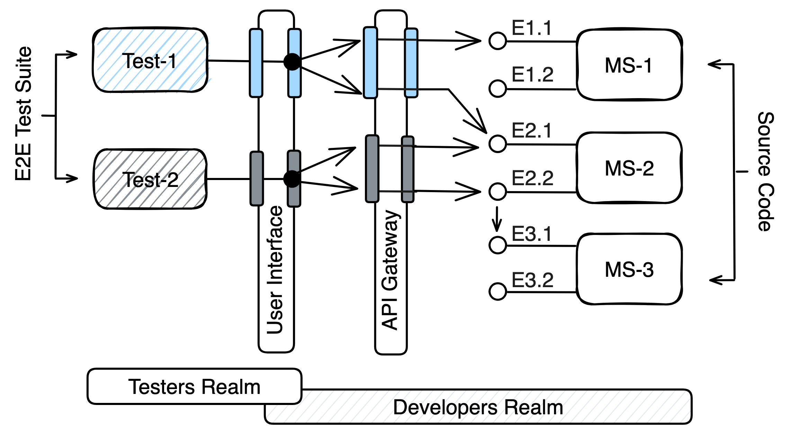

*Рисунок 1. Пример расчёта для E2E.*

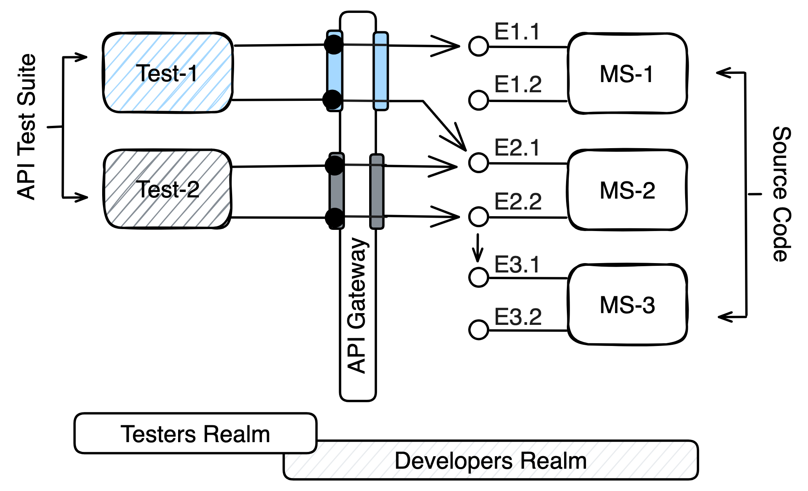

*Рисунок 2. Пример расчёта для API-тестирования.*

Применяя наши метрики к обоим наборам тестов, можно рассчитать покрытие эндпоинтов микросервиса ($C_{ms}(i)$) для каждого микросервиса. Для MS-1 и MS-3 только один из двух эндпоинтов тестируется на протяжении всех тестов, что даёт покрытие 50% для каждого ($C_{ms}(1) = C_{ms}(3) = 1/2$). Однако для MS-2 оба эндпоинта тестируются как минимум один раз, что даёт покрытие 100% ($C_{ms}(2) = 2/2$).

Далее мы рассчитываем покрытие эндпоинтов тест-кейсом ($C_{test}(i)$) для каждого теста. Test-1 охватывает два из шести эндпоинтов в системе, что даёт покрытие приблизительно 33,3% ($C_{test}(1) = 2/6$). Test-2 охватывает три различных эндпоинта, что даёт покрытие 50% ($C_{test}(2) = 3/6$). Test-2 содержит межсервисный вызов эндпоинта E3.1, как показано в нашем подходе.

Наконец, можно рассчитать полное покрытие эндпоинтов набором тестов ($C_{suite}$) системы. Из шести эндпоинтов в системе в ходе двух тестов тестируются четыре различных эндпоинта. Это даёт ≈66,6% покрытия ($C_{suite} = 4/6$).

### 3.3. Извлечение метрик

Для автоматического сбора данных, необходимых для вычисления метрик покрытия, предлагается использовать комбинацию методов статического и динамического анализа.

Этап статического анализа сосредоточен на изучении исходного кода с целью извлечения информации о реализованных в системе эндпоинтах, в то время как этап динамического анализа включает проверку системных логов и трейсов для идентификации эндпоинтов, вызываемых автоматическими тестами. Путём объединения данных, полученных в результате обоих анализов, этот подход применяет предложенные метрики для расчёта покрытия эндпоинтов, а затем предоставляет два различных способа визуализации покрытия в представлении системы. Процесс включает следующие четыре этапа, как проиллюстрировано на рисунке 3:

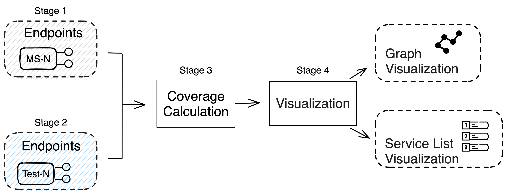

*Рисунок 3. Обзор предлагаемого подхода.*

- **Этап 1.** Извлечение эндпоинтов из исходного кода (статический анализ).
- **Этап 2.** Извлечение эндпоинтов из записей трейсов (динамический анализ).
- **Этап 3.** Расчёт покрытия.
- **Этап 4.** Визуализация покрытия.

Далее мы последовательно рассматриваем детали каждого этапа, чтобы продемонстрировать предлагаемый подход.

#### 3.3.1. Этап 1: извлечение эндпоинтов из исходного кода (статический анализ)

Цель этого этапа — понять, какие объявленные эндпоинты, готовые к использованию, предлагает реализация системы. Наш подход применяет статический анализ исходного кода системы для извлечения эндпоинтов, используемых в каждом микросервисе ($E_{ms(i)}$). Статический анализ — это процесс анализа синтаксиса и структуры кода без его выполнения с целью извлечения информации о системе. Как показано на рисунке 4, сначала в кодовой базе системы можно выделить микросервисы и обнаружить их. Затем кодовая база каждого микросервиса проходит обработку в процессе извлечения эндпоинтов, который формирует эндпоинты, соответствующие каждому микросервису.

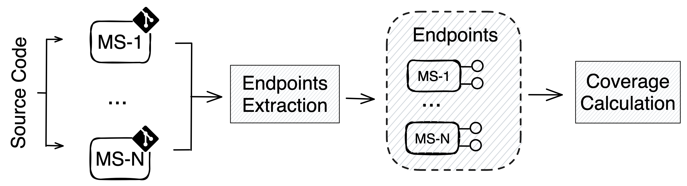

*Рисунок 4. Блок-схема этапа 1: статический анализ.*

Идентификация эндпоинтов API обычно опирается на конкретные фреймворки или библиотеки (например, фреймворк Java Spring использует такие аннотации, как `@RestController` и `@RequestMapping`). Благодаря этому идентификация метаданных остаётся единообразной. Анализ кода извлекает атрибуты метаданных о каждом эндпоинте, включая путь, HTTP-метод, параметры и тип возвращаемого значения. Однако идентификация эндпоинтов может выполняться и кросс-платформенно, как продемонстрировали Schiewe et al. [[24]](#ref-24), или с помощью таких фреймворков, как Swagger[^2].

В результате этого процесса формируется список эндпоинтов, организованный в соответствии с микросервисом, к которому относится каждый из них. Этот исчерпывающий список эндпоинтов становится одним из входных параметров для процесса расчёта покрытия, где он объединяется с выходными данными потока динамического анализа.

#### 3.3.2. Этап 2: извлечение эндпоинтов из записей трейсов (динамический анализ)

Цель этого этапа — определить эндпоинты, вызываемые наборами тестов во время выполнения. Мы используем динамический анализ для определения эндпоинтов, вызываемых во время выполнения каждого тест-кейса в наборах тестов ($E^{tested}_{test(i)}$). Наряду с этим динамический анализ позволяет определить микросервисы, содержащие эти протестированные эндпоинты ($E^{tested}_{ms(i)}$). Анализируемая система запускается, чтобы наблюдать за её поведением и транзакциями во время работы. Этот анализ включает запуск нескольких тестов и сбор возникающих трейсов, как показано на рисунке 5.

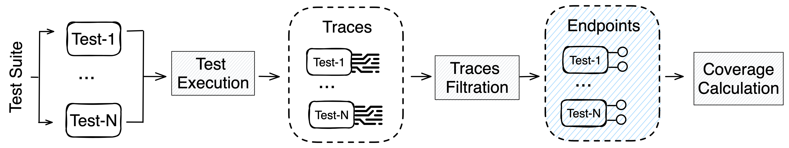

*Рисунок 5. Блок-схема этапа 2: динамический анализ.*

Процесс динамического анализа, показанный на рисунке 5, выполняет две основные задачи. Во-первых, он принимает на вход тесты (т. е. E2E-тесты и API-тесты) и последовательно их выполняет. Во время выполнения тестов генерируются трейсы для фиксации взаимодействий с системой. Эти трейсы отправляются в настроенную централизованную систему логирования (например, SkyWalking, Jaeger), которая сохраняет их либо в собственном хранилище, либо во внешнем настроенном решении для хранения данных (например, Elasticsearch), что позволяет проводить анализ и дальнейшую обработку. Во-вторых, процесс вычисляет дельту созданных трейсов, чтобы определить трейсы, относящиеся к каждому выполненному тесту. Это достигается разными способами. Первый — записывать временную метку от начала выполнения теста до его завершения. Второй — извлекать трейсы после каждого выполнения теста и вычислять разницу на основе последней записи трейса. Третий — отправлять динамически сгенерированный трейс до и после выполнения каждого теста, чтобы отметить начало и конец. В нашем подходе используется первая стратегия, поскольку она позволяет избежать ненужной обработки и усложнений на этом этапе.

Извлечённые последовательности трейсов, соответствующие каждому тесту, проходят фильтрацию, в ходе которой отбираются и идентифицируются трейсы, связанные с эндпоинтами. Это может включать запросы к хранилищу трейсов для получения конкретных индексов трейсов в данных. Например, инструмент SkyWalking маркирует трейсы, включающие вызовы эндпоинтов, и делает их доступными по индексу (в частности, по индексу `sw_endpoint_relation_server_side`). Кроме того, централизованные системы логирования кодируют записи данных с помощью Base64[^3] при отправке их во внешнее хранилище, такое как Elasticsearch. Поэтому этот этап может включать дополнительный процесс декодирования, если он необходим для обнаружения эндпоинтов. Эти связанные с эндпоинтами записи трейсов содержат информацию об эндпоинтах источника и назначения, участвующих в отношении вызова.

В результате формируется список эндпоинтов, организованный в соответствии с набором тестов, к которому они относятся. Этот список эндпоинтов становится вторым входным параметром для процесса расчёта покрытия, где он объединяется с выходными данными этапа статического анализа.

#### 3.3.3. Этап 3: расчёт покрытия

На этом этапе мы определяем, к каким эндпоинтам системы осуществлялся доступ при выполнении наборов тестов, а к каким — нет. Таким образом, здесь объединяются данные, извлечённые на двух предыдущих этапах, для расчёта трёх метрик покрытия ($C_{ms}(i)$, $C_{test}(i)$, $C_{suite}$). При этом применяется подход на основе множеств, позволяющий учитывать исключительно уникальность эндпоинтов и их взаимное соответствие, установленное на предыдущих этапах.

> Сложность возникает при сопоставлении эндпоинтов системы, извлечённых из исходного кода, с эндпоинтами, извлечёнными из трейсов. Трейсы содержат вызванные эндпоинты со значениями аргументов (например, `http://xxx.com/10`), тогда как эндпоинты, идентифицированные статическим анализом, содержат типы и имена параметров (например, `http://xxx.com/id: Integer`). Аналогичная проблема была учтена при профилировании систем с использованием анализа логов и сопоставления строк лога с операторами логирования в исходном коде [[26]](#ref-26). Исходный код содержит шаблон сообщения лога с параметрами, а логи выполнения содержат сообщение со значениями из контекста выполнения, что не является прямым совпадением (т. е. `log.info('calling {a} from {b}')` в исходном коде в противоположность контекстному оператору лога `'calling foo from bar'`[^13], где интерпретируются и `a`, и `b`). Zhao et al. [[26]](#ref-26) нашли все операторы логирования в коде и извлекли шаблоны, которые затем сопоставляли с помощью регулярных выражений, чтобы определить и сопоставить типы параметров, значения которых присутствуют в выходных данных лога.

В рамках нашего подхода для решения этой проблемы применяется сопоставление сигнатур. Наш подход предусматривает сравнение сигнатуры метода эндпоинта с данными и параметрами, которыми обмениваются при REST-вызове, для обнаружения и проверки подлинности запросов и их соответствия. Таким образом, для определения того, какие эндпоинты системы были вызваны тестом, сравниваются извлечённые из исходного кода атрибуты эндпоинтов (такие как путь, тип запроса и список параметров) с REST-вызовами, извлечёнными из трейсов тестов. Процесс сопоставления позволяет установить уровни покрытия и определить, какие эндпоинты были вызваны тестами.

Расчёт $C_{ms}(i)$ включает категоризацию и деление количества протестированных эндпоинтов (этап 2) на количество объявленных эндпоинтов для каждого микросервиса (этап 1). Для $C_{test}(i)$ расчёт предусматривает извлечение количества эндпоинтов, покрытых каждым тест-кейсом (этап 2), с последующим делением этого значения на общее количество эндпоинтов в системе (этап 1). Такое вычисление позволяет определить, какой процент всех эндпоинтов системы покрывает тест-кейс. Наконец, $C_{suite}$ определяется делением общего количества различных эндпоинтов, покрытых всеми тест-кейсами в наборе тестов (этап 2), на общее количество эндпоинтов в системе (этап 1).

#### 3.3.4. Этап 4: визуализация покрытия

Хотя микросервисные архитектуры в первую очередь предназначены для крупных систем, крайне важно предложить удобное представление, чтобы помочь специалистам-практикам легко понять покрытие в привычном контексте системы. Поэтому этот подход даёт централизованную визуализацию расчёта покрытия, предлагая два метода представления этих метрик покрытия. Первый метод отображает список микросервисов, а для каждого микросервиса показаны его эндпоинты. Покрытые эндпоинты отмечены зелёным цветом, а пропущенные — красным, как продемонстрировано в исследовании случая ниже. Во втором представлении используется граф зависимостей сервисов, в котором микросервисы представлены в виде узлов, а зависимости между ними — в виде рёбер. Узлы в графе имеют цветовую кодировку в соответствии с процентом покрытия, что позволяет визуально оценить покрытие в целостном представлении системы, отображающем зависимости между сервисами.

Эти методы визуализации помогают интерпретировать две метрики — $C_{ms}(i)$ и $C_{test}(i)$. Таким образом, эти расчёты и визуализации покрытия показывают, какую степень покрытия обеспечивают фреймворки автоматизации в контексте микросервисов, позволяя визуально оценивать результативность усилий по тестированию и определять области, требующие улучшения.

### 3.4. Обсуждение методологии

Эта методология раскрывает взаимосвязь между статическим и динамическим анализом данных: оба вида анализа необходимы для расчёта метрик покрытия. Заложенная в ней структура делает её универсальной для полиглотных систем: она предоставляет подробные рекомендации без строгой привязки к какому-либо конкретному языку программирования или технологии. Такая гибкость даёт широкую применимость в различных конфигурациях систем, сохраняя при этом конкретность в определении порядка вычисления покрытия. Следовательно, детали реализации, необходимые для эффективного применения методологии, могут варьироваться в зависимости от системного окружения.

Однако при согласовании информации, извлечённой из статической и динамической фаз, возникают трудности, поскольку они обладают различными характеристиками. Несоответствие сигнатур эндпоинтов между исходным кодом и трейсами может возникать вследствие расхождений между значениями в трейсах и типами, заданными в коде. Следовательно, методология учитывает эту проблему и предлагает меры по её решению, чтобы сопоставление извлечённых данных было точным.

E2E-тестирование и API-тестирование различаются уровнями коммуникации: E2E-тестирование охватывает различные уровни (от пользовательского интерфейса до API-шлюза и эндпоинтов), а API-тестирование фокусируется на конкретных вызовах эндпоинтов, которые могут проходить непосредственно через API-шлюз. Несмотря на это, методология остаётся применимой для расчёта покрытия в обоих сценариях. Посредством извлечения трейсов, генерируемых при выполнении, вне зависимости от пройденных уровней коммуникации, она фиксирует полное покрытие эндпоинтов. Более того, её гибкость позволяет проводить целенаправленный анализ тестирования конкретных коммуникационных уровней, тем самым выделяя вызовы межсервисного взаимодействия и различая тесты, проходящие через API-шлюз, и тесты, обходящие его. Это различие подчёркивает важность API-шлюза в качестве точки фильтрации, в частности, для соблюдения сквозных аспектов, таких как аутентификация в целях безопасности.

Кроме того, применение методологии к обоим подходам к тестированию существенно повышает уверенность в работоспособности системы с различных точек зрения. Каждый подход ориентирован на различные стратегии тестирования, чтобы система оставалась тестируемой: E2E-тестирование рассматривает систему с точки зрения пользовательского сценария, а API-тестирование — с точки зрения надёжности функциональности.

---

## 4. Исследование случая

В этом разделе проводится исследование случая, демонстрирующее осуществимость предложенного подхода к автоматизированному расчёту метрик. Цель состоит в том, чтобы предоставить тестировщикам информацию, которая позволит улучшить покрытие системы и её тестируемость. Это достигается путём реализации предложенного подхода на обоих его этапах для извлечения необходимых данных для расчёта трёх метрик покрытия. Исследование случая включает интеграцию извлечения данных из исходного кода системы с записями трейсов, генерируемыми во время выполнения наборов тестов E2E и API.

В этом исследовании случая рассматривался системный опенсорс-бенчмарк, а также использовались существующий набор тестов E2E и набор тестов API, разработанные для той же системы. Для демонстрации автоматизации предлагаемого расчёта метрик был разработан инструмент для проверки концепции (PoC), который использовался для оценки предоставленных тестовых бенчмарков. Материалы всех этапов анализа данных и их результаты опубликованы в наборе данных[^4]. Этот набор данных содержит полные расчёты метрик.

### 4.1. Реализация инструмента для проверки концепции (PoC)

В этом разделе описывается реализация PoC[^5] для демонстрации четырёх этапов предлагаемого подхода. Мы сосредоточились на статическом анализе исходного кода Java-проектов, использующих Java Spring Cloud — опенсорс-фреймворк, широко применяемый для создания облачных приложений. Он предоставляет разработчикам полный набор инструментов и библиотек для создания масштабируемых и отказоустойчивых приложений в экосистеме Java.

Для извлечения эндпоинтов из исходного кода (этап 1) мы использовали опенсорс-библиотеку JavaParser [[27]](#ref-27). Она позволила выполнять синтаксический анализ файлов исходного кода Java, генерировать представление в виде абстрактного синтаксического дерева (AST) и обходить его для обнаружения аннотаций Spring, таких как `@GetMapping` и `@PostMapping`. После обнаружения эндпоинтов мы извлекли соответствующие атрибуты.

Для извлечения эндпоинтов из записей трейсов (этап 2) мы сосредоточились на извлечении логов и трейсов, сгенерированных SkyWalking, из Elasticsearch, который широко используется в качестве центрального компонента стека ELK (Elasticsearch, Logstash, Kibana) [[28]](#ref-28). Мы использовали Elasticsearch Java High-Level REST Client [[29]](#ref-29), который обеспечивает удобный способ взаимодействия с Elasticsearch. Он предоставляет класс `QueryBuilder` для построения запросов поиска и фильтрации данных, например, для создания запроса на получение записей лога, находящихся между определёнными временными метками начала и конца.

Затем PoC выполняет расчёт покрытия (этап 3), используя Apache Maven (инструмент автоматизации сборки для Java-проектов) для выполнения наборов тестов Selenium [[30]](#ref-30) и Gatling [[31]](#ref-31). После этого результаты статического и динамического процессов интегрируются, и применяются предложенные метрики. Для визуализации покрытия (этап 4) мы применяем два рассмотренных ранее подхода. Мы применили фреймворк React для реализации веб-приложения[^6], которое представляет информацию в виде раскрываемого списка для удобной навигации. Для интеграции с визуализацией графа зависимостей сервисов мы использовали библиотеку Prophet[^7] — опенсорс-проект, генерирующий графы из исходного кода. Помимо этого, мы задействовали библиотеку визуализатора[^8], которая предлагает специализированную 3D-визуализацию микросервисов для графов зависимостей сервисов. На рисунке 6 представлена сводка использованных фреймворков для каждого этапа.

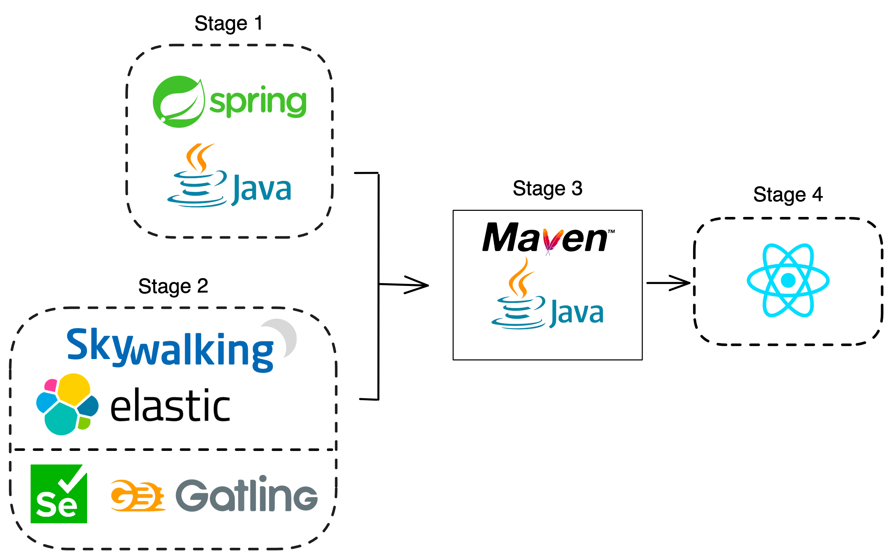

*Рисунок 6. Фреймворки, использованные в PoC.*

### 4.2. Бенчмарк и наборы тестов

Чтобы тестирование нашего приложения было объективным, мы использовали опенсорс-бенчмарк, состоящий из системы TrainTicket и связанных с ней наборов тестов.

TrainTicket [[32]](#ref-32), [[33]](#ref-33) — это система бронирования железнодорожных билетов на основе микросервисов, созданная с использованием фреймворка Java Spring. Она использует стандартные аннотации для определения эндпоинтов и Java-клиент RestTemplate для отправки запросов к эндпоинтам. Этот бенчмарк состоит из 41 микросервиса на базе Java и использует Apache SkyWalking [[34]](#ref-34) в качестве системы мониторинга производительности приложения.

Для запуска системы TrainTicket и выполнения на ней тестов потребовались определённые исправления конфигурации. Для этого был создан форк[^9] репозитория TrainTicket на основе релиза 1.0.0. Этот форк включал необходимые исправления и скрипт развёртывания. TrainTicket интегрируется с Elasticsearch, что позволяет нашему PoC использовать SkyWalking для пересылки системных логов в Elasticsearch для дополнительной обработки и анализа.

Для наборов тестов мы использовали тестовый опенсорс-бенчмарк[^10], опубликованный в [[35]](#ref-35). Этот бенчмарк предназначен для тестирования той же версии системы TrainTicket. Он содержит 11 различных тест-кейсов E2E-тестирования с использованием фреймворка Selenium и 26 тест-кейсов API-тестирования с использованием фреймворка Gatling.

### 4.3. Эталонные данные

Чтобы проверить полноту нашего подхода, мы провели ручной анализ для построения эталонных данных для бенчмарков. Полные эталонные данные опубликованы в наборе данных с открытым доступом. Ручной анализ включал извлечение данных, относящихся к первым двум этапам предложенного нами процесса, описанного в разделе 3.3, а именно: извлечение эндпоинтов из исходного кода и извлечение эндпоинтов из записей трейсов.

Для этапа 1 мы сверили эндпоинты, извлечённые в ходе статического анализа, с исходным кодом классов контроллеров микросервисов. Это позволило нам идентифицировать и извлечь такую информацию, как путь эндпоинта, тип запроса, список параметров и тип возвращаемого значения. В результате этого процесса было извлечено 262 объявленных эндпоинта в кодовой базе бенчмарка TrainTicket.

Для этапа 2 мы проверили эндпоинты, выявленные в ходе динамического анализа, проанализировав наборы тестов E2E (Selenium) и API (Gatling). Поскольку E2E-тесты в основном включают взаимодействия на основе пользовательского интерфейса и не содержат явного упоминания эндпоинтов, мы провели ручной анализ логов, сгенерированных этими тестами и хранящихся в Elasticsearch. Логи содержали закодированные сведения об эндпоинтах источника и назначения, которые мы декодировали и отфильтровали, чтобы составить список из 171 уникального эндпоинта, вызываемого во время E2E-тестов, и 495 уникальных эндпоинтов, задействованных во время API-тестов. В число этих уникальных эндпоинтов входят объекты, не являющиеся фактическими эндпоинтами системы, например, вызовы медиатора API-шлюза; они отфильтровываются на следующих этапах.

### 4.4. Результаты исследования случая

Мы начали выполнение с запуска скрипта развёртывания для настройки системы TrainTicket на локальном экземпляре. Затем наш PoC выполнил тест-кейсы из предоставленных бенчмарков, сгенерировал список вызванных эндпоинтов и рассчитал покрытие в соответствии с описанными метриками отдельно для каждого из E2E- и API-тестов. Выполнение PoC занимает несколько секунд, в течение которых извлекаются данные и вычисляются метрики.

Что касается оценки полноты нашего PoC, исследование случая подтвердило, что мы зафиксировали все эндпоинты, заявленные в эталонных данных. PoC успешно зафиксировал все 262 реализованных эндпоинта в системе, продемонстрировав полноту результата этапа 1. Для полноты этапа 2 PoC извлёк весь набор из 171 эндпоинта во время E2E-тестов и 495 уникальных эндпоинтов во время API-тестирования. Выполнение PoC и подробные расчёты метрик покрытия (этап 3) описаны в следующих подразделах, включая как E2E-тестирование с использованием Selenium, так и API-тестирование с использованием Gatling.

#### 4.4.1. Результаты E2E-тестирования (Selenium)

Результаты эксперимента, проведённого на бенчмарке E2E-тестов, выявили в общей сложности 171 уникальный эндпоинт, извлечённый из набора из 953 записей лога, сгенерированных во время выполнения тест-кейсов. 119 из них оказались фактическими эндпоинтами системы, а 52 относились к вызовам API-шлюза.

В результате полного извлечения данных мы рассчитали полное покрытие эндпоинтов набором тестов — около 45,42% ($C_{suite} = 119/262 \approx 45.42\%$). Сводная статистика для расчётов метрик представлена в таблице 1.

**Таблица 1.** Сводная статистика метрик покрытия для сквозного тестирования.

| Метрика | Покрытие (%) |
|---|---|
| $C_{suite}$ | 45,42 |

**Таблица 1 (продолжение).**

| Метрика | Минимум | Среднее | Максимум | Мода |
|---|---|---|---|---|
| $C_{ms}(i)$ | 0 | 44,5 | 100 | 25 |
| $C_{test}(i)$ | 1,14 | 7,29 | 15,27 | 7,25 |

Расчёт $C_{test}(i)$ показывает, что максимальное покрытие, достигнутое тест-кейсом в исследовании, составило приблизительно 15,27%. Это наблюдалось в тест-кейсе Booking, в котором было выполнено 53 вызова к 40 уникальным эндпоинтам в системе. С другой стороны, минимальное покрытие составило примерно 1,14% и было зафиксировано в тест-кейсе Login, в котором вызывались только три эндпоинта. Анализ показывает, что среднее покрытие эндпоинтов тест-кейсом составило приблизительно 7,29%, в то время как наиболее частое покрытие среди тест-кейсов составило приблизительно 7,25%. Такое покрытие наблюдалось в следующих пяти тест-кейсах: AdminConfigList, ContactList, PriceList, AdminStationList и AdminTrainList. На рисунке 7 показано покрытие эндпоинтов, достигнутое 11 тест-кейсами, а также среднее покрытие — для более наглядного сопоставления.

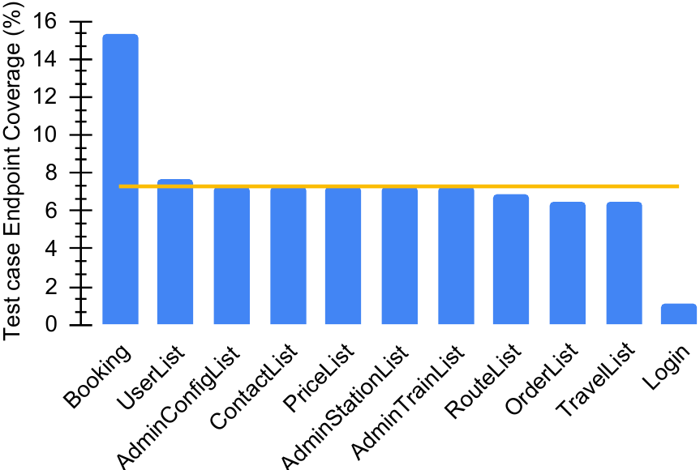

*Рисунок 7. Покрытие эндпоинтов тест-кейсом в бенчмарке E2E-тестирования (Ctest(i)).*

Расчёт $C_{ms}(i)$ показывает, что максимальное покрытие составляет 100%; оно наблюдается в ts-verification-code-service, где тест-кейсы покрывают оба его эндпоинта. С другой стороны, минимальное покрытие составляет 0%, что указывает на то, что наборы тестов не тестировали ни одного эндпоинта в следующих четырёх микросервисах: ts-wait-order-service, ts-preserve-other-service, ts-notification-service и ts-food-delivery-service. Среднее покрытие эндпоинтов микросервисов составило приблизительно 44,5%, а мода распределения показывает, что наиболее распространённым было покрытие 25%, которое наблюдалось в следующих четырёх микросервисах: ts-travel2-service, ts-payment-service, ts-route-plan-service и ts-order-other-service. Полные расчёты для каждого микросервиса представлены на рисунке 8.

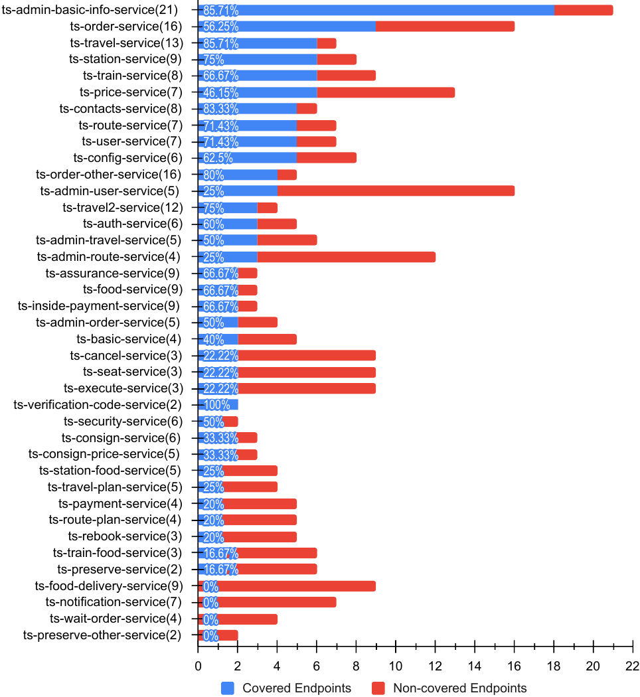

*Рисунок 8. Покрытие эндпоинтов микросервисов в бенчмарке E2E-тестирования (Cms(i)). Числа в скобках указывают общее количество эндпоинтов в каждом микросервисе.*

#### 4.4.2. Результаты API-тестирования (Gatling)

Результаты эксперимента, проведённого на бенчмарке API-тестирования, выявили в общей сложности 495 различных эндпоинтов, извлечённых из набора из 1902 записей лога, сгенерированных во время выполнения тест-кейсов. Из них 241 приходился на фактические эндпоинты системы, 249 — на вызовы API-шлюза, не соответствующие эндпоинтам системы, а 5 не соответствовали заявленной в системе сигнатуре API, как подробно описано в таблице 2.

**Таблица 2.** Несоответствия эндпоинтов API-тестирования сигнатурам системы.

| Несовпадающий эндпоинт | Причина |
|---|---|
| `ts-consign-price-service/api/v1/consignpriceservice/consignprice` @ GET | Ожидался метод POST |
| `ts-auth-service/api/v1/users/login` @ GET | Ожидался метод POST |
| `ts-security-service/api/v1/securityservice/securityConfigs` @ DELETE | Ожидался 1 параметр |
| `ts-assurance-service/api/v1/assuranceservice/types` @ GET | Ожидался путь `/assurances` |
| `ts-assurance-service/api/v1/assuranceservice/assurances/orderid/id` @ GET | Опечатка: `/assurance` |

Кроме того, мы вручную извлекли эндпоинты из реализации API-тестирования. В отличие от E2E-тестирования, эндпоинты явно указаны в исходном коде тестов, что позволяет с помощью API-тестирования дополнительно валидировать те из них, которые не отображаются в логах, но могут присутствовать в тестовом коде. Это выявило, что два микросервиса (ts-wait-order-service и ts-food-delivery-service) были запланированы для тестирования, но не отображались в логах из-за неправильной конфигурации в системе бенчмарка TrainTicket. Этот результат подчёркивает дополнительный аспект, который наша методология способна выявить путём сравнения ожидаемого покрытия, полученного из эндпоинтов в тестах, с фактическим покрытием, полученным из логов. В ходе полного извлечения данных мы рассчитали полное покрытие эндпоинтов набором тестов — около 91,98% ($C_{suite} = 241/262 \approx 91.98\%$). Сводная статистика для расчёта метрик представлена в таблице 3.

**Таблица 3.** Сводная статистика метрик покрытия для API-тестирования.

| Метрика | Покрытие (%) |
|---|---|
| $C_{suite}$ | 91,98 |

**Таблица 3 (продолжение).**

| Метрика | Минимум | Среднее | Максимум | Мода |
|---|---|---|---|---|
| $C_{ms}(i)$ | 0 | 91,77 | 100 | 100 |
| $C_{test}(i)$ | 0,76 | 3,55 | 12,21 | 1,90 |

Расчёт $C_{test}(i)$ показывает, что наибольшее покрытие, достигнутое тест-кейсом в исследовании, составило около 12,21%. Это продемонстрировал тест-кейс OrderService, который охватил 32 уникальных эндпоинта в системе. И наоборот, минимальное покрытие составило примерно 0,76% и наблюдалось в тест-кейсе LoginModule, в котором вызывались только два эндпоинта. Анализ показывает, что среднее покрытие эндпоинтов тест-кейсом составило около 3,55%, а наиболее распространённое покрытие среди тест-кейсов — около 1,90%. Такое покрытие наблюдалось в следующих пяти тест-кейсах: BasicService, NotifyService, OrderListAdmin, Security и TravelList. На рисунке 9 показано покрытие эндпоинтов, достигнутое 26 тест-кейсами, а также среднее покрытие — для более наглядного сопоставления.

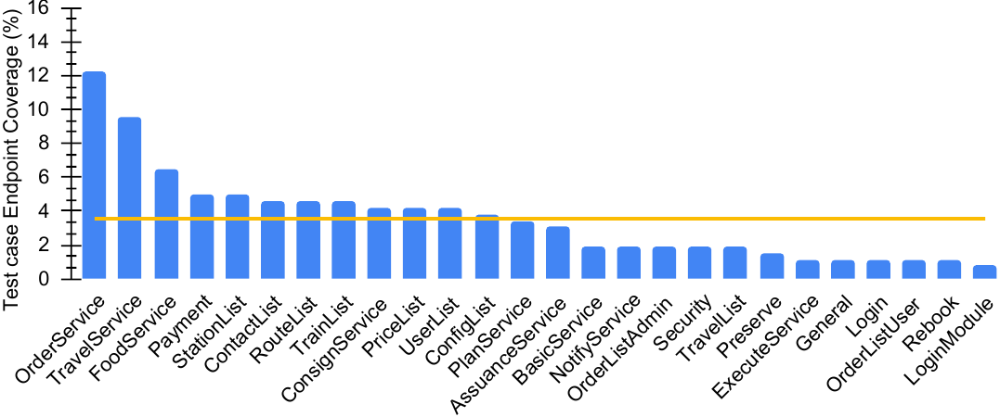

*Рисунок 9. Покрытие эндпоинтов тест-кейсом в бенчмарке API-тестирования (Ctest(i)). Оранжевая линия обозначает среднее покрытие.*

Расчёт $C_{ms}(i)$ показывает, что максимальное покрытие составило 100% — это наиболее распространённое значение для 32 микросервисов в системе. С другой стороны, минимальное покрытие составило 0%, что означает, что наборы тестов не тестировали ни одного эндпоинта в следующих двух микросервисах: ts-wait-order-service и ts-food-delivery-service. Среднее покрытие эндпоинтов микросервисов составило приблизительно 91,77%. Подробные расчёты для каждого микросервиса представлены на рисунке 10.

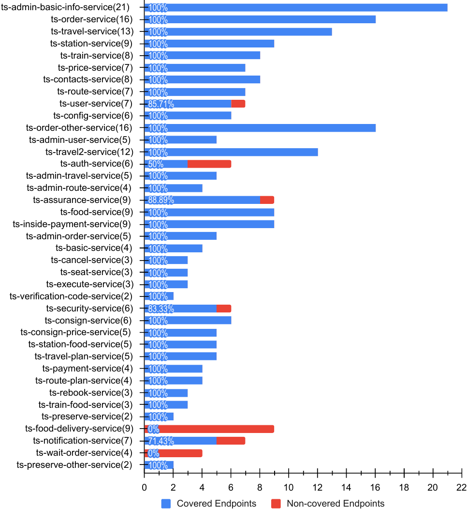

*Рисунок 10. Покрытие эндпоинтов микросервисов в бенчмарке API-тестирования (Cms(i)). Числа в скобках указывают общее количество эндпоинтов в каждом микросервисе.*

### 4.5. Результаты комбинированного E2E- и API-покрытия

Хотя E2E-тесты подтверждают, что обращённые к пользователю части системы работают как задумано, API-тесты проверяют функциональность и коммуникацию между бэкенд-сервисами. Ожидается, что объединение покрытия, полученного из обоих наборов тестов, даст более полное представление о гарантиях качества и уверенность в работоспособности системы на уровне детализации эндпоинтов системы. Такие комбинированные тесты гарантируют, что эндпоинты отвечают на запросы и охвачены хотя бы какими-то тестами.

При обнаружении проблемы по-прежнему целесообразно выполнять как E2E-, так и API-тесты, поскольку это может помочь локализовать её. Например, такой подход позволяет определить, связана ли она с фронтендом, бэкендом или интеграцией, что повышает эффективность отладки и устранения проблем. Объединение E2E- и API-тестов создаёт устойчивую стратегию тестирования, охватывающую различные аспекты системы, что повышает надёжность и ускоряет выявление проблем. Таким образом, с этой точки зрения комбинированное покрытие становится актуальным для комплексной оценки системы.

Что касается покрытия эндпоинтов микросервисов ($C_{ms}(i)$), комбинированный подход увеличил покрытие только одного микросервиса — ts-assurance-service — до 100% по сравнению с 88,88% при API-тестировании и 22,22% при E2E-тестировании. Это улучшение объясняется тем, что E2E-тестирование успешно покрыло эндпоинт `ts-assurance-service/api/v1/assuranceservice/assurances/types@GET`, который в API-тестах был сконфигурирован неверно. Однако покрытие остальных 40 микросервисов в системе осталось таким же, как при API-тестировании.

В свою очередь, объединение $C_{test}(i)$ при E2E- и API-тестировании сводится к простому добавлению, поскольку у каждого набора тестов свои задачи, отличные от задач другого. Это даёт более полный список тестов с соответствующими результатами покрытия системы.

Полное покрытие эндпоинтов набором тестов ($C_{suite}$) незначительно увеличилось примерно до 92,36% ($C_{suite} = 242/262 \approx 92.36\%$) после объединения эндпоинтов из E2E- и API-тестов. Это контрастировало с отдельными показателями покрытия: 91,98% для API и 45,42% для E2E. Было рассчитано пересечение между эндпоинтами, охваченными каждым из этих двух подходов к тестированию; результаты, представленные на рисунке 11, показали, что наборы тестов E2E и API покрывают одни и те же 118 эндпоинтов. Более того, набор тестов E2E охватывал эндпоинт (`ts-assurance-service/api/v1/assuranceservice/assurances/types@GET`), не охваченный наборами тестов API. Напротив, наборы тестов API покрывали дополнительно 123 эндпоинта, не включённые в покрытие набора тестов E2E. Следовательно, в системе TrainTicket в общей сложности остался 21 эндпоинт, не охваченный ни одним из наборов тестов[^11].

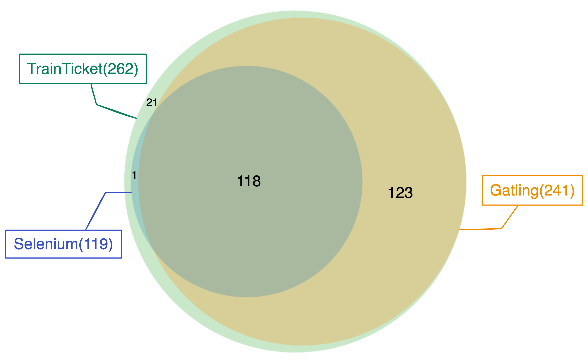

*Рисунок 11. Комбинированное покрытие эндпоинтов в бенчмарке E2E- и API-тестирования.*

### 4.6. Визуализация покрытия

Рассчитанные метрики визуализируются с использованием двух подходов (этап 4), как показано на рисунке 12a,b: первый показывает список сервисов, а второй даёт целостный обзор зависимостей сервисов в контексте покрытия эндпоинтов. Представление в виде списка сервисов состоит из нескольких раскрываемых списков, обеспечивающих комплексное отображение всех микросервисов в системе, как показано на рисунке 12a. Заголовок каждого раскрываемого списка включает название микросервиса и процент его покрытия, а в теле списка отображаются пути эндпоинтов, связанных с этим микросервисом. В этой визуализации используется красно-зелёная цветовая схема: покрытые эндпоинты выделены зелёным, а непокрытые — красным. Например, микросервис ts-config-service демонстрирует покрытие приблизительно 83,33% по результатам набора тестов E2E, где пропущен только один эндпоинт (`GET@/api/v1/configservice/welcome`) из шести. В отличие от этого, ts-contacts-service имеет покрытие приблизительно 62,50%: два из семи эндпоинтов остаются непроверенными[^12].

С другой стороны, 3D-граф показывает полную структуру зависимостей сервисов системы, как показано на рисунке 12b, где узлы представляют микросервисы, а рёбра обозначают зависимости между микросервисами. Этот подход вводит четыре цветовых кода, основанных на процентах покрытия микросервисов: красный для 0–69%, оранжевый для 70–79%, жёлтый для 80–89% и зелёный для 90–100%. Например, узел, соответствующий ts-config-service, выделен жёлтым цветом, что указывает на его покрытие 83,33%. В отличие от этого, узел ts-contacts-service отмечен красным цветом, что соответствует его покрытию 62,50%. Такая 3D-визуализация обеспечивает динамическое представление зависимостей сервисов вместе с соответствующими статусами их покрытия.

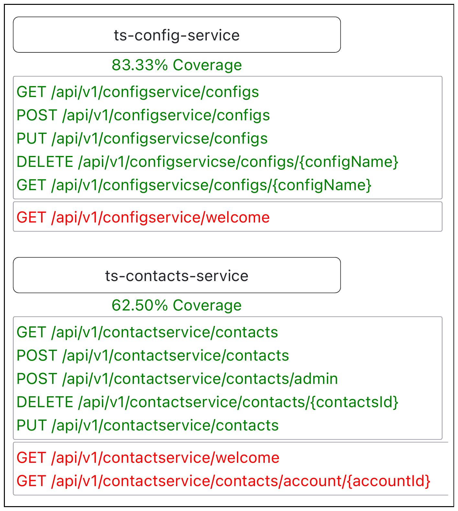

*(a)*

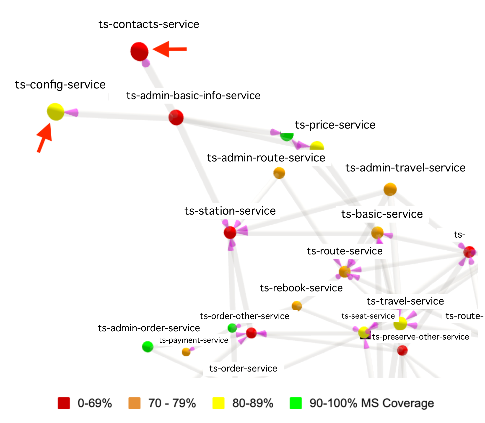

*(b)*

*Рисунок 12. Визуализация покрытия эндпоинтов микросервисов. (a) Раскрываемый список отображает перечень эндпоинтов микросервисов. (b) Интерактивный 3D-визуализатор показывает зависимости сервисов (обрезанный вид). Полные изображения доступны по адресу https://github.com/cloudhubs/test-coverage-frontend (дата обращения: 10 мая 2024 г.).*

---

## 5. Обсуждение

Наш подход предлагает перспективное решение, которое поддерживает надёжность системы за счёт более строгой проверки полноты наборов тестов E2E и API, способствуя непрерывному обеспечению надёжности и качества децентрализованных микросервисных систем. Помимо интеграции обеих методологий тестирования, он развивает существующие работы, учитывая характерные особенности микросервисной архитектуры, включая межсервисную коммуникацию и тестирование таких компонентов, как API-шлюз. Большинство существующих исследований упускают из виду эти специфические для микросервисов характеристики. Более того, подход предлагает три уровня детализации, позволяющие разработчикам и тестировщикам выявлять конкретные части, требующие модификации по мере развития системы, и извлекать из этого пользу. Результаты нашей оценки указывают на положительный эффект от установления связей между различными тестами и эндпоинтами системы автоматизированными средствами. Такое отслеживание даёт тестировщикам сведения, полезные для управления распространением изменений в тестовой инфраструктуре, поскольку оно может напрямую указывать на коэволюционирующие зависимости между конкретными микросервисами или эндпоинтами и конкретными тестами.

Объединение E2E-тестирования с API-тестированием обеспечивает ещё более полное представление о покрытии системы. Однако важно учитывать контекст, в котором применяется этот подход, признавая, что пользовательский интерфейс при E2E-тестировании может взаимодействовать не со всеми эндпоинтами промежуточного ПО. Это может отражаться в предоставленных метриках, указывая на то, что E2E-тест может не достигать 100% покрытия. Это вызывает вопрос: означают ли оставшиеся эндпоинты наличие антипаттерна Nobody Home [[36]](#ref-36), указывающего на отсутствие связей с пользовательским интерфейсом, или же они представляют собой устаревший либо мёртвый код?

Напротив, API-тесты в нашем исследовании охватили значительную часть этих эндпоинтов, что привело к более высокому покрытию по сравнению с E2E-тестами. Тем не менее, API-тестирование может включать тестирование устаревших, удалённых или неиспользуемых с точки зрения пользовательского интерфейса эндпоинтов, поскольку эти тесты направлены непосредственно на эндпоинты API. Вместе с тем преимущество API-тестирования заключается в его опоре на статический исходный код, в котором объявлены API тестируемых эндпоинтов. Благодаря этому подход способен идентифицировать напрямую объявленные эндпоинты в исходном коде набора тестов API. Предлагаемый подход позволяет сопоставить объявленные эндпоинты в наборах тестов API с эндпоинтами, извлечёнными из исходного кода системы, и выявить те, которые больше не существуют в системе. Более того, анализ записей трейсов для различения эндпоинтов, покрытых прямыми вызовами пользователя (через пользовательский интерфейс или прямые вызовы API), и эндпоинтов, покрытых посредством межсервисных вызовов (от другого микросервиса), добавляет дополнительный уровень валидации. Это помогает специалистам-практикам оценить каждый эндпоинт системы с точки зрения его проектирования и открытости вовне.

Кроме того, если учитывать характер подходов к тестированию в исследовании случая, API-тесты продемонстрировали более высокое покрытие как по метрикам микросервисов, так и по метрике полного набора тестов. Однако метрика покрытия эндпоинтов тест-кейсом показала более низкое значение в расчёте на один тест-кейс. Расхождение возникает из-за того, что API-тесты выполняют большее количество тест-кейсов и каждый из них использует меньше эндпоинтов. Тест-кейсы E2E-тестирования, напротив, используют больше эндпоинтов, но самих тестов в общем наборе меньше.

Микросервисы часто реализуют эндпоинты `isAlive/welcome` для проверок работоспособности. Библиотеки, такие как Hystrix, могут автоматически генерировать эти эндпоинты, а в остальных случаях их могут реализовать вручную. В случае TrainTicket было реализовано 39 эндпоинтов, не использовавшихся в пользовательском интерфейсе и потому бессмысленных, однако включённых в API-тесты. Проверка этих эндпоинтов позволяет убедиться, что система корректно инициализирована.

---

## 6. Угрозы валидности

В этом разделе рассматриваются потенциальные угрозы валидности нашего подхода. В качестве основы для анализа мы используем таксономию Wohlin [[37]](#ref-37), которая охватывает угрозы валидности конструкции, внешней валидности, внутренней валидности и валидности выводов.

Потенциальная угроза валидности конструкции обусловлена зависимостью от статического анализа для извлечения эндпоинтов и динамического анализа централизованных трейсов, генерируемых тестами. Сюда относятся отсутствующий или нестандартный исходный код, а также отсутствие поддержки централизованных трейсов, что может препятствовать реализации нашего подхода.

Наш PoC в настоящее время реализован для конкретных языков программирования и фреймворков. Однако важно отметить, что сама методология не ограничивается этими спецификациями и может быть адаптирована и применена к другим языкам и фреймворкам, что позволяет смягчить угрозы валидности конструкции, связанные с зависимостями. Более того, асинхронный обмен сообщениями создаёт потенциальный риск при выполнении теста, приводя к появлению «призрачных» событий в трейсах вызовов эндпоинтов. Возможные подходы к снижению этой угрозы могут включать отключение асинхронных сервисов или повторное выполнение теста с целью минимизации воздействия.

Угрозы внутренней валидности возникают вследствие потенциальных несоответствий между сигнатурами эндпоинтов, извлечёнными из исходного кода, и трейсами. Хотя перегрузки возникают нечасто, неточное сопоставление может иметь место из-за того, что значения в трейсах не полностью соответствуют типам, определённым в коде. Например, если трейс содержит целое число в URL-адресе, оно может сопоставляться с типом параметра «целое число», даже если соответствующий эндпоинт имеет тип параметра «строка». Помимо этого, несколько авторов совместно работали над точностью данных и расчётов: они независимо друг от друга провели верификацию и перекрёстную валидацию результатов, чередуя процессы валидации с целью минимизации эффектов обучения.

Для устранения угроз внешней валидности в нашем исследовании случая использовался широко признанный опенсорс-бенчмарк для оценки покрытия его эндпоинтов с применением предложенного нами подхода. Тем не менее, важно признать, что результаты и выводы, полученные на основе этого конкретного бенчмарка, могут не в полной мере отражать весь спектр микросервисных систем, в которых применяются различные стандарты и практики.

Одна из потенциальных угроз валидности выводов — то, что наш инструмент был протестирован на опенсорс-проекте, а не на промышленном проекте. Однако мы стремились решить эту проблему, выбрав опенсорс-проект, в котором применялись фреймворки, широко используемые в промышленности. Кроме того, чтобы результаты были надёжными и согласованными, мы провели исследование случая в нескольких средах и подтвердили их устойчивость.

---

## 7. Выводы

Покрытие — важная составляющая разработки программного обеспечения. Отсутствие инструментов, предоставляющих обратную связь о покрытии, оставляет проблему нерешённой для облачных и микросервисных систем. В данной работе предложены основанные на эндпоинтах метрики покрытия E2E- и API-тестированием таких систем. Более того, в работе проиллюстрирован автоматизированный подход к извлечению таких метрик, а сам подход оценён посредством реализации PoC, апробированной в ходе исследования случая с использованием сторонней системы. Подобный механизм способен предоставить тестировщикам важную информацию о том, насколько полным является покрытие с учётом количества эндпоинтов в системе, вовлечённых в тестирование.

Кроме того, представленный подход устанавливает связи между тестами и эндпоинтами микросервисов на трёх различных уровнях. Он показывает покрытие всего набора тестов для каждого отдельного микросервиса, покрытие каждого тест-кейса для всех эндпоинтов системы, а также покрытие всего набора тестов для полного набора эндпоинтов системы. Наряду с этим в работе продемонстрированы два подхода к визуализации покрытия микросервисов в рамках того же целостного контекста.

Исследование случая показало, что наборы тестов E2E и API дают разные результаты на одном и том же бенчмарке микросервисной системы. Тесты API продемонстрировали высокий процент покрытия, что обоснованно с учётом их направленности на конкретные API в ходе тестирования. Однако в них отсутствовала реалистичная последовательность вызовов, отражающая реальные сценарии с точки зрения пользователя. В отличие от них, наборы тестов E2E обеспечивали эту реалистичную цепочку вызовов, начиная с пользовательского интерфейса и заканчивая эндпоинтами системы. Однако они показали более низкий процент покрытия системы, что может быть обусловлено неиспользуемыми эндпоинтами в пользовательском интерфейсе системы либо недостаточным количеством тестов в наборах для покрытия всего сценария пользовательского интерфейса. Объединение покрытия, которое дают оба набора тестов, как ожидается, даёт более комплексную оценку уверенности в покрытии эндпоинтов системы. Это особенно актуально с учётом того, что каждый подход к тестированию направлен на достижение различных целей; таким образом, их интеграция может дать более целостное представление о состоянии системы и покрытии её функциональности.

В децентрализованных системах не хватает инструментов, которые давали бы обратную связь о покрытии, которое обеспечивают тесты, затрагивающие систему целиком. И всё же работоспособный механизм достижим автоматизированными средствами: он опирается на покрытие эндпоинтов системы и при этом по-прежнему даёт содержательную обратную связь. Однако если эндпоинты допускают широкий диапазон условных выполнений, подход будет иметь ограниченную информативность, поскольку он лишь фиксирует факт достижения эндпоинта в ходе выполнения теста.

В дальнейшем мы планируем исследовать эволюцию как системы, так и набора тестов, углубляясь в детали ниже уровня эндпоинтов. Кроме того, мы намерены расширить наши метрики, включив в них более широкий диапазон путей тестирования в рамках эндпоинтов. Помимо этого, мы планируем провести дополнительные сравнительные исследования и соотнести их с существующими работами, чтобы предоставить сообществу более комплексные инструменты.

---

**Author Contributions:** Conceptualization, A.S.A., J.Y.; methodology, A.S.A. and T.C.; validation, T.C., E.S. and D.T.; formal analysis, A.S.A.; investigation, A.S.A., T.C. and J.Y.; resources, A.S.A.; data curation, A.S.A. and J.Y.; writing—original draft preparation, A.S.A. and T.C.; writing—review and editing, A.S.A., T.C., J.Y., E.S. and D.T.; visualization, A.S.A.; supervision, T.C.; project administration, T.C.; funding acquisition, T.C. and D.T. All authors have read and agreed to the published version of the manuscript.

**Funding:** This material was supported by the National Science Foundation under Grant No. 2409933 and Grant No. 349488 (MuFAno) from the Academy of Finland.

**Data Availability Statement:** The generated data and its analysis have been made publicly available in a dataset accessible at the following link: [https://zenodo.org/records/10553186](https://zenodo.org/records/10553186), accessed on 10 May 2024.

**Conflicts of Interest:** The authors declare no conflicts of interest. The funders had no role in the design of the study, in the collection, analysis, or interpretation of data, in the writing of the manuscript, or in the decision to publish the results.

---

[^1]: Примечание переводчика. В оригинале — *fault detention* («удержание дефектов»); по составу перечня метрик речь идёт о *fault detection*, то есть об обнаружении дефектов. В переводе дано исправленное чтение.

[^2]: Swagger: https://swagger.io (дата обращения: 10 мая 2024 г.).

[^3]: Base64: https://developer.mozilla.org/en-US/docs/Glossary/Base64 (дата обращения: 10 мая 2024 г.).

[^4]: Набор данных: https://zenodo.org/records/10553186 (дата обращения: 10 мая 2024 г.).

[^5]: Исходный код PoC: https://github.com/cloudhubs/test-coverage-backend (дата обращения: 10 мая 2024 г.).

[^6]: Визуализатор покрытия: https://github.com/cloudhubs/test-coverage-frontend (дата обращения: 10 мая 2024 г.).

[^7]: Prophet: https://github.com/cloudhubs/graal-prophet-utils (дата обращения: 10 мая 2024 г.).

[^8]: 3D-визуализатор: https://github.com/cloudhubs/graal_mvp (дата обращения: 10 мая 2024 г.).

[^9]: TrainTicket: https://github.com/cloudhubs/train-ticket/tree/v1.0.1 (дата обращения: 10 мая 2024 г.).

[^10]: Бенчмарк тестов: https://github.com/cloudhubs/microservice-tests (дата обращения: 10 мая 2024 г.).

[^11]: Примечание переводчика. Числа оригинала не сходятся. Обоими наборами покрыты 118 эндпоинтов, только набором E2E — один, только набором API — ещё 123; в сумме это даёт 242 покрытых эндпоинта и 262 − 242 = 20 непокрытых. При этом и в тексте, и на рисунке 11 указан 21 непокрытый эндпоинт. Данные оригинала сохранены без изменений.

[^12]: Примечание переводчика. В оригинале — арифметическое несоответствие: если из семи эндпоинтов не проверены два, покрытие составляет 5/7 ≈ 71,43%, а не приведённые 62,50%; доле 62,50% отвечает соотношение 5/8. Данные оригинала сохранены без изменений.

[^13]: Примечание переводчика. В оригинале — опечатка: `'calling for from bar'`; судя по шаблону `log.info('calling {a} from {b}')` и по дальнейшему тексту «where both `a` and `b` are interpreted» должно быть `'calling foo from bar'`. В переводе дано исправленное чтение.

## Список литературы

1. Tsai, W.T.; Bai, X.; Paul, R.; Shao, W.; Agarwal, V. End-to-end integration testing design. In *Proceedings of the 25th Annual International Computer Software and Applications Conference, COMPSAC 2001*, Chicago, IL, USA, 8–12 October 2001; IEEE: Piscataway, NJ, USA, 2001; pp. 166–171.
2. Ehsan, A.; Abuhaliqa, M.A.M.; Catal, C.; Mishra, D. RESTful API testing methodologies: Rationale, challenges, and solution directions. *Appl. Sci.* **2022**, *12*, 4369. [[CrossRef]](http://doi.org/10.3390/app12094369)
3. Sharma, A.; Revathi, M. Automated API testing. In *Proceedings of the 2018 3rd International Conference on Inventive Computation Technologies (ICICT)*, Coimbatore, India, 15–16 November 2018; IEEE: Piscataway, NJ, USA, 2018; pp. 788–791.
4. Bhojwani, R. Design Patterns for Microserviceto-Microservice Communication-Dzone Microservices. 2018. Available online: [https://dzone.com/articles/design-patterns-for-microservices](https://dzone.com/articles/design-patterns-for-microservices) (accessed on 10 May 2024).
5. Ghani, I.; Wan-Kadir, W.M.; Mustafa, A.; Imran Babir, M. Microservice Testing Approaches: A Systematic Literature Review. *Int. J. Integr. Eng.* **2019**, *11*, 65–80.
6. Jiang, P.; Shen, Y.; Dai, Y. Efficient software test management system based on microservice architecture. In *Proceedings of the 2022 IEEE 10th Joint International Information Technology and Artificial Intelligence Conference*, Chongqing, China, 17–19 June 2022; Volume 10, pp. 2339–2343.
7. Jorgensen, A.; Whittaker, J.A. An api testing method. In *Proceedings of the International Conference on Software Testing Analysis & Review (STAREAST 2000)*, Orlando, FL, USA, 1–5 May 2000.
8. Raj, P.; Vanga, S.; Chaudhary, A. *Cloud-Native Computing: How to Design, Develop, and Secure Microservices and Event-Driven Applications*; John Wiley & Sons: Hoboken, NJ, USA, 2022.
9. Abdelfattah, A.S.; Cerny, T.; Salazar, J.Y.; Lehman, A.; Hunter, J.; Bickham, A.; Taibi, D. End-to-End Test Coverage Metrics in Microservice Systems: An Automated Approach. In *Service-Oriented and Cloud Computing*; Papadopoulos, G.A., Rademacher, F., Soldani, J., Eds.; Springer: Cham, Switzerland, 2023; pp. 35–51.
10. Abdelfattah, A.S.; Cerny, T. Roadmap to Reasoning in Microservice Systems: A Rapid Review. *Appl. Sci.* **2023**, *13*, 1838. [[CrossRef]](http://dx.doi.org/10.3390/app13031838)
11. Horgan, J.R.; London, S.; Lyu, M.R. Achieving software quality with testing coverage measures. *Computer* **1994**, *27*, 60–69. [[CrossRef]](http://dx.doi.org/10.1109/2.312032)
12. Whalen, M.W.; Rajan, A.; Heimdahl, M.P.; Miller, S.P. Coverage metrics for requirements-based testing. In *Proceedings of the 2006 International Symposium on Software Testing and Analysis*, Portland, ME, USA, 17–20 July 2006; pp. 25–36.
13. Staats, M.; Whalen, M.; Rajan, A.; Heimdahl, M. *Coverage Metrics for Requirements-Based Testing: Evaluation of Effectiveness*; NASA: Washington, DC, USA, 2010.
14. Rajan, A. Coverage metrics to measure adequacy of black-box test suites. In *Proceedings of the 21st IEEE/ACM International Conference on Automated Software Engineering (ASE'06)*, Tokyo, Japan, 18–22 September 2006; IEEE: Piscataway, NJ, USA, 2006; pp. 335–338.
15. Corradini, D.; Zampieri, A.; Pasqua, M.; Ceccato, M. Restats: A test coverage tool for RESTful APIs. In *Proceedings of the 2021 IEEE International Conference on Software Maintenance and Evolution (ICSME)*, Luxembourg, 27 September–1 October 2021; IEEE: Piscataway, NJ, USA, 2021; pp. 594–598.
16. Grano, G.; Titov, T.V.; Panichella, S.; Gall, H.C. Branch coverage prediction in automated testing. *J. Softw. Evol. Process.* **2019**, *31*, e2158. [[CrossRef]](http://dx.doi.org/10.1002/smr.2158)
17. Golmohammadi, A.; Zhang, M.; Arcuri, A. Testing RESTful APIs: A Survey. *ACM Trans. Softw. Eng. Methodol.* **2023**, *33*, 27. [[CrossRef]](http://dx.doi.org/10.1145/3617175)
18. Waseem, M.; Liang, P.; Shahin, M.; Di Salle, A.; Márquez, G. Design, monitoring, and testing of microservices systems: The practitioners’ perspective. *J. Syst. Softw.* **2021**, *182*, 111061. [[CrossRef]](http://dx.doi.org/10.1016/j.jss.2021.111061)
19. Giamattei, L.; Guerriero, A.; Pietrantuono, R.; Russo, S. Automated Grey-Box Testing of Microservice Architectures. In *Proceedings of the 2022 IEEE 22nd International Conference on Software Quality, Reliability and Security (QRS)*, Guangzhou, China, 5–9 December 2022; pp. 640–650.
20. Corradini, D.; Zampieri, A.; Pasqua, M.; Ceccato, M. Empirical Comparison of Black-box Test Case Generation Tools for RESTful APIs. In *Proceedings of the 2021 IEEE 21st International Working Conference on Source Code Analysis and Manipulation (SCAM)*, Luxembourg, 27–28 September 2021; pp. 226–236. [[CrossRef]](http://dx.doi.org/10.1109/SCAM52516.2021.00035)
21. Ma, S.P.; Fan, C.Y.; Chuang, Y.; Lee, W.T.; Lee, S.J.; Hsueh, N.L. Using Service Dependency Graph to Analyze and Test Microservices. In *Proceedings of the 2018 IEEE 42nd Annual Computer Software and Applications Conference*, Tokyo, Japan, 23–27 July 2018; Volume 02, pp. 81–86.
22. Ball, T. The concept of dynamic analysis. *ACM SIGSOFT Softw. Eng. Notes* **1999**, *24*, 216–234. [[CrossRef]](http://dx.doi.org/10.1145/318774.318944)
23. Villa, O.; Stephenson, M.; Nellans, D.; Keckler, S.W. Nvbit: A dynamic binary instrumentation framework for nvidia gpus. In *Proceedings of the 52nd Annual IEEE/ACM International Symposium on Microarchitecture*, Columbus, OH, USA, 12–16 October 2019; pp. 372–383.
24. Schiewe, M.; Curtis, J.; Bushong, V.; Cerny, T. Advancing Static Code Analysis With Language-Agnostic Component Identification. *IEEE Access* **2022**, *10*, 30743–30761. [[CrossRef]](http://dx.doi.org/10.1109/ACCESS.2022.3160485)
25. Abdelfattah, A.; Schiewe., M.; Curtis., J.; Cerny., T.; Song., E. Towards Security-Aware Microservices: On Extracting Endpoint Data Access Operations to Determine Access Rights. In *Proceedings of the 13th International Conference on Cloud Computing and Services Science—CLOSER*, Prague, Czech Republic, 26–28 April 2023; INSTICC, SciTePress: Setúbal, Portugal, 2023; pp. 15–23. [[CrossRef]](http://dx.doi.org/10.5220/0011707500003488)
26. Zhao, X.; Zhang, Y.; Lion, D.; Ullah, M.F.; Luo, Y.; Yuan, D.; Stumm, M. lprof: A non-intrusive request flow profiler for distributed systems. In *Proceedings of the 11th USENIX Symposium on Operating Systems Design and Implementation*, Broomfield, CO, USA, 6–8 October 2014; pp. 629–644.
27. JavaParser Contributors. JavaParser. 2024. Available online: [https://github.com/javaparser/javaparser](https://github.com/javaparser/javaparser) (accessed on 10 May 2024).
28. Amazon Web Services. ELK Stack. 2024. Available online: [https://aws.amazon.com/what-is/elk-stack](https://aws.amazon.com/what-is/elk-stack) (accessed on 10 May 2024).
29. Elastic. Java High Level REST Client. 2024. Available online: [https://www.elastic.co/guide/en/elasticsearch/client/java-rest/current/java-rest-high.html](https://www.elastic.co/guide/en/elasticsearch/client/java-rest/current/java-rest-high.html) (accessed on 10 May 2024).
30. Selenium Contributors. Selenium. 2024. Available online: [https://www.selenium.dev](https://www.selenium.dev) (accessed on 10 May 2024).
31. Gatling Contributors. Gatling. 2024. Available online: [https://gatling.io](https://gatling.io) (accessed on 10 May 2024).
32. Zhou, X.; Peng, X.; Xie, T.; Sun, J.; Xu, C.; Ji, C.; Zhao, W. Benchmarking microservice systems for software engineering research. In *Proceedings of the 40th International Conference on Software Engineering: Companion Proceeedings, ICSE 2018*, Gothenburg, Sweden, 27 May–3 June 2018; Chaudron, M., Crnkovic, I., Chechik, M., Harman, M., Eds.; ACM: New York, NY, USA, 2018; pp. 323–324. [[CrossRef]](http://dx.doi.org/10.1145/3183440.3194991)
33. FudanSELab. Train Ticket Wiki. 2024. Available online: [https://github.com/FudanSELab/train-ticket/wiki](https://github.com/FudanSELab/train-ticket/wiki) (accessed on 10 May 2024).
34. Apache Software Foundation. Apache SkyWalking Documentation. 2024. Available online: [https://skywalking.apache.org/docs](https://skywalking.apache.org/docs) (accessed on 10 May 2024).
35. Smith, S.; Robinson, E.; Frederiksen, T.; Stevens, T.; Cerny, T.; Bures, M.; Taibi, D. Benchmarks for End-to-End Microservices Testing. *arXiv* **2023**, arXiv:2306.05895.
36. Cerny, T.; Abdelfattah, A.S.; Maruf, A.A.; Janes, A.; Taibi, D. Catalog and detection techniques of microservice anti-patterns and bad smells: A tertiary study. *J. Syst. Softw.* **2023**, *206*, 111829. [[CrossRef]](http://dx.doi.org/10.1016/j.jss.2023.111829)
37. Wohlin, C.; Runeson, P.; Hst, M.; Ohlsson, M.C.; Regnell, B.; Wessln, A. *Experimentation in Software Engineering*; Springer Publishing Company: Berlin/Heidelberg, Germany, 2012.

---

> **Disclaimer/Publisher's Note:** The statements, opinions and data contained in all publications are solely those of the individual author(s) and contributor(s) and not of MDPI and/or the editor(s). MDPI and/or the editor(s) disclaim responsibility for any injury to people or property resulting from any ideas, methods, instructions or products referred to in the content.
