# Открытые проблемы фаззинга REST API: сравнение инструментов

**Перевод на русский язык:** А. Н. Сенников. Неофициальный перевод; при расхождениях с оригиналом приоритет имеет оригинал. Текст перевода распространяется по лицензии [CC BY 4.0](https://creativecommons.org/licenses/by/4.0/legalcode.ru).

**Оригинальное название:** *Open Problems in Fuzzing RESTful APIs: A Comparison of Tools*

**Публикация:** ACM Transactions on Software Engineering and Methodology, т. 32, вып. 6, статья 144 (сентябрь 2023); 45 страниц

**Man Zhang¹, Andrea Arcuri¹⁻²**

> ¹ Kristiania University College, Kirkegata 24-26, 0153 Oslo, Norway; man.zhang@kristiania.no
> ² Oslo Metropolitan University, Norway; andrea.arcuri@kristiania.no

**CCS Concepts:** • Software and its engineering → Software verification and validation; Search-based software engineering;

**Citation:** Man Zhang and Andrea Arcuri. 2023. Open Problems in Fuzzing RESTful APIs: A Comparison of Tools. ACM Trans. Softw. Eng. Methodol. 32, 6, Article 144 (September 2023), 45 pages. https://doi.org/10.1145/3597205

**Funding.** This work was funded by the European Research Council (ERC) under the European Union’s Horizon 2020 research and innovation programme (EAST project, grant agreement 864972).

**Copyright:** © 2023 Copyright held by the owner/author(s). This work is licensed under a Creative Commons Attribution International 4.0 License. 1049-331X/2023/09-ART144 $15.00.

---

## Аннотация

REST API — это тип веб-сервиса, широко используемый в промышленности. В последние несколько лет исследовательское сообщество приложило немало усилий для разработки новых методов автоматического фаззинга этих API с целью обнаружения в них дефектов. Многие реальные дефекты были автоматически обнаружены во множестве самых разных REST API. Однако анализируемые фаззеры обычно рассматривают API как «чёрный ящик», и анализ того, что фактически покрывается в этих системах, не проводится. Поэтому, хотя эти фаззеры, безусловно, полезны для практиков, мы не знаем их текущих ограничений и фактической результативности. Решение этой проблемы является необходимым шагом для разработки более совершенных, эффективных и результативных методов. Для этого в данной статье мы сравниваем семь современных фаззеров на 18 опенсорсных REST API, 1 промышленном и 1 искусственном. Затем мы анализируем исходный код, чтобы определить, для каких частей этих API фаззеры не могут сгенерировать тесты. Этот анализ указывает на явные ограничения существующих фаззеров и формулирует конкретные задачи для дальнейшей работы исследовательского сообщества.

**Ключевые слова:** автоматизированная генерация тестов, SBST, фаззинг, REST, сравнение

---

## 1. Введение

REST API широко используются в промышленности. Вероятно, REST является наиболее распространённым типом веб-сервиса, используемым для предоставления функциональности (т. е. API) по сети. Многие компании по всему миру предоставляют услуги через REST API, в том числе Google [[8](#ref-8)], Amazon [[1](#ref-1)], LinkedIn [[12](#ref-12)], Twitter [[22](#ref-22)] и Reddit [[14](#ref-14)]. В настоящее время на веб-сайтах (таких как APIs.guru[^1] и RapidAPI Hub[^2]) перечислены тысячи API, доступных в Интернете, причём большинство из них реализовано с использованием REST. Кроме того, REST API широко используются при разработке бэкенд-приложений корпоративного уровня с применением микросервисной архитектуры [[64](#ref-64)].

В связи с их широким применением в промышленности в последние годы в исследовательском сообществе [[48](#ref-48)] наблюдается большой интерес к разработке новых методов автоматического тестирования приложений такого типа (например, [[27](#ref-27), [37](#ref-37), [54](#ref-54), [60](#ref-60), [66](#ref-66), [67](#ref-67)]). По сравнению с другими видами приложений (например, парсерами данных) и типами тестирования (например, компонентным тестированием), системное тестирование REST API сопряжено с рядом специфических проблем. К ним относятся работа с сетевыми коммуникациями (например, HTTP поверх TCP) и доступ к базам данных (например, Postgres и MySQL).

В литературе предложены различные методики [[48](#ref-48)], которые позволили автоматически обнаружить множество дефектов в существующих API (например, [[27](#ref-27), [37](#ref-37), [54](#ref-54), [60](#ref-60), [66](#ref-66), [67](#ref-67)]). Однако до сих пор большинство исследованных подходов — методы чёрного ящика, применяемые к удалённым веб-сервисам в Интернете. Хотя эти фаззеры оказались полезны для обнаружения ряда дефектов, неясно, насколько они действительно результативны при тестировании этих API. Например, в большинстве исследований не сообщается ни о какой форме покрытия кода, поскольку тестируемые системы (system under test, SUT) обычно представляют собой удалённые «чёрные ящики» без доступа к их исходному коду. Например, возможно, что большинство обнаруженных дефектов находится просто на первом уровне валидации входных данных этих SUT, при этом код их бизнес-логики практически не выполняется [[57](#ref-57)]. Без углублённого анализа того, какие части кода SUT не задействуются этими фаззерами, невозможно понять их ограничения. Это препятствует дальнейшему развитию исследований новых методов, позволяющих добиться лучших результатов.

Для решения этих проблем в данной статье мы сравниваем семь современных фаззеров, а именно (в алфавитном порядке) bBOXRT [[54](#ref-54)], EvoMaster [[27](#ref-27)], RESTest [[60](#ref-60)], RestCT [[67](#ref-67)], RESTler [[37](#ref-37)], RestTestGen [[66](#ref-66)] и Schemathesis [[50](#ref-50)]. Мы применили их к 13 REST API, работающим на JVM (12 из них опенсорсные и 1 промышленный), и к 6 опенсорсным REST API, работающим на NodeJS. Для всех них мы собрали метрики покрытия строк с помощью JaCoCo [[10](#ref-10)] (для JVM) и c8 [[5](#ref-5)] (для NodeJS). Эксперименты проводились как для тестирования методом чёрного ящика, так и для тестирования методом белого ящика. Для сравнения результативности фаззеров чёрного ящика в обнаружении дефектов специально для этого исследования был также реализован новый искусственный REST API.

Этот большой набор экспериментов (который занимает примерно 120 дней при последовательном выполнении) позволяет нам детально проанализировать текущие ограничения современного уровня техники в фаззинге REST API. Эти инструменты обеспечивают разную степень покрытия кода, но для достижения лучших результатов по-прежнему необходимо решить множество проблем. К ним относятся, например, вопросы о том, как обрабатывать недостаточно специфицированные схемы и как решать проблемы взаимодействия с внешними сервисами.

В данной статье мы представляем следующие новые научные результаты:

- Мы провели одно из самых крупных и разнообразных на сегодняшний день эмпирических сравнений фаззеров для REST API.
- Вместо использования метрик чёрного ящика мы приводим результаты фактического покрытия для используемых API.
- Мы предоставляем углублённый анализ текущих проблем в этой области тестирования.

Статья организована следующим образом. В разделе 2 изложены предпосылки — описание семи сравниваемых инструментов. Связанные работы рассматриваются в разделе 3. В разделе 4 представлены подробные результаты сравнения инструментов. В разделе 4.7 представлен основной научный вклад данной работы, включающий анализ текущих открытых проблем, выявленных в ходе нашего эмпирического исследования (при этом подробный анализ каждого изученного API представлен в приложении). Угрозы валидности рассматриваются в разделе 5. Наконец, раздел 6 содержит заключение статьи.

## 2 Предпосылки: используемые инструменты

В этой статье мы сравниваем семь различных фаззеров для REST API: bBOXRT, EvoMaster, RESTest, RestCT, RESTler, RestTestGen и Schemathesis. В этом разделе они кратко описаны в алфавитном порядке. Для сравнения инструментов мы использовали их последние выпущенные версии по состоянию на 23 мая 2022 года.

Насколько нам известно, эта подборка отражает современный уровень техники фаззинга REST API, поскольку эти инструменты являются наиболее часто используемыми, наиболее популярными (например, по количеству звёзд и статистике загрузок на GitHub) и наиболее цитируемыми в литературе. Например, некоторые инструменты, упоминаемые в литературе, такие как QuickRest [[52](#ref-52)], по-видимому, недоступны в Интернете, в то время как другие, такие как ApiTester [[45](#ref-45)], не имеют документации и не обновлялись в течение многих лет [[3](#ref-3)]. Недавно появившийся инструмент Morest [[55](#ref-55)] не имеет опенсорс-кода, и его пакет для воспроизведения, по-видимому, не предоставляет ни исполняемого файла, ни кода для воспроизведения экспериментов[^3], а содержит только анализ данных. Таким образом, сравнение с этими другими инструментами представляется невозможным. Кроме того, существуют некоторые опенсорс-фаззеры, созданные практиками в отрасли, такие как APIFuzzer [[2](#ref-2)], Dredd [[11](#ref-11)] и Tcases [[21](#ref-21)]. Однако поскольку эти фаззеры не упоминаются в научной литературе (т. е. нет научных статей, описывающих методы, которые они используют для генерации тест-кейсов), и учитывая, что в предыдущем исследовании [[53](#ref-53)] эти инструменты показали худшие результаты по сравнению с другими фаззерами, мы не включаем их в данное исследование.

Для работы всех этих инструментов требуется схема OpenAPI/Swagger [[13](#ref-13)]. На основе такой схемы эти инструменты отправляют синтаксически корректные HTTP-запросы, используя различные стратегии (например, случайные и основанные на поиске) для выбора способа создания входных данных (например, параметров запроса и тел запроса в формате JSON).

bBOXRT [[54](#ref-54)] предназначен для тестирования устойчивости REST API методом чёрного ящика. Инструмент написан на Java, а его исходный код доступен в Сети на страницах института авторов [[4](#ref-4)] с 2020 года. Мы не смогли найти ни одной выпущенной версии, поэтому использовали последнюю версию из его основной ветви Git (коммит 7c894247).

EvoMaster [[27](#ref-27)–[30](#ref-30), [32](#ref-32)–[34](#ref-34), [70](#ref-70), [75](#ref-75)] — это инструмент, основанный на поиске, который использует эволюционные вычисления для генерации тест-кейсов для REST API. Он поддерживает как тестирование методом чёрного ящика, так и тестирование методом белого ящика [[30](#ref-30)] (но последнее — только для программ, работающих на JVM и JavaScript/TypeScript). Инструмент написан на Kotlin и с 2016 года находится в открытом доступе на GitHub [[6](#ref-6)]. В данном исследовании мы использовали версию 1.5.0. Мы являемся авторами этого инструмента.

RESTest [[59](#ref-59)–[62](#ref-62), [65](#ref-65)] — инструмент тестирования методом чёрного ящика с опенсорс-кодом, размещённым на GitHub [[16](#ref-16)] с 2018 года. Одна из основных особенностей этого инструмента — способность анализировать взаимозависимости между входными параметрами. Инструмент написан на Java. Мы использовали его версию 1.2.0.

RestCT [[67](#ref-67)] применяет комбинаторное тестирование для проверки REST API методом чёрного ящика. Его исходный код находится в открытом доступе на GitHub [[15](#ref-15)] с 2022 года. Инструмент написан на Python. Мы использовали его версию 1.0.

RESTler [[37](#ref-37), [38](#ref-38), [46](#ref-46), [47](#ref-47)] — это фаззер чёрного ящика для REST API. Его исходный код находится в открытом доступе на GitHub [[17](#ref-17)] с 2020 года. Инструмент написан на Python и F#. У него нет опубликованного релиза, хотя в его Git-репозитории есть помеченные тегами коммиты. Мы используем версию репозитория с последним тегом v8.5.0.

RestTestGen [[44](#ref-44), [66](#ref-66)] — ещё один фаззер чёрного ящика для REST API. Он написан на Java, но исходные версии, использованные в работе Viglianisi et al. [[66](#ref-66)], не имеют опенсорс-кода. С конца 2021 года на GitHub [[18](#ref-18)] доступна новая переработанная версия опенсорс-инструмента. В данном исследовании мы используем версию с последним тегом v22.01.

Schemathesis [[50](#ref-50)] — это фаззер чёрного ящика, использующий методы тестирования на основе свойств [[56](#ref-56)], разработка которого началась в 2019 году. Фаззер способен выводить структуру и семантику SUT на основе их схем API, таких как OpenAPI [[13](#ref-13)]. Он написан на Python и может быть установлен с помощью pip. В данном исследовании мы используем версию 3.15.2 [[20](#ref-20)].

Эти семь инструментов характеризуются разными уровнями зрелости, практичности и качества документации. С одной стороны, высокое покрытие кода и обнаружение дефектов могут быть не столь важными для практиков, если инструмент невозможно использовать из-за слишком сложной настройки и отсутствия документации. С другой стороны, большинство из этих инструментов представляют собой академические прототипы, предназначенные в первую очередь для изучения исследовательских вопросов, а не для широкого применения практиками.

Поскольку мы являемся авторами EvoMaster, мы слишком предвзяты, чтобы комментировать его зрелость и практичность. Мы можем лишь констатировать, что это самый старый из этих семи инструментов и что он активно поддерживается.

Среди остальных шести инструментов Schemathesis явно ориентирован в первую очередь на практиков благодаря простоте использования (например, поддержке GitHub Actions) и обширной документации. Например, такие инструменты, как RESTler и RestTestGen, требуют клонирования их Git-репозиториев и локальной сборки (в отличие, например, от Schemathesis, который можно установить с помощью pip, или EvoMaster, предоставляющего установщики для всех основных операционных систем, такие как .msi для Windows). RESTest предоставляет выпущенные jar-файлы и полезную документацию, но в наших экспериментах он оказался не таким удобным в использовании, как Schemathesis (например, для его настройки требуется несколько ручных действий). На момент написания этой статьи другие инструменты (а именно bBOXRT и RestCT) не обновлялись в течение нескольких месяцев (согласно истории коммитов в их Git-репозиториях). Поэтому, возможно, их поддержка уже не осуществляется.

## 3 Связанные работы

Для достижения лучших результатов (например, более высокого покрытия кода и обнаружения дефектов) необходимо понимать ограничения современных методик тестирования. На протяжении многих лет проводились различные исследования, направленные на получение такого понимания, например изучение ограничений динамического символьного выполнения (DSE) [[68](#ref-68), [69](#ref-69)] и поискового тестирования программного обеспечения (SBST) для компонентного тестирования [[24](#ref-24), [26](#ref-26), [49](#ref-49)]. Однако, насколько нам известно, не было проведено ни одной работы по изучению ограничений фаззинга REST API (большинство работ посвящено тестированию чёрного ящика, где достигнутое покрытие кода обычно не указывается, а анализ того, что не было покрыто, не проводится).

Что касается сравнений инструментов для фаззинга REST API, в литературе имеются некоторые работы. Например, авторы RestTestGen сравнили четыре инструмента для тестирования методом чёрного ящика (RestTestGen, RESTler, bBOXRT и RESTest) на 14 API [[43](#ref-43)]. Эти API написаны на различных языках (например, Java, C#, PHP, JavaScript и Go), при этом самый большой из них содержит до 24 044 строк кода (LOC). Однако данные о покрытии кода не были представлены. На основании данного сравнения можно сделать вывод, что RestTestGen является наиболее результативным инструментом, тогда как RESTler — наиболее надёжным (т. е. его можно использовать для большего количества API без сбоев).

Авторы RESTest и EvoMaster сравнили два инструмента [[58](#ref-58)] с целью изучения компромиссов между тестированием методом чёрного ящика и тестированием методом белого ящика. Например, они исследовали, как на результаты влияет использование «пользовательских генераторов» с тестовыми данными, предоставленными пользователями.

Авторы RestCT, представляя свой инструмент [[67](#ref-67)], сравнили его с RESTler на 11 API, взятых из двух проектов (GitLab и Bing Maps), и продемонстрировали лучшие результаты RestCT.

Авторы Morest [[55](#ref-55)] сравнили его с инструментами для тестирования методом чёрного ящика EvoMaster, RestTestGen и RESTler на шести API. Они утверждали, что Morest обеспечивает наилучшие результаты. Однако поскольку Morest недоступен для сравнений (в отличие от EvoMaster, RestTestGen и RESTler), подобные утверждения не могут быть независимо верифицированы.

В предыдущей работе мы сравнили режимы чёрного и белого ящика EvoMaster на восьми SUT [[30](#ref-30)] (семь опенсорсных и одна промышленная), продемонстрировав лучшие результаты в режиме белого ящика. SUT, использованные в данной работе, представляют собой расширенный набор опенсорсных SUT, использованных в работе Arcuri [[30](#ref-30)] (т. е. для экспериментов на JVM были использованы те же SUT плюс ещё пять).

В параллельном исследовании, вышедшем одновременно с первой версией данной работы на arXiv [[71](#ref-71)], Kim et al. [[53](#ref-53)] провели сравнение инструментов для фаззинга REST API. Всего было сравнено девять различных инструментов (те же, что и в данной работе, за вычетом недавнего RestCT, но с добавлением упомянутых выше APIFuzzer [[2](#ref-2)], Dredd [[11](#ref-11)] и Tcases [[21](#ref-21)]) на 20 API, работающих на JVM (половина из которых совпадает с использованными здесь и происходит из нашего собственного репозитория EMB [[7](#ref-7)] — набора API, на котором мы экспериментируем с EvoMaster). Чтобы наше исследование заметнее отличалось от этой параллельной работы и чтобы лучше обобщить наши результаты, мы дополнительно включаем в него 6 API на JavaScript/TypeScript, работающих на NodeJS, а также 1 промышленный API, предоставленный одним из наших промышленных партнёров. Кроме того, если фокус работы Kim et al. [[53](#ref-53)], по-видимому, направлен на сравнение инструментов, то наш фокус — на углублённом анализе открытых проблем фаззинга REST API (раздел 4.7). Сравнение инструментов служит лишь средством для определения того, какой из них даёт наилучшие результаты, поскольку тесты, сгенерированные таким инструментом, являются отправной точкой для углублённого анализа.

В обоих исследованиях [[53](#ref-53), [71](#ref-71)] EvoMaster в режиме чёрного ящика показывает наилучшие результаты, за ним с небольшим отрывом следует Schemathesis, а тестирование методом белого ящика даёт лучшие результаты, чем тестирование чёрного ящика. Kim et al. [[53](#ref-53)], по-видимому, не являются авторами ни одного из сравниваемых инструментов. С одной стороны, поэтому их сравнение непредвзято. Это отличается от нашего случая, поскольку мы являемся авторами EvoMaster, который во всех этих сравнениях оказался лучшим. К исследованиям, в которых инструмент авторов показывает наилучшие результаты, всегда стоит относиться с некоторой долей скептицизма, особенно если такие результаты не могут быть независимо воспроизведены третьими лицами. Это одна из главных причин, по которой EvoMaster распространяется как опенсорс: все скрипты экспериментов хранятся в его Git-репозитории и автоматически обновляются на Zenodo для долгосрочного хранения при каждом новом релизе (например, версия 1.5.0 [[35](#ref-35)]). Все SUT для экспериментов при этом подготовлены в едином репозитории (а именно EMB [[7](#ref-7)]). С другой стороны, авторство инструмента с наилучшими результатами даёт нам уникальное понимание текущих открытых проблем фаззинга REST API, которые мы анализируем и обсуждаем в разделе 4.7.

## 4 Эмпирический анализ

В данной статье мы стремимся ответить на следующие исследовательские вопросы:

- **RQ1:** Как семь сравниваемых фаззеров чёрного ящика показывают себя с точки зрения покрытия строк?
- **RQ2:** Какое влияние оказывает бюджет времени на результаты фаззеров чёрного ящика?
- **RQ3:** Какие типы дефектов способны обнаружить сравниваемые фаззеры чёрного ящика?
- **RQ4:** Какие результаты по покрытию строк и обнаружению дефектов достигаются при фаззинге методом белого ящика?
- **RQ5:** Каковы основные открытые проблемы, препятствующие достижению более высоких результатов в настоящее время?

Для ответа на эти исследовательские вопросы мы провели три различные серии экспериментов на исследовании случая, описанном в разделе 4.1. Первая серия предназначена для тестирования методом чёрного ящика, нацеленного на покрытие кода (RQ1 и RQ2, разделы 4.3 и 4.4; общая конфигурация описана в разделе 4.2). Вторая серия — для обнаружения дефектов (RQ3, раздел 4.5). Третья — для тестирования методом белого ящика (RQ4, раздел 4.6). На основе результатов этих экспериментов в разделе 4.7 представлен углублённый анализ результатов по RQ5.

### 4.1 Исследование случая

Для проведения экспериментов в данной работе мы использовали коллекцию из 19 REST API, а также одно искусственное исследование случая под названием rest-faults для эксперимента по обнаружению дефектов. В таблице 1 представлены статистические данные по этим 20 API.

Поскольку нам необходимо измерить покрытие кода и проанализировать исходный код, чтобы проверить, какие части не покрыты, нам требовались опенсорсные API, которые можно было бы запустить на локальном компьютере. Кроме того, для упрощения сбора результатов покрытия кода проще использовать API, написанные на одном и том же языке программирования (например, Java), или по крайней мере ограничиться небольшим количеством различных языков. Для каждого языка программирования потребовалось бы настроить собственный инструмент покрытия кода для анализа результатов теста. Мы также хотели провести сравнение с тестированием методом белого ящика, которое в настоящее время поддерживает только EvoMaster и которое требует некоторых ручных настроек (например, для инструментации байт-кода под эвристики белого ящика). Поэтому мы решили использовать то же исследование случая, которое ведём для EvoMaster.

В частности, мы поддерживаем репозиторий REST API под названием EMB [[7](#ref-7)], который также хранится на Zenodo [[36](#ref-36)]. Отметим, что один из этих API предоставлен одним из наших промышленных партнёров, и, разумеется, нам не разрешено размещать его в EMB. Эти 19 API написаны на четырёх различных языках: Java, Kotlin, JavaScript и TypeScript. Они выполняются в двух различных средах выполнения: JVM и NodeJS. Для каждой SUT мы указываем общее количество исходных файлов (т. е. файлов с расширениями .java, .kt, .js или .ts) и количество строк в них (LOC). Поскольку они также включают операторы импорта, пустые строки, комментарии и тесты, для API, работающих на JVM, мы дополнительно указываем количество фактических целевых строк для покрытия кода (измеряется с помощью инструмента JaCoCo [[10](#ref-10)]).

**Таблица 1.** Статистика по 18 REST API из EMB [[7](#ref-7)], 1 промышленному API и 1 искусственному API

| SUT | Язык | Эндпоинты | Файлы | LOC файлов | LOC c8/JaCoCo |
|---|---|---:|---:|---:|---:|
| cyclotron | JavaScript | 50 | 25 | 5803 | 2458 |
| disease-sh-api | JavaScript | 34 | 57 | 3343 | 2997 |
| js-rest-ncs | JavaScript | 6 | 8 | 775 | 768 |
| js-rest-scs | JavaScript | 11 | 13 | 1046 | 1044 |
| realworld-app | TypeScript | 19 | 37 | 1229 | 1077 |
| spacex-api | JavaScript | 94 | 63 | 4966 | 3144 |
| catwatch | Java | 23 | 106 | 9636 | 1835 |
| cwa-verification | Java | 5 | 47 | 3955 | 711 |
| features-service | Java | 18 | 39 | 2275 | 457 |
| gestaohospital-rest | Java | 20 | 33 | 3506 | 1056 |
| ind0 | Java | 20 | 75 | 5687 | 1674 |
| languagetool | Java | 2 | 1385 | 174 781 | 45 445 |
| ocvn-rest | Java | 258 | 526 | 45 521 | 6868 |
| proxyprint | Java | 115 | 73 | 8338 | 2958 |
| rest-ncs | Java | 6 | 9 | 605 | 275 |
| rest-news | Kotlin | 7 | 11 | 857 | 144 |
| rest-scs | Java | 11 | 13 | 862 | 295 |
| restcountries | Java | 22 | 24 | 1977 | 543 |
| scout-api | Java | 49 | 93 | 9736 | 2673 |
| rest-faults | Java | 8 | 3 | 115 | 26 |
| Всего (X, Y)* | | 778 (214, 564) | 2640 (203, 2437) | 285 013 (17 162, 267 851) | 76 448 (11 488, 64 960) |

\* Здесь и далее в строке «Всего (X, Y)»: «Всего» — суммарное значение по всем исследованиям случая, X — суммарное значение только по API на JavaScript/TypeScript, Y — суммарное значение по API на JVM.

Для API, работающих на NodeJS, покрытие кода измеряется с помощью инструмента c8, который использует нативное покрытие V8. По умолчанию инструмент c8 рассчитывает покрытие кода только для файлов, загружаемых движком [[5](#ref-5)]. Например, в случае с cyclotron разница между LOC файлов и LOC, учтёнными c8, обусловлена недостижимыми файлами (а именно api.analyticselasticsearch.js, api.analytics.js, api.statistics-elasticsearch.js). Однако все эти файлы становятся достижимыми только при ручном изменении конфигурации в config.js (значение по умолчанию — false). Поэтому мы приводим количество целевых строк, измеренных c8, которые могли быть загружены при настройках SUT по умолчанию.

Для экспериментов по обнаружению дефектов для фаззеров чёрного ящика (раздел 4.5) мы создали небольшой искусственный API, написанный на Java, с 10 внедрёнными дефектами. Этот API опенсорсный и в настоящее время доступен на GitHub.[^4]

### 4.2 Параметры эксперимента по тестированию чёрного ящика: покрытие кода

Для каждой SUT мы создали Bash-скрипты для её запуска, включая все необходимые зависимости (например, поскольку ocvn-rest использует базу данных MongoDB, она автоматически запускается с помощью Docker). Каждая SUT запускается с инструментацией либо JaCoCo (для JVM), либо c8 (для NodeJS), чтобы обеспечить возможность сбора результатов покрытия кода по завершении каждого выполнения инструмента.

Каждый из семи сравниваемых инструментов запускался на каждой из 19 SUT, при этом запуски повторялись с разными сидами определённое количество раз (например, 10 раз при бюджете в 1 час), чтобы учесть случайность, присущую этим инструментам. Каждый скрипт запускает SUT как фоновый процесс, а затем — один из инструментов. Каждый скрипт запускает SUT на отдельном TCP-порте, что позволяет выполнять любые из этих скриптов параллельно на одном компьютере.

Покрытие кода вычисляется на основе всех HTTP-вызовов, выполненных в процессе фаззинга, а не на основе выходных данных сгенерированных тестовых файлов (при их наличии). Это было сделано по нескольким причинам: не все инструменты генерируют тест-кейсы в формате JUnit для JavaScript; к тому же сгенерированные тесты могут не компилироваться (т. е. в инструментах есть ошибки), а настройка компиляции тестов и их запуска для сбора покрытия была бы довольно сложна для автоматизации (поскольку каждый инструмент ведёт себя по-разному). Это также означает, что при сбое инструмента мы всё равно измеряем достигнутое им покрытие кода. Если инструмент аварийно завершает работу сразу при запуске (например, из-за сбоя при разборе схем OpenAPI/Swagger), мы всё равно измеряем покрытие кода, достигнутое при запуске SUT.

Все эксперименты для данной статьи были выполнены на компьютере с Windows 10, 24-ядерным процессором Intel Xeon с частотой 2,40 ГГц и 192 ГБ оперативной памяти. Во избежание проблем при параллельном выполнении заданий (например, исчерпания ресурсов операционной системы, что могло бы привести к тайм-аутам), мы выполняли только восемь заданий одновременно. Это означает, что на каждый эксперимент приходилось 3 ядра (шесть виртуальных потоков) и 24 ГБ оперативной памяти.

Что касается семи выбранных фаззеров, некоторые из них не позволяют настроить глобальный бюджет времени для завершения фаззинга (например, Schemathesis [[19](#ref-19)] и RESTest [[16](#ref-16)]). Кроме того, хотя некоторые фаззеры предоставляют опцию тайм-аута (например, RestTestGen), они могут завершать работу значительно раньше указанного значения тайм-аута [[44](#ref-44)]. Чтобы сделать сравнение фаззеров более справедливым за счёт применения одного и того же бюджета времени, при заданном бюджете X (например, 1 час) каждый фаззер запускается в цикле с одинаковым тайм-аутом X. Если у фаззера заканчивается время, он завершает работу; если же он завершает работу раньше, но время ещё остаётся, он перезапускается для генерации дополнительных тестов. Таким образом, всё собранное нами покрытие основано на одинаковом бюджете времени для всех фаззеров.

Для сравнения этих инструментов в качестве метрики мы используем покрытие строк, регистрируемое JaCoCo и c8. Другой важной метрикой было бы обнаружение дефектов. Однако вопрос о том, как рассчитать обнаружение дефектов беспристрастным способом, применимым ко всем сравниваемым инструментам, далеко не тривиален. Каждый инструмент может самостоятельно сообщать о количестве найденных дефектов, но то, как эти числа рассчитываются, может существенно различаться от инструмента к инструменту, что делает подобное сравнение практически бессмысленным. Проверка вручную тысяч (а возможно, и десятков тысяч) тест-кейсов также не является приемлемым вариантом. Поэтому для экспериментов этого типа наиболее подходящей метрикой сравнения оказалось покрытие строк. Тем не менее обнаружение дефектов — крайне важная метрика, необходимая для корректного сравнения фаззеров. Для фаззеров чёрного ящика она будет оценена с помощью специального API, как подробнее описано в разделе 4.5. Для экспериментов методом белого ящика (раздел 4.6) это не является проблемой, поскольку мы используем один и тот же инструмент (а именно EvoMaster).

Что касается организации эксперимента, любому инструменту тестирования чёрного ящика для фаззинга REST API необходимо указать расположение схемы API. Во всех SUT, использованных в нашем исследовании случая, схемы предоставляются самими SUT непосредственно через HTTP-эндпоинт. Однако мы обнаружили, что большинство инструментов не поддерживают получение схемы по заданному URL, например http://localhost:8080/v2/api-docs. Для проведения экспериментов с этими инструментами мы разработали Bash-скрипт, который после запуска SUT получает схему, загружает её в локальную файловую систему и затем задаёт путь к файлу, чтобы инструменты знали, где получить доступ к схеме.

Что касается дополнительных настроек для запуска инструментов, EvoMaster, RestCT и Schemathesis оказались наиболее простыми в конфигурировании, поскольку требуют лишь одного шага настройки: все их параметры можно задать аргументами командной строки. Однако RestCT в настоящее время не работает напрямую в Windows [[15](#ref-15)]. Поэтому в этих экспериментах мы запускали его через Windows Subsystem for Linux, что могло внести некоторые временные задержки по сравнению с запуском непосредственно на машине под Linux. Тем не менее RestCT — единственный инструмент с ограничениями на тип операционной системы, и практикам в отрасли, использующим Windows, также придётся запускать его через Windows Subsystem for Linux (или Docker). Для настройки RestTestGen с доступными опциями требуется JSON-файл (rtg_config.json) [[18](#ref-18)].

RESTler требует нескольких этапов настройки: например, сначала нужно сгенерировать файлы грамматик, а затем использовать их для фаззинга. Однако, опираясь на его онлайн-документацию, мы смогли написать Python-скрипт, описывающий порядок запуска инструмента. Для RESTest требуется предварительный шаг по генерации тестовой конфигурации, и такая генерация может выполняться автоматически с помощью утилиты CreateTestConf, предоставляемой самим инструментом. Для использования bBOXRT требуется файл Java-класса для загрузки и настройки спецификации API; на момент написания статьи специальной документации о том, как задавать такой класс, не существует, но в открытом репозитории инструмента есть много примеров, которые помогли нам создать нужные Java-классы для SUT нашего исследования случая. Отметим, что в экспериментах, описанных в этой статье, все перечисленные настройки выполнялись автоматически нашими Bash-скриптами.

Все ручные шаги по настройке инструментов, автоматизированные в наших Bash-скриптах, требуют некоторого времени. Однако это время не учитывалось в бюджете времени (например, 1 час), использованном в экспериментах: каждый инструмент запускался в течение одинакового времени независимо от того, сколько времени заняла его настройка. Тому есть две основные причины. Во-первых, для обоснованной оценки стоимости каждого ручного шага потребовались бы эмпирические исследования с участием людей, учитывающие ряд характеристик (например, опыт участников и их знакомство с существующими фаззерами), а такое исследование выходило бы за рамки данной работы.

Во-вторых, настройка инструмента для API — это единовременные затраты. Один и тот же API будет непрерывно тестироваться на протяжении всего жизненного цикла (например, на сервере непрерывной интеграции) при каждом внесении новых изменений или функций, поэтому в этом контексте такие единовременные затраты на настройку незначительны. Кроме того, при тестировании нескольких API (например, в микросервисной архитектуре) настройки вполне могут быть весьма схожими, и настройка фаззеров для нового API может свестись к простому копированию и вставке (например, именно это мы наблюдали при применении EvoMaster в крупных компаниях, таких как Meituan [[73](#ref-73)]). Поскольку эти затраты ручного труда в любом случае были невелики по времени (порядка нескольких минут, не считая времени на изучение документации инструментов), мы не рассматриваем это как серьёзную угрозу валидности нашего исследования.

При первом проведении экспериментов нам удалось собрать результаты только для EvoMaster, RESTler и Schemathesis. Все остальные инструменты не смогли выполнить ни одного HTTP-вызова — например, из-за несовпадения формата схемы либо отсутствующей или неверно настроенной информации в схемах. В частности, bBOXRT допускает схему только в формате YAML: из 19 схем, использованных в этом исследовании, в формате YAML указана лишь одна (restcountries), остальные используют JSON. RestTestGen принимает схему только в формате OpenAPI v3 в JSON [[18](#ref-18)]: лишь 2 из 19 SUT (cwa-verification и spacex-api) предоставляют OpenAPI v3 в JSON. Кроме того, RESTest и RestTestGen требуют указания информации о протоколе (например, http или https через тег servers/schemes) в схеме OpenAPI/Swagger, но, поскольку этот тег не является обязательным, такая информация не всегда доступна в схеме: она указана лишь у 7 из 19 SUT (cyclotron, disease-sh-api, js-rest-ncs, js-rest-scs, realworld-app, features-service и restcountries).

Кроме того, для формирования HTTP-запросов RestCT, RESTest и RestTestGen требуют информацию, указанную в host (для схемы версии 2) и servers (для схемы версии 3). Но такая информация (как правило, связанная с номерами TCP-портов) может быть не вполне корректной. Например, host и TCP-порт могут относиться к продакшен-настройкам API и не отражать ситуацию, когда API запущен на локальном хосте на эфемерном порту для целей тестирования. Эти три инструмента, судя по всему, не предоставляют способа переопределить такую информацию. Так, из 19 SUT в 10 (cyclotron, disease-sh-api, js-rest-ncs, js-rest-scs, realworld-app, spacex-api, cwa-verification, features-service, languagetool и restcountries) указан жёстко заданный TCP-порт, а в 1 (scout-api) TCP-порт не указан вовсе. Во избежание этих проблем при обращении к SUT мы разработали утилиту на основе библиотеки swagger-parser. Она позволяет конвертировать схемы между форматами JSON и YAML (это применялось только для bBOXRT и RestTestGen) и преобразовывать OpenAPI v2 в OpenAPI v3 (только для RestTestGen), а также добавлять недостающую информацию о протоколе и исправлять или добавлять информацию о host и servers в схемах.

После внесения этих изменений в схемы мы повторили эксперименты, чтобы собрать данные от всех семи инструментов. В идеале эти проблемы должны устраняться самими инструментами. Однако поскольку они довольно незначительны и требовали лишь изменений в схемах OpenAPI/Swagger, мы решили устранить их сами, чтобы иметь возможность собирать данные от всех семи инструментов, а не только от трёх.

Кроме того, нам потребовалось настроить аутентификацию для пяти API: proxyprint, scout-api, ocvn-rest, realworld-app и spacex-api. Для proxyprint, scout-api и spacex-api требуются статические токены, передаваемые через HTTP-заголовки — это было легко настроить в RestCT, EvoMaster и Schemathesis простым вызовом этих инструментов с параметром --header. В RESTest потребовалось переписать файл конфигурации теста, добавив в него настройку аутентификации. Для RESTler и RestTestGen потребовалось написать некоторые скрипты конфигурации. Документации по настройке аутентификации для bBOXRT нет, но нам удалось настроить её, изучив примеры из репозитория инструмента.

Для ocvn-rest и realworld-app аутентификация требует POST-запроса к эндпоинту form-login и последующего использования полученного cookie во всех дальнейших HTTP-запросах. Из семи сравниваемых инструментов такую аутентификацию, судя по всему, напрямую поддерживают RESTler, bBOXRT, Schemathesis и RestTestGen — через исполняемый скрипт. Судя по имеющейся документации, настроить её нам не удалось, поскольку для этого требуется писать разные скрипты для разных фаззеров, вручную выполняющие такие HTTP-вызовы для входа в систему и обрабатывающие ответы. Технически, написав скрипты вручную, можно было бы использовать для этого также EvoMaster, RestCT и RESTest, передавая полученный cookie через опцию --header или файл конфигурации теста. Поскольку всё это было довольно трудоёмким, а аутентификация в этом API нужна только для эндпоинтов администратора, мы решили не тратить значительное время на настройку динамического токена аутентификации такого рода.

### 4.3 RQ1: эксперименты по тестированию чёрного ящика

Для ответа на RQ1 каждый из семи сравниваемых инструментов был запущен на каждой из 19 SUT, с 10-кратным повторением, чтобы учесть фактор случайности, присущий этим инструментам. В результате было получено в общей сложности 7 × 19 × 10 = 1 330 Bash-скриптов.

В каждом скрипте каждый инструмент запускался в течение 1 часа, что в общей сложности составило 1 330 часов (т. е. 55,4 дня вычислительных усилий). Следует отметить, что выбор времени выполнения для каждого эксперимента может повлиять на результаты сравнений. Выбор 1 часа технически произволен, однако он основан на том, как практики могли бы использовать эти фаззеры в реальной работе, и при этом не настолько длителен, чтобы проведение всех этих экспериментов стало неосуществимым в разумные сроки.

В таблице 2 представлены результаты данных экспериментов. Для каждого инструмента приведено среднее (т. е. арифметическое среднее) покрытие строк, а также минимальное и максимальное значения из 10 прогонов. Затем каждый инструмент ранжируется (от 1 до 7) на основе его средних результатов на каждой SUT (при этом 1 соответствует наилучшему рангу). Для анализа дисперсии этих методов на основе рангов их результатов на SUT применяется критерий Фридмана.

**Таблица 2.** Результаты экспериментов с семью фаззерами чёрного ящика на 19 REST API

| SUT | bBOXRT | EvoMaster BB | RestCT | RESTler | RESTest | RestTestGen | Schemathesis |
|---|---:|---:|---:|---:|---:|---:|---:|
| cyclotron | 41,3 [41,3; 41,3] (5) | **70,3 [70,1; 72,3] (1)** | 41,3 [41,3; 41,3] (5) | 41,3 [41,3; 41,3] (5) | 41,3 [41,3; 41,3] (5) | 41,3 [41,3; 41,3] (5) | 69,1 [67,7; 69,7] (2) |
| disease-sh-api | 56,4 [55,4; 57,4] (3) | 60,8 [60,8; 60,9] (2) | 48,4 [48,4; 48,4] (6,5) | 48,5 [48,5; 48,5] (4) | 48,5 [48,4; 48,5] (5) | 48,4 [48,4; 48,4] (6,5) | **61,5 [61,4; 61,6] (1)** |
| js-rest-ncs | 70,2 [67,3; 71,1] (5) | 93,0 [89,8; 95,8] (2) | 92,2 [87,5; 92,7] (3) | 44,3 [44,3; 44,3] (6,5) | 44,3 [44,3; 44,3] (6,5) | 88,6 [85,8; 93,0] (4) | **100,0 [100,0; 100,0] (1)** |
| js-rest-scs | 83,2 [83,0; 83,5] (5) | **88,7 [87,5; 89,5] (1)** | 83,2 [83,1; 83,2] (6) | 54,1 [54,1; 54,1] (7) | 84,1 [83,3; 84,6] (4) | 86,4 [85,4; 87,1] (2) | 86,1 [85,9; 87,4] (3) |
| realworld-app | 64,2 [62,8; 66,4] (4) | 69,4 [69,4; 69,4] (2) | 59,7 [59,7; 59,7] (6) | 66,5 [66,5; 66,5] (3) | 59,7 [59,7; 59,7] (6) | 59,7 [59,7; 59,7] (6) | **69,7 [69,1; 69,8] (1)** |
| spacex-api | 76,1 [76,1; 76,2] (6) | 84,7 [84,7; 84,8] (2) | 76,1 [76,1; 76,2] (7) | 76,3 [76,3; 76,4] (3) | 76,3 [76,3; 76,3] (5) | 76,3 [76,3; 76,4] (4) | **85,4 [85,3; 85,6] (1)** |
| catwatch | 31,0 [29,2; 31,8] (3) | **35,9 [34,3; 36,9] (1)** | 9,7 [9,7; 9,7] (7) | 17,3 [14,5; 20,5] (5) | 20,8 [15,9; 23,8] (4) | 15,1 [12,3; 18,3] (6) | 35,8 [33,6; 39,1] (2) |
| cwa-verification | 43,4 [42,9; 43,5] (4) | 49,4 [49,1; 49,6] (2) | 21,9 [21,9; 21,9] (6) | 21,9 [21,9; 21,9] (6) | 21,9 [21,9; 21,9] (6) | 43,8 [43,3; 43,9] (3) | **49,5 [49,5; 49,5] (1)** |
| features-service | 35,7 [35,7; 35,7] (4) | **59,7 [58,4; 62,1] (1)** | 21,0 [21,0; 21,0] (6) | 21,0 [21,0; 21,0] (6) | 21,0 [21,0; 21,0] (6) | 45,9 [45,1; 46,8] (3) | 52,0 [46,6; 57,1] (2) |
| gestaohospital-rest | 36,2 [36,2; 36,2] (4) | 50,8 [44,8; 54,3] (3) | 19,9 [19,9; 19,9] (7) | 21,5 [21,5; 21,5] (6) | 29,0 [28,1; 32,0] (5) | 57,2 [51,7; 58,7] (2) | **58,7 [55,9; 62,3] (1)** |
| ind0 | **8,2 [8,2; 8,2] (3)** | **8,2 [8,2; 8,2] (3)** | 7,6 [7,6; 7,6] (6,5) | 7,6 [7,6; 7,6] (6,5) | **8,2 [8,2; 8,2] (3)** | **8,2 [8,2; 8,2] (3)** | **8,2 [8,2; 8,2] (3)** |
| languagetool | 1,7 [1,7; 1,7] (6) | **32,6 [26,0; 35,1] (1)** | 1,5 [1,5; 1,5] (7) | 1,9 [1,9; 1,9] (4,5) | 2,5 [2,5; 2,5] (2) | 1,9 [1,9; 1,9] (4,5) | 2,2 [2,1; 2,5] (3) |
| ocvn-rest | 10,1 [10,1; 10,1] (5) | **27,5 [27,5; 27,6] (1)** | 10,1 [10,1; 10,1] (5) | 10,1 [10,1; 10,1] (5) | 10,1 [10,1; 10,1] (5) | 10,1 [10,1; 10,1] (5) | 27,5 [27,5; 27,7] (2) |
| proxyprint | 4,2 [4,2; 4,2] (5) | **34,0 [32,5; 35,0] (1)** | 4,2 [4,2; 4,2] (5) | 4,2 [4,2; 4,2] (5) | 4,2 [4,2; 4,2] (5) | 4,2 [4,2; 4,2] (5) | 4,4 [4,4; 4,4] (2) |
| rest-ncs | 55,0 [52,4; 56,4] (5) | 64,5 [64,4; 64,7] (3) | 85,5 [85,5; 85,5] (2) | 40,7 [40,7; 40,7] (6) | 5,1 [5,1; 5,1] (7) | 64,3 [64,0; 64,7] (4) | **94,1 [93,1; 94,5] (1)** |
| rest-news | 34,9 [34,0; 36,8] (5) | **69,4 [69,4; 69,4] (1)** | 13,9 [13,9; 13,9] (6,5) | 44,4 [44,4; 44,4] (4) | 13,9 [13,9; 13,9] (6,5) | 47,2 [47,2; 47,2] (3) | 68,8 [67,4; 70,8] (2) |
| rest-scs | 60,2 [59,3; 61,4] (6) | **66,9 [64,4; 70,2] (1)** | 60,5 [60,3; 61,0] (5) | 58,3 [58,3; 58,3] (7) | 61,7 [61,4; 62,4] (4) | 65,3 [64,4; 67,1] (2) | 64,8 [64,4; 65,1] (3) |
| restcountries | 65,5 [63,7; 68,5] (5) | **76,1 [76,1; 76,1] (1)** | 3,5 [3,5; 3,5] (7) | 50,6 [50,6; 50,6] (6) | 73,0 [71,5; 74,2] (4) | 75,4 [73,5; 76,6] (2) | 73,9 [72,4; 75,0] (3) |
| scout-api | 18,1 [18,1; 18,1] (5) | **36,7 [32,8; 41,1] (1)** | 12,0 [12,0; 12,0] (6,5) | 26,5 [26,4; 26,6] (2) | 12,0 [12,0; 12,0] (6,5) | 23,0 [21,4; 23,8] (4) | 23,0 [22,1; 25,1] (3) |
| Среднее | 41,9 (4,6) | 56,8 (1,6) | 35,4 (5,8) | 34,6 (5,1) | 33,6 (5,0) | 45,4 (3,9) | 54,5 (1,9) |
| Критерий Фридмана | χ² = 71,845, p-значение = ≤0,001 | | | | | | |

Для каждого инструмента представлено среднее покрытие строк, а также его [min,max] значения по 10 запускам. Каждому инструменту также присваивается ранг на основании его результатов на каждой SUT. При равенстве результатов указывается средний ранг. Для каждой SUT результаты лучших инструментов (например, с рангом (1)) выделены жирным шрифтом. Также приведены значение χ² и p-значение критерия Фридмана для дисперсионного анализа по рангам.

Из этих результатов можно сделать несколько интересных выводов. Во-первых, что касается ранжирования, EvoMaster, по-видимому, является лучшим фаззером чёрного ящика (лучший в 11 из 19 SUT, со средним покрытием 56,8%), за ним следует Schemathesis (лучший в 7 SUT, со средним покрытием 54,5%). Различия в результатах методов являются статистически значимыми при уровне значимости 0,05 (т. е. p ≤ 0,05) согласно критерию Фридмана. EvoMaster BB достигает наилучшего среднего ранга (т. е. 1,6), тогда как Schemathesis занимает второе место по среднему рангу (т. е. 1,9).

Далее остальные инструменты можно разделить на две группы: bBOXRT (средний ранг 4,6) и RestTestGen (средний ранг 3,9) с аналогичным покрытием от 41,6%[^5] до 45,4%, затем RESTler (средний ранг 5,1), RESTest (средний ранг 5,0) и RestCT (средний ранг 5,8) с аналогичным покрытием от 33,6% до 35,4%. Эти результаты подтверждают предыдущее исследование [[43](#ref-43)], показавшее, что RestTestGen демонстрирует лучшие результаты (по критериям чёрного ящика), чем RESTler и RESTest, а также то, что RestCT лучше, чем RESTler [[67](#ref-67)] (хотя в данном случае разница в среднем покрытии невелика и составляет всего 0,8%). Интересно отметить, что в сравнении с анализом в работе Kim et al. [[53](#ref-53)] ранжирование инструментов полностью совпадает (следует напомнить, что из 29 API, в совокупности рассмотренных в нашей работе и в их работе, только 10 API, использованных в обоих эмпирических исследованиях, совпадают).

Для всех API, за исключением одного, наилучшие результаты демонстрирует либо EvoMaster, либо Schemathesis. Исключение составляет промышленный API, где пять инструментов достигают одинакового покрытия 8,2% во всех 10 запусках. Данный интересный случай будет более подробно рассмотрен в разделе 4.7. В 12 API либо EvoMaster является лучшим, за которым следует Schemathesis, либо наоборот. На всех API оба инструмента занимали места не ниже третьего.

Остальные семь API (включая промышленный) демонстрируют интересное поведение при использовании остальных пяти инструментов. Например, для js-rest-scs RestTestGen демонстрирует вторые лучшие результаты со средним значением 86,4% по сравнению с 86,1% у Schemathesis. Интересный аспект здесь заключается в том, что из 10 прогонов RestTestGen демонстрирует худшее минимальное покрытие (85,4% против 85,9%) и худшее максимальное покрытие (87,1% против 87,4%), хотя среднее значение выше (86,4% против 86,1%). Это может произойти при использовании рандомизированных алгоритмов. В gestaohospital-rest RestTestGen и Schemathesis демонстрируют схожие результаты (57,2% и 58,7%), тогда как EvoMaster значительно отстаёт (50,8%).

Аналогичным образом результаты RestTestGen и Schemathesis весьма схожи для rest-scs (65,3% и 64,8%) и restcountries (75,4% и 73,9%), при этом EvoMaster демонстрирует лишь незначительное преимущество (66,9% для rest-scs и 76,1% для restcountries). В languagetool RESTest демонстрирует лучшие результаты, чем Schemathesis, однако разница минимальна (всего 0,3%). В rest-ncs наблюдается значительный разрыв в результатах между EvoMaster (64,5%) и Schemathesis (94,1%), при этом вторые лучшие результаты демонстрирует RestCT (85,5%). Наконец, на scout-api RESTler демонстрирует лучшие результаты, чем Schemathesis (26,5% против 23,0%), хотя значительно отстаёт от EvoMaster (36,7%).

Другое интересное наблюдение заключается в том, что результаты этих фаззеров характеризуются значительной вариабельностью, поскольку они используют рандомизированные алгоритмы для генерации тест-кейсов. В таблице 2 представлены некоторые из наиболее экстремальных случаев для EvoMaster и Schemathesis. На languagetool из 10 прогонов у EvoMaster разрыв между лучшим (35,1%) и худшим (26,0%) прогоном составляет 9,1%. На scout-api разрыв составляет 8,3%. Для Schemathesis разрыв составляет 10,5% на features-service и 6,4% на gestaohospital-rest. Это ещё одно напоминание об особой природе рандомизированных алгоритмов, а также о важности их надлежащего анализа. Например, проведение сравнений на основе одного прогона является нецелесообразным.

Статистические тесты [[31](#ref-31)] необходимы, когда требуется с высокой степенью достоверности утверждать, что один алгоритм/инструмент лучше другого. В данном конкретном случае EvoMaster BB продемонстрировал наилучшие результаты в целом, исходя из значимого p-значения (т. е. <0,05) по критерию Фридмана и наилучшего среднего ранга по всем 19 API (т. е. 1,6), как показано в таблице 2. Кроме того, мы сравниваем результаты EvoMaster с результатами всех остальных инструментов по одному на каждой SUT (таким образом, 6 × 19 = 114 сравнений) и представляем p-значения U-критерия Манна — Уитни — Уилкоксона в таблице 3.

За исключением очень немногих случаев, подавляющее большинство сравнений является статистически значимым при уровне α = 0,05. Зачастую 10 повторений может не хватить для выявления статистически значимых различий, и в литературе рекомендуются более высокие значения повторений, такие как 30 и 100 [[31](#ref-31)]. Однако в данном случае разрывы в результатах являются достаточно большими, поэтому в большинстве случаев 10 повторений было более чем достаточно. Следует отметить, что, как более подробно объясняется в работе Arcuri и Galeotti [[31](#ref-31)], мы не применяли каких-либо корректировок p-значений для этих множественных сравнений (поскольку они являются спорными). Мы предпочитаем представлять необработанные значения (округлённые до 0,001 для удобства восприятия) на тот случай, если читатели всё же пожелают применить подобные корректировки при анализе таких данных.

**Таблица 3.** p-значения U-критерия Манна — Уитни — Уилкоксона для результатов EvoMaster в сравнении со всеми другими инструментами на каждой SUT (всего 114 парных сравнений)

| SUT | bBOXRT | RestCT | RESTler | RESTest | RestTestGen | Schemathesis |
|---|---:|---:|---:|---:|---:|---:|
| cyclotron | **0,001** | **0,001** | **0,001** | **0,001** | **0,001** | **0,001** |
| disease-sh-api | **0,001** | **0,001** | **0,001** | **0,001** | **0,001** | **0,001** |
| js-rest-ncs | **0,001** | 0,721 | **0,001** | **0,001** | **0,003** | **0,001** |
| js-rest-scs | **0,001** | **0,001** | **0,001** | **0,001** | **0,001** | **0,001** |
| realworld-app | **0,001** | **0,001** | **0,001** | **0,001** | **0,001** | **0,001** |
| spacex-api | **0,001** | **0,001** | **0,001** | **0,001** | **0,001** | **0,001** |
| catwatch | **0,001** | **0,001** | **0,001** | **0,001** | **0,001** | 0,909 |
| cwa-verification | **0,001** | **0,001** | **0,001** | **0,001** | **0,001** | 0,434 |
| features-service | **0,001** | **0,001** | **0,001** | **0,001** | **0,001** | **0,001** |
| gestaohospital-rest | **0,001** | **0,001** | **0,001** | **0,001** | **0,001** | **0,001** |
| ind0 | NaN | **0,001** | **0,001** | NaN | NaN | NaN |
| languagetool | **0,001** | **0,001** | **0,001** | **0,001** | **0,001** | **0,001** |
| ocvn-rest | **0,001** | **0,001** | **0,001** | **0,001** | **0,001** | **0,033** |
| proxyprint | **0,001** | **0,001** | **0,001** | **0,001** | **0,001** | **0,001** |
| rest-ncs | **0,001** | **0,001** | **0,001** | **0,001** | 0,179 | **0,001** |
| rest-news | **0,001** | **0,001** | **0,001** | **0,001** | **0,001** | 0,069 |
| rest-scs | **0,001** | **0,001** | **0,001** | **0,001** | **0,039** | **0,007** |
| restcountries | **0,001** | **0,001** | **0,001** | **0,001** | 0,417 | **0,001** |
| scout-api | **0,001** | **0,001** | **0,001** | **0,001** | **0,001** | **0,001** |

Значения ниже порога α = 0,05 выделены жирным шрифтом. Значения NaN возникают, когда в сравниваемых наборах данных отсутствует различие (они полностью совпадают). Их можно интерпретировать как p-значение, равное 1.

Для полноты картины, поскольку Schemathesis демонстрирует наилучшие результаты лишь на нескольких API, в таблице 4 представлен аналогичный анализ, в котором Schemathesis попарно сравнивается со всеми остальными инструментами.

**Таблица 4.** p-значения U-критерия Манна — Уитни — Уилкоксона для результатов Schemathesis в сравнении со всеми остальными инструментами на каждой SUT (всего 114 парных сравнений)

| SUT | bBOXRT | EvoMaster BB | RestCT | RESTler | RESTest | RestTestGen |
|---|---:|---:|---:|---:|---:|---:|
| cyclotron | **0,001** | **0,001** | **0,001** | **0,001** | **0,001** | **0,001** |
| disease-sh-api | **0,001** | **0,001** | **0,001** | **0,001** | **0,001** | **0,001** |
| js-rest-ncs | **0,001** | **0,001** | **0,001** | **0,001** | **0,001** | **0,001** |
| js-rest-scs | **0,001** | **0,001** | **0,001** | **0,001** | **0,001** | 0,081 |
| realworld-app | **0,001** | **0,001** | **0,001** | **0,001** | **0,001** | **0,001** |
| spacex-api | **0,001** | **0,001** | **0,001** | **0,001** | **0,001** | **0,001** |
| catwatch | **0,001** | 0,909 | **0,001** | **0,001** | **0,001** | **0,001** |
| cwa-verification | **0,001** | 0,434 | **0,001** | **0,001** | **0,001** | **0,001** |
| features-service | **0,001** | **0,001** | **0,001** | **0,001** | **0,001** | **0,001** |
| gestaohospital-rest | **0,001** | **0,001** | **0,001** | **0,001** | **0,001** | 0,168 |
| ind0 | NaN | NaN | **0,001** | **0,001** | NaN | NaN |
| languagetool | **0,001** | **0,001** | **0,001** | **0,001** | **0,001** | **0,001** |
| ocvn-rest | **0,001** | **0,033** | **0,001** | **0,001** | **0,001** | **0,001** |
| proxyprint | **0,001** | **0,001** | **0,001** | **0,001** | **0,001** | **0,001** |
| rest-ncs | **0,001** | **0,001** | **0,001** | **0,001** | **0,001** | **0,001** |
| rest-news | **0,001** | 0,069 | **0,001** | **0,001** | **0,001** | **0,001** |
| rest-scs | **0,001** | **0,007** | **0,001** | **0,001** | **0,001** | 0,061 |
| restcountries | **0,001** | **0,001** | **0,001** | **0,001** | **0,014** | **0,019** |
| scout-api | **0,001** | **0,001** | **0,001** | **0,001** | **0,001** | 0,557 |

Значения ниже порога α = 0,05 выделены жирным шрифтом. Значения NaN возникают, когда в сравниваемых наборах данных отсутствует различие (они полностью совпадают). Их можно интерпретировать как p-значение, равное 1.

При рассмотрении полученных значений покрытия все эти инструменты в среднем достигают покрытия не менее 30%. Только два из них (а именно EvoMaster и Schemathesis) достигают более 50%. Однако ни один инструмент не обеспечивает покрытие выше 60%. Это означает, что, хотя данные инструменты могут быть полезны для практиков, по-прежнему существует ряд исследовательских проблем, требующих решения (более подробно это будет рассмотрено в разделе 4.7). Однако на вопрос, какой уровень покрытия можно обоснованно ожидать от инструментов чёрного ящика (не располагающих информацией об исходном коде SUT), ответить сложно.

**RQ1:** *Все сравниваемые инструменты в среднем обеспечивают покрытие строк не менее 30%, но ни один из них не превышает 60%. Из семи сравниваемых инструментов EvoMaster, по-видимому, демонстрирует наилучшие результаты, за ним с небольшим отрывом следует Schemathesis.*

### 4.4 RQ2: бюджет времени

Выбор продолжительности эксперимента (1 час) произволен, и при использовании других бюджетов времени могли бы быть получены иные результаты. В конечном счёте бюджет времени следует определять исходя из того, как практики в отрасли фактически использовали бы эти фаззеры в повседневной работе. Однако, насколько нам известно, в литературе отсутствуют научно обоснованные данные о том, как практики применяют эти инструменты. Выбор продолжительности в 1 час основан на нашем неформализованном опыте общения и обсуждений с инженерами в отрасли.

Тем не менее интересно проследить, как будут меняться результаты при использовании других бюджетов времени. Такие сценарии остаются реалистичными — например, когда инженеры хотят получить результаты быстро (за несколько минут) или запускают сеансы фаззинга на сервере непрерывной интеграции в течение нескольких часов ночью. Чтобы ответить на RQ2, мы провели новый набор экспериментов, в которых использовали 1/10 исходного бюджета (то есть 6 минут) и в 10 раз больший бюджет (то есть 10 часов). К сожалению, выполнение каждого эксперимента в течение 10 часов потребовало бы огромных затрат времени даже при распараллеливании экспериментов (если только не задействовать большое число машин). По этой причине для этих экспериментов мы использовали только два инструмента с наилучшими результатами (а именно EvoMaster и Schemathesis), при этом эксперименты повторялись только три раза. Тем не менее даже при таких сокращённых параметрах эти эксперименты потребовали 2 × 19 × ((6 × 10) + (600 × 3)) мин = 49 дней вычислительных затрат.

В таблице 5 показаны результаты этих экспериментов. Графическое представление приведено на рисунке 1. Статистический анализ сравнения результатов при разных бюджетах времени приведён в таблице 6.

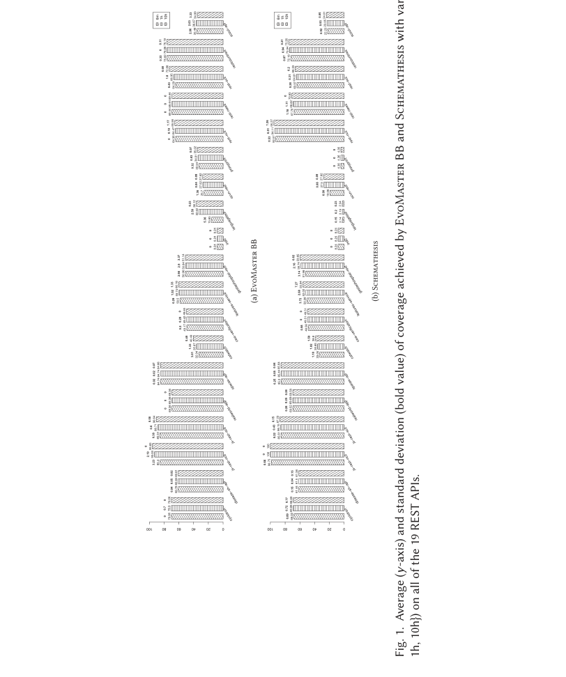

**Рисунок 1:** Среднее значение (ось y) и стандартное отклонение (значение жирным шрифтом) покрытия, достигнутого EvoMaster BB и Schemathesis при разных бюджетах времени (то есть {6 мин, 1 ч, 10 ч}) на всех 19 REST API.

**Таблица 5.** Результаты эксперимента с разными бюджетами времени (то есть {6 мин, 1 ч, 10 ч})

| SUT | EvoMaster BB 6 мин | EvoMaster BB 1 ч | EvoMaster BB 10 ч | Schemathesis 6 мин | Schemathesis 1 ч | Schemathesis 10 ч |
|---|---:|---:|---:|---:|---:|---:|
| cyclotron | 70,1 [70,1; 70,1] | 70,3 [70,1; 72,3] | 70,1 [70,1; 70,1] | 68,0 [67,0; 69,1] | 69,1 [67,7; 69,7] | 68,9 [68,1; 69,7] |
| disease-sh-api | 60,8 [60,7; 60,9] | 60,8 [60,8; 60,9] | 60,8 [60,8; 60,8] | 61,4 [61,1; 61,7] | 61,5 [61,4; 61,6] | 61,4 [61,3; 61,6] |
| js-rest-ncs | 85,4 [82,4; 90,4] | 93,0 [89,8; 95,8] | 95,8 [95,8; 95,8] | 98,8 [98,4; 100,0] | 100,0 [100,0; 100,0] | 100,0 [100,0; 100,0] |
| js-rest-scs | 85,5 [85,1; 86,3] | 88,7 [87,5; 89,5] | 90,6 [90,0; 91,2] | 85,6 [85,2; 86,1] | 86,1 [85,9; 87,4] | 87,2 [87,1; 87,4] |
| realworld-app | 69,4 [69,4; 69,4] | 69,4 [69,4; 69,4] | 69,4 [69,4; 69,4] | 69,5 [68,9; 69,8] | 69,7 [69,1; 69,8] | 69,6 [69,3; 69,8] |
| spacex-api | 84,7 [84,7; 84,8] | 84,7 [84,7; 84,8] | 84,9 [84,8; 84,9] | 85,3 [84,8; 85,6] | 85,4 [85,3; 85,6] | 85,6 [85,6; 85,7] |
| catwatch | 32,9 [23,6; 36,6] | 35,9 [34,3; 36,9] | 40,5 [36,9; 46,8] | 33,1 [31,1; 34,3] | 35,8 [33,6; 39,1] | 38,8 [37,0; 40,0] |
| cwa-verification | 49,2 [49,1; 49,6] | 49,4 [49,1; 49,6] | 49,6 [49,6; 49,6] | 48,6 [47,3; 49,5] | 49,5 [49,5; 49,5] | 49,5 [49,5; 49,5] |
| features-service | 58,5 [58,4; 59,5] | 59,7 [58,4; 62,1] | 60,2 [59,3; 61,7] | 50,4 [46,4; 57,5] | 52,0 [46,6; 57,1] | 55,9 [51,4; 64,3] |
| gestaohospital-rest | 51,0 [44,8; 54,5] | 50,8 [44,8; 54,3] | 51,1 [48,8; 53,5] | 52,0 [48,5; 57,5] | 58,7 [55,9; 62,3] | 59,8 [59,2; 60,4] |
| ind0 | 8,2 [8,2; 8,2] | 8,2 [8,2; 8,2] | 8,2 [8,2; 8,2] | 8,2 [8,2; 8,2] | 8,2 [8,2; 8,2] | 8,2 [8,2; 8,2] |
| languagetool | 15,6 [6,8; 25,3] | 32,6 [26,0; 35,1] | 36,1 [35,9; 36,3] | 2,1 [2,1; 2,5] | 2,2 [2,1; 2,5] | 2,3 [2,1; 2,5] |
| ocvn-rest | 25,7 [22,7; 27,1] | 27,5 [27,5; 27,6] | 27,6 [27,6; 27,7] | 19,1 [16,9; 19,9] | 27,5 [27,5; 27,7] | 27,8 [27,8; 27,9] |
| proxyprint | 32,5 [32,4; 33,6] | 34,0 [32,5; 35,0] | 35,0 [35,0; 35,1] | 4,4 [4,4; 4,4] | 4,4 [4,4; 4,4] | 4,4 [4,4; 4,4] |
| rest-ncs | 64,4 [64,4; 64,4] | 64,5 [64,4; 64,7] | 65,6 [64,7; 66,9] | 92,6 [92,4; 93,8] | 94,1 [93,1; 94,5] | 95,3 [94,5; 96,7] |
| rest-news | 69,4 [69,4; 69,4] | 69,4 [69,4; 69,4] | 69,4 [69,4; 69,4] | 67,8 [65,3; 70,1] | 68,8 [67,4; 70,8] | 70,8 [70,8; 70,8] |
| rest-scs | 64,3 [63,7; 65,4] | 66,9 [64,4; 70,2] | 72,9 [72,2; 73,6] | 64,0 [63,7; 64,4] | 64,8 [64,4; 65,1] | 66,3 [66,1; 66,4] |
| restcountries | 75,8 [74,8; 76,1] | 76,1 [76,1; 76,1] | 76,2 [76,1; 76,2] | 72,2 [71,1; 73,8] | 73,9 [72,4; 75,0] | 75,3 [75,1; 75,5] |
| scout-api | 35,5 [30,9; 39,6] | 36,7 [32,8; 41,1] | 35,0 [31,3; 37,7] | 22,2 [21,4; 24,3] | 23,0 [22,1; 25,1] | 24,0 [23,1; 24,8] |

Мы приводим среднее, минимальное и максимальное значения покрытия (то есть среднее [мин, макс]), достигнутые двумя лучшими фаззерами чёрного ящика (то есть EvoMaster и Schemathesis) при каждом варианте бюджета времени для каждого из 19 REST API.

**Таблица 6.** Результаты сравнения покрытия, достигнутого при разных настройках бюджета времени (то есть {6 мин, 1 ч, 10 ч}), для двух лучших фаззеров чёрного ящика (то есть EvoMaster и Schemathesis) на всех 19 REST API

EvoMaster BB (группы из четырёх столбцов: 1 ч против 6 мин · 10 ч против 1 ч · 10 ч против 6 мин):

| SUT | Â₁₂ | p-значение | Разница, % | Отн. разница | Â₁₂ | p-значение | Разница, % | Отн. разница | Â₁₂ | p-значение | Разница, % | Отн. разница |
|---|---:|---:|---:|---:|---:|---:|---:|---:|---:|---:|---:|---:|
| cyclotron | 0,60 | 0,168 | +0,24 | +0,35% | 0,40 | 0,502 | −0,24 | −0,35% | 0,50 | NaN | 0,00 | 0,00% |
| disease-sh-api | **0,82** | **0,010** | **+0,06** | **+0,10%** | 0,33 | 0,392 | −0,04 | −0,06% | 0,77 | 0,176 | +0,02 | +0,03% |
| js-rest-ncs | **0,99** | **≤0,001** | **+7,63** | **+8,93%** | **0,90** | **0,045** | **+2,80** | **+3,01%** | **1,00** | **0,013** | **+10,43** | **+12,21%** |
| js-rest-scs | **1,00** | **≤0,001** | **+3,17** | **+3,71%** | **1,00** | **0,007** | **+1,94** | **+2,18%** | **1,00** | **0,014** | **+5,11** | **+5,97%** |
| realworld-app | 0,50 | NaN | 0,00 | 0,00% | 0,50 | NaN | 0,00 | 0,00% | 0,50 | NaN | 0,00 | 0,00% |
| spacex-api | 0,50 | 1,000 | 0,00 | 0,00% | **0,98** | **0,004** | **+0,14** | **+0,17%** | **0,98** | **0,004** | **+0,14** | **+0,17%** |
| catwatch | **0,97** | **≤0,001** | **+2,94** | **+8,92%** | **0,98** | **0,013** | **+4,62** | **+12,87%** | **1,00** | **0,010** | **+7,55** | **+22,93%** |
| cwa-verification | **0,73** | **0,024** | **+0,26** | **+0,52%** | 0,70 | 0,246 | +0,23 | +0,46% | **0,93** | **0,005** | **+0,48** | **+0,98%** |
| features-service | **0,77** | **0,007** | **+1,23** | **+2,11%** | 0,65 | 0,487 | +0,44 | +0,73% | **0,96** | **0,001** | **+1,67** | **+2,86%** |
| gestaohospital-rest | 0,48 | 0,939 | −0,11 | −0,22% | 0,50 | 1,000 | +0,29 | +0,58% | 0,48 | 1,000 | +0,18 | +0,35% |
| ind0 | 0,50 | NaN | 0,00 | 0,00% | 0,50 | NaN | 0,00 | 0,00% | 0,50 | NaN | 0,00 | 0,00% |
| languagetool | **1,00** | **≤0,001** | **+16,97** | **+108,44%** | **1,00** | **0,007** | **+3,50** | **+10,72%** | **1,00** | **0,003** | **+20,47** | **+130,79%** |
| ocvn-rest | **1,00** | **≤0,001** | **+1,82** | **+7,09%** | **0,87** | **0,048** | **+0,10** | **+0,35%** | **1,00** | **0,010** | **+1,92** | **+7,46%** |
| proxyprint | **0,95** | **≤0,001** | **+1,47** | **+4,52%** | **0,98** | **0,017** | **+1,01** | **+2,98%** | **1,00** | **0,010** | **+2,49** | **+7,64%** |
| rest-ncs | **0,65** | **0,036** | **+0,11** | **+0,17%** | **0,95** | **0,015** | **+1,10** | **+1,71%** | **1,00** | **≤0,001** | **+1,21** | **+1,88%** |
| rest-news | 0,50 | NaN | 0,00 | 0,00% | 0,50 | NaN | 0,00 | 0,00% | 0,50 | NaN | 0,00 | 0,00% |
| rest-scs | **0,95** | **≤0,001** | **+2,66** | **+4,14%** | **1,00** | **0,014** | **+5,93** | **+8,86%** | **1,00** | **0,008** | **+8,60** | **+13,37%** |
| restcountries | **0,75** | **0,011** | **+0,24** | **+0,31%** | **0,83** | **0,010** | **+0,12** | **+0,16%** | **0,92** | **0,022** | **+0,36** | **+0,47%** |
| scout-api | 0,60 | 0,448 | +1,19 | +3,35% | 0,37 | 0,554 | −1,68 | −4,58% | 0,50 | 1,000 | −0,49 | −1,38% |
| #Значимость | 12 | | | | 10 | | | | 12 | | | |

Schemathesis (группы из четырёх столбцов: 1 ч против 6 мин · 10 ч против 1 ч · 10 ч против 6 мин):

| SUT | Â₁₂ | p-значение | Разница, % | Отн. разница | Â₁₂ | p-значение | Разница, % | Отн. разница | Â₁₂ | p-значение | Разница, % | Отн. разница |
|---|---:|---:|---:|---:|---:|---:|---:|---:|---:|---:|---:|---:|
| cyclotron | **0,86** | **0,007** | **+1,06** | **+1,56%** | 0,47 | 0,932 | −0,19 | −0,27% | 0,73 | 0,271 | +0,87 | +1,28% |
| disease-sh-api | 0,71 | 0,096 | +0,06 | +0,10% | 0,32 | 0,380 | −0,12 | −0,19% | 0,37 | 0,540 | −0,06 | −0,09% |
| js-rest-ncs | **0,90** | **≤0,001** | **+1,25** | **+1,27%** | 0,50 | NaN | 0,00 | 0,00% | **0,90** | **0,021** | **+1,25** | **+1,27%** |
| js-rest-scs | **0,93** | **≤0,001** | **+0,53** | **+0,62%** | **0,92** | **0,028** | **+1,08** | **+1,26%** | **1,00** | **0,012** | **+1,62** | **+1,89%** |
| realworld-app | 0,70 | 0,097 | +0,17 | +0,25% | 0,33 | 0,364 | −0,11 | −0,16% | 0,53 | 0,931 | +0,06 | +0,08% |
| spacex-api | 0,61 | 0,401 | +0,13 | +0,16% | **0,97** | **0,020** | **+0,21** | **+0,24%** | **0,97** | **0,022** | **+0,34** | **+0,40%** |
| catwatch | **0,96** | **≤0,001** | **+2,80** | **+8,46%** | **0,93** | **0,028** | **+2,95** | **+8,24%** | **1,00** | **0,010** | **+5,75** | **+17,39%** |
| cwa-verification | **0,93** | **≤0,001** | **+0,94** | **+1,94%** | 0,50 | NaN | 0,00 | 0,00% | **0,93** | **0,022** | **+0,94** | **+1,94%** |
| features-service | 0,64 | 0,238 | +1,64 | +3,26% | 0,56 | 0,814 | +3,93 | +7,55% | 0,74 | 0,231 | +5,57 | +11,06% |
| gestaohospital-rest | **0,94** | **≤0,001** | **+6,76** | **+13,01%** | 0,62 | 0,611 | +1,11 | +1,89% | **1,00** | **0,007** | **+7,87** | **+15,14%** |
| ind0 | 0,50 | NaN | 0,00 | 0,00% | 0,50 | NaN | 0,00 | 0,00% | 0,50 | NaN | 0,00 | 0,00% |
| languagetool | 0,41 | 0,468 | +0,05 | +2,46% | 0,67 | 0,385 | +0,15 | +6,77% | 0,69 | 0,323 | +0,20 | +9,39% |
| ocvn-rest | **1,00** | **≤0,001** | **+8,44** | **+44,28%** | **1,00** | **0,011** | **+0,32** | **+1,17%** | **1,00** | **0,010** | **+8,76** | **+45,96%** |
| proxyprint | 0,50 | NaN | 0,00 | 0,00% | 0,50 | NaN | 0,00 | 0,00% | 0,50 | NaN | 0,00 | 0,00% |
| rest-ncs | **0,96** | **≤0,001** | **+1,54** | **+1,66%** | 0,83 | 0,076 | +1,16 | +1,24% | **1,00** | **0,001** | **+2,70** | **+2,92%** |
| rest-news | **0,76** | **0,032** | **+1,06** | **+1,57%** | **0,95** | **0,023** | **+2,01** | **+2,93%** | **1,00** | **0,007** | **+3,08** | **+4,54%** |
| rest-scs | **0,97** | **≤0,001** | **+0,84** | **+1,32%** | **1,00** | **0,011** | **+1,51** | **+2,34%** | **1,00** | **0,007** | **+2,36** | **+3,68%** |
| restcountries | **0,94** | **≤0,001** | **+1,76** | **+2,44%** | **1,00** | **0,013** | **+1,32** | **+1,78%** | **1,00** | **0,009** | **+3,08** | **+4,27%** |
| scout-api | **0,82** | **0,010** | **+0,82** | **+3,70%** | 0,83 | 0,112 | +0,96 | +4,15% | **0,90** | **0,037** | **+1,78** | **+8,00%** |
| #Значимость | 12 | | | | 7 | | | | 12 | | | |
| #Значимость всего | 24 | | | | 17 | | | | 24 | | | |

Для сравнения настроек a и b (то есть a против b, где a больше b — например, 1 ч против 6 мин) мы приводим p-значение по U-критерию Манна — Уитни — Уилкоксона и величину эффекта (Â₁₂) по статистике Варги — Делани. Значения, выделенные жирным шрифтом, означают, что a статистически значимо лучше b (то есть p-значение < 0,05 и Â₁₂ < 0,5[^6]), значения обычным шрифтом — что статистически значимой разницы между a и b нет. Значения NaN у p-значения возникают, когда a и b полностью совпадают. Для каждого фаззера среди 19 SUT #Значимость показывает число SUT, для которых результаты статистически значимо улучшаются при большем бюджете времени (то есть a значимо лучше b). Также приведены разница и относительная разница между средним a и средним b (то есть Разница,% = mean(a) − mean(b) и Отн. разница = (mean(a) − mean(b)) / mean(b)).

Из этих данных можно сделать несколько ключевых наблюдений:

- В большинстве случаев увеличение бюджета времени действительно повышает достигнутое покрытие кода.
- Прирост покрытия может быть существенным (например, +20,5% для EvoMaster на languagetool) или совсем небольшим (например, лишь +0,2% для spacex-api).
- При высокой вариабельности результатов эксперименты с более длинным бюджетом времени иногда случайно дают более слабые результаты. Это не типично, но случается (например, для EvoMaster на scout-api).
- Уже при малом бюджете времени (6 минут) можно получить сравнительно приемлемые результаты покрытия. Это важно учитывать, поскольку многие дефекты в этих REST API относятся к первому уровню валидации входных данных [[57](#ref-57)].
- Есть случаи, когда результаты не отличаются даже при стократном увеличении бюджета времени (10 часов против 6 минут). Так обстоит дело с промышленным API (ind0). Интересно, что тестирование методом белого ящика даёт заметно лучшие результаты, чем методы чёрного ящика (это будет показано в разделе 4.6). Хотя увеличение времени и улучшает результаты фаззеров чёрного ящика, в ряде случаев этого недостаточно и требуются более продвинутые методы, такие как тестирование методом белого ящика.

**RQ2:** *Уже при небольшом бюджете времени в 6 минут можно получить хорошие результаты. Более длительные бюджеты времени способны дать лучшие результаты, но величина улучшения может существенно различаться между тестируемыми API.*

### 4.5 RQ3: обнаружение дефектов методом чёрного ящика

#### 4.5.1 Проблемы измерения обнаружения дефектов

Как отмечалось ранее, каждый инструмент может самостоятельно сообщать о количестве обнаруженных дефектов, но способы расчёта этого числа могут существенно различаться от инструмента к инструменту, что делает любое сравнение практически бессмысленным. Проверка вручную тысяч (а возможно, и десятков тысяч) тест-кейсов также не является приемлемым вариантом, особенно когда они созданы на разных языках программирования (например, Java и Python).

Некоторые авторы, такие как Kim et al. [[53](#ref-53)], используют количество уникальных трейсов стека исключений в логах SUT в качестве косвенного показателя обнаруженных дефектов. С одной стороны, инструмент, который приводит к тому, что SUT генерирует больше исключений, можно считать лучшим. С другой стороны, использование такой метрики в качестве косвенного показателя обнаружения дефектов имеет множество недостатков, например следующие. (1) Не все исключения, зарегистрированные в логах, связаны с дефектами. (2) Не все SUT по умолчанию выводят какие-либо логи (например, это относится к нескольким SUT в нашем исследовании). (3) Сбои (которые приводят к ответам с кодом состояния HTTP 500) являются лишь одним типом дефектов в REST API, обнаруживаемых этими фаззерами [[57](#ref-57)]. При этом, например, все дефекты, связанные с несоответствием ответа схеме API, не оставляли бы следов в логах. По всем этим причинам мы не проводили такого рода анализ логов, поскольку не считаем, что они предоставляют значительно больше информации по сравнению с покрытием строк — особенно учитывая, что для проведения такого анализа необходимо реализовать инфраструктуру, что может оказаться непростой задачей.

В качестве альтернативы мы рассматривали создание HTTP-прокси, который использовался бы между фаззером и SUT. С помощью такого прокси-сервера можно было бы записывать все ответы от SUT — например, регистрировать все эндпоинты, возвращающие код состояния HTTP 500, — независимо от используемого фаззера. Мы отказались от этой идеи по двум основным причинам: (1) это могло бы привести к существенной задержке при выполнении всех тест-кейсов, что могло бы исказить результаты экспериментов (более медленные фаззеры получили бы относительное преимущество, если бы каждый HTTP-вызов выполнялся искусственно дольше из-за прохождения через прокси), и (2) такой подход не позволил бы различать разные дефекты, срабатывающие в одном и том же эндпоинте.

Другой альтернативой было использование какого-либо инструмента мутационного тестирования [[51](#ref-51)]. Однако нам не известно ни об одном таком инструменте, предназначенном для системного тестирования (то есть все они, по-видимому, ориентированы на компонентное тестирование). Кроме того, при использовании инструмента мутационного тестирования могут возникнуть серьёзные технические проблемы, если сгенерированные тесты и SUT написаны на разных языках программирования (например, Python и Java). Разработка нового инструмента мутационного тестирования для REST API была бы полезной, но это выходит за рамки данной работы.

В существующих работах по сравнению фаззеров в других областях, таких как парсеры данных [[41](#ref-41)], сбои SUT используются в качестве оракула для обнаружения дефектов. Их легко идентифицировать (SUT больше не работает), хотя для различения возможных разных дефектов в одной и той же SUT при её сбое необходимо использовать интеллектуальные методы. В REST API это не так, поскольку сбои в бизнес-логике не приводят к сбоям HTTP-серверов, на которых они работают. HTTP-серверы перехватывают эти исключения и возвращают HTTP-ответ с кодом состояния 500. Кроме того, как уже отмечалось, это лишь один тип дефекта, который может быть автоматически обнаружен в REST API [[57](#ref-57)]. В литературе определены различные типы автоматизированных оракулов [[48](#ref-48)]. Сосредоточение внимания только на этом типе дефектов может быть слишком ограничительным.

#### 4.5.2 Организация эксперимента

В итоге для более объективного сравнения обнаружения дефектов различными фаззерами REST API мы создали искусственный API с 10 различными типами искусственных дефектов (как упоминалось в разделе 4.1). Затем мы запустили на нём каждый фаззер чёрного ящика и вручную оценили сгенерированные им тест-кейсы, чтобы проверить, были ли выявлены дефекты.

API спроектирован так, что вызвать проявление дефектов в нём должно быть тривиально. Другими словами, для проявления дефекта было бы достаточно просто вызвать эндпоинт независимо от входных данных. Цель здесь — проверить, способны ли фаззеры определить, действительно ли полученные ответы содержат дефект. Другими словами, мы эмпирически проверяем, какой диапазон автоматизированных оракулов использует каждый фаззер.

Независимо от достигнутого покрытия кода, фаззер можно расширить за счёт дополнительных автоматизированных оракулов, описанных в литературе. Но их интеграция не обязательно тривиальна. Например, рассмотрим дефекты устойчивости, при которых отправляются некорректные (согласно схеме) данные, а затем фаззер проверяет, имеет ли HTTP-ответ код состояния из семейства 4xx (т. е. указывающий на ошибку пользователя). Отправка недопустимых данных может негативно сказаться на попытках максимизировать покрытие кода в SUT, поскольку валидация входных данных выполняется на первом уровне API. Поэтому частота и момент отправки недопустимых входных данных для проверки этого типа автоматизированного оракула — нетривиальное проектное решение в фаззере.

В наш искусственный API мы внедрили следующие 10 различных типов дефектов, для которых можно определить автоматизированный оракул. Обратите внимание, что этот список не претендует на исчерпывающее перечисление всех возможных дефектов, которые могут быть автоматически обнаружены с помощью оракула. Например, мы не рассматривали дефекты, связанные с безопасностью (например, основанные на политиках доступа). Эта подборка — лишь отправная точка, призванная пролить больше света на эту важную проблему.

10 типов дефектов таковы:

1. В бизнес-логике API выбрасывается исключение, что приводит к возврату кода состояния HTTP 500.
2. Эндпоинт возвращает тело ответа, в котором поле имеет неверный тип согласно схеме.
3. Эндпоинт возвращает код состояния успеха (т. е. из семейства 2xx), который не объявлен в схеме.
4. В теле запроса значение числового поля не должно превышать определённого максимума, но это ограничение игнорируется в API.
5. В теле запроса значение строкового поля должно быть одним из значений заданного перечисления, но это ограничение игнорируется в API.
6. В теле запроса должно присутствовать булево поле, но это ограничение игнорируется в API.
7. Эндпоинт POST возвращает недопустимый заголовок location (указывающий на вновь созданный ресурс), что приводит к коду состояния 404 при его использовании в вызове GET.
8. Эндпоинт DELETE возвращает код состояния 200, но ничего не удаляет (т. е. запрос GET по тому же URL по-прежнему вернёт неудалённый ресурс).
9. Эндпоинт PUT ошибочно выполняет частичное обновление (по семантике, аналогичной RFC 7396 JSON Merge Patch) вместо полной замены ресурса (что можно обнаружить, запросив изменённый ресурс с помощью GET), как того требует семантика HTTP.
10. Эндпоинт PUT ошибочно выполняет неидемпотентную модификацию. Поэтому многократный вызов одного и того же эндпоинта приводит к разным результатам, что можно проверить, запросив изменённый ресурс с помощью GET. Напомним, что все методы HTTP идемпотентны, за исключением POST и PATCH.

Мы запустили каждый из семи фаззеров чёрного ящика на искусственном API. Поскольку эндпоинты такого API покрыть тривиально, мы запускали каждый инструмент только один раз, всего на 6 минут. Затем мы вручную проверили все сгенерированные тест-кейсы, чтобы увидеть, какие из 10 дефектов были выявлены правильно.

#### 4.5.3 Результаты эксперимента

В таблице 7 представлены результаты этих экспериментов. Для этого API RestCT не удалось сгенерировать ни одного тест-кейса, поскольку, по-видимому, у него возникают проблемы при работе с эндпоинтами, не имеющими параметров запроса или пути. Хотя API тривиален, RESTest и RestTestGen не смогли достичь полного покрытия, в отличие от остальных четырёх фаззеров.

**Таблица 7.** Результаты эксперимента по обнаружению дефектов всеми выбранными фаззерами чёрного ящика на `rest-faults`

| Фаззер | Покрытие строк, % | №1 | №2 | №3 | №4 | №5 | №6 | №7 | №8 | №9 | №10 |
|---|---:|:--:|:--:|:--:|:--:|:--:|:--:|:--:|:--:|:--:|:--:|
| bBOXRT | 100,0 | ✓ | ✓ | | | | | | | | |
| EvoMaster BB | 100,0 | ✓ | | ✓ | | | | | | | |
| RestCT | 26,9 | | | | | | | | | | |
| RESTler | 100,0 | ✓ | | | | | | | | | |
| RESTest | 61,5 | | | | | | | | | | |
| RestTestGen | 92,3 | ✓ | | | ? | ? | ? | | | | |
| Schemathesis | 100,0 | ✓ | | ✓ | | | | | | | |

Для каждого фаззера указано достигнутое покрытие строк и тип обнаруженных дефектов.

Из 10 дефектов только №1 надёжно обнаруживается большинством инструментов. Дефект №2 обнаружил только bBOXRT. Дефект №3 обнаружили только EvoMaster и Schemathesis. Ни один из остальных 7 дефектов не был корректно идентифицирован ни одним из фаззеров. Однако необходимо сделать некоторые пояснения:

- **bBOXRT.** Согласно Laranjeiro et al. [[54](#ref-54)], этот фаззер должен быть способен обнаруживать дефекты тестирования устойчивости (т. е. №4, №5 и №6), но он этого не сделал. По-видимому, он пытался отправлять разные виды ошибочных входных данных, но с неверными типами тела запроса, из-за чего все эти HTTP-запросы завершались кодом состояния 415 (т. е. Unsupported Media Type). Однако это был единственный фаззер, правильно идентифицировавший дефект №2.
- **RESTler.** Согласно Atlidakis et al. [[38](#ref-38)], этот фаззер должен был обнаружить дефект №8, но этого не произошло.
- **RESTest.** Нам не удалось определить, находит ли этот фаззер какие-либо дефекты. Он сгенерировал 121 файл JUnit, которые в совокупности содержат 968 тест-кейсов. Однако ни один из тест-кейсов не показывает, какие дефекты он позволяет обнаружить в исходном коде SUT. Тест-кейсы необходимо запустить; при этом дефекты проверяются с помощью пользовательских операторов логирования в используемой HTTP-библиотеке (а именно RestAssured). Для запуска таких тестов требуется библиотека от RESTest, опубликованная на Maven Central. Однако на момент написания статьи в этой библиотеке, по-видимому, отсутствуют некоторые транзитивные зависимости, поэтому ни один из сгенерированных тестов не удалось запустить.
- **RestTestGen.** Как и bBOXRT, согласно Corradini et al. [[44](#ref-44)], этот фаззер должен быть способен обнаруживать дефекты №4, №5 и №6. Возможно, это так, но неясно, какие именно дефекты он находит. Например, он может генерировать тестовые последовательности с 20 HTTP-вызовами, сопровождаемые заключительным комментарием: «Ошибочная тестовая последовательность была принята сервером как валидная». Однако нет информации о том, что делает эту тестовую последовательность «ошибочной».

Результаты этого эксперимента ясно показывают, что современные фаззеры обнаруживают лишь небольшое подмножество возможных типов дефектов в REST API. Как сообщается в недавнем обзоре Golmohammadi et al. [[48](#ref-48)], большинство фаззеров способны обнаружить сотни/тысячи дефектов в существующих API. Обычно это достигается за счёт обнаружения кодов состояния HTTP 500 (например, как в дефекте №1). Однако не все дефекты имеют одинаковую степень серьёзности. Например, во многих случаях код состояния 500 — это просто неправильная обработка недопустимых входных данных [[57](#ref-57)]. Возврат кода состояния 500 вместо 400 при некорректных входных данных не так серьёзен, как дефект типа №10. В данном случае этот последний тип дефекта может иметь катастрофические последствия, поскольку он не только способен повредить данные API, но и с трудом поддаётся воспроизведению и отладке из-за недетерминированности и низкой частоты повторного выполнения идемпотентных методов в стеке HTTP.

**RQ3:** *Существующие фаззеры обнаруживают лишь небольшое число типов дефектов в REST API.*

### 4.6 RQ4: эксперименты по тестированию методом белого ящика

Из семи сравниваемых инструментов только EvoMaster поддерживает тестирование методом белого ящика. EvoMaster использует методы эволюционных вычислений, при которых байт-код SUT инструментируется для вычисления различных видов эвристик. Из-за возможных конфликтов с инструментацией JaCoCo и c8, а также из-за того, что EvoMaster использует собственные классы драйверов (которые необходимо писать вручную) для запуска и остановки инструментированных SUT, этот набор экспериментов проводился иначе, чем эксперименты методом чёрного ящика.

Мы запускали EvoMaster на каждой SUT с 10-кратным повторением (всего 190 запусков), каждый раз на 1 час (как и в экспериментах методом чёрного ящика). Однако JaCoCo и c8 не активировались. После каждого прогона EvoMaster генерирует файлы статистики, включающие информацию о покрытии кода и обнаружении дефектов. Однако поскольку между способами вычисления покрытия строк в EvoMaster и в JaCoCo/c8 могут быть различия, было бы сложно достоверно сравнить эти результаты с результатами таблицы 2. Поэтому для сравнения мы также запускали EvoMaster в режиме серого ящика (ещё 190 запусков). Этот режим генерирует тест-кейсы точно так же, как режим чёрного ящика, с той разницей, что SUT инструментирована, и метрики покрытия вычисляются при каждом выполнении теста. Дополнительное преимущество в том, что помимо покрытия кода мы можем достоверно сравнивать и обнаружение дефектов, поскольку эта метрика вычисляется точно так же (так как это один и тот же инструмент). Поскольку EvoMaster — фаззер чёрного ящика, обеспечивающий наивысшее покрытие кода (раздел 4.3), сравнение результатов белого ящика только с EvoMaster не представляет серьёзной угрозы валидности. Эти 380 прогонов добавили ещё 15,8 дня вычислительных затрат.

**Таблица 8.** Результаты эксперимента для эволюционного поиска методом белого ящика (WB) и случайного поиска методом серого ящика (RS) с использованием EvoMaster на 19 REST API

| | Процент покрытия строк | | | | Число обнаруженных дефектов | | | |
| SUT | Покрытие строк, % (RS) | Покрытие строк, % (WB) | Â₁₂ | p-значение | Число обнаруженных дефектов (RS) | Число обнаруженных дефектов (WB) | Â₁₂ | p-значение |
|---|---:|---:|---:|---:|---:|---:|---:|---:|
| cyclotron | 31,2 | 31,3 | 0,69 | 0,158 | 32,2 | 30,9 | **0,13** | 0,004 |
| disease-sh-api | 18,1 | 19,5 | **1,00** | 0,001 | 30,0 | 36,2 | **1,00** | 0,001 |
| js-rest-ncs | 60,7 | 83,2 | **1,00** | 0,001 | 6,0 | 6,0 | 0,50 | 1,000 |
| js-rest-scs | 60,9 | 76,2 | **1,00** | 0,001 | 1,0 | 1,0 | 0,50 | 1,000 |
| realworld-app | 24,6 | 24,4 | **0,03** | 0,001 | 25,0 | 30,5 | **1,00** | 0,001 |
| spacex-api | 41,5 | 41,5 | 0,58 | 0,540 | 52,2 | 50,9 | 0,32 | 0,170 |
| catwatch | 41,1 | 50,0 | **1,00** | 0,001 | 18,0 | 23,7 | **1,00** | 0,001 |
| cwa-verification | 40,4 | 46,9 | **1,00** | 0,001 | 4,0 | 4,0 | 0,50 | 1,000 |
| features-service | 68,8 | 81,8 | **1,00** | 0,001 | 22,2 | 31,4 | **1,00** | 0,001 |
| gestaohospital-rest | 39,4 | 39,5 | **0,72** | 0,024 | 15,0 | 22,0 | **1,00** | 0,001 |
| ind0 | 8,4 | 18,8 | **1,00** | 0,001 | 1,0 | 48,1 | **1,00** | 0,001 |
| languagetool | 28,9 | 39,5 | **0,93** | 0,001 | 16,6 | 12,8 | 0,55 | 0,731 |
| ocvn-rest | 35,3 | 24,8 | **0,00** | 0,001 | 279,9 | 257,9 | **0,00** | 0,001 |
| proxyprint | 53,3 | 51,6 | 0,28 | 0,120 | 84,1 | 86,3 | 0,59 | 0,531 |
| rest-ncs | 61,9 | 93,0 | **1,00** | 0,001 | 5,0 | 6,0 | **1,00** | 0,001 |
| rest-news | 55,4 | 66,5 | **1,00** | 0,001 | 5,0 | 7,8 | **1,00** | 0,001 |
| rest-scs | 63,3 | 86,2 | **1,00** | 0,001 | 1,0 | 12,0 | **1,00** | 0,001 |
| restcountries | 74,9 | 77,1 | **1,00** | 0,001 | 2,0 | 2,0 | 0,50 | 1,000 |
| scout-api | 54,7 | 53,4 | 0,37 | 0,346 | 94,0 | 88,6 | **0,14** | 0,008 |
| Среднее | 45,4 | 52,9 | 0,77 | | 36,5 | 39,9 | 0,67 | |

Мы приводим среднее покрытие строк, измеренное самим EvoMaster (не JaCoCo и не c8), а также количество дефектов, обнаруженных в этих API. Если различия статистически значимы на уровне α = 0,05, величина эффекта Â₁₂ выделена жирным шрифтом.

Таблица 8 показывает следующее. Во-первых, в среднем покрытие строк увеличивается на 7,5% (с 45,4% до 52,9%). Даже если на каждый API приходится всего 10 прогонов, результаты в большинстве случаев статистически значимы.

Для таких API, как rest-ncs, среднее покрытие может превышать 90%. Для других API, в частности features-service, улучшение превышает 13% (а именно с 68,8% до 81,1% — максимум)[^7]. В случае ind0, хотя достигнутое покрытие относительно низкое (т. е. <20%), оно всё же более чем удваивается (т. е. с 8,4% до 18,8%).

Хотя результаты значительно улучшились по сравнению с тестированием чёрного ящика, почти для половины этих SUT всё ещё не удалось достичь более 50% покрытия строк. Кроме того, есть два интересных случая, в которых результаты тестирования методом белого ящика на самом деле значительно хуже (а именно для realworld-app и ocvn-rest). В первом случае разница минимальна и составляет всего 0,2%. Во втором случае, однако, разница существенна и составляет 10,5% (снижение с 35,3% до 24,8%). Такое поведение для поисковых алгоритмов типично, поскольку всё зависит от качества функции пригодности и свойств ландшафта поиска [[42](#ref-42)]. Если функция пригодности не даёт градиента для алгоритма поиска, он может легко застрять в локальных оптимумах. В таких случаях случайный поиск может дать лучшие результаты. EvoMaster использует несколько эвристик в своей функции пригодности, пытаясь максимизировать покрытие кода, но для ocvn-rest они не работают, что мы подробнее обсудим в разделе 4.7.

Однако улучшение функции пригодности в этом случае возможно (мы рассмотрим это в будущих версиях EvoMaster).

Что касается обнаружения дефектов, тестирование методом белого ящика позволяет обнаружить больше дефектов. В контексте тестирования REST API код состояния 500 рассматривается как потенциальный дефект, возникающий в SUT, который можно выявить как методом чёрного, так и методом белого ящика путём извлечения информации из HTTP-ответов. Неудивительно, что подход белого ящика показывает лучшие результаты, поскольку обычно существует сильная корреляция между покрытием кода и обнаружением дефектов [[41](#ref-41)]. Например, невозможно обнаружить дефект, если код, в котором он скрыт, никогда не выполняется. Однако это также зависит от применяемых функций пригодности и эвристик — например, от того, ориентированы ли они в большей степени на обнаружение дефектов, чем на другие критерии тестирования (например, покрытие кода и покрытие, связанное со схемой [[48](#ref-48)]). Интересный момент здесь в том, что улучшение невелико — в среднем лишь на 3,4 дефекта больше. В этих экспериментах тестирование с использованием случайных данных обнаруживает в среднем 36,5 дефекта, поэтому относительное улучшение составляет менее 10%.

Для проблемной области фаззинга REST API (и, вероятно, веб-API в целом) это неудивительно [[57](#ref-57)]. Многие из этих API дают сбой сразу же после получения недопустимого ввода, вместо того чтобы вернуть корректный ответ об ошибке пользователя (например, с кодом состояния HTTP из семейства 4xx). Кроме того, случайный поиск довольно хорошо генерирует недопустимые входные значения. Поэтому фаззер легко находит множество дефектов уже на самом первом уровне валидации входных данных в коде SUT, даже если достигнутое покрытие кода относительно низкое.

**RQ4:** *Фаззинг методом белого ящика даёт значительно более высокие результаты по сравнению с фаззингом методом чёрного ящика — в среднем на 7,5% больше покрытия кода и на 3,4 дефекта больше. Однако для многих API результаты покрытия по-прежнему были ниже 50%.*

### 4.7 RQ5: открытые проблемы

Для выявления открытых проблем мы провели детальный анализ на основе результатов работы существующих фаззеров на реальных API (18 опенсорсных и 1 промышленный). Мы запустили семь инструментов/конфигураций на 19 REST API с бюджетом в 1 час на эксперимент. Однако лишь в одном-единственном случае удалось достичь 100%-ного покрытия строк (а именно Schemathesis на js-rest-ncs, см. таблицу 2). В общем случае достижение 100%-ного покрытия строк может быть невозможным, поскольку часть кода может быть недостижимой. Например, это часто встречается для конструкторов в классах, содержащих только статические методы, а также для блоков catch для исключений, которые невозможно вызвать с помощью теста. Однако для нескольких из этих SUT не удалось достичь даже 50%-ного покрытия строк.

Определение приемлемого целевого показателя покрытия (80%? 90%?) не входит в задачи данной работы. Однако очевидно, что чем выше покрытие кода, тем лучше для практиков, использующих эти фаззеры. Поэтому для улучшения этих фаззеров крайне важно понять их текущие ограничения. Чтобы ответить на этот вопрос, мы подробно изучили логи инструментов в разделе 4.7.1 и значительные части исходного кода SUT в разделе 4.7.2 (напомним, что их объём составляет более 280 000 строк кода; см. таблицу 1). Углублённый анализ текущих открытых проблем фаззинга REST API — необходимый научный шаг для более глубокого понимания этой проблемы. Он нужен для разработки новых и более результативных методов.

Здесь мы проводим два разных вида анализа. Во-первых, мы рассматриваем логи, генерируемые инструментами (раздел 4.7.1), что помогает выявить возможные серьёзные проблемы в этих фаззерах (например, при сбое они могут генерировать сообщения лога с трейсом стека). Во-вторых, мы запускаем сгенерированные тесты и вручную проверяем исполняемый ими код (раздел 4.7.2), чтобы проанализировать, что не было покрыто. Это помогает выдвинуть гипотезы, объясняющие причины такой ситуации, что необходимо для разработки новых методов, обеспечивающих более высокое покрытие. Наконец, мы обобщаем все эти результаты (раздел 4.7.3).

Важно подчеркнуть, что цель этих анализов — выявить общие проблемы или случаи проблем, которые, вероятно, будут присутствовать и в других SUT. Разработка новых методов, которые лишь чрезмерно подгоняются под конкретный бенчмарк, приносит мало или вовсе не приносит пользы. В конечном счёте важны будут именно те результаты, которые практики смогут получить, используя эти фаззеры на своих API.

#### 4.7.1 Анализ логов

Исходя из логов инструментов, обсуждения заслуживают как минимум четыре распространённые проблемы. Во-первых, схемы OpenAPI/Swagger могут содержать ошибки (например, это относится к cyclotron, disease-sh-api, cwa-verification, features-service, proxyprint и ocvn-rest). Это может произойти, когда схемы написаны вручную, а также когда они автоматически извлекаются из кода с помощью некоторых инструментов/библиотек (поскольку эти инструменты сами могут иметь дефекты). В этих случаях большинство фаззеров просто аварийно завершают работу, не выполняя ни одного HTTP-вызова и не генерируя ни одного тест-кейса. Важно предупреждать пользователей об этих проблемах со схемой, но, по всей видимости, фаззерам следует быть более устойчивыми и не давать сбоев (например, эндпоинты с проблемами в схеме можно было бы просто пропускать).

Вторая проблема проявляется в languagetool. Большинство фаззеров для REST API поддерживают тела HTTP-запросов только в формате JSON. Однако в HTTP можно отправить тело запроса любого типа. JSON — самый распространённый формат для REST API [[63](#ref-63)], но есть и другие, например XML и `application/x-www-form-urlencoded`, используемый в languagetool. Судя по результатам таблицы 2, только EvoMaster поддерживает этот формат. На этом API EvoMaster достигает покрытия кода от 26% до 35,1%, тогда как ни один другой фаззер не обеспечивает более 2,5%.

Третья проблема характерна для scout-api, где проявляется особый случай работы с JSON-телами запросов. Большинство инструментов предполагают, что JSON-тело запроса представляет собой дерево — например, корневой объект `A`, который может иметь поля, сами являющиеся объектами (`A.B`), и так далее рекурсивно (`A.B.C.D` и `A.F.C`), образуя древовидную структуру. Однако схема OpenAPI/Swagger может определять объекты, являющиеся графами, как в случае со scout-api. Объект `A` может иметь поле типа `B`, но сам `B` может иметь поле типа `A`. Это рекурсивное отношение создаёт граф, с которым нужно аккуратно обращаться при создании экземпляра `A` (необязательные поля можно пропускать, чтобы избежать бесконечной рекурсии, которая иначе привела бы к сбою фаззеров).

Четвёртая проблема связана с выполнением HTTP-запросов к SUT. Для тестирования REST API фаззеры формируют HTTP-запросы на основе схемы, а затем используют различные HTTP-библиотеки для отправки запросов в SUT — например, в EvoMaster используется `JerseyClient`. Анализируя логи, мы обнаружили, что в нескольких исследованиях случая некоторые фаззеры, по-видимому, не испытывают проблем с разбором схем, но не могут выполнить HTTP-запросы. Например, при обработке realworld-app с помощью `OkHttpClient` в RestTestGen выбрасывалось исключение `javax.net.ssl.SSLException: Unsupported or unrecognized SSL message`. Для js-rest-ncs, js-rest-scs и ind0 мы обнаружили, что при фаззинге с помощью RESTler v8.5.0 всегда возвращались ответы `404 Not Found`. Проверив логи, полученные от RESTler, мы обнаружили, что это может быть связано с проблемой при генерации правильных URL для HTTP-запросов. Для SUT, у которых `basePath` равен `/`, RESTler, по-видимому, генерирует двойной слэш (т. е. `//`) в URL запросов. Однако то, будет ли двойной слэш принят как совпадение с реальным путём, зависит от SUT (например, js-rest-ncs, js-rest-scs и ind0 этого не допускают). На рисунке 2 приведены логи, полученные от RESTler, отражающие обработанные запросы, содержащие двойной слэш, и ответы, возвращённые js-rest-ncs (рисунок 2(a)) и rest-ncs (рисунок 2(b)).

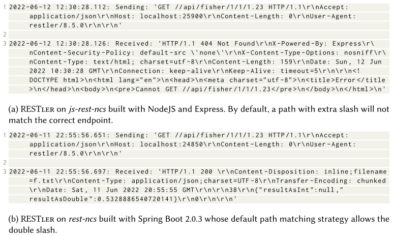

**Рисунок 2:** Разная обработка запросов разными методами.

(a) RESTler на js-rest-ncs, созданном на NodeJS и Express. По умолчанию путь с лишним слэшем не будет сопоставлен с правильным эндпоинтом.

(b) RESTler на rest-ncs, собранном на Spring Boot 2.0.3, чья стратегия сопоставления путей по умолчанию допускает двойной слэш.

#### 4.7.2 Анализ исходного кода

Для каждой SUT мы вручную запускали лучший (т. е. с наибольшим покрытием кода) набор тестов (сгенерированный EvoMaster) с включённым сбором покрытия кода. Затем в IDE мы вручную проверяли, какие ветвления (например, операторы if) были достигнуты при выполнении тест-кейса, но не покрыты, а также рассматривали случаи, когда выполнение теста прерывается в середине блока кода из-за возникновения исключений. Это делалось для того, чтобы понять, какие текущие проблемы и трудности необходимо преодолеть этим фаззерам для получения лучших результатов.

Чтобы быть полезными для исследователей, эти анализы должны быть детальными, с конкретным разбором исходного кода этих API. Никакие общие теории нельзя вывести, не изучив и не проанализировав сначала отдельные случаи научного/инженерного явления. Такие обсуждения в области разработки программного обеспечения могут представлять интерес для разных групп читателей, ориентированных на разную степень детализации. Кроме того, среди читателей могут быть и те, кто в настоящее время не занимается активной разработкой фаззера, поэтому здесь мы приводим только краткое изложение. Полные анализы по каждой SUT приведены в приложении A.

В таблице 9 обобщены все выявленные основные проблемы по каждой SUT. Причин, по которым не удалось достичь более высокого покрытия, может быть много. Здесь на основе нашего анализа мы выделили шесть основных категорий проблем:

- **Аутентификация.** В некоторых случаях для определённых ролей необходимо передавать сведения для аутентификации, используя её конкретные типы (например, API может поддерживать разные способы входа).
- **Базы данных.** Выполнение может зависеть от данных, возвращаемых запросами к базе данных, но эти запросы ничего не возвращают, поскольку ограничения не удовлетворяются (например, условия `WHERE` в SQL-запросах `SELECT`). Сгенерировать правильные данные, удовлетворяющие этим ограничениям, может быть сложно.
- **Внешние сервисы.** API зависит от определённых взаимодействий с внешними сервисами (например, другими API в интернете). Однако с точки зрения фаззеров нет возможности контролировать, что возвращают эти внешние сервисы.
- **Несоответствия схемы.** Схема API может быть недостаточно специфицированной (например, могут отсутствовать некоторые ограничения на данные, а некоторые используемые в API параметры запроса могут быть не описаны) либо содержать неверную информацию (например, неверные типы входных параметров).
- **Ограничения строк.** Строковые входные данные могут требовать соответствия определённым форматам (например, заданным регулярными выражениями), что нелегко вывести автоматически.
- **Недостижимый код.** Часть кода может быть попросту недостижима через точки входа API. Это может быть мёртвый код либо код, выполняемый другими скриптами или функциональностью (например, графическим интерфейсом и фоновыми потоками).

**Таблица 9.** Основные проблемы, препятствующие более высокому покрытию, по каждой SUT

| SUT | Аутентификация | Базы данных | Внешние сервисы | Несоответствия схемы | Ограничения строк | Недостижимый код |
|---|:--:|:--:|:--:|:--:|:--:|:--:|
| catwatch | | | ✓ | | | |
| cwa-verification | | | | ✓ | ✓ | |
| cyclotron | | ✓ | | ✓ | | ✓ |
| disease-sh-api | | | | | | ✓ |
| features-service | | ✓ | | | | |
| gestaohospital-rest | | ✓ | | | | |
| ind0 | | | | | ✓ | |
| js-rest-ncs | | | | | | |
| js-rest-scs | | | | | ✓ | |
| languagetool | | | | ✓ | | |
| ocvn-rest | | | | ✓ | ✓ | ✓ |
| proxyprint | ✓ | | | ✓ | ✓ | ✓ |
| realworld-app | | ✓ | | | | |
| rest-ncs | | | | | | |
| rest-news | | ✓ | | | | ✓ |
| rest-scs | | | | | ✓ | |
| restcountries | | | | | | ✓ |
| scout-api | ✓ | | | | ✓ | ✓ |
| spacex-api | ✓ | ✓ | | | | |
| Всего | 3 | 6 | 1 | 5 | 7 | 7 |

Отметим, что это лишь основные проблемы, с которыми мы сталкиваемся в настоящее время. Их решение не означает максимизацию покрытия кода. По мере выполнения большего объёма кода могут выявляться новые проблемы. Конкретный пример — cwa-verification. Этот API действительно подключается к внешнему сервису, но код, выполняющий это подключение, в настоящее время не выполняется ни одним из фаззеров. Поэтому работа с внешними сервисами пока не даст улучшения на cwa-verification. Однако когда будут решены другие проблемы cwa-verification (см. таблицу 9), для дальнейшего улучшения результатов покрытия потребуется заняться и внешними сервисами.

#### 4.7.3 Обсуждение

На основе анализа логов и тестов, сгенерированных для 19 API, можно сделать несколько общих наблюдений:

- Многие исследовательские прототипы не отличаются особой устойчивостью и могут давать сбой при применении к новым SUT. Например, мы много раз сталкивались с этой проблемой в EvoMaster — в частности, при добавлении нового API в EMB [[7](#ref-7)]. Хотя мы ежегодно добавляем в EMB новые API, EMB доступен как опенсорс с 2017 года, и любой желающий может использовать его в своих эмпирических исследованиях и проверить, не дают ли сбоев их собственные инструменты. Однако важно подчеркнуть, что в данной работе мы сравнивали реализации инструментов, а не методы. Так, инструмент с низкими результатами (из-за сбоев) всё же может содержать новые методы, которые окажутся весьма полезны (например, при интеграции или повторной реализации в более зрелом инструменте).
- Как и программное обеспечение, схемы могут содержать дефекты и/или упущения (например, могут отсутствовать ограничения на некоторые входные данные). Это довольно распространённое явление, особенно когда схемы пишутся вручную. Хотя с помощью тестирования методом белого ящика (в настоящее время поддерживается только EvoMaster) это можно было бы решить путём анализа исходного кода SUT, для чёрного ящика это серьёзная проблема, и приемлемого решения может не найтись.
- Взаимодействие с базами данных — обычное явление для REST API. Для выполнения кода, извлекающего данные, такие данные должны сначала присутствовать в базе данных. Данные можно создать с помощью эндпоинтов самого API (например, запросов POST), а также вставить непосредственно в базу данных SQL-командами. Оба подхода сопряжены с трудностями — например, как правильно связать разные эндпоинты, работающие с одними и теми же ресурсами, и как обращаться с ограничениями данных, указанными в коде API, а не в SQL-схеме базы данных. Сравниваемые фаззеры предлагают разные решения этой проблемы, но очевидно, что предстоит сделать ещё больше.
- В настоящее время ни один фаззер не обеспечивает имитацию внешних веб-сервисов (например, с помощью таких библиотек, как WireMock). Тестирование с использованием реальных внешних сервисов имеет много недостатков (например, сгенерированные тесты могут стать нестабильными), но для стратегий чёрного ящика это может быть единственным вариантом. Для стратегий белого ящика имитация веб-сервисов будет иметь важное значение при тестировании промышленных корпоративных систем, разработанных с использованием микросервисной архитектуры (поскольку в этом классе ПО взаимодействия между веб-сервисами весьма распространены).
- При фаззинге API, требующих входа в систему разных пользователей, необходимо предоставлять информацию для аутентификации. Даже с фаззером для белого ящика автоматическое создание разных пользователей с разными ролями может оказаться невозможным. Например, обычно пароли в базах данных хешируются, и современные фаззеры не способны выяснить путём обратной разработки, как создавать корректные хешированные пароли (например, при создании данных в базе данных в рамках тестов [[32](#ref-32)]). Для достижения определённых частей кода могут потребоваться конкретные пользователи с конкретными ролями. Если они не предоставлены/не настроены до начала фаззинга, такой код выполнить не удастся. Тестировщик может предоставить разные профили пользователей для фаззинга, но в этих ручных конфигурациях могут отсутствовать некоторые важные роли/настройки.
- Ограничения на строковые входные данные, по-видимому, довольно распространены в REST API. Эти ограничения могут отсутствовать в схеме (например, конкретное строковое поле должно удовлетворять заданному регулярному выражению). Фаззеры белого ящика могут анализировать код, чтобы понять, как такие строки обрабатываются, но это непросто. Фаззеры чёрного ящика могли бы попытаться вывести эти ограничения с помощью обработки естественного языка (например, на основе имён этих входных данных и, возможно, их описания, если оно предоставлено).

Многие из выявленных нами проблем (например, работа с базами данных и недостаточно специфицированными схемами) специфичны для REST API, хотя они, вероятно, применимы и к фаззингу других типов веб-сервисов (например, GraphQL [[39](#ref-39), [40](#ref-40)] и RPC [[72](#ref-72), [73](#ref-73)]). Эти проблемы не были бы актуальны в других контекстах тестирования (например, при генерации компонентных тестов или фаззинге библиотек парсеров). Проблемы, связанные с предоставлением конфигураций аутентификации вручную, вероятно, актуальны для любого ПО, которому требуется информация для аутентификации. Работа с ограничениями на строковые данные, вероятно, наиболее общая проблема, поскольку она применима, например, и к компонентному тестированию.

Это означает, что решение этих проблем не только помогло бы тестированию REST API, но и, вероятно, могло бы положительно сказаться на других областях тестирования.

**RQ5:** *В фаззинге REST API есть несколько открытых проблем, включая, например, то, как работать с недостаточно специфицированными схемами и как решать вопросы взаимодействия со средой (например, базами данных и другими внешними API).*

## 5 Угрозы валидности

*Внутренняя валидность.* Помимо написания вспомогательного кода для запуска и анализа экспериментов, перед их проведением мы не вносили изменений в код какого-либо существующего инструмента, применяемого в данном исследовании. Несмотря на то, что мы являемся авторами EvoMaster, в целях объективности мы использовали последнюю версию перед проведением данных экспериментов и не проводили их повторно после устранения каких-либо новых проблем. Однако поскольку мы использовали все эти API в наших предыдущих исследованиях, EvoMaster ни на одном из них не завершался аварийно.

Использование EMB [[7](#ref-7)] в качестве исследования случая может привести к систематической ошибке в пользу EvoMaster. Во избежание чрезмерной подгонки EvoMaster к EMB, эта платформа ежегодно расширялась новыми API, различающимися по размеру и сложности. Кроме того, поскольку EMB уже несколько лет является опенсорс-проектом, любой может использовать его в качестве исследования случая для оценки результативности своих фаззеров.

Мы использовали семь существующих инструментов, по возможности в их последних версиях. Однако существует вероятность того, что мы могли неправильно их настроить, особенно учитывая, что некоторые из этих инструментов имеют минимальную документацию. Чтобы этого избежать, мы внимательно изучаем их логи выполнения, чтобы выявить наличие явных случаев неправильной конфигурации. Кроме того, все наши скрипты публикуются в репозитории EvoMaster как опенсорс, поэтому любой желающий может их просмотреть и при необходимости воспроизвести исследование.

Любое сравнение инструментов, выполненное авторами одного из этих инструментов, неизбежно будет в той или иной мере предвзятым, особенно если этот инструмент, как окажется, обеспечивает наилучшие результаты (как в нашем случае с EvoMaster). Однако данная проблема не повлияла бы на относительные результаты работы остальных шести инструментов. Аналогичным образом, данная проблема не оказывает влияния и на углублённый анализ тестируемых систем (SUT).

Все сравниваемые фаззеры используют рандомизированные алгоритмы. С учётом этого каждый эксперимент повторялся либо 3 раза (бюджет 10 часов), либо 10 раз (бюджеты 6 минут и 1 час), и мы проанализировали их с помощью соответствующих статистических тестов.

*Внешняя валидность.* Выбранные семь фаззеров, вероятно, представляют современный уровень развития технологий тестирования REST API. Однако результаты, полученные для 19 API, могут не обобщаться на другие API, хотя мы также отобрали различные среды выполнения (например, JVM и NodeJS), включая 1 промышленный API. Эксперименты по системному тестированию такого рода требуют значительных затрат (в нашем случае более 120 дней вычислительных усилий), что затрудняет использование большего количества API. Кроме того, поиск REST API в опенсорс-репозиториях не так прост, и для их конфигурирования могут потребоваться значительные усилия (например, настройка внешних зависимостей, таких как базы данных, и выяснение того, используют ли они какую-либо форму аутентификации и каким образом).

## 6 Заключение

REST API широко применяются в промышленности, поэтому в исследовательском сообществе было разработано несколько методик их автоматического тестирования [[48](#ref-48)]. Несколько отчётов в литературе демонстрируют практическую полезность этих методик, сообщая о реальных дефектах, автоматически обнаруженных с помощью этих фаззеров. Однако имеется мало информации о сравнении различных методик, а также об их результативности в отношении охвата различных частей кода этих API. Последнее обычно обусловлено тестированием удалённых API, к исходному коду которых исследователи не имеют доступа.

Для решения этих проблем в данной статье нами проведено сравнение современного уровня технологий в области фаззинга REST API с использованием семи фаззеров для тестирования 20 API (18 опенсорсных, 1 промышленного и 1 искусственного, применённого исключительно для анализа дефектов). Общий объём составил более 280 000 LOC (для бизнес-логики, без учёта миллионов LOC всех используемых сторонних библиотек). Каждый фаззер запускался на 1 час, и каждый эксперимент повторялся 10 раз, чтобы учесть фактор случайности, присущий этим инструментам. Для лучшего понимания результатов лучшие фаззеры также запускались на 6 минут и 10 часов (при этом последний эксперимент повторялся только 3 раза).

Результаты продемонстрировали различные степени покрытия для разных инструментов тестирования чёрного ящика, при этом EvoMaster, по-видимому, является инструментом, обеспечивающим наилучшие результаты (т. е. наивысшее покрытие кода в среднем) в данном исследовании случая, за ним с небольшим отрывом следует Schemathesis. Однако ни один фаззер для тестирования методом чёрного ящика не смог достичь в среднем более 60% покрытия строк. Кроме того, эксперименты демонстрируют, что тестирование методом белого ящика даёт лучшие результаты, чем тестирование чёрного ящика. Тем не менее значительные части этих API остаются непокрытыми, поскольку фаззерам не удаётся сгенерировать надлежащие данные для максимизации покрытия кода. Кроме того, эти фаззеры обнаружили лишь небольшое количество типов дефектов. Хотя они уже приносят пользу практикам в отрасли, для достижения лучших результатов требуются дополнительные усилия.

Для решения этой проблемы после данного масштабного эмпирического анализа был проведён углублённый анализ исходного кода каждого из 19 API с целью понимания основных проблем, препятствующих достижению фаззерами лучших результатов. Было выявлено несколько проблем, включая, например, способы обработки недостаточно специфицированных схем и взаимодействия с внешними сервисами (например, другими API и базами данных). Это позволяет получить полезный перечень общих проблем, который исследователи могут использовать для стимулирования новых исследовательских усилий, направленных на улучшение результатов в данной проблемной области.

Для некоторых из этих проблем нами были рассмотрены возможные решения, однако они требуют эмпирической валидации. Будущие исследования будут направлены на использование новых знаний и идей, представленных в данной работе, для разработки новых вариантов этих инструментов с целью достижения лучших результатов (в отношении покрытия кода и обнаружения дефектов). В частности, представленные в данном исследовании выводы определяют направление текущих исследовательских работ в EvoMaster, указывая на чёткие исследовательские проблемы, требующие приоритетного рассмотрения.

Сравнение существующих инструментов позволяет получить представление о текущих ограничениях фаззинга REST API. Хотя сравнение результатов по покрытию кода не представляет особой сложности, существуют значительные проблемы при попытке проведения справедливых сравнений на основе обнаружения дефектов, особенно в автоматизированном режиме. В будущем потребуется разработать автоматизированную инфраструктуру и вспомогательный код для проведения экспериментов, основанных на обнаружении дефектов.

Все инструменты и API, использованные в данном исследовании, доступны в сети Интернет. Для обеспечения воспроизводимости данного исследования все скрипты, использованные в наших экспериментах, опубликованы как опенсорс и доступны в Интернете в репозитории EvoMaster по адресу www.evomaster.org. Предоставляется документация, определяющая порядок их использования (например, в разделе «Replicating studies» на веб-сайте). Данные скрипты автоматически сохраняются на Zenodo при каждом новом релизе (например, версия 1.5.0 [[35](#ref-35)]).

## Приложение A. Анализ исходного кода

В данном приложении рассматривается выполнение тест-кейсов на каждой SUT, в алфавитном порядке, поочерёдно. Затем приводятся гипотезы, объясняющие, почему не удалось достичь более высокого покрытия.

Следует отметить, что при упоминании покрытия кода, достигнутого методом белого ящика с помощью EvoMaster, мы ссылаемся на результаты, представленные в таблице 8. Эти значения покрытия вычисляются с помощью инструментации самого EvoMaster и не полностью совпадают с данными, которые предоставили бы другие инструменты покрытия, такие как JaCoCo и c8 (поскольку могут существовать различия в способах вычисления покрытия). Например, результаты покрытия, предоставляемые c8, могут быть значительно выше, поскольку они рассчитываются только для загруженных скрипт-файлов (на основе всех экспериментов), тогда как для EvoMaster учитывались все исходные файлы. Иными словами, если при каждом запуске $i$ инструмент покрывает $X_i$ строк из общего количества $N_i$, о котором сообщается, то процент покрытия $c_i$ рассчитывается как $c_i = X_i/N$, где $N = max(N_i)$. Кроме того, текущее ограничение EvoMaster для JavaScript заключается в том, что регистрируемое покрытие не включает покрытие, достигнутое во время загрузки, а только с момента начала поиска. Данная проблема была устранена для JVM, но ещё не решена для JavaScript. Следовательно, значения в таблице 8 не являются непосредственно сопоставимыми со значениями в таблице 2.

### A.1 catwatch

При среднем покрытии строк 50% catwatch можно считать нетривиальным API. Основная проблема заключается в том, что данная SUT осуществляет вызов внешнего сервиса (а именно API GitHub для получения информации о проекте). Однако такой вызов, по-видимому, застревает на длительное время (и, возможно, прерывается по тайм-ауту), в результате чего не выполняется ни одна из частей кода, отвечающих за синтаксический анализ ответов (и проведение различных видов анализа). Вызов внешних сервисов представляет собой проблему для фаззеров. Внешние сервисы могут выйти из строя или измениться в любой момент. Они могут возвращать разные данные при каждом вызове, что приводит к нестабильности утверждений в сгенерированных тестах. Хотя тестирование с использованием реальных внешних сервисов полезно и должно выполняться, сгенерированные тесты, вероятно, не подойдут для регрессионного тестирования. Данная проблема известна в отрасли, и для её решения существуют различные подходы, например, имитация внешних сервисов (в экосистеме JVM популярной библиотекой для этой цели является WireMock [[23](#ref-23)]). Усовершенствование фаззеров для работы с имитируемыми сервисами (например, для настройки имитируемых данных, которые они должны возвращать) станет важным направлением будущих исследований.

### A.2 cwa-verification

В API cwa-verification достигнутое покрытие составляет менее 50% (а именно 46,9%). Здесь следует рассмотреть два интересных случая, которые оказывают существенное влияние на достигнутое покрытие.

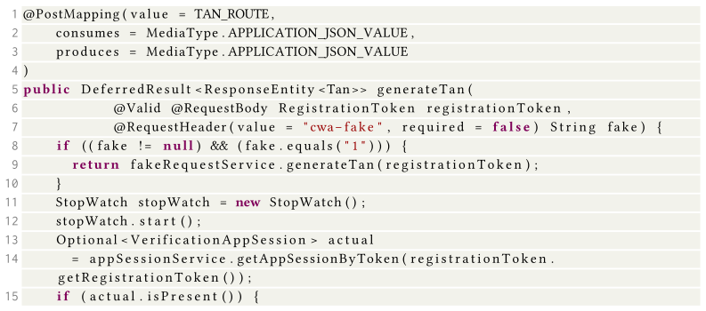

**Рисунок 3:** Фрагмент функции из класса ExternalTanController в API cwa-verification.

Во-первых, на рисунке 3 представлен фрагмент кода для одного из обработчиков эндпоинта (а именно `ExternalTanController`, однако та же проблема возникает и в `ExternalTestStateController` и `InternalTanController`). В данном случае условие `actual.isPresent()` никогда не выполняется, что приводит к пропуску значительной части кода. В качестве входных данных предоставляется токен как часть тела запроса, после чего в базе данных осуществляется поиск записи, соответствующей этому токену. Однако ни одной записи не обнаружено, и EvoMaster не может создать её напрямую. Теоретически подобный случай должен был бы легко обрабатываться при поддержке SQL [[32](#ref-32)], однако этого не произошло. Причина заключается в специфических свойствах такого токена. Этот тип токена имеет заданное ограничение в схеме OpenAPI:

```json
"registrationToken": {
  "pattern": "^[a-f0-9]{8}-[a-f0-9]{4}-4[a-f0-9]{3}-[89aAbB][a-f0-9]{3}-[a-f0-9]{12}$",
  "type": "string"
}
```

В результате длина токена составляет 36 символов. EvoMaster без проблем генерирует строки, соответствующие такому регулярному выражению, в том числе строку `bfe8b80b-dca1-458d-B312-96ecae446be0`. Однако подобное ограничение отсутствует в базе данных SQL, где столбец для этих токенов просто объявляется следующим образом:

```yaml
- column:
    name: registration_token_hash
    type: varchar(64)
```

Когда EvoMaster записывает данные непосредственно в базу данных, это будут случайные строки, которые не удовлетворяют такому регулярному выражению. Опять же, это не должно быть проблемой благодаря taint-анализу (анализу помеченных данных) [[33](#ref-33)]. Причина, по которой это не работает, заключается в длине строки, которая составляет 36 символов. По умолчанию EvoMaster не генерирует случайные строки, содержащие более 16 символов. Даже если бы с помощью taint-анализа мы могли бы внедрить правильную строку в базу данных, в настоящее время этого не происходит, поскольку 36 больше 16.

Отметим, что наличие ограничения на длину строк является существенным. Выборка случайных строк без ограничения длины, содержащих миллиарды символов, приводила бы к слишком многим негативным побочным эффектам. Выбор значения 16 является произвольным: оно могло быть выше или ниже. Тем не менее независимо от выбранного ограничения, системе SUT могут потребоваться строки, длина которых превышает такое ограничение, как это происходит в данном случае для cwa-verification.

Решение этой проблемы заключается в разграничении двух различных ограничений максимальной длины: жёсткого, которое никогда не должно нарушаться (например, ограничение в схемах OpenAPI или SQL), и мягкого (например, 16). Мягкое ограничение будет применяться при выборке случайных строк, но в некоторых конкретных обстоятельствах (например, при taint-анализе) оно может быть нарушено.

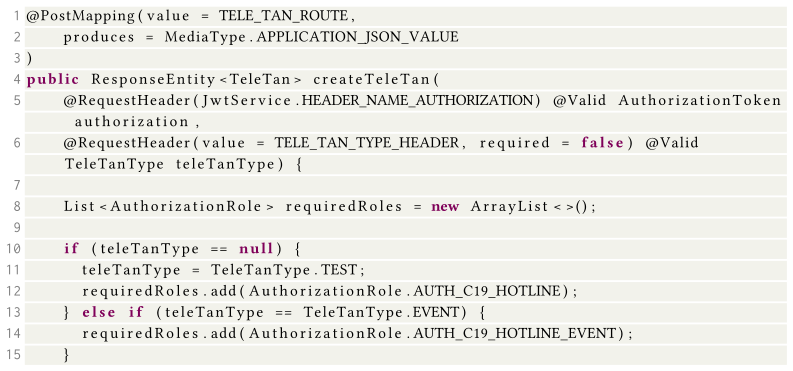

**Рисунок 4:** Фрагмент функции из класса InternalTanController в API cwa-verification.

Второй интересный случай, который следует рассмотреть, представлен в обработчике эндпоинта InternalTanController, как показано на рисунке 4. Здесь в качестве входных данных может быть предоставлен HTTP-заголовок со значением `TELE_TAN_TYPE_HEADER="X-CWA-TELETAN-TYPE"`. Однако такая информация отсутствует в схеме OpenAPI. Следовательно, объект `teleTanType` всегда имеет значение null. Это пример недостаточно специфицированной схемы.

### A.3 cyclotron

В случае API cyclotron различие между тестированием по методу белого ящика и серого ящика незначительно. Существуют как минимум три основных вопроса, заслуживающих обсуждения.

Во-первых, значительный объём кода исполняется только при включении некоторых параметров конфигурации. Однако по умолчанию они отключены (например, `config.analytics.enable` и `config.enableAuth` в `config.js`). Весь код, связанный с данными функциональными возможностями, не может быть протестирован посредством REST-эндпоинтов.

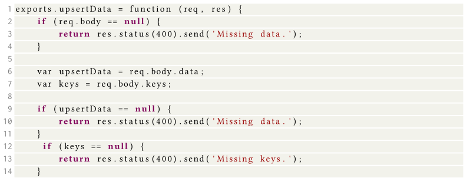

**Рисунок 5:** Фрагмент функции из файла api.data.js в API cyclotron для эндпоинта /data/{key}/upsert.

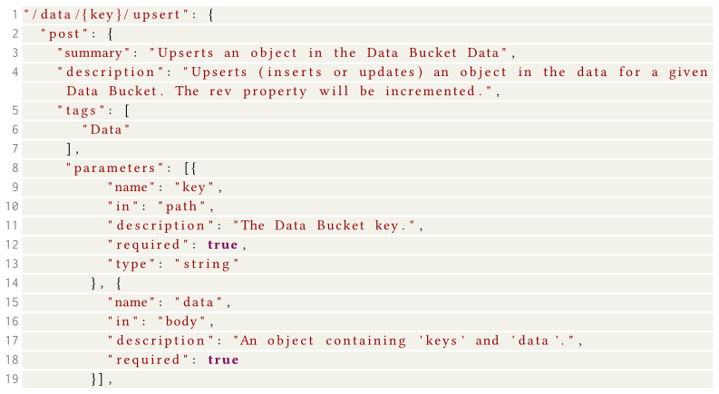

**Рисунок 6:** Фрагмент схемы OpenAPI для API cyclotron.

Во-вторых, как и для нескольких других API в данном исследовании, представленная здесь схема не является полностью корректной/полной. Например, на рисунке 5 представлен фрагмент обработчика эндпоинта `/data/{key}/upsert`, в котором два поля `data` и `keys` считываются из входного объекта в теле HTTP-запроса. Однако в схеме отсутствует формальное определение этих полей, поскольку они упоминаются лишь в комментарии (см. строку 17 на рисунке 6).

В-третьих, API осуществляет несколько обращений к базе данных MongoDB. Несколько эндпоинтов начинают работу с извлечения данных из базы данных, например, с помощью таких команд, как `Dashboards.findOne({ name: dashboardName })`. В случае отсутствия данных последующий код не выполняется. Однако получить правильный идентификатор (например, `dashboardName` в данном примере) случайно затруднительно. Хотя EvoMaster поддерживает базы данных SQL (т. е. анализ всех выполненных запросов во время выполнения), он не поддерживает MongoDB и NodeJS (т. е. поддержка SQL в настоящее время реализована только для JVM).

### A.4 disease-sh-api

В случае disease-sh-api не наблюдается существенных различий между EvoMaster (как в режиме чёрного, так и белого ящика) и Schemathesis. После анализа сгенерированных тестов достигается практически полное достижимое покрытие, поскольку оставшийся код недостижим через REST-эндпоинты в API.

Во-первых, схема относится только к версии v3 API, однако в исходном коде по-прежнему присутствует вся реализация эндпоинтов для версии v2. На основе информации, содержащейся в схеме, вызвать эти эндпоинты невозможно. Во-вторых, значительная часть кода посвящена извлечению записей о заболеваниях из онлайн-баз данных и их хранению в локальном экземпляре Redis. Однако такой код исполняется только посредством скриптов, а не из REST-эндпоинтов. Следует отметить, что при проведении экспериментов база данных была заполнена выборкой валидных данных, поскольку отсутствует REST-эндпоинт для их добавления.

### A.5 features-service

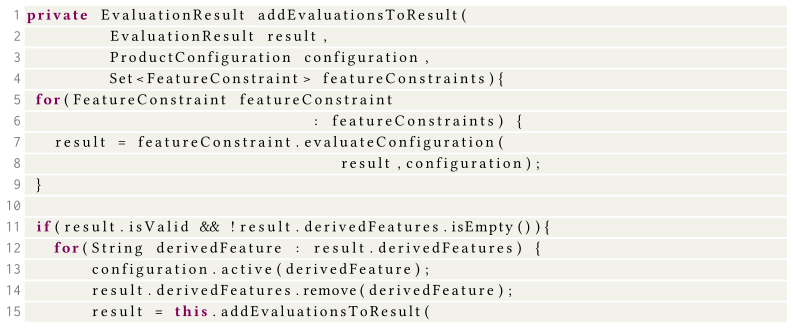

**Рисунок 7:** Фрагмент функции из класса ConfigurationEvaluator в API features-service.

При среднем покрытии строк 81,8% features-service можно считать одним из более простых API. Значительная часть кода не может быть охвачена каким-либо сгенерированным системным тестом, например, геттеры/сеттеры, которые никогда не вызываются, или некоторые функции, которые используются только в написанных вручную модульных тестах. По-прежнему остаются некоторые ветви, не охваченные тестированием, которые связаны со свойствами данных в базе данных. Другими словами, когда метод GET извлекает некоторые данные, отдельные свойства проверяются по одному, но для успешного прохождения всех этих проверок такие данные должны быть предварительно созданы методом POST. На рисунке 7 представлен один из таких случаев, когда код внутри оператора `if` не выполняется. Отслеживание того, как данные базы данных влияют на выполнение потока управления, и определение того, какие операции следует вызывать в первую очередь для создания таких данных, представляют собой проблему, требующую решения.

### A.6 gestaohospital-rest

Для API gestaohospital-rest разница между EvoMaster в режиме белого ящика и EvoMaster в режиме серого ящика незначительна (т. е. среднее покрытие составляет 39,5% против 39,4%; см. таблицу 8). Кроме того, RestTestGen и Schemathesis демонстрируют лучшие результаты, чем EvoMaster (см. таблицу 2).

Одной из специфических характеристик данного API по сравнению с большинством других SUT в нашем эмпирическом исследовании является то, что этот тип API использует базу данных MongoDB. В отличие от баз данных SQL, EvoMaster в режиме белого ящика не поддерживает базы данных NoSQL (такие как MongoDB). Поскольку данный API осуществляет множество взаимодействий с базой данных (например, имеется большое количество вызовов типа `service.findByHospitalId(hospital_id)`), покрытие оказывается незначительным, если такие данные, к которым осуществляется доступ, отсутствуют в базе данных, а эволюционный поиск не имеет градиента для их создания. В этом отношении, по-видимому, RestTestGen и Schemathesis лучше справляются с созданием ресурсов с помощью команд POST и используют созданные таким образом данные для своих последующих запросов GET. Хотя покрытие и довольно высокое, оно не превышает 62,3% (измерено с помощью JaCoCo для Schemathesis), что означает, что остаются некоторые проблемы, которые необходимо преодолеть.

Мы не смогли детально проанализировать выходные данные этих инструментов в интегрированной среде разработки для Java-программы *gestaohospital-rest* (например, с помощью отладчика): RestTestGen генерировал только JSON-файлы с описаниями тестов и не создавал файл JUnit. Выходные данные Schemathesis представлены в YAML для формата VCR-Cassette. Формат VCR-Cassette в основном предназначен для Ruby и Python; реализации на Java для обработки тестов в этом формате, по-видимому, не поддерживались в течение нескольких лет.

### A.7 ind0

API с закрытым исходным кодом *ind0* был предоставлен одним из наших промышленных партнёров. Поэтому мы не можем предоставить для него какой-либо пример кода, но всё же можем обсудить его на высоком уровне. Данный API представляет собой сервис в архитектуре микросервисов. Хотя по размеру он не особенно велик (см. таблицу 1), это наиболее сложный API в нашем исследовании случая. Ни один фаззер чёрного ящика не достигает более 8,2% покрытия строк, а тестирование методом белого ящика достигает в среднем лишь 18,8%.

Из 20 эндпоинтов все, кроме одного, требуют ввода строк, удовлетворяющих сложному регулярному выражению, однако такая информация отсутствует в схеме OpenAPI. Следовательно, крайне маловероятно, что случайная строка удовлетворит такому ограничению. Кроме того, ограничение выражено в аннотации @, которая обрабатывается фреймворком Spring до выполнения любого из HTTP-обработчиков.

Благодаря taint-анализу EvoMaster может обрабатывать эти случаи [[33](#ref-33)], даже когда ограничения оцениваются в сторонних библиотеках (а не только в бизнес-логике SUT). Тем не менее результаты характеризуются значительной вариабельностью, то есть при среднем покрытии 18,8% стандартное отклонение составляет 7,0, при этом покрытие варьируется от минимума 11,9% до максимума 32,6% (по 10 повторным прогонам эксперимента). EvoMaster удаётся удовлетворить эти ограничения, хотя и не во всех прогонах, поскольку такие строки не только сопоставляются с регулярным выражением, но и дополнительно проверяются на соответствие другим ограничениям. Однако поскольку регулярное выражение абсолютно одинаково для всех этих 19 эндпоинтов и применяется к переменной пути URL с тем же именем, должна существовать возможность разработки стратегий повторного использования такой информации для ускорения поиска вместо решения одних и тех же ограничений каждый раз для каждого эндпоинта. Даже в прогоне с наивысшим покрытием 32,6% многие эндпоинты не покрыты вследствие данной проблемы.

### A.8 js-rest-ncs

Искусственный API *js-rest-ncs* использует функции численных вычислений (например, классификацию треугольников [[25](#ref-25)]) за REST-эндпоинтами. Поскольку это реимплементация *rest-ncs* на JavaScript, для анализа мы обратимся к разделу A.14.

Однако следует отметить, что значения покрытия выше по очень простой причине: получение схемы OpenAPI является частью бизнес-логики API, и для неё вычисляется покрытие кода (поскольку схема находится внутри файла JavaScript в виде строки в объявлении HTTP-эндпоинта). Для Java же схема обрабатывается как JSON-ресурс.

### A.9 js-rest-scs

Аналогично случаю *js-rest-ncs*, *js-rest-scs* представляет собой реимплементацию *rest-scs* на JavaScript, в которой используются функции вычислений на основе строк. Поэтому для анализа мы обратимся к разделу A.16.

Как и в случае *js-rest-ncs*, получение схемы влияет на вычисляемое покрытие кода. Однако для EvoMaster в режиме белого ящика покрытие хуже для *js-rest-scs*, чем для *rest-scs*. Причина довольно проста: поддержка тестирования методом белого ящика кода JavaScript в EvoMaster является гораздо более поздним дополнением [[74](#ref-74)], и в настоящее время поддерживаются не все функции, реализованные для JVM (например, различные формы taint-анализа [[33](#ref-33)]).

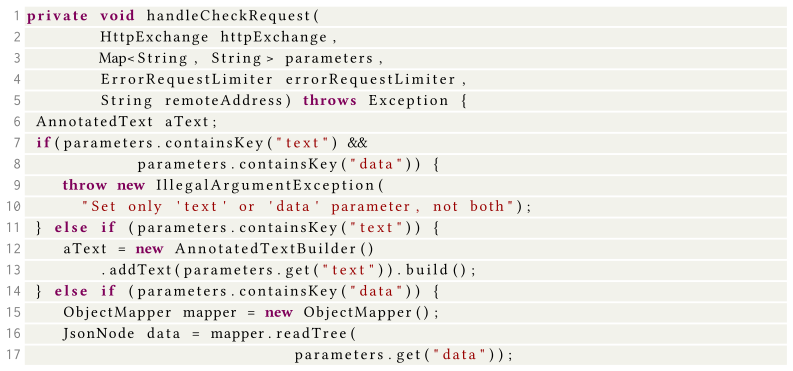

**Рисунок 8:** Фрагмент функции из класса `ApiV2` в API *languagetool*.

### A.10 languagetool

Для API *languagetool* покрытие достигает 39,5%. Это самый крупный и сложный API в нашем исследовании (см. таблицу 1). Это приложение, ограниченное быстродействием процессора (например, без базы данных), выполняющее сложный анализ текста. Данный API имеет только два эндпоинта: `/v2/languages`, который представляет собой простой GET без параметров (и, следовательно, тривиально покрывается одним вызовом), и `/v2/check`, который представляет собой POST с 11 входными параметрами. Однако, исходя из анализа исходного кода `ApiV2.handleRequest`, представляется, что существуют дополнительные эндпоинты, хотя они не указаны в схеме OpenAPI/Swagger. Без обширного анализа данной SUT неясно, какая часть её кода не будет покрыта из-за этой проблемы.

После выполнения от точки входа `/v2/check` имеется несколько пропущенных ветвей, заслуживающих рассмотрения. На рисунке 8 последний оператор завершается сбоем, поскольку метод `mapper.readTree` выбрасывает исключение (и, следовательно, все последующие операторы не могут быть выполнены). В данном случае при получении формы в теле запроса `application/x-www-form-urlencoded` 1 из 11 параметров обрабатывается как JSON-данные (т. е. входное значение с именем `data`). Такая информация записана в схеме в виде комментария, хотя тип зарегистрирован как простая строка. Маловероятно, что случайная строка будет представлять собой валидный JSON-объект.

Другая проблема возникает при входе в класс `TextChecker`. Несколько операторов if ссылаются на входные параметры, которые не определены в схеме, такие как `textSessionId`, `noopLanguages`, `preferredLanguages`, `enableTempOffRules`, `allowIncompleteResults`, `enableHiddenRules`, `ruleValues`, `sourceText`, `sourceLanguage` и `multilingual`. Обработка не полностью определённых схем является серьёзной проблемой для фаззеров, особенно для фаззеров типа «чёрный ящик». Технически такие упущения в схемах можно рассматривать как *дефекты*, которые должны быть исправлены пользователями. Однако схемы можно рассматривать как *документацию*, и проблемы в документации могут иметь более низкий приоритет по сравнению с ошибками в реализации API. Тем не менее, поскольку фаззеры в значительной степени полагаются на такие схемы, более широкое применение фаззеров может изменить отраслевую практику: появятся веские основания своевременно обновлять и исправлять эти схемы.

Поскольку в данной SUT не были охвачены десятки тысяч строк, существует множество других пропущенных ветвей, подробное обсуждение которых представляло бы интерес. Однако неясно, насколько они связаны с вышеупомянутыми проблемами или независимы от них. После решения проблемы обработки не полностью определённых схем важно будет повторно провести эти эксперименты, чтобы выявить оставшиеся основные проблемы.

### A.11 ocvn-rest

Для API *ocvn-rest* при тестировании методом чёрного ящика покрытие достигло 35,3%[^8], что значительно выше, чем 24,8%, достигнутое при тестировании методом белого ящика. Это второй по величине API в нашем исследовании после *languagetool*, исходя из количества LOC. Однако по количеству эндпоинтов он является крупнейшим: их 192[^9]. Ввиду ограниченного объёма невозможно было бы рассмотреть каждый из этих 192 эндпоинтов. Поэтому для анализа достигнутого покрытия мы использовали наборы тестов, сгенерированные как при тестировании белого ящика, так и при тестировании чёрного ящика. В них содержатся сотни тест-кейсов. Даже однократный вызов каждого эндпоинта привёл бы как минимум к 192 HTTP-вызовам в сгенерированных тестах. Учитывая сложность данной SUT, возможно, рекомендуется использовать более крупный бюджет поиска (свыше 1 часа).

Более 35% кодовой базы (пакеты `org.devgateway.ocvn` и `org.devgateway.ocds.persistence`) связаны с работой с базами данных, такими как SQL и MongoDB, однако, по-видимому, такой код не выполняется. Это может произойти, если выполнение в эндпоинте завершится с ошибкой до записи в базы данных или чтения из них (например, из-за валидации входных данных). Определения HTTP-обработчиков в пакете `org.devgateway.ocds.web.rest.controller` занимают более 30% кодовой базы. Однако тесты охватывают только половину (т. е. около 15%). Несколько эндпоинтов (например, в классе `UserDashboardRestController`) не были охвачены, поскольку они требуют аутентификации администратора, которая не была настроена для данных экспериментов (см. обсуждение аутентификации в разделе 4.3[^10]). Класс `CorruptionRiskDashboardIndicatorsStatsController` определяет несколько HTTP-эндпоинтов, но ни один из них не отображается в схеме OpenAPI/Swagger. Следовательно, фаззеры не могут их вызывать.

Около 5% кодовой базы, по-видимому, связано с генерацией диаграмм Excel, однако этот код не покрывается тестами. Все 14 HTTP-эндпоинтов, связанных с этой функциональностью, завершаются с ошибкой в самой первой строке (и, таким образом, значительная часть кодовой базы не выполняется, возможно, намного больше 5%), что является вариацией следующего оператора с различными входными строками в качестве второго параметра:

```
1 final String chartTitle = translationService.getValue(
2         filter.getLanguage(),
3         "charts:cancelledFunding:title");
```

В данном случае язык указывается в качестве входного параметра в HTTP-запросах, а затем сопоставляется с регулярным выражением. Это приводит к сбою вызова `translationService.getValue`, когда значение этого параметра не соответствует регулярному выражению. Тестирование методом белого ящика позволяет проанализировать эти случаи, однако это может оказаться затруднительным для методов чёрного ящика, если информация о таких регулярных выражениях недоступна в схемах OpenAPI/Swagger.

Другая значительная часть кода, которая не охвачена (ещё около 5%), находится в пакете `org.devgateway.ocds.web.spring`. Однако, по-видимому, большая часть этого кода вызывается только фронтендом приложения OCVN (и JAR-файл для *ocvn-rest* не содержит модуля этого типа). С точки зрения HTTP-эндпоинтов это можно считать мёртвым кодом, поскольку он недостижим из этих эндпоинтов.

Может показаться удивительным, что тестирование методом белого ящика даёт значительно худшие результаты, чем тестирование методом серого ящика, с большим отрывом (а именно 10,5%). В задаче комбинаторной оптимизации это может произойти, когда функция пригодности обеспечивает незначительный градиент для поиска или не обеспечивает его вовсе, генерируя так называемые *плато пригодности*. Операторы мутации, которые вносят лишь небольшие изменения в хромосому особи (в данном контексте — эволюционировавшего тест-кейса), будут иметь меньшие шансы избежать таких локальных оптимумов. EvoMaster располагает некоторыми продвинутыми механизмами для решения этих случаев, такими как *адаптивная гипермутация* [[70](#ref-70)]. Однако этого было недостаточно для обработки *ocvn-rest*.

Проблема здесь заключается в том, что большинство эндпоинтов принимают в качестве входных данных JSON-объект, при этом необходимо соблюдать несколько ограничений. Однако эти ограничения оцениваются не в бизнес-логике SUT, а в сторонней библиотеке. Эти ограничения не указаны в схеме OpenAPI. На рисунке 9 представлен пример, в котором входные JSON-данные преобразуются в экземпляр класса YearFilterPagingRequest. Поскольку этот входной параметр помечен аннотацией `@Valid`, его валидность оценивается перед вызовом метода `countTendersByYear()`. Если входные данные некорректны, то фреймворк Spring возвращает HTTP-ответ с кодом состояния 400 (т. е. ошибка пользователя), не вызывая метод countTendersByYear().

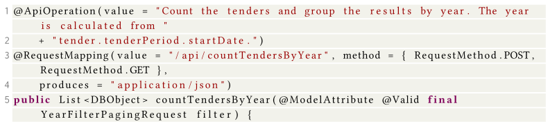

**Рисунок 9:** Фрагмент функции из класса `CountPlansTendersAwardsController` в API *ocvn-rest*.

Как показано на рисунке 10, класс `YearFilterPagingRequest` содержит девять полей, для которых объявлены ограничения `javax.validation`. Для признания всего объекта некорректным достаточно нарушить только одно из девяти ограничений. Поскольку ограничения оцениваются в сторонней библиотеке, функция пригодности не имеет градиента, который бы направлял поиск на решение всех ограничений. Изучение результатов позволяет сделать вывод о том, что генерация валидных экземпляров случайным образом возможна, хотя и с низкой вероятностью. Однако небольшие мутации в существующем недопустимом экземпляре практически не имеют шансов сделать объект допустимым.

Для решения этих проблем можно предложить как минимум три стратегии:

- *Белый ящик*: вычисление функции пригодности для оптимизации покрытия (с использованием различных эвристик поиска) для всего кода, включая сторонние библиотеки, а не только для бизнес-логики тестируемой системы (SUT). Таким образом, будет обеспечен градиент для генерации тестов, в которых код, оценивающий ограничения `@Valid`, возвращает значение true. Хотя это теоретически возможно, данный подход не представляется многообещающим (за исключением случая, когда инструментируется только необходимый код в сторонних библиотеках). В большинстве случаев код бизнес-логики тестируемой системы (SUT) является незначительным по сравнению с исходным кодом всех используемых сторонних библиотек, включая фреймворки приложений, такие как Spring, HTTP-серверы, такие как Tomcat, и ORM-библиотеки, такие как Hibernate. Инструментация всего кода для вычисления расширенных эвристик во всех сторонних библиотеках, вероятно, приведёт к значительным потерям производительности. Это особенно относится ко всему коду, который выполняется перед бизнес-логикой (например, распаковка входящих HTTP-запросов).
- *Белый ящик*: нативная поддержка `@Valid` в функции пригодности путём создания расстояния между ветвями для каждого поля с целью минимизации расстояния для всех полей. Различные расстояния между ветвями могут быть вычислены для различных ограничений, являющихся частью стандарта `javax.validation` (например, `javax.validation.constraints.Min`). Для каждой аннотации `@Valid` в бизнес-логике тестируемой системы (SUT) может быть создан новый тестовый целевой объект (для оптимизации). Однако одна из основных проблем здесь заключается в том, что `javax.validation` позволяет создавать пользовательские аннотации ограничений. Это, например, относится к `@EachPattern` и `@EachRange`, используемым на рисунке 10.
- *Чёрный ящик*: даже если в схеме OpenAPI отсутствует информация об ограничениях полей, в схеме можно обнаружить, что один и тот же тип объекта используется в качестве входных данных более чем в одном эндпоинте. Если в этом случае для эндпоинта сложно создать валидный экземпляр, возможной стратегией может быть повторное использование в качестве входных данных экземпляра, созданного для другого эндпоинта, при вызове которого был возвращён код состояния 2xx. Такая сложность может проявляться, например, в том, что все выполненные на данный момент HTTP-вызовы возвращают ответ с кодом состояния HTTP 400. Для этой стратегии требуется, чтобы подходящий экземпляр уже был создан в ходе поиска к данному моменту.

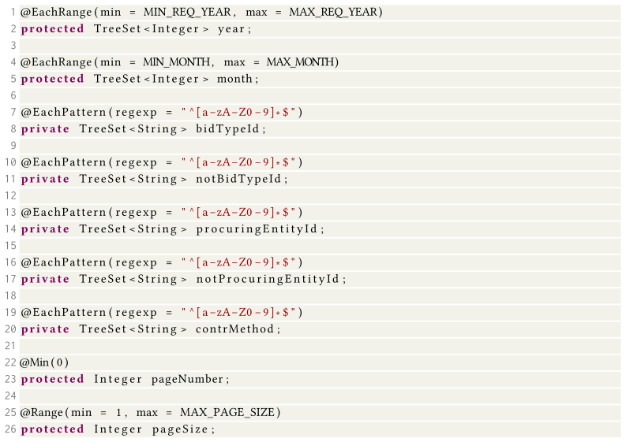

**Рисунок 10:** Все поля с объявленными ограничениями (всего девять) в классе `YearFilterPagingRequest` в API *ocvn-rest*.

### A.12 realworld-app

В API *realworld-app* наблюдается небольшая разница между EvoMaster в режиме чёрного ящика и Schemathesis (инструментация c8: 69,4% против 69,7%), а также между EvoMaster в режимах серого ящика и белого ящика (инструментация EvoMaster без покрытия bootstrap: 24,6% против 24,4%).

Большая часть кода покрыта. Остаются либо недостижимые ветви, либо ветви, связанные с извлечением данных из базы данных (в данном случае MySQL) с некоторыми заданными свойствами. На рисунке 11 представлен один из таких примеров, в котором выполняются три запроса к базе данных на основе двух входных значений: `id` и `slug`. Условие оператора if в конце этого фрагмента кода никогда не выполняется, поскольку оно зависит от этих трёх SQL-запросов. Следует напомнить, что, хотя EvoMaster поддерживает анализ SQL-запросов (который мог бы помочь в данном случае), в настоящее время эта функция доступна только для JVM, но не для NodeJS.

### A.13 proxyprint

Покрытие строк для *proxyprint* достигает 53,3% — приемлемый результат, хотя возможны и дальнейшие улучшения. Некоторые функции в данном API никогда не вызываются, и поэтому их невозможно покрыть, например, методы `sendEmailFinishedPrintRequest` и `sendEmailCancelledPrintRequest` в классе `MailBox`, а также приватные методы `singleFileHandle` и `calcBudgetsForPrintShops` в классе `ConsumerController`. Таким образом, 100%-ное покрытие для данного API невозможно.

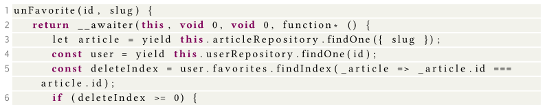

**Рисунок 11:** Фрагмент функции из файла `article.service.js` в API *realworld-app*.

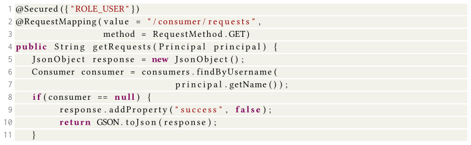

**Рисунок 12:** Фрагмент обработчика функции для эндпоинта `/consumer/request` в *proxyprint*.

В этом API есть ряд различных непокрытых ветвей. Однако обнаружить здесь интересные задачи не так просто. Одна из проблем заключается в том, что количество HTTP-вызовов к этому API невелико, и поэтому при использовании 1-часового бюджета объём фактически выполняемого поиска невелик по сравнению с другими SUT. Например, сгенерированные файлы статистики EvoMaster сообщают в среднем о 37 393 HTTP-вызовах на эксперимент для *proxyprint*, тогда как для *rest-news* это значение составляет 372 733 (т. е. почти в 10 раз больше). Таким образом, многие из этих пропущенных ветвей могли бы быть покрыты, если бы EvoMaster работал в течение более длительного периода времени. Тем не менее представляется весьма маловероятным, что некоторые из этих ветвей будут покрыты даже при использовании более крупных бюджетов поиска. Рассмотрим некоторые из них.

Некоторые из них связаны с аутентификацией. Например, на рисунке 12 код внутри оператора if никогда не выполняется. Для достижения этого оператора необходимо предоставить HTTP-вызов с действительной информацией для аутентификации. Такая информация проверяется по базе данных, когда объект `Principal` инстанцируется фреймворком (в данном случае Spring Security). Информация для аутентификации должна быть доступна при запуске SUT (если только API не имеет возможности регистрировать новых пользователей непосредственно «на лету» из самого API). Следовательно, для решения вопросов безопасности (особенно при использовании хешированных паролей) требуется некоторый инициализационный скрипт (например, для регистрации набора пользователей с действительными данными имени пользователя/пароля). В случае *proxyprint* также создаются некоторые другие данные в других таблицах (например, в таблице `Consumer`). Чтобы обеспечить покрытие ветвления этого типа, фаззер должен найти способ либо создать новых валидных пользователей, либо изменить существующие данные в базе данных (например, EvoMaster может добавлять новые данные, но не изменять существующие [[32](#ref-32)]).

На рисунке 13 представлен пример, в котором строка, определяющая переменную `quantity`, выбрасывает исключение вследствие вызова `Double.valueOf` для входного значения null. В данном случае объект HTTP-запроса передаётся в качестве входных данных конструктору класса `IPNMessage`, который является частью библиотеки PayPal SDK. Внутри библиотеки этого типа вызывается метод `request.getParameterMap()` для извлечения всех параметров HTTP-запроса, которые используются для заполнения объекта map, возвращаемого методом `ipnlistener.getIpnMap()`. Однако поскольку такие параметры считываются динамически во время выполнения, схема OpenAPI/Swagger не располагает информацией о них (для данной SUT схема создаётся автоматически с помощью библиотеки при запуске API). Следовательно, отсутствует информация, позволяющая использовать HTTP-параметр под названием `mc_gross` типа double. Поскольку параметр этого типа используется напрямую без преобразования, преобразования для тестируемости на основе taint-анализа могут решить эту проблему [[33](#ref-33)], однако такие методы необходимо расширить для поддержки `getParameterMap()` и `Map.get`.

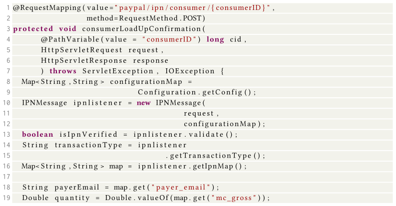

**Рисунок 13:** Фрагмент обработчика функции для эндпоинта `/paypal/ipn/consumer/{consumerID}` в *proxyprint*.

На рисунке 14 представлен ещё один интересный пример, в котором значение строкового поля в JSON-теле запроса используется напрямую для создания экземпляра значения перечисления (т. е. оператор `Item.RingType.valueOf(rti.getRingType())`). Это приводит к сбою, поскольку крайне маловероятно, что случайная строка будет представлять допустимое значение из ограниченного набора. Данную проблему можно решить, предоставив такую информацию в схеме OpenAPI/Swagger (которая поддерживает определение перечислений в полях строкового типа), или также обработав `valueOf()` в перечислении путём расширения методов, описанных в работе Arcuri и Galeotti [[33](#ref-33)], для его поддержки.

Обработчик `calcBudgetForPrintRequest` для эндпоинта `/consumer/budget` никогда не вызывается (и поэтому вся бизнес-логика, связанная с этим эндпоинтом, остаётся непокрытой тестами). Для этого типа эндпоинта в качестве входных данных требуется тело запроса типа `multipart/form-data`, однако в схеме ошибочно указан тип `application/json`. Фаззер, возможно, сможет обработать этот случай автоматически, однако такой случай можно рассматривать как серьёзную проблему в схеме, которую пользователи должны исправить как ошибку в SUT. Другими словами, есть принципиальная разница между непредоставлением *всей* информации (например, отсутствующие ограничения значений перечисления, как в случае `/printshops/{id}/pricetable/rings`) и предоставлением *неверной* информации (т. е. неверный тип тела запроса, как в случае `/consumer/budget`).

### A.14 rest-ncs

На SUT *rest-ncs* тестирование методом белого ящика с использованием EvoMaster в среднем достигает 93%. Анализ непокрытых строк показывает, что они недостижимы (т. е. это мёртвый код). Примером может служить двойная проверка того, является ли значение переменной меньше 0, и возврат ошибки в случае положительного результата. В этом случае невозможно получить истинный результат второй проверки. Следовательно, поскольку максимально достижимое покрытие достигается в каждом отдельном прогоне, данную проблему можно считать *решённой*.

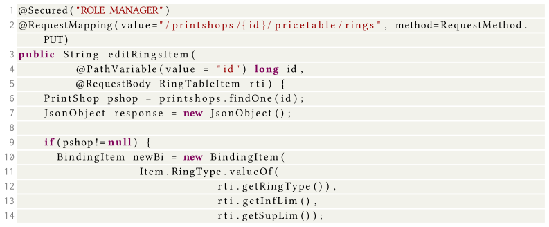

**Рисунок 14:** Фрагмент обработчика функции для эндпоинта `/printshops/id/pricetable/rings` в proxyprint.[^11]

Что касается тестирования чёрного ящика, все фаззеры, за исключением двух, достигают более 50% покрытия строк, при этом Schemathesis достигает 94,1% покрытия (рассчитано с помощью JaCoCo), а RestCT — 85,5% среднего покрытия. Для данного API инструмент тестирования методом чёрного ящика EvoMaster показывает более слабые результаты (т. е. 64,4%).

Это довольно интересное явление, которое в значительной степени зависит от некоторых проектных решений, реализованных в этих фаззерах. Например, некоторые ветвления в данном API зависят от того, равны ли два или более целочисленных входных значения (например, в случае Triangle Classification). При наличии двух 32-битных целых чисел X и Y вероятность того, что X = Y, составляет лишь 1/2^32. В среднем потребуется выборка более 2 миллиардов значений, прежде чем будет получено X = Y. При таких ограничениях фаззеру для тестирования методом чёрного ящика будет довольно сложно покрыть ветвление такого типа, если выборка целочисленных входных значений осуществляется случайным образом. Однако фаззеру не требуется отбирать значения из всего спектра всех возможных целых чисел. Например, он может осуществлять выборку из ограниченного диапазона (например, [−100, 100]). С одной стороны, чем короче диапазон, тем выше вероятность получить X = Y. С другой стороны, короткий диапазон может сделать невозможным покрытие ветвлений, требующих значений за пределами такого диапазона (например, 12 345). Это компромисс, который необходимо принять.

### A.15 rest-news

Для данного API удалось достичь 66,5% покрытия строк. Что касается других SUT, то большая часть недостающего покрытия обусловлена мёртвым кодом, исполнение которого невозможно. Однако имеются некоторые ветвления, которые можно было бы покрыть, но не покрыли. Все они, по-видимому, связаны с одной и той же проблемой, а именно с обновлением существующих данных в базе данных. Базы данных позволяют определять ограничения для своих данных (например, число должно находиться в определённом диапазоне) с помощью таких команд SQL, как `CHECK`. EvoMaster в режиме белого ящика может записывать тестовые данные непосредственно в базы данных SQL [[32](#ref-32)] с учётом всех этих ограничений (поскольку вся эта информация доступна в схеме базы данных). Если какое-либо ограничение не выполняется, то команды SQL `INSERT` завершатся с ошибкой.

Проблема здесь заключается в том, что SUT может определять дополнительные ограничения для таких данных. В проектах на JVM это обычно осуществляется с помощью аннотаций `javax.validation` при использовании библиотек ORM, таких как Hibernate [[9](#ref-9)]. Однако EvoMaster, по-видимому, не справляется с этим и генерирует данные, которые допустимы для базы данных (поскольку все операции `CHECK` проходят успешно, а операции `INSERT` не завершаются с ошибкой), но не соответствуют этим дополнительным ограничениям. Следовательно, в эндпоинте обновления из базы данных могут быть считаны недопустимые (с точки зрения ограничений `javax.validation`) данные, которые затем SUT не сможет записать обратно (поскольку эти ограничения `javax.validation` проверяются при каждой операции записи), когда эндпоинт обновления выполнит свои вычисления.

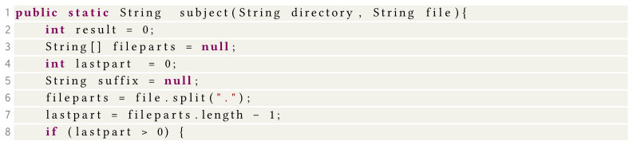

**Рисунок 15:** Фрагмент целевой функции из класса `FileSuffix` в API rest-scs.

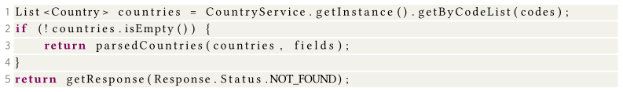

**Рисунок 16:** Фрагмент кода из класса `CountryRestV2` в API restcountries.

### A.16 rest-scs

Покрытие строк для rest-scs достигает 86,2%: тестирование методом белого ящика показывает здесь высокую результативность. Два типа ветвлений не были охвачены: те, которые включают проверки регулярных выражений с помощью `Pattern.matches`, и те, которые включают символ точки («.»). В последнем случае это связано с тем, что EvoMaster не использует этот тип символов при выборке случайных строк, что делает невозможным покрытие оператора `if` на рисунке 15. Может показаться, что это довольно просто исправить. Однако, как только в случайных строках используются специальные символы, при выводе тест-кейсов необходимо проявлять особую осторожность (например, символ `$` имеет особое значение в Kotlin, и при использовании в строках его необходимо экранировать, чего не требуется в Java). Правила экранирования символов могут существенно различаться в зависимости от контекста, в котором эти символы используются в тест-кейсе (например, внутри URL-адреса, внутри JSON-объекта, передаваемого в качестве тела HTTP-запроса, или в данных, вводимых в базу данных SQL). Все эти случаи необходимо обработать, поскольку в противном случае инструменты будут генерировать тест-кейсы, которые не компилируются.

### A.17 restcountries

Для API restcountries достигается высокое покрытие (т. е. 77,1%). Как и в других SUT, присутствует значительное количество мёртвого кода, обусловленного никогда не вызываемыми геттерами/сеттерами и блоками catch для исключений, которые, возможно, не могут быть вызваны посредством тест-кейсов. Класс `StripeRest` представляет собой интересный случай, поскольку он определяет эндпоинт `/contribute`, но информация о нём отсутствует в схеме (и, следовательно, этот тип эндпоинта никогда не вызывается).

На рисунке 16 представлен фрагмент кода, который повторяется несколько раз с небольшими вариациями в нескольких эндпоинтах. В данном случае этот API возвращает список стран на основе различных критериев фильтрации, таких как коды стран. Однако ответ с `NOT_FOUND` никогда не возвращается. Проблема заключается в том, что даже если HTTP-запросы предоставляют недопустимые входные данные (например, несуществующий код страны), список `countries` ошибочно заполняется значениями null, и, таким образом, список никогда не бывает пустым. Это интересный дефект в API, который затем приводит к сбою (т. е. возврату кода состояния 500), поскольку `parsedCountries` выбрасывает исключение. Однако до тех пор, пока этот дефект в API не будет устранён, все эти операторы с `NOT_FOUND` технически представляют собой мёртвый код, который невозможно покрыть тестами.

Аналогично rest-ncs, задачу фаззинга этого API можно считать решённой, по крайней мере, для его текущей неисправной версии.

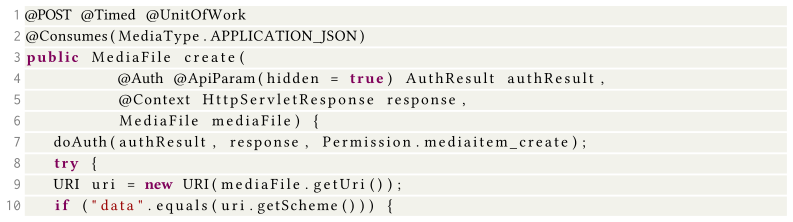

**Рисунок 17:** Фрагмент кода функции `create` из класса `MediaFileResource` в API scout-api.

### A.18 scout-api

На scout-api EvoMaster в режиме белого ящика демонстрирует несколько худшие результаты (53,4% по сравнению с 54,7%), хотя данная разница не является статистически значимой (на основе 10 прогонов). Значительная часть его кодовой базы (более трети) не может быть выполнена. Например, в фоновом режиме scout-api может запустить поток для получения и анализа некоторых данных независимо от REST-эндпоинтов (т. е. весь модуль `data-batch-jobs`). Этот тип потока отключён по умолчанию, и поэтому почти 30% всей кодовой базы не выполняется. Ещё одна заметная часть кодовой базы (около 5%) связана с аутентификацией с использованием OAuth через API Google (scout-api предоставляет различные способы аутентификации).

Значительная часть кодовой базы могла бы быть исполнена, но этого не происходит из-за оператора `if` в начале одного из HTTP-эндпоинтов. Это проиллюстрировано на рисунке 17. Здесь тело входящего JSON-запроса преобразуется в объект `MediaFile`, который содержит строковое поле, обрабатываемое как URI. Большинство случайных строк представляют собой валидный URI, поскольку URI может быть просто именем. Однако крайне маловероятно, что случайная строка будет представлять URI с допустимым компонентом схемы, и поэтому `uri.getScheme()` возвращает значение null. Впрочем, этот случай, вероятно, было бы тривиально решить с помощью taint-анализа (например, путём расширения техник, описанных в работе Arcuri и Galeotti [[33](#ref-33)], для поддержки объектов URI). Однако это не означает, что будет достигнуто значительно более высокое покрытие; оно зависит от всего оставшегося кода, который выполняется после удовлетворения этого предиката.

Даже без анализа кода данный тип проблемы также может быть решён с помощью методов чёрного ящика. Например, в данном API строковое поле, представляющее URI, называется `uri`. Анализ наименований полей может быть использован, чтобы предположить их ожидаемый тип. Например, любое поле, название которого начинается или заканчивается на `uri`, может рассматриваться как фактический URI при генерации данных. Кроме того, некоторые типы довольно распространены в REST API, например строки, представляющие URL-адреса и даты. Вместо полностью случайной выборки строк, возможно, имеет смысл с некоторой вероятностью выбирать строки заданных типов, которые широко используются. Возможно, теперь это будет работать во всех случаях, но данный вопрос заслуживает дальнейшего изучения.[^12]

### A.19 spacex-api

Аналогично realworld-app, в случае spacex-api наблюдается лишь небольшая разница между EvoMaster в режиме чёрного ящика и Schemathesis (инструментация c8: 84,7% против 85,4%). Небольшая разница есть и между EvoMaster в режимах серого ящика и белого ящика (инструментация EvoMaster без покрытия bootstrap: 41,5% против 41,5%, но с Â₁₂ = 0,58). В данном случае на результаты покрытия влияют две основные проблемы.

Во-первых, данный API требует аутентификации, при этом для выполнения каждого эндпоинта API необходимы определённые роли авторизации. Для данных экспериментов в базе данных был создан пользователь с соответствующими учётными данными, а фаззерам была предоставлена информация для авторизации, позволяющая отправлять HTTP-запросы от имени этого пользователя. Настройка этого пользователя была выполнена вручную с помощью скрипта. Однако после проведения экспериментов и анализа сгенерированных тестов мы обнаружили, что некоторые роли авторизации отсутствовали (например, `capsule:create`). В связи с этим несколько эндпоинтов не были охвачены из-за неправильной конфигурации аутентификации.

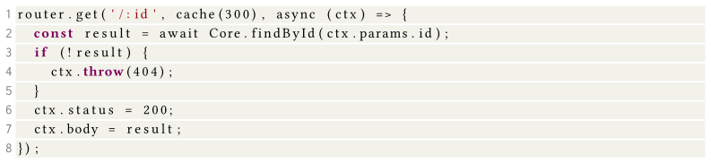

**Рисунок 18:** Фрагмент обработчика для эндпоинта `GET /cores/:id` в API spacex-api.

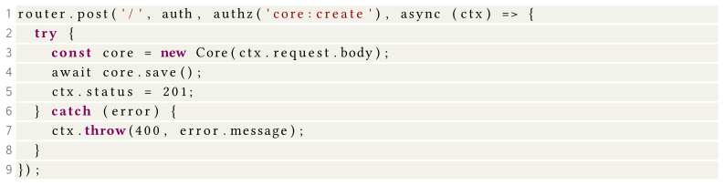

**Рисунок 19:** Фрагмент обработчика для эндпоинта `POST /cores` в API spacex-api.

Вторая основная проблема связана с базой данных. На рисунке 18 представлен пример, в котором выполняется поиск записи по идентификатору. Ни один тест, сгенерированный EvoMaster, не смог осуществить вызов, который возвращал бы код состояния HTTP 200. При тестировании методом белого ящика EvoMaster не может этого сделать, поскольку не способен анализировать запросы к базам данных MongoDB. Даже при тестировании чёрного ящика возможно создание новой записи с помощью метода POST и использование её идентификатора для последующего метода GET. Фаззеры могут использовать информацию такого рода для создания последовательностей HTTP-вызовов, в которых идентификаторы связаны. Однако всё зависит от того, как определена эта связь.

На рисунке 19 представлена реализация эндпоинта `POST` для создания записи данного типа. EvoMaster без проблем полностью покрывает код такого эндпоинта и создаёт валидные записи. Кроме того, EvoMaster применяет различные стратегии для связывания эндпоинтов, которые управляют одними и теми же ресурсами [[29](#ref-29), [75](#ref-75)]. Однако они основаны на зарегистрированных взаимодействиях с базой данных (что для NodeJS и MongoDB здесь не реализовано) и на передовых практиках проектирования REST API. Например, рекомендуется, чтобы методы POST для коллекций ресурсов (например, `/cores`) создавали новый ресурс, идентификатор которого (выбранный на сервере, чтобы гарантировать его уникальность, если это не UUID) присутствовал в HTTP-заголовке `location` ответа (например, `location: /cores/42`). EvoMaster может использовать эти заголовки `location` для создания запросов `POST`, за которыми следует соответствующий связанный запрос `GET`.

Однако в данном API реализация метода POST на рисунке 19, по-видимому, не соответствует передовым практикам проектирования REST API. Например, она не задаёт заголовок `location` в ответе и не возвращает сгенерированный идентификатор (например, в теле ответа). Тем не менее API такого типа всё ещё можно протестировать, выполнив следующие действия. Сначала нужно создать новый ресурс с помощью метода `POST /cores`, затем выполнить метод `GET` для всей коллекции (т. е. `GET /cores`), а затем извлечь поля идентификатора из этого ответа, чтобы выполнить вызов `GET /cores/:id` с действительным идентификатором. Обратим внимание, что данный подход предполагает, что коллекция пуста. В противном случае первый метод `POST` даже не требуется. Однако при этом также предполагается, что имя поля, представляющего идентификатор, одинаково (или, по крайней мере, очень схоже) как в теле запроса, так и в параметре пути эндпоинта (чтобы их можно было сопоставить).

## Список литературы

<a id="ref-1"></a>[1] Amazon Gateway API. n.d. Working with REST APIs. Retrieved May 20, 2022 from https://docs.aws.amazon.com/apigateway/latest/developerguide/apigateway-rest-api.html.

<a id="ref-2"></a>[2] GitHub. n.d. APIFuzzer—HTTP API Testing Framework. Retrieved May 23, 2023 from https://github.com/KissPeter/APIFuzzer.

<a id="ref-3"></a>[3] GitHub. n.d. ApiTester. Retrieved May 20, 2022 from https://github.com/opendata-for-all/api-tester.

<a id="ref-4"></a>[4] Nuno Laranjeiro. n.d. bBOXRT. Retrieved May 23, 2023 from https://git.dei.uc.pt/cnl/bBOXRT.

<a id="ref-5"></a>[5] GitHub. n.d. C8. Retrieved May 20, 2022 from https://github.com/bcoe/c8.

<a id="ref-6"></a>[6] GitHub. n.d. EvoMaster. Retrieved May 23, 2023 from https://github.com/EMResearch/EvoMaster.

<a id="ref-7"></a>[7] GitHub. n.d. EvoMaster Benchmark (EMB). Retrieved May 20, 2022 from https://github.com/EMResearch/EMB.

<a id="ref-8"></a>[8] Google Drive. n.d. Introduction to Google Drive API. Retrieved May 20, 2022 from https://developers.google.com/drive/api/v3/about-sdk.

<a id="ref-9"></a>[9] Hibernate. n.d. Hibernate Home Page. Retrieved May 20, 2022 from http://hibernate.org.

<a id="ref-10"></a>[10] JaCoCo. n.d. JaCoCo Home Page. Retrieved May 20, 2022 from https://www.jacoco.org/.

<a id="ref-11"></a>[11] GitHub. n.d. Language-Agnostic HTTP API Testing Tool. Retrieved May 23, 2023 from https://github.com/apiaryio/dredd.

<a id="ref-12"></a>[12] Microsoft. n.d. LinkedIn API. Retrieved May 20, 2022 from https://docs.microsoft.com/en-us/linkedin/.

<a id="ref-13"></a>[13] Swagger. n.d. OpenAPI/Swagger. Retrieved May 23, 2023 from https://swagger.io/.

<a id="ref-14"></a>[14] Reddit. n.d. Reddit API. Retrieved May 20, 2022 from https://www.reddit.com/dev/api.

<a id="ref-15"></a>[15] GitHub. n.d. RestCT. Retrieved May 23, 2023 from https://github.com/GIST-NJU/RestCT.

<a id="ref-16"></a>[16] GitHub. n.d. RESTest. Retrieved May 23, 2023 from https://github.com/isa-group/RESTest.

<a id="ref-17"></a>[17] GitHub. n.d. RESTler. Retrieved May 23, 2023 from https://github.com/microsoft/restler-fuzzer.

<a id="ref-18"></a>[18] GitHub. n.d. RestTestGen. Retrieved May 23, 2023 from https://github.com/SeUniVr/RestTestGen.

<a id="ref-19"></a>[19] Schemathesi. n.d. Command Line Interface. Retrieved May 23, 2023 from https://schemathesis.readthedocs.io/en/stable/cli.html.

<a id="ref-20"></a>[20] Schemathesis. n.d. Schemathesis: Property-Based Testing for API Schemas. Retrieved May 23, 2023 from https://schemathesis.readthedocs.io/.

<a id="ref-21"></a>[21] GitHub. n.d. Tcases for OpenAPI: From REST-ful to Test-ful. Retrieved May 23, 2023 from https://github.com/Cornutum/tcases/tree/master/tcases-openapi.

<a id="ref-22"></a>[22] Twitter Developer Platform. n.d. Twitter API. Retrieved May 20, 2022 from https://developer.twitter.com/en/docs/twitter-api.

<a id="ref-23"></a>[23] WireMock. n.d. WireMock Home Page. Retrieved May 20, 2022 from https://wiremock.org/.

<a id="ref-24"></a>[24] Nasser Albunian, Gordon Fraser, and Dirk Sudholt. 2020. Causes and effects of fitness landscapes in unit test generation. In Proceedings of the 2020 Genetic and Evolutionary Computation Conference (GECCO’20). 1204–1212.

<a id="ref-25"></a>[25] A. Arcuri. 2009. Full theoretical runtime analysis of alternating variable method on the triangle classification problem. In Proceedings of the International Symposium on Search Based Software Engineering (SSBSE’09). 113–121.

<a id="ref-26"></a>[26] A. Arcuri. 2009. Insight knowledge in search based software testing. In Proceedings of the 2009 Genetic and Evolutionary Computation Conference (GECCO’09). 1649–1656.

<a id="ref-27"></a>[27] Andrea Arcuri. 2017. RESTful API automated test case generation. In Proceedings of the IEEE International Conference on Software Quality, Reliability, and Security (QRS’17). IEEE, Los Alamitos, CA, 9–20.

<a id="ref-28"></a>[28] Andrea Arcuri. 2018. EvoMaster: Evolutionary multi-context automated system test generation. In Proceedings of the IEEE International Conference on Software Testing, Verification, and Validation (ICST’18). IEEE, Los Alamitos, CA.

<a id="ref-29"></a>[29] Andrea Arcuri. 2019. RESTful API automated test case generation with EvoMaster. ACM Transactions on Software Engineering and Methodology 28, 1 (2019), 3.

<a id="ref-30"></a>[30] Andrea Arcuri. 2020. Automated black-and white-box testing of RESTful APIs with EvoMaster. IEEE Software 38, 3 (2020), 72–78.

<a id="ref-31"></a>[31] A. Arcuri and L. Briand. 2014. A hitchhiker’s guide to statistical tests for assessing randomized algorithms in software engineering. Software Testing, Verification and Reliability 24, 3 (2014), 219–250.

<a id="ref-32"></a>[32] Andrea Arcuri and Juan P. Galeotti. 2020. Handling SQL databases in automated system test generation. ACM Transactions on Software Engineering and Methodology 29, 4 (2020), 1–31.

<a id="ref-33"></a>[33] Andrea Arcuri and Juan P. Galeotti. 2021. Enhancing search-based testing with testability transformations for existing APIs. ACM Transactions on Software Engineering and Methodology 31, 1 (2021), 1–34.

<a id="ref-34"></a>[34] Andrea Arcuri, Juan Pablo Galeotti, Bogdan Marculescu, and Man Zhang. 2021. EvoMaster: A search-based system test generation tool. Journal of Open Source Software 6, 57 (2021), 2153.

<a id="ref-35"></a>[35] Andrea Arcuri, ZhangMan, asmab89, Bogdan, Amid Gol, Juan Pablo Galeotti, Seran, et al. 2022. EMResearch/EvoMaster:. https://doi.org/10.5281/zenodo.6651631

<a id="ref-36"></a>[36] Andrea Arcuri, ZhangMan, Amid Golmohammadi, and asmab89. 2022. EMResearch/EMB:. Retrieved May 23, 2023 from https://doi.org/10.5281/zenodo.6106830

<a id="ref-37"></a>[37] Vaggelis Atlidakis, Patrice Godefroid, and Marina Polishchuk. 2019. RESTler: Stateful REST API fuzzing. In Proceedings of the ACM/IEEE International Conference on Software Engineering (ICSE’19). 748–758.

<a id="ref-38"></a>[38] Vaggelis Atlidakis, Patrice Godefroid, and Marina Polishchuk. 2020. Checking security properties of cloud service rest APIs. In Proceedings of the IEEE International Conference on Software Testing, Verification, and Validation (ICST’20). IEEE, Los Alamitos, CA, 387–397.

<a id="ref-39"></a>[39] Asma Belhadi, Man Zhang, and Andrea Arcuri. 2022. Evolutionary-based automated testing for GraphQL APIs. In Proceedings of the 2022 Genetic and Evolutionary Computation Conference (GECCO’22).

<a id="ref-40"></a>[40] Asma Belhadi, Man Zhang, and Andrea Arcuri. 2022. White-box and black-box fuzzing for GraphQL APIs. arXiv:2209.05833 [cs.SE] (2022). https://doi.org/10.48550/ARXIV.2209.05833

<a id="ref-41"></a>[41] Marcel Böhme, László Szekeres, and Jonathan Metzman. 2022. On the reliability of coverage-based fuzzer benchmarking. In Proceedings of the 44th IEEE/ACM International Conference on Software Engineering (ICSE’22). 1621–1633.

<a id="ref-42"></a>[42] José Campos, Yan Ge, Nasser Albunian, Gordon Fraser, Marcelo Eler, and Andrea Arcuri. 2018. An empirical evaluation of evolutionary algorithms for unit test suite generation. Information and Software Technology 104 (2018), 207–235.

<a id="ref-43"></a>[43] Davide Corradini, Amedeo Zampieri, Michele Pasqua, and Mariano Ceccato. 2021. Empirical comparison of black-box test case generation tools for RESTful APIs. In Proceedings of the 2021 IEEE 21st International Working Conference on Source Code Analysis and Manipulation (SCAM’21). IEEE, Los Alamitos, CA, 226–236.

<a id="ref-44"></a>[44] Davide Corradini, Amedeo Zampieri, Michele Pasqua, Emanuele Viglianisi, Michael Dallago, and Mariano Ceccato. 2022. Automated black-box testing of nominal and error scenarios in RESTful APIs. Software Testing, Verification and Reliability 32, 5 (2022), e1808.

<a id="ref-45"></a>[45] Hamza Ed-Douibi, Javier Luis Cánovas Izquierdo, and Jordi Cabot. 2018. Automatic generation of test cases for REST APIs: A specification-based approach. In Proceedings of the 2018 IEEE 22nd International Enterprise Distributed Object Computing Conference (EDOC’18). 181–190.

<a id="ref-46"></a>[46] Patrice Godefroid, Bo-Yuan Huang, and Marina Polishchuk. 2020. Intelligent REST API data fuzzing. In Proceedings of the ACM Symposium on the Foundations of Software Engineering (FSE’20). ACM, New York, NY, 725–736.

<a id="ref-47"></a>[47] Patrice Godefroid, Daniel Lehmann, and Marina Polishchuk. 2020. Differential regression testing for REST APIs. In Proceedings of the 29th ACM SIGSOFT International Symposium on Software Testing and Analysis. 312–323.

<a id="ref-48"></a>[48] Amid Golmohammadi, Man Zhang, and Andrea Arcuri. 2022. Testing RESTful APIs: A Survey. arXiv:2212.14604 (2022). https://doi.org/10.48550/ARXIV.2212.14604

<a id="ref-49"></a>[49] M. Harman and P. McMinn. 2010. A theoretical and empirical study of search based testing: Local, global and hybrid search. IEEE Transactions on Software Engineering 36, 2 (2010), 226–247.

<a id="ref-50"></a>[50] Zac Hatfield-Dodds and Dmitry Dygalo. 2022. Deriving semantics-aware fuzzers from web API schemas. In Proceedings of the 2022 IEEE/ACM 44th International Conference on Software Engineering: Companion Proceedings (ICSE-Companion’22). IEEE, Los Alamitos, CA, 345–346.

<a id="ref-51"></a>[51] Yue Jia and Mark Harman. 2011. An analysis and survey of the development of mutation testing. IEEE Transactions on Software Engineering 37, 5 (2011), 649–678.

<a id="ref-52"></a>[52] Stefan Karlsson, Adnan Causevic, and Daniel Sundmark. 2020. QuickREST: Property-based test generation of OpenAPI described RESTful APIs. In Proceedings of the IEEE International Conference on Software Testing, Verification, and Validation (ICST’20). IEEE, Los Alamitos, CA.

<a id="ref-53"></a>[53] Myeongsoo Kim, Qi Xin, Saurabh Sinha, and Alessandro Orso. 2022. Automated test generation for REST APIs: No time to rest yet. In Proceedings of the 31st ACM SIGSOFT International Symposium on Software Testing and Analysis (ISSTA’22). 289–301. https://doi.org/10.48550/ARXIV.2204.08348

<a id="ref-54"></a>[54] Nuno Laranjeiro, João Agnelo, and Jorge Bernardino. 2021. A black box tool for robustness testing of REST services. IEEE Access 9 (2021), 24738–24754.

<a id="ref-55"></a>[55] Yi Liu, Yuekang Li, Gelei Deng, Yang Liu, Ruiyuan Wan, Runchao Wu, Dandan Ji, Shiheng Xu, and Minli Bao. 2022. Morest: Model-based RESTful API testing with execution feedback. In Proceedings of the ACM/IEEE International Conference on Software Engineering (ICSE’22).

<a id="ref-56"></a>[56] David R. MacIver and Zac Hatfield-Dodds. 2019. Hypothesis: A new approach to property-based testing. Journal of Open Source Software 4, 43 (2019), 1891.

<a id="ref-57"></a>[57] Bogdan Marculescu, Man Zhang, and Andrea Arcuri. 2022. On the faults found in REST APIs by automated test generation. ACM Transactions on Software Engineering and Methodology 31, 3 (2022), 1–43.

<a id="ref-58"></a>[58] Alberto Martin-Lopez, Andrea Arcuri, Sergio Segura, and Antonio Ruiz-Cortés. 2021. Black-box and white-box test case generation for RESTful APIs: Enemies or allies? In Proceedings of the 2021 IEEE 32nd International Symposium on Software Reliability Engineering (ISSRE’21). IEEE, Los Alamitos, CA, 231–241.

<a id="ref-59"></a>[59] Alberto Martin-Lopez, Sergio Segura, Carlos Muller, and Antonio Ruiz-Cortés. 2022. Specification and automated analysis of inter-parameter dependencies in web APIs. IEEE Transactions on Services Computing 15, 4 (2022), 2342–2355.

<a id="ref-60"></a>[60] Alberto Martin-Lopez, Sergio Segura, and Antonio Ruiz-Cortés. 2020. RESTest: Black-box constraint-based testing of RESTful web APIs. In Proceedings of the International Conference on Service-Oriented Computing.

<a id="ref-61"></a>[61] Alberto Martin-Lopez, Sergio Segura, and Antonio Ruiz-Cortés. 2021. RESTest: Automated black-box testing of RESTful web APIs. In Proceedings of the ACM International Symposium on Software Testing and Analysis (ISSTA’21). ACM, New York, NY, 682–685.

<a id="ref-62"></a>[62] A. Giuliano Mirabella, Alberto Martin-Lopez, Sergio Segura, Luis Valencia-Cabrera, and Antonio Ruiz-Cortés. 2021. Deep learning-based prediction of test input validity for RESTful APIs. In Proceedings of the 2021 IEEE/ACM 3rd International Workshop on Deep Learning for Testing and Testing for Deep Learning (DeepTest’21). IEEE, Los Alamitos, CA, 9–16.

<a id="ref-63"></a>[63] Andy Neumann, Nuno Laranjeiro, and Jorge Bernardino. 2021. An analysis of public REST web service APIs. IEEE Transactions on Services Computing 14, 4 (2021), 957–970.

<a id="ref-64"></a>[64] Sam Newman. 2015. Building Microservices. O’Reilly Media.

<a id="ref-65"></a>[65] Juan Carlos Alonso Valenzuela, Alberto Martin-Lopez, Sergio Segura, Jose Maria Garcia, and Antonio Ruiz-Cortes. 2023. ARTE: Automated generation of realistic test inputs for web APIs. IEEE Transactions on Software Engineering 49, 1 (2023), 348–363.

<a id="ref-66"></a>[66] Emanuele Viglianisi, Michael Dallago, and Mariano Ceccato. 2020. RESTTESTGEN: Automated black-box testing of RESTful APIs. In Proceedings of the IEEE International Conference on Software Testing, Verification, and Validation (ICST’20). IEEE, Los Alamitos, CA.

<a id="ref-67"></a>[67] Huayao Wu, Lixin Xu, Xintao Niu, and Changhai Nie. 2022. Combinatorial testing of RESTful APIs. In Proceedings of the ACM/IEEE International Conference on Software Engineering (ICSE’22).

<a id="ref-68"></a>[68] Xusheng Xiao, Sihan Li, Tao Xie, and Nikolai Tillmann. 2013. Characteristic studies of loop problems for structural test generation via symbolic execution. In Proceedings of the 2013 28th IEEE/ACM International Conference on Automated Software Engineering (ASE’13). IEEE, Los Alamitos, CA, 246–256.

<a id="ref-69"></a>[69] Xusheng Xiao, Tao Xie, Nikolai Tillmann, and Jonathan de Halleux. 2011. Precise identification of problems for structural test generation. In Proceeding of the 33rd International Conference on Software Engineering (ICSE’11). ACM, New York, NY, 611–620.

<a id="ref-70"></a>[70] Man Zhang and Andrea Arcuri. 2021. Adaptive hypermutation for search-based system test generation: A study on REST APIs with EvoMaster. ACM Transactions on Software Engineering and Methodology 31, 1 (2021), Article 2, 52 pages.

<a id="ref-71"></a>[71] Man Zhang and Andrea Arcuri. 2022. Open problems in fuzzing RESTful APIs: A comparison of tools. arXiv preprint arXiv:2205.05325 (2022).

<a id="ref-72"></a>[72] Man Zhang, Andrea Arcuri, Yonggang Li, Yang Liu, and Kaiming Xue. 2023. White-box fuzzing RPC-based APIs with EvoMaster: An industrial case study. ACM Transactions on Software Engineering and Methodology. Published online, February 22, 2023. https://doi.org/10.48550/ARXIV.2208.12743

<a id="ref-73"></a>[73] Man Zhang, Andrea Arcuri, Yonggang Li, Yang Liu, and Kaiming Xue. 2023. White-box fuzzing RPC-based APIs with EvoMaster: An industrial case study. ACM Transactions on Software Engineering and Methodology. Published online, February 22, 2023. https://doi.org/10.1145/3585009

<a id="ref-74"></a>[74] Man Zhang, Asma Belhadi, and Andrea Arcuri. 2022. JavaScript instrumentation for search-based software testing: A study with RESTful APIs. In Proceedings of the IEEE International Conference on Software Testing, Verification, and Validation (ICST’22). IEEE, Los Alamitos, CA.

<a id="ref-75"></a>[75] Man Zhang, Bogdan Marculescu, and Andrea Arcuri. 2021. Resource and dependency based test case generation for RESTful web services. Empirical Software Engineering 26, 4 (2021), Article 76, 61 pages.

Received 12 July 2022; revised 13 April 2023; accepted 19 April 2023

[^1]: https://apis.guru/. Дата обращения: 31 мая 2023 г.

[^2]: https://rapidapi.com/hub. Дата обращения: 31 мая 2023 г.

[^3]: Веб-сайт https://anonymous.4open.science/r/morest-rest-8CAE/ в настоящее время выдаёт ошибку «Действие репозитория истекло».

[^4]: https://github.com/EMResearch/rest-faults.

[^5]: Примечание переводчика. В оригинале нижняя граница покрытия для группы bBOXRT и RestTestGen указана как 41,6%, однако среднее bBOXRT в таблице 2 составляет 41,9%. Расхождение сохраняется в оригинале статьи.

[^6]: Примечание переводчика. В оригинале статьи критерий значимости приведён как «p-значение < 0,05 и Â₁₂ < 0,5». По статистике Варги — Делани значимому превосходству a над b соответствует Â₁₂ > 0,5 — именно такие величины выделены жирным шрифтом в таблицах 6 и 8 (например, 0,82; 0,99; 1,00). Знак неравенства в оригинале, по-видимому, опечатка.

[^7]: Примечание переводчика. В оригинале указан максимум 81,1%. В таблице 8 среднее покрытие строк для features-service при тестировании методом белого ящика составляет 81,8%. Расхождение сохраняется в оригинале статьи.

[^8]: Примечание переводчика. В оригинале эти 35,3% отнесены к тестированию методом чёрного ящика. В таблице 8 величина 35,3% приведена для случайного поиска в режиме серого ящика (RS), а 24,8% — для эволюционного поиска методом белого ящика (WB); в разделе A.11 это же сравнение описано как «белый ящик против серого ящика». По-видимому, в оригинале здесь неточность.

[^9]: Примечание переводчика. В оригинале указано 192 эндпоинта у ocvn-rest. В таблице 1 для этой SUT приведено 258 эндпоинтов. Расхождение сохраняется в оригинале статьи.

[^10]: Примечание переводчика. В оригинале ссылка указывает на раздел 4.3, однако обсуждение аутентификации приведено в разделе 4.2. По-видимому, в оригинале опечатка.

[^11]: Примечание переводчика. В подписи к рисунку 14 путь записан как /printshops/id/pricetable/rings, тогда как в тексте — /printshops/{id}/pricetable/rings. Формы записи различаются в оригинале статьи.

[^12]: Примечание переводчика. В оригинале: “This might now work in all cases, but it is something worthy of investigation.” По-видимому, здесь опечатка: по смыслу ожидается “might not work in all cases” — иначе вторая часть фразы («но это заслуживает дальнейшего изучения») плохо согласуется с первой. Перевод сохраняет буквальное чтение оригинала.
