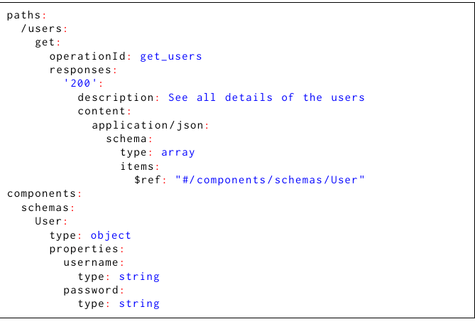

# Конкурс инструментов SBFT 2026: REST League

**Перевод на русский язык:** А. Н. Сенников. Неофициальный перевод; при расхождениях с оригиналом приоритет имеет оригинал. Текст перевода распространяется по лицензии [CC BY 4.0](https://creativecommons.org/licenses/by/4.0/legalcode.ru).

**Оригинальное название:** *SBFT Tool Competition 2026: REST League*

**Публикация:** SBFT ’26, 12–18.04.2026, Рио-де-Жанейро, Бразилия; 5 страниц

**Michele Pasqua ¹, Davide Corradini ², Sofia Mari ¹, Mariano Ceccato ¹**

> ¹ Dept. of Computer Science, University of Verona, Verona, Italy
> ² SnT, University of Luxembourg, Luxembourg, Luxembourg

**Citation:** Michele Pasqua, Davide Corradini, Sofia Mari, and Mariano Ceccato. 2026. SBFT Tool Competition 2026: REST League. In 19th Search-Based and Fuzz Testing Workshop (SBFT ’26), April 12–18, 2026, Rio de Janeiro, Brazil. ACM, New York, NY, USA, 5 pages. https://doi.org/10.1145/3786155.3795704

---

## Аннотация

REST API — основной механизм предоставления доступа к удалённым ресурсам и функциям, позволяющий разнородным программным системам взаимодействовать через интернет по общему интерфейсу. Автоматизированная генерация тестов для REST API ценна тем, что помогает быстро перебирать большое число сценариев выполнения (сокращая ручной труд) и выявлять дефекты, а это ведёт к более надёжным и безопасным системам. Генерировать тесты для REST API трудно: исходный код тестируемой системы, как правило, недоступен из-за микросервисной архитектуры, сторонних библиотек или проприетарных компонентов, и API приходится рассматривать как чёрные ящики.

В этих условиях конкурс REST League призван вовлечь в работу исследовательское сообщество и индустрию, закрепив за генерацией тестов для REST API статус жизненно важного и формирующегося направления программной инженерии. В первом выпуске на оценку в REST League поступило три промышленных инструмента и два исследовательских. Инструменты проверены на наборе реальных REST API; платформой оценки служил RESTgym. В число критериев оценки входят обнаружение дефектов, покрытие операций API, покрытие исходного кода и эффективность тестирования; все эти показатели собираются автоматически средствами RESTgym.

**Ключевые слова:** REST API, тестирование чёрного ящика, конкурс инструментов

---

## 1. Введение

Стремительное распространение веб-API, прежде всего тех, что следуют архитектурному стилю REST (REpresentational State Transfer) [[12]](#ref-12), потребовало разработки надёжных решений для автоматизированного тестирования. Из-за сложности веб-сервисов автоматизированное тестирование REST API ведётся преимущественно методом чёрного ящика: инструменты проверяют корректность и безопасность API, взаимодействуя с ним только по протоколу HTTP, без доступа к исходному коду и метрикам, производным от кода. Как правило, они опираются лишь на формальную документацию. Такая документация имеет вид спецификации OpenAPI [[14]](#ref-14), то есть структурированного файла (YAML или JSON), где указано, как обратиться к сервису по URI, какая схема аутентификации применяется, и приведены подробности всех операций, доступных в API. На рисунке 1 приведён фрагмент спецификации OpenAPI для простого REST API [[11]](#ref-11). В частности, для каждой операции API описаны используемые в запросах входные параметры (и их схема), а также приведена схема ответов. Эти сведения инструменты тестирования используют, чтобы строить последовательности HTTP-запросов и выявлять дефекты или уязвимости в тестируемом API.

**Рисунок 1.** Пример спецификации OpenAPI (фрагмент).

Исследовательских и промышленных инструментов для тестирования REST API методом чёрного ящика существует немало, однако стандартизированных бенчмарков и сравнительных методик, позволяющих объективно оценить их работу, обычно не хватает. REST League[^6] — конкурс инструментов, призванный закрыть этот пробел: он даёт общую площадку, где разные инструменты тестирования запускаются на одном наборе REST API, образующих бенчмарк. Главная цель — стимулировать нововведения в области тестирования REST API и выявить сильные и слабые стороны нынешних передовых стратегий, среди которых тестирование номинальных сценариев, тестирование ошибочных сценариев и фаззинг, ориентированный на безопасность. Конкурс проводится при поддержке исследовательской группы по программной инженерии Университета Вероны[^1]. Эта же группа сопровождает передовое программное обеспечение для тестирования REST API: RestTestGen Framework [[7]](#ref-7) — для быстрой разработки инструментов тестирования REST API методом чёрного ящика; Restats [[6]](#ref-6) — для сбора метрик такого тестирования; RESTgym [[5]](#ref-5) — для оркестрации запуска инструментов тестирования REST API.

В первом выпуске конкурса было подано пять заявок: три инструмента, готовых к промышленному применению, и два исследовательских прототипа. Участники получили указания, как сделать свой инструмент совместимым с инфраструктурой оценки согласно документации RESTgym[^2]. Инструменты оценивались на наборе из 11 REST API разного уровня сложности; состав набора участникам заранее не раскрывался. Каждый инструмент-участник запускался на каждом API несколько раз, чтобы учесть недетерминированное поведение. Оценка велась по трём аспектам работы: обнаружению дефектов, эффективности и результативности тестирования.

---

## 2 Постановка эксперимента

Чтобы сравнение было честным и всесторонним, REST League опирается на стандартизированную инфраструктуру оценки: в частности, средой управляет RESTgym [[5]](#ref-5), а метрики вычисляет Restats [[6]](#ref-6). Условия оценки складываются из перечисленных ниже компонентов.

### 2.1 API бенчмарка

Инструменты оценивались на наборе разнородных REST API — 11 исследований случая, в сумме 317 операций. В набор вошли 5 API из RESTgym, уже рассматривавшихся в литературе, и 6 API, взятых из GitHub и в прежних работах не использовавшихся. Исследования случая различаются по сложности, предметной области и качеству спецификаций OpenAPI. Сведения об API, использованных в конкурсе, приведены в таблице 1: там указано число строк исходного кода и число задокументированных операций для каждого API[^3].

**Таблица 1.** Сведения о REST API, использованных в конкурсе.

| API | Строк кода | Операций | Источник |
|---|---:|---:|---|
| `blog` | 1 188 | 52 | RESTgym [[24]](#ref-24) |
| `erc20` | 1 161 | 13 | GitHub [[26]](#ref-26) |
| `feature-service` | 1 489 | 18 | RESTgym [[24]](#ref-24) |
| `flight-search` | 11 368 | 40 | GitHub [[21]](#ref-21) |
| `gestao-hospital` | 2 652 | 20 | GitHub [[25]](#ref-25) |
| `kafka-rest-proxy` | 71 496 | 50 | GitHub [[3]](#ref-3) |
| `market` | 8 302 | 13 | RESTgym [[24]](#ref-24) |
| `notebook-manager` | 634 | 5 | GitHub [[2]](#ref-2) |
| `person-controller` | 913 | 12 | RESTgym [[24]](#ref-24) |
| `pet-clinic` | 6 930 | 35 | GitHub [[22]](#ref-22) |
| `poject-tracking-system`[^6] | 4 072 | 59 | RESTgym [[24]](#ref-24) |

### 2.2 Метрики оценки

Работа инструментов измерялась несколькими количественными метриками. Покрытие исходного кода показывает, какая часть внутренней логики API была задействована; покрытие спецификации — какая часть документации API (то есть спецификации OpenAPI) была задействована; обнаружение дефектов — сколько уникальных дефектов выявлено. Для оценки результативности инструментов собирались следующие метрики.

- **Покрытие ветвей**[^7] — процент покрытых ветвей исходного кода.
- **Покрытие строк** — процент покрытых строк исходного кода.
- **Покрытие методов** — процент покрытых методов исходного кода.
- **Покрытие операций** — абсолютное число операций, перечисленных в спецификации и успешно протестированных с кодом состояния 2XX [[17]](#ref-17).
- **Обнаружение дефектов** — абсолютное число вызванных уникальных сбоев на стороне сервера, то есть тестовых взаимодействий, которые вернули код состояния 5XX с уникальным сообщением об ошибке[^4].

Кроме того, мы оценили эффективность инструментов, измерив, как перечисленные метрики меняются во времени. Инструмент, достигающий высокой результативности за меньшее время, считается более эффективным. Поэтому мы также собирали следующие метрики эффективности.

- **AUC покрытия ветвей** — площадь под кривой, описывающей изменение покрытия ветвей в пределах часового бюджета времени.
- **AUC покрытия строк** — площадь под кривой, описывающей изменение покрытия строк в пределах часового бюджета времени.
- **AUC покрытия методов** — площадь под кривой, описывающей изменение покрытия методов в пределах часового бюджета времени.
- **AUC покрытия операций** — площадь под кривой, описывающей изменение покрытия операций в пределах часового бюджета времени.
- **AUC обнаружения дефектов** — площадь под кривой, описывающей изменение обнаружения дефектов в пределах часового бюджета времени.

Метрики результативности автоматически собирает Restats, встроенный в инфраструктуру оценки RESTgym; метрики эффективности вычислены в ходе апостериорного анализа.

### 2.3 Процедура эксперимента

Инструменты запускались в контейнерах Docker, что обеспечивало изоляцию и воспроизводимость. Оркестрацию запуска инструментов и сбор метрик автоматически выполнял RESTgym. Каждому инструменту отводился фиксированный бюджет времени на генерацию и выполнение тест-кейсов — один час на каждый API. Чтобы снизить смещение из-за недетерминированного поведения инструментов, каждая сессия тестирования выполнялась десять раз, а результаты усреднялись. Инструменты и API конкурса запускались на 128-ядерной машине с 386 ГБ ОЗУ, что позволило вести сессии тестирования параллельно. Для каждого контейнера инструмента резервировалось 8 ядер и 16 ГБ ОЗУ. Машина, использованная в экспериментах, оснащена видеокартой Nvidia RTX 4090.

### 2.4 Инструменты-участники

Чтобы участвовать в конкурсе, инструмент должен был удовлетворять нескольким минимальным требованиям, изложенным в приглашении к участию. Требования таковы: работать по методу чёрного ящика, взаимодействуя с API исключительно через HTTP-запросы на основе предоставленной спецификации OpenAPI, и быть совместимым с RESTgym — инфраструктурой оценки, принятой в конкурсе. Ограничений на использование малых и больших языковых моделей в этом выпуске конкурса мы не вводили. Все заявки, поданные в REST League, этим требованиям удовлетворяли, поэтому к оценке допущены следующие пять инструментов (перечислены в алфавитном порядке).

- **AutoRestTest** — опенсорс-инструмент, объединяющий граф зависимостей семантических свойств, мультиагентное обучение с подкреплением и большие языковые модели для результативного тестирования REST API [[23]](#ref-23).
- **CATS** — опенсорс-инструмент для автоматизированного фаззинга и негативного тестирования REST API; сочетает обширный каталог фаззеров с механизмом самовосстановления, который подстраивает тест-кейсы под изменения в спецификации API [[10]](#ref-10).
- **EvoMaster** — опенсорс-фаззер, основанный на поиске и нацеленный на веб-API, включая REST, GraphQL и RPC [[1]](#ref-1).
- **RESTest** — опенсорс-платформа для тестирования на основе модели; поддерживает генерацию тест-кейсов методом чёрного ящика для REST API [[18]](#ref-18).
- **Schemathesis** — опенсорс-инструмент для автоматизированного тестирования REST API методом чёрного ящика; сочетает тестирование на основе свойств и исследование с учётом состояния [[13]](#ref-13).

В конкурс мы добавили RestTestGen[^6] — опенсорс-инструмент, который при тестировании REST API выстраивает вызовы операций в порядке, заданном графом зависимостей операций, опираясь на зависимости по данным [[8]](#ref-8). Инструмент разработан исследовательской группой по программной инженерии Университета Вероны и уже доступен в RESTgym. RestTestGen добавлен только как базовый уровень сравнения и потому исключён из результатов конкурса.

---

## 3 Эмпирические результаты

Достижения инструмента по разным аспектам тестирования конкурс отмечает значками. Выделены три задачи. В задаче «Обнаружение дефектов» награждаются инструменты, которые выявляют больше сбоев на стороне сервера; в задаче «Результативность» — инструменты с более высокой результативностью (по покрытию исходного кода и спецификации); в задаче «Эффективность» — инструменты с лучшим соотношением результативности и времени тестирования. В итоге присуждаются следующие значки.

- значок **Bug Hunter** — инструменту с лучшей оценкой в задаче «Обнаружение дефектов»;
- значок **Roadrunner** — инструменту с лучшей оценкой в задаче «Эффективность»;
- значок **Gold API Tester** — инструменту с лучшей оценкой в задаче «Результативность»;
- значок **Silver API Tester** — инструменту со второй по величине оценкой в задаче «Результативность».

Инструмент, получивший значок Gold API Tester, также становится абсолютным победителем конкурса. Чтобы присудить значки, мы построили систему оценок на основе собранных метрик тестирования. Оценка в задаче «Обнаружение дефектов» опирается на метрику «Обнаружение дефектов», усреднённую по всем API и нормализованную по Z-оценке [[16]](#ref-16). Оценка в задаче «Эффективность» опирается на метрики «AUC обнаружения дефектов», «AUC покрытия операций» и «AUC покрытия ветвей», усреднённые по всем API и нормализованные по Z-оценке. Оценка инструмента — невзвешенная сумма этих нормализованных метрик. Наконец, оценка в задаче «Результативность» опирается на метрики «Обнаружение дефектов», «Покрытие операций» и «Покрытие ветвей», усреднённые по всем API и нормализованные по Z-оценке. Оценка инструмента — невзвешенная сумма этих нормализованных метрик.

### 3.1 Итоговые оценки

Результаты и итоговые оценки конкурса приведены в таблицах 2, 3 и 4. Для наглядности оценки сдвинуты в область положительных значений. В таблице 2 приведены результаты задачи «Обнаружение дефектов»: значок Bug Hunter получил AutoRestTest, а значит, он превосходит остальные инструменты в провоцировании сбоев на стороне сервера. В таблице 3 приведены результаты задачи «Эффективность»: значок Roadrunner получил AutoRestTest, а значит, его стратегия генерации позволяет исследовать пространство тестов API за меньшее время, чем стратегии соперников. Наконец, в таблице 4 приведены результаты задачи «Результативность»: значок Gold API Tester получил AutoRestTest, а значит, он превосходит остальные инструменты в генерации тест-кейсов, полнее исследующих поведение API. В той же задаче значок Silver API Tester достался EvoMaster — инструменту со вторым по величине результатом тестирования.

**Таблица 2.** Результаты и оценки в задаче «Обнаружение дефектов».

| Инструмент | Обнаружение дефектов | Оценка | Место |
|---|---:|---:|---|
| AutoRestTest | 67,09 | 70,90 | 1 |
| Schemathesis | 24,65 | 49,71 | 2 |
| RestTestGen | 22,90 | 48,83 | — базовый уровень |
| CATS | 21,21 | 47,99 | 3 |
| RESTest | 11,25 | 43,02 | 4 |
| EvoMaster | 4,31 | 39,55 | 5 |

**Таблица 3.** Результаты и оценки в задаче «Эффективность».

| Инструмент | AUC обнаружения дефектов | AUC покрытия операций | AUC покрытия ветвей | Оценка | Место |
|---|---:|---:|---:|---:|---|
| AutoRestTest | 151 490,00 | 60 224,11 | 744,41 | 61,33 | 1 |
| RestTestGen | 57 785,23 | 56 590,65 | 780,10 | 55,07 | — базовый уровень |
| EvoMaster | 14 212,70 | 58 307,26 | 671,54 | 50,85 | 2 |
| Schemathesis | 58 822,56 | 34 539,22 | 707,13 | 50,60 | 3 |
| CATS | 66 760,82 | 27 848,08 | 385,96 | 45,33 | 4 |
| RESTest | 17 972,24 | 8 322,85 | 236,66 | 36,82 | 5 |

**Таблица 4.** Результаты и оценки в задаче «Результативность».

| Инструмент | Обнаружение дефектов | Покрытие операций | Покрытие ветвей | Оценка | Место |
|---|---:|---:|---:|---:|---|
| AutoRestTest | 67,09 | 17,27 | 21% | 61,54 | 1 |
| RestTestGen | 22,90 | 16,33 | 23% | 55,50 | — базовый уровень |
| EvoMaster | 4,31 | 16,73 | 19% | 50,14 | 2 |
| Schemathesis | 24,65 | 10,61 | 20% | 48,48 | 3 |
| RESTest | 11,25 | 10,89 | 18% | 44,75 | 4 |
| CATS | 21,21 | 9,56 | 12% | 39,59 | 5 |

*Замечание об использовании языковых моделей.* Среди инструментов-участников малую языковую модель во время тестирования применяет только один — RESTest, причём локально, на машине, где проводился бенчмаркинг; удалённо обращается к большой языковой модели тоже только один — AutoRestTest. Так, RESTest[^6] использует локально развёрнутую модель Llama 3.2 3B [[20]](#ref-20), а AutoRestTest — модель Gemini 2.5 Flash-Lite [[9]](#ref-9) через прокси OpenRouter[^5].

### 3.2 Доля успешных прогонов

Среди оценённых инструментов было три готовых к промышленному применению (CATS, EvoMaster и Schemathesis) и два исследовательских прототипа (AutoRestTest и RESTest); базовый инструмент (RestTestGen) — тоже исследовательский прототип. При оценке мы отметили, что все инструменты показали высокую долю успешных прогонов. Каждый сумел протестировать все API набора, кроме одного (у разных инструментов — разного). Доля успешных прогонов составила целых 91%[^9].

Подробности таковы. AutoRestTest не смог протестировать API `flight-service`[^8]: инструмент аварийно завершался из-за ошибки при декодировании JSON. CATS при тестировании API `erc20` через несколько минут перестал отправлять запросы. EvoMaster приводил к аварийному завершению контейнера API `feature-service` (аварийное завершение происходит только при использовании этого инструмента). RESTest не смог протестировать API `kafka-rest-proxy` и `flight-search`: инструмент аварийно завершался из-за ошибки, связанной с неподдерживаемым параметром типа «объект» в строке запроса или в пути. Schemathesis не смог протестировать API `pet-clinic`: инструмент аварийно завершался из-за сбоя при разборе шаблона из спецификации API. RestTestGen приводил к аварийному завершению контейнера API `kafka-rest-proxy` (аварийное завершение происходит только при использовании этого инструмента). Все описанные сбои происходили во всех десяти повторениях, что исключает недетерминированное смещение.

---

## 4 Заключительные замечания

REST League — заметный шаг к стандартизации оценки инструментов тестирования REST API. Предлагая прозрачную и строгую схему оценки, конкурс побуждает академическое и промышленное сообщества совершенствовать стратегии автоматизированного тестирования. Полученные в конкурсе наблюдения не только показывают нынешний уровень развития области, но и указывают направления дальнейших исследований, среди которых улучшенная обработка зависимостей между параметрами и более результативное тестирование сложных рабочих процессов REST API с учётом состояния. При всей результативности в провоцировании сбоев на стороне сервера зафиксированное в конкурсе покрытие кода у всех инструментов оказалось относительно низким (ни один не превысил 23%). Это указывает на то, что тестирование чёрного ящика по-прежнему с трудом добирается до глубинной бизнес-логики. Более того, результаты конкурса показывают, что единственный инструмент, использующий большую языковую модель, превосходит остальные инструменты тестирования по всем аспектам оценки. Это позволяет предположить, что способность больших языковых моделей к семантическому рассуждению сегодня превосходит возможности традиционных методов фаззинга (поисковых и основанных на свойствах) по крайней мере в условиях чёрного ящика. Наконец, несмотря на высокую долю успешных прогонов (91% в целом), конкурс показал, что даже передовые и готовые к промышленному применению инструменты подвержены сбоям при работе со сложными API.

*Data availability.* All experiment logs and detailed results are available in the competition replication package [[19]](#ref-19).

## Acknowledgments

We thank the participants for their invaluable contributions and feedback, which support the evolution and maturity of automated testing strategies for REST APIs. Davide Corradini was supported by the Luxembourg National Research Fund under the Industrial Partnership Block Grant (IPBG), ref. IPBG19/14016225/INSTRUCT. This project has received funding from the European Union’s HorizonEurope research and innovation programme under grant agreement No.101070238. Views and opinions expressed are however those of the authors only and do not necessarily reflect those of the European Union. Neither the European Union nor the granting authority can be held responsible for them.

---

[^1]: UniVerSE Lab: https://universe-lab.pages.dev
[^2]: RESTgym: https://github.com/SeUniVr/RESTgym
[^3]: Число строк кода подсчитано онлайн-инструментом https://ghloc.vercel.app на основе репозитория каждого API на GitHub.
[^4]: Сообщение об ошибке считается уникальным, если оно достаточно отличается от остальных сообщений, согласно определению, ранее предложенному в работах [[4]](#ref-4), [[15]](#ref-15).
[^5]: OpenRouter: https://openrouter.ai
[^6]: Примечание переводчика. В оригинале есть и разнобой в написании, и опечатки: *Rest League* наряду с *REST League*, *ResTestGen* наряду с *RestTestGen*, *RESTtest* наряду с *RESTest*, `poject-tracking-system` вместо `project-tracking-system`. В переводе названия приведены к преобладающей форме; идентификатор API в таблице 1 сохранён как в оригинале.
[^7]: Примечание переводчика. В оригинале метрика записана с опечаткой: *Brach Coverage* и *Brach Coverage AUC* в перечне раздела 2.2. В разделе 3 и таблицах 3 и 4 — формы без опечатки: *Branch Coverage* и *Branch Coverage AUC*; в таблице 3 стоит *Branch Coverage AUC*, в таблице 4 — *Branch Coverage*. Речь идёт о покрытии ветвей и площади под кривой его изменения.
[^8]: Примечание переводчика. В оригинале — *flight-service*. В таблице 1 тот же API назван *flight-search*; в этом абзаце он фигурирует и как *flight-service* (у AutoRestTest), и как *flight-search* (у RESTest). Другого API, в имени которого есть *flight*, в наборе нет.
[^9]: Примечание переводчика. В оригинале сказано, что каждый инструмент справился со всеми API, кроме одного, и указана доля успешных прогонов 91%. По перечню ниже это неточно: RESTest не смог протестировать два API (`kafka-rest-proxy` и `flight-search`), а с `kafka-rest-proxy` не справились два инструмента — RESTest и RestTestGen. Кроме того, EvoMaster и RestTestGen приводили к аварийному завершению контейнера API, а не инструмента. Доля 91% получается, если каждый инструмент протестировал 10 API из 11 (90,9%), — именно это обещает формулировка «кроме одного». Поскольку все инциденты повторялись во всех десяти повторениях, пару можно считать либо успешной, либо неуспешной. Если же считать все шесть инструментов, включая базовый RestTestGen, и все семь пар, затронутых перечисленными инцидентами, неуспешными (в том числе два аварийных завершения контейнеров API), получится 59/66 = 89,4%. Это альтернативный подсчёт: оригинал не определяет, учитываются ли в доле базовый инструмент и аварийные завершения контейнеров API.

## Список литературы

[1] Andrea Arcuri. 2019. RESTful API Automated Test Case Generation with EvoMaster. *ACM Trans. Softw. Eng. Methodol.* 28, 1, Article 3 (2019), 37 pages. [doi:10.1145/3293455](https://doi.org/10.1145/3293455)

[2] bird-developer. 2026. A Real World Example for Open API Restful Spring boot Application + Swagger + MySQL + Docker. [https://github.com/birddevelper/NoteBookManager](https://github.com/birddevelper/NoteBookManager)

[3] confluentic. 2026. Confluent REST Proxy for Kafka. [https://github.com/confluentinc/kafka-rest](https://github.com/confluentinc/kafka-rest)

[4] Davide Corradini, Zeno Montolli, Michele Pasqua, and Mariano Ceccato. 2024. DeepREST: Automated Test Case Generation for REST APIs Exploiting Deep Reinforcement Learning. In *Proceedings of the 39th IEEE/ACM International Conference on Automated Software Engineering (ASE ’24)*. Association for Computing Machinery, New York, NY, USA, 1383–1394. [doi:10.1145/3691620.3695511](https://doi.org/10.1145/3691620.3695511)

[5] Davide Corradini, Michele Pasqua, and Mariano Ceccato. 2025. RESTgym: A Flexible Infrastructure for Empirical Assessment of Automated REST API Testing Tools. In *2025 IEEE Conference on Software Testing, Verification and Validation (ICST)*. 757–761. [doi:10.1109/ICST62969.2025.10988956](https://doi.org/10.1109/ICST62969.2025.10988956)

[6] Davide Corradini, Amedeo Zampieri, Michele Pasqua, and Mariano Ceccato. 2021. Restats: A Test Coverage Tool for RESTful APIs. In *2021 IEEE International Conference on Software Maintenance and Evolution (ICSME)*. 594–598. [doi:10.1109/ICSME52107.2021.00063](https://doi.org/10.1109/ICSME52107.2021.00063)

[7] Davide Corradini, Amedeo Zampieri, Michele Pasqua, and Mariano Ceccato. 2022. RestTestGen: An Extensible Framework for Automated Black-box Testing of RESTful APIs. In *2022 IEEE International Conference on Software Maintenance and Evolution (ICSME)*. IEEE, 504–508.

[8] Davide Corradini, Amedeo Zampieri, Michele Pasqua, Emanuele Viglianisi, Michael Dallago, and Mariano Ceccato. 2022. Automated black-box testing of nominal and error scenarios in RESTful APIs. *Software Testing, Verification and Reliability* 32, 5 (2022), e1808. [doi:10.1002/stvr.1808](https://doi.org/10.1002/stvr.1808)

[9] DeepMind. 2026. Introducing 2.5 Flash-Lite, a thinking model for those looking for low cost and latency. [https://deepmind.google/models/gemini/flash-lite](https://deepmind.google/models/gemini/flash-lite)

[10] Endava. 2026. CATS: REST API fuzzer and negative testing tool. [https://endava.github.io/cats](https://endava.github.io/cats)

[11] erev0s. 2026. Vulnerable REST API with OWASP top 10 vulnerabilities for security testing. [https://github.com/erev0s/VAmPI](https://github.com/erev0s/VAmPI)

[12] Roy Thomas Fielding. 2000. Architectural styles and the design of network-based software architectures. University of California, Irvine.

[13] Zac Hatfield-Dodds and Dmitry Dygalo. 2022. Deriving semantics-aware fuzzers from web API schemas. In *Proceedings of the ACM/IEEE 44th International Conference on Software Engineering: Companion Proceedings (ICSE ’22)*. Ass. for Computing Machinery, New York, NY, USA, 345–346. [doi:10.1145/3510454.3528637](https://doi.org/10.1145/3510454.3528637)

[14] OpenAPI Initiative. 2025. OpenAPI Specifications. [https://spec.openapis.org/oas](https://spec.openapis.org/oas)

[15] Myeongsoo Kim, Saurabh Sinha, and Alessandro Orso. 2024. Adaptive REST API Testing with Reinforcement Learning. In *Proceedings of the 38th IEEE/ACM International Conference on Automated Software Engineering (ASE ’23)*. IEEE Press, 446–458. [doi:10.1109/ASE56229.2023.00218](https://doi.org/10.1109/ASE56229.2023.00218)

[16] Erwin Kreyszig, Herbert Kreyszig, and E. J. Norminton. 2011. *Advanced Engineering Mathematics* (tenth ed.). Wiley, Hoboken, NJ.

[17] Alberto Martin-Lopez, Sergio Segura, and Antonio Ruiz-Cortés. 2019. Test coverage criteria for RESTful web APIs. In *Proceedings of the 10th ACM SIGSOFT International Workshop on Automating TEST Case Design, Selection, and Evaluation (A-TEST 2019)*. Association for Computing Machinery, New York, NY, USA, 15–21. [doi:10.1145/3340433.3342822](https://doi.org/10.1145/3340433.3342822)

[18] Alberto Martin-Lopez, Sergio Segura, and Antonio Ruiz-Cortés. 2021. RESTest: automated black-box testing of RESTful web APIs (ISSTA ’21). Association for Computing Machinery, New York, NY, USA, 682–685. [doi:10.1145/3460319.3469082](https://doi.org/10.1145/3460319.3469082)

[19] Michele Pasqua, Davide Corradini, Sofia Mari, and Mariano Ceccato. 2026. Replication package for the SBFT Tool Competition 2026 - REST League. [https://doi.org/10.5281/zenodo.18434145](https://doi.org/10.5281/zenodo.18434145)

[20] Meta Platforms. 2026. Llama 3.2: Revolutionizing edge AI and vision with open, customizable models. [https://ai.meta.com/blog/llama-3-2-connect-2024-vision-edge-mobile-devices](https://ai.meta.com/blog/llama-3-2-connect-2024-vision-edge-mobile-devices)

[21] Rapter1990. 2026. Case Study - Flight Search Api (Java 21, Spring Boot, Mongodb, JUnit, Spring Security, JWT, Docker, AOP, Kubernetes, Prometheus, Grafana, Github Actions (CI/CD), Jenkins). [https://github.com/Rapter1990/flightsearchapi](https://github.com/Rapter1990/flightsearchapi)

[22] spring-petclinic. 2026. REST version of the Spring Petclinic sample application. [https://github.com/spring-petclinic/spring-petclinic-rest](https://github.com/spring-petclinic/spring-petclinic-rest)

[23] Tyler Stennett, Myeongsoo Kim, Saurabh Sinha, and Alessandro Orso. 2025. AutoRestTest: A Tool for Automated REST API Testing Using LLMs and MARL. In *Proceedings of the IEEE/ACM 47th International Conference on Software Engineering: Companion Proceedings* (Ottawa, Ontario, Canada) (ICSE ’25). IEEE Press, 21–24. [doi:10.1109/ICSE-Companion66252.2025.00015](https://doi.org/10.1109/ICSE-Companion66252.2025.00015)

[24] UniVerSE Lab. 2026. RESTgym benchmarking infrastructure. [https://github.com/SeUniVr/RESTgym](https://github.com/SeUniVr/RESTgym)

[25] ValchanOficial. 2026. Code:Nation - Sistema de Gestão Hospitalar. [https://github.com/ValchanOficial/GestaoHospital](https://github.com/ValchanOficial/GestaoHospital)

[26] web3labs. 2026. ERC-20 token standard RESTful service using Spring Boot and web3j. [https://github.com/web3labs/erc20-rest-service](https://github.com/web3labs/erc20-rest-service)
