# Автоматизированное тестирование REST API на основе спецификации

**Перевод на русский язык:** А. Н. Сенников. Неофициальный перевод; при расхождениях с оригиналом приоритет имеет оригинал. Текст перевода распространяется по лицензии [CC BY 4.0](https://creativecommons.org/licenses/by/4.0/legalcode.ru).

**Оригинальное название:** *Automated Specification-Based Testing of REST APIs*

**Публикация:** *Sensors* 2021, 21, 5375

**Ovidiu Baniaș ¹,\*, Diana Florea ¹, Robert Gyalai ¹, Daniel-Ioan Curiac ¹,\***

> ¹ Automation and Applied Informatics Department, Politehnica University of Timisoara, Parvan 2, 300223 Timisoara, Romania
>
> \* Correspondence: ovidiu.banias@aut.upt.ro (O.B.); daniel.curiac@aut.upt.ro (D.-I.C.); Tel.: +40-256-403-211 (O.B.); diana.florea@student.upt.ro (D.F.); robert.gyalai-korpos@student.upt.ro (R.G.)

**Citation:** Baniaș, O.; Florea, D.; Gyalai, R.; Curiac, D.-I. Automated Specification-Based Testing of REST APIs. *Sensors* **2021**, *21*, 5375. https://doi.org/10.3390/s21165375

**Academic Editor:** Giovanni Betta

**Received:** 17 June 2021 · **Revised:** — · **Accepted:** 6 August 2021 · **Published:** 9 August 2021

**Publisher’s Note:** MDPI stays neutral with regard to jurisdictional claims in published maps and institutional affiliations.

**Copyright:** © 2021 by the authors. Licensee MDPI, Basel, Switzerland. This article is an open access article distributed under the terms and conditions of the Creative Commons Attribution (CC BY) license (https://creativecommons.org/licenses/by/4.0/).

---

## Аннотация

Сегодня интерфейсы прикладного программирования с передачей состояния представления (REpresentational State Transfer Application Programming Interfaces, REST API) широко используются в веб-приложениях, поэтому для валидации вызовов API разрабатывается множество тест-кейсов. Мы предлагаем решение, которое автоматизирует генерацию тест-кейсов для REST API на основе их спецификаций. Помимо автоматической генерации тест-кейсов наш подход даёт пользователю возможность влиять на процесс их генерации. Добавляя пользовательское взаимодействие, мы стремимся дополнить автоматическую генерацию тест-кейсов API человеческим опытом тестирования и учётом конкретного контекста. Мы используем последнюю версию OpenAPI 3.x и широкий набор метрик покрытия, чтобы проанализировать функциональность и производительность сгенерированных тест-кейсов, а также нефункциональные метрики — для анализа производительности API. Эксперименты подтвердили результативность и практическую применимость нашего метода.

**Ключевые слова:** тестирование программного обеспечения; тестирование на основе спецификации; автоматическая генерация тест-кейсов; REST API; OpenAPI 3.x

---

## 1. Введение

В эпоху интернета и взаимосвязанности обмен данными и взаимодействие через веб-приложения широко распространены. Веб-приложения взаимодействуют не только со своими пользователями через различные устройства — персональные компьютеры, смартфоны, планшеты, — но и обмениваются информацией с другими приложениями. Чтобы такой обмен между приложениями был корректным, веб-сервисы обычно используют API в качестве основного механизма. Поэтому большой спрос на веб-сервисы и их широкое применение предъявляют высокие требования к качеству этих сервисов, а эффективно обеспечить его позволяет автоматизированное и непрерывное тестирование функциональности и производительности API.

Вскоре после релиза REST [[1]](#ref-1) эта архитектура стала самой популярной при разработке веб-API. Причина столь быстрого распространения в том, что REST API опираются на протокол HTTP и упрощают разработку и сопровождение веб-приложений [[2]](#ref-2), [[3]](#ref-3). В исследовании преимуществ REST API [[2]](#ref-2) отмечается, что они просты в применении и понимании, обеспечивают малое время ответа и поддерживают множество типов данных. Стоит отметить, что REST API — самый востребованный архитектурный стиль API в каталоге API сервиса ProgrammableWeb (https://www.programmableweb.com/news/which-api-types-and-architectural-styles-are-most-used/research/2017/11/26, дата обращения: 6 августа 2021 г.): доля его использования составляет 81,53%. К тому же REST API, по всей вероятности, останутся самым популярным архитектурным стилем API и в последующие годы [[2]](#ref-2).

То, что REST API предпочитают и разработчики, и бизнес, порождает потребность в непрерывном тестировании API, позволяющем поддерживать качество и производительность связанных с ними веб-сервисов. Автоматизация генерации и выполнения тест-кейсов для REST API способна принести большую пользу всей разработке веб-сервиса и обеспечению его качества. Полученный набор тест-кейсов, автоматически сгенерированный по спецификации API, может покрыть больше ситуаций, чем, вероятно, удалось бы при создании тест-кейсов вручную. OpenAPI — самый распространённый язык спецификаций для REST API [[4]](#ref-4), и версия 3.x — последняя из выпущенных. Поскольку возможности существенно расширились по сравнению с версией 2.x, в настоящей работе мы предлагаем процесс генерации тест-кейсов на основе последней версии OpenAPI.

При разработке решения для автоматизированного тестирования на основе спецификации метрики покрытия тест-кейсами оказываются, пожалуй, самыми полезными функциональными дескрипторами: их анализ показывает, какая часть системы проверена сгенерированными тест-кейсами [[4]](#ref-4)–[[6]](#ref-6). В работе [[7]](#ref-7) предложен практический набор критериев покрытия, объединённых в комплексную восьмиуровневую модель покрытия (Test Coverage Model). Модель задаёт разные уровни покрытия, опирающиеся на показатели покрытия кода и обнаружения дефектов. Мы применяем эти критерии покрытия, чтобы оценить и продемонстрировать результативность нашего подхода к автоматической генерации тест-кейсов в реальных условиях.

Подводя итог, перечислим вклад настоящей работы:

- Новая методика генерации тест-кейсов для REST API, опирающаяся на принципы тестирования чёрного ящика. Она включает четыре типа конфигураций генерации тест-кейсов — от полностью автоматизированной генерации до полуавтоматизированной, при которой пользователь сам задаёт значения отдельных параметров, для которых в спецификации OpenAPI не указаны конкретные значения.
- Наш подход сосредоточен главным образом на функциональном тестировании, но включает также проверку одного нефункционального свойства — производительности API. Эта нефункциональная метрика вычисляется как среднее время получения ответа после отправки запроса.
- Анализ широкого набора критериев покрытия: предлагаются критерии, опирающиеся на свойства архитектуры REST и протокола HTTP, отражённые в спецификации OpenAPI. Такой подход призван дать более полную картину сгенерированных тест-кейсов, чтобы лучше изучить их валидность после выполнения.
- В нашем подходе используется OpenAPI версии 3.x — последняя версия спецификации.

Дальнейшее изложение построено так[^1]. В разделе 2 представлены теоретические основы, на которые мы опирались при проектировании и реализации подхода. В разделе 3 изложены смежные работы в области автоматизированного тестирования REST API и подчёркнуты особенности нашего метода. В разделе 4 описан предлагаемый метод и его реализация. В разделе 5 приведён подробный практический пример того, как предложенной процедурой можно пользоваться для автоматической генерации тест-кейсов, вместе с рядом наглядных результатов, подтверждающих обоснованность предложенных методов. В разделе 6 обсуждаются ограничения метода и сформулированы выводы.

## 2. Предпосылки

### 2.1. REST

Передача состояния представления (REpresentational State Transfer, REST) — архитектурная парадигма, применяемая при разработке систем на основе веб-сервисов. Несмотря на широкое применение REST при разработке веб-сервисов, стандартом он пока не стал. Принципы разработки веб-сервисов в REST формулируются через сочетание стандартов, таких как HTTP, JSON и XML. Главная цель REST — улучшить различные нефункциональные свойства веб-системы: производительность, масштабируемость, простоту, надёжность, прозрачность и т. д. На рисунке 1 показано применение REST API в контексте обмена данными между клиентом и веб-сервисом. Веб-приложение или другой клиент отправляет веб-серверу запрос на ресурс. Запрос состоит из URL эндпоинта REST API, метода API (в основном это операции CRUD: `GET`, `PUT`, `POST`, `DELETE`) и параметров. Ответом служит представление ресурса, как правило, в формате JSON или XML.

Коды состояния обозначают тип ответов, получаемых при вызовах REST API поверх HTTP. Код состояния — трёхзначное число: первая цифра обозначает класс (например, 2xx — успешно, 5xx — ошибка сервера и т. д.), последние две — конкретный тип ответа (например, 202 — принято, 401 — требуется аутентификация). Они дают лишь сводную характеристику ответа, а не саму запрашиваемую информацию. Коды состояния важны и полезны при тестировании REST API [[8]](#ref-8). В предлагаемом решении мы опираемся на коды состояния, чтобы генерировать тест-кейсы, покрывающие как успешные, так и неуспешные запросы. Кроме того, сведения из кодов состояния используются далее для расчёта метрики покрытия кодов состояния и анализа её значений.

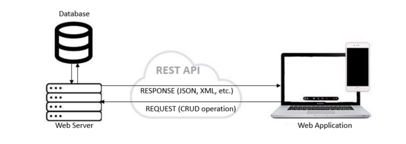

### 2.2. Спецификация OpenAPI 3.0

OpenAPI (ранее — Swagger Specification) — широко используемый язык спецификаций для REST API [[4]](#ref-4). OpenAPI раскрывает возможности и функции веб-сервиса без доступа к его исходному коду. Более того, внешний потребитель может понять, как удалённо взаимодействовать с веб-сервисом, располагая минимальной документацией о нём, написанной на языке спецификаций OpenAPI [[9]](#ref-9). Как правило, OpenAPI задаёт спецификацию REST API в форматах JSON или YAML.

Архитектура OpenAPI включает HTTP-методы — `GET`, `POST`, `PUT`, `DELETE` — и параметры, для которых указаны имя, тип, формат и место использования. Кроме того, спецификация OpenAPI содержит перечень различных ответов, представленных кодами возврата HTTP [[10]](#ref-10).

Недостаток языка спецификаций OpenAPI в том, что он не охватывает зависимости между параметрами. Для веб-сервисов такие зависимости обычны: на отдельные параметры могут накладываться ограничения, сужающие их сочетания либо требующие определённой комбинации параметров для формирования валидного запроса [[11]](#ref-11). Версий OpenAPI несколько; самая используемая — OpenAPI 2.0, тогда как последняя выпущенная — OpenAPI версии 3.x [[4]](#ref-4). Изучив спецификации API, доступные на `APIs.guru` (https://apis.guru/browse-apis/, дата обращения: 6 августа 2021 г.), мы решили использовать спецификации на основе OpenAPI 3.x для реализации и валидации предлагаемого решения.

### 2.3. Тестирование REST API

Тестирование API — важная часть этапа тестирования программного обеспечения: этот уровень тестирования ближе к пользователю и вместе с тем связывает клиент с сервером. Тестирование API особенно важно, чтобы проверить, соответствует ли API ожиданиям по надёжности, производительности и безопасности, а также заданной функциональности в различных сценариях [[4]](#ref-4).

Тестирование REST API может быть непростой задачей, поскольку требует работы с запросами и ответами между клиентом и сервером [[5]](#ref-5). Оно настолько же сложно, насколько сложна предоставляемая бизнес-услуга. В [[12]](#ref-12) перечислен ряд принципов, на которых можно построить стратегию тестирования API. Согласно [[13]](#ref-13), тестирование веб-сервисов делится на шесть основных этапов: валидация WSDL (Web Services Description Language), компонентное тестирование, функциональное тестирование, регрессионное тестирование, нагрузочное тестирование и проверка соответствия стандартам. В предлагаемом решении мы сосредоточены на функциональном тестировании и проверяем, что взаимодействие между сервером и клиентами, а также запросы и ответы соответствуют ожидаемому.

В настоящей работе рассматривается реальная ситуация: сведения о фактической реализации API ограничены тем, что дано в спецификации, а это сужает число и типы тест-кейсов, которые можно реализовать и выполнить. С учётом того, что исходный код веб-приложения недоступен, API тестируется методом чёрного ящика [[5]](#ref-5). Следовательно, применимо прежде всего функциональное тестирование — самый распространённый вид тестирования чёрного ящика. Тестирование чёрного ящика называют также тестированием на основе спецификации, поскольку тестируемая система рассматривается как чёрный ящик с входами и выходами. При тестировании API на основе спецификации тест-кейсы выполняются путём отправки HTTP-запросов к API, а ответы API на эти запросы анализируются и верифицируются на соответствие спецификациям [[4]](#ref-4).

Тестирование на основе дефектов — особый метод тестирования, нацеленный на выявление некорректного поведения тестируемой системы. Его цель — внести в запросы некорректные значения и убедиться, что система отреагирует должным образом и не даст сбоя. Этот метод применим и к API [[4]](#ref-4). Запросы с неверными значениями параметров API отправляются намеренно, чтобы проверить, вернёт ли веб-сервис коды состояния об ошибке. В такой ситуации тест-кейс считается успешным, если система не примет неверные значения.

Опираясь на перечисленные принципы и виды тестирования, мы ориентировали наше решение как на тестирование чёрного ящика, так и на функциональное тестирование. Для наших тест-кейсов мы применили также тестирование на основе дефектов, чтобы покрыть больше сценариев.

### 2.4. Нефункциональное и функциональное тестирование REST API и метрики

Любое программное обеспечение разрабатывается исходя из требований двух типов: функциональных и нефункциональных. Тест-кейсы нефункционального тестирования призваны проверить поведение системы на соответствие задокументированным требованиям и охватывают следующие аспекты: безопасность, доступность, производительность, масштабируемость, совместимость, надёжность, практичность [[14]](#ref-14).

Тестировать нефункциональные свойства REST API непросто, поскольку спецификации API дают о таких свойствах мало сведений. Насколько мы установили, программных инструментов, способных тестировать нефункциональные свойства API, немного: это, например, инструмент из [[15]](#ref-15), а также онлайн-инструменты SOAP UI (https://www.soapui.org/, дата обращения: 6 августа 2021 г.) и Moesif API Analytics (https://www.moesif.com/solutions/track-api-program, дата обращения: 6 августа 2021 г.). Эти инструменты в основном сосредоточены на измерении производительности и доступности (*availability*) операций, описанных в спецификациях API. Мы тоже сосредоточимся на метрике производительности — среднем времени получения ответа.

Функциональное тестирование REST API выполнять проще, чем нефункциональное. В нашем исследовании применяются метрики покрытия, причём запросы к API служат входами, а ответы API — выходами [[7]](#ref-7). Соответственно, в следующих разделах измеряются такие типы критериев покрытия, теоретически представленные в [[7]](#ref-7):

- критерии покрытия входов: покрытие путей, покрытие операций, покрытие параметров, покрытие значений параметров;
- критерии покрытия выходов: покрытие кодов состояния, покрытие свойств тела ответа, покрытие типов содержимого.

Согласно [[7]](#ref-7), перечисленные в предыдущем абзаце критерии покрытия можно упорядочить по восьми уровням покрытия (рисунок 2) — от самого слабого, TCL0, до самого сильного, TCL7. Чтобы достичь конкретного уровня, должны быть выполнены все критерии покрытия предшествующих уровней. Роль этой модели покрытия и её уровней — упорядочить наборы тестов по тому, какая часть функциональности покрыта тест-кейсами.

![Рисунок 2. Модель покрытия: уровни и критерии [7].](images/figure-02.png)

## 3. Смежные работы

Анализируя научную литературу, мы обнаружили несколько подходов и методов тестирования веб-сервисов, в которых тест-кейсы генерируются по спецификациям проекта. Многие из этих работ посвящены веб-API, разработанным по стандарту SOAP. В подходах [[16]](#ref-16), [[17]](#ref-17) тест-кейсы генерируются на основе спецификации с опорой на определения WSDL веб-API на базе SOAP. Метод из [[17]](#ref-17) сосредоточен на тестировании на основе дефектов — одном из наших подходов к тестированию. В [[16]](#ref-16) генерация тест-кейсов по спецификациям опирается главным образом на типы данных различных параметров и на операции, применимые к параметрам API. Подход из [[16]](#ref-16) близок к нашему: мы тоже сосредоточены на тестировании параметров исходя из их типов данных и на тестировании различных операций над параметрами API.

В последние годы для REST API предложено немало методов автоматизации тестирования и генерации тест-кейсов. Это либо подходы чёрного ящика, либо подходы белого ящика. Arcuri предлагает EvoMaster [[18]](#ref-18) — автоматизированный подход к тестированию методом белого ящика, генерирующий тест-кейсы с помощью эволюционного алгоритма. Спецификация API в этом подходе, как и у нас, основана на OpenAPI. Однако это решение для тестирования методом белого ящика, поэтому ему нужен доступ не только к спецификации API, но и к исходному коду: решению из [[18]](#ref-18) требуется байт-код API на языке Java. В последующей работе Zhang et al. [[19]](#ref-19) дорабатывают упомянутый EvoMaster до более сложного решения для генерации тест-кейсов на основе ресурсов, добавляя шаблоны с упорядоченными тестовыми действиями и применяя для генерации тест-кейсов метод на основе поиска.

Методы тестирования чёрного ящика применительно к API используют тогда, когда доступ к исходному коду невозможен и, значит, генерацию тест-кейсов можно автоматизировать только по спецификации API. Chakrabarti и Kumar [[20]](#ref-20) предлагают автоматическую генерацию тест-кейсов для тестирования чёрного ящика (Test-The-Rest), при которой требуется вручную задать модель. Ещё один метод, заслуживающий упоминания, порождает тест-кейсы по спецификации API с помощью опенсорс-инструмента Tcases [[5]](#ref-5). Как и в предлагаемом нами решении, тест-кейсы генерируются по спецификации OpenAPI, а метод их генерации включает комбинаторное тестирование, то есть рассматриваются и валидные, и невалидные значения. Между нашим решением и решением из [[5]](#ref-5) есть существенное различие: Tcases генерирует тест-кейсы на основе модели, ограничиваясь минимальным покрытием требований, тогда как наше решение опирается при генерации тест-кейсов на принципы комбинаторного тестирования и тестирования областей значений, чтобы разнообразие тест-кейсов покрывало как можно больше ситуаций.

Подход RESTler [[21]](#ref-21) близок к нашему: в обоих случаях коды состояния служат одним из главных факторов при оценке результатов тестирования. Но RESTler создавался как инструмент тестирования безопасности для поиска дефектов в REST API, мы же ставим целью проверку различных аспектов REST API, а не только его дефектов.

Ed-douibi [[4]](#ref-4) предлагает ещё один метод генерации тестов на основе спецификации. Наши подходы схожи во многом: OpenAPI как источник спецификации API, использование тестирования на основе дефектов. Кроме того, в предлагаемом решении введены четыре различные конфигурации, позволяющие пользователю выбрать, какие тест-кейсы порождать. Конфигурация *стандартная* (`Standard`) — самая простая и самая близкая к [[4]](#ref-4); она послужила отправной точкой для нашего решения. В остальных трёх конфигурациях используются доступные параметры из спецификации; чтобы сгенерировать тест-кейсы, зависящие от параметров, которые не описаны или не обязательны, может потребоваться ввод пользователя. Помимо этого, мы развили единственный критерий покрытия, использованный в [[4]](#ref-4), проанализировав разные типы покрытия для выполненных тестов.

Ed-douibi [[4]](#ref-4) использует OpenAPI версии 2.0. Мы сосредоточились на более новой версии OpenAPI 3.x, которая получает всё большее распространение и даёт обновлённую структуру документа, включая новые многократно используемые объекты-компоненты и улучшенную схему JSON. Karlsson [[10]](#ref-10) предлагает QuickREST — решение, близкое к нашему, но сосредоточенное на тестировании на основе свойств.

Для тестирования нефункциональных свойств REST API подходов разработано ограниченное число. Есть ряд коммерческих инструментов — например, SOAP UI (https://www.soapui.org/, дата обращения: 6 августа 2021 г.), — предлагающих тестирование нефункциональных свойств API. Однако сосредоточены они в основном на нагрузочном тестировании. В [[15]](#ref-15) представлен фреймворк GADOLINIUM. Он автоматически тестирует такие нефункциональные свойства, как производительность и доступность API. Под влиянием этого подхода мы решили включить нефункциональную метрику производительности наряду с остальными функциональными метриками, главным образом чтобы выяснить, влияет ли на производительность то, в какой конфигурации мы порождаем тесты для API.

Все перечисленные подходы сосредоточены на генерации тест-кейсов по спецификации API, а также на их выполнении для измерения покрытия по критерию. Однако мы считаем, что покрытие в этих подходах можно улучшить. Поэтому мы предлагаем новый подход и даём подробный отчёт по нескольким метрикам покрытия. Более того, наше решение даёт как полностью автоматизированную, так и полуавтоматизированную генерацию тест-кейсов — через четыре конфигурации. В результате у пользователя шире выбор типов порождаемых тест-кейсов, и это отличает наше решение от подходов, описанных в рассмотренных работах. Кроме того, мы стремимся сместить акцент на нефункциональную метрику — производительность. По результатам обзора литературы предлагаемое решение, насколько нам известно, первым объединяет тестирование и измерение как функциональных, так и нефункциональных свойств REST API.

## 4. Предлагаемый подход

Цель нашего подхода — проверить любой REST API, автоматически сгенерировав и выполнив тест-кейсы исключительно по его спецификации OpenAPI. Поскольку сведений о том, как API был реализован, у нас нет, мы придерживаемся принципов тестирования чёрного ящика. Чтобы сделать процедуру генерации тестов более гибкой, мы предложили ввести разные уровни конфигурации, выбираемые пользователем. Чтобы результаты были подробными, мы решили включить в статистику тестирования API несколько критериев покрытия, а также метрику производительности. В следующих подразделах представлены предлагаемый метод, четыре типа доступных конфигураций тестирования и подробное описание самой реализации.

### 4.1. Описание метода

На входе предлагаемое решение принимает либо определение тестируемого API, либо ссылку на определение API в формате JSON. Затем это определение интерпретируется системой. На выходе получается набор специально спроектированных объектов, которые используются в нашей реализации, а также при выполнении тест-кейсов, чтобы инкапсулировать сведения из определения API. Такой объект содержит сведения о числе и типах параметров, о пути, о типе операции и т. д. Схема работы предлагаемого решения, включающая виды деятельности и действия нашей системы, приведена на рисунке 3.

В зависимости от настроек, заданных до запуска, предлагаемая система способна порождать тест-кейсы разных типов:

1. Тест-кейсы с минимальным числом параметров: только те параметры, которые в спецификации OpenAPI тестируемого API помечены как `required`. Свойство `required` — логического типа, и в этом случае его значение должно быть `true`. Если свойство в спецификации отсутствует, по умолчанию считается, что его значение — `false` [[9]](#ref-9).
2. Тест-кейсы с максимальным числом параметров: для генерации тест-кейсов используются все параметры, определённые в спецификации OpenAPI. Свойство `required` игнорируется.
3. Автоматизированные тест-кейсы: ввод от пользователя не требуется, тест-кейсы генерируются автоматически.
4. Частичные тест-кейсы: от пользователя требуется ввод только тогда, когда нужных сведений нет ни в спецификации, ни в определении API. Запрашивая ввод, программа сообщает имя параметра, тип данных, а при наличии — и описание параметра. Обычно в описании параметра приводятся примеры данных или иные сведения о его значениях, хотя в самой спецификации эти сведения явно не заданы. Такой случай показан на рисунке 4: у параметра `cultureCode` в спецификации не задан атрибут `example`, поэтому стандартная реализация отправила бы случайную строку, которую API не принял бы. Пользователь же видит те сведения о параметре, что даны в спецификации, и понимает, какой ввод от него ожидается. Получив ввод пользователя, программа генерирует тест-кейс автоматически.

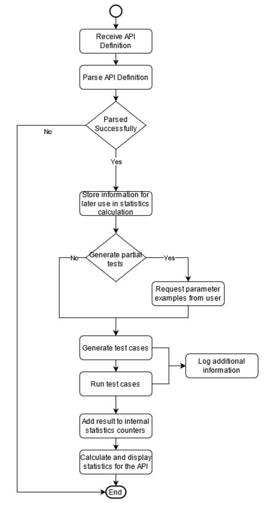

В приведённом примере программа показывает пользователю диалоговое окно, как на рисунке 5. Введённое пользователем значение затем используется в процессе генерации тестов как валидное вместо обычных значений по умолчанию. Поэтому все операции, использующие этот параметр, с большей вероятностью будут работать корректно, что, в свою очередь, упрощает обнаружение настоящих проблем в API. Поскольку один и тот же параметр может использоваться в разных операциях, введённое пользователем значение кэшируется и при необходимости используется повторно.

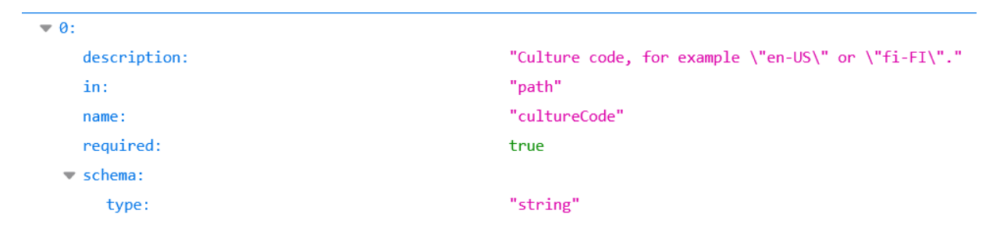

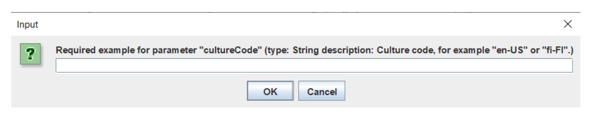

Для генерации тест-кейсов каждому параметру назначается ряд корректных и ошибочных значений в зависимости от типа параметра [[4]](#ref-4). Если спецификация API задаёт параметры со значениями из некоторого интервала, мы применяем принципы тестирования областей значений. Тест-кейс включает выполнение конкретного запроса со всеми возможными комбинациями параметров. Чтобы определить, пройден тест или нет, проверяется, соответствуют ли значения всех параметров требованиям спецификации, предъявляемым к их категории. Если все параметры имеют корректные, согласно спецификации, значения, ожидается успешный ответ с кодом состояния 2xx. Напротив, при тестировании на основе дефектов ожидается ответ с ошибкой, если хотя бы одному параметру присвоено некорректное значение.

Пока тест-кейсы выполняются, данные собираются и сохраняются для последующего использования. По завершении выполнения всех тест-кейсов для этого API рассчитываются метрики и выводится статистика по покрытию и производительности API.

Комбинаторная функция применяется исходя из числа параметров, необходимых для выполнения запроса. Если число возможных комбинаций превышает заданный порог, для получения подходящей комбинации параметров используются специальная функция и метод.

Пусть для операции API задана последовательность из *p* параметров $\{x_1, x_2, \ldots, x_p\}$; тогда для каждого параметра $x_i$ по его типу порождается подмножество значений $V_i = \{v_1, v_2, \ldots\}$. Соответственно, мы генерируем следующее число тест-кейсов:

$$\sum_{i=1}^{p} (card(V_i) - 1) + 1$$

Каждый параметр $x_i$ по очереди принимает все свои возможные значения из множества $V_i$, тогда как у остальных параметров значение остаётся одним и тем же. Когда общее число комбинаций меньше заданного порога или равно ему, используются все возможные комбинации. Итоговое число комбинаций тогда таково:

$$\prod_{i=1}^{p} (card(V_i)).$$

### 4.2. Детали реализации

В этом подразделе описана наша реализация на языке Java в среде Eclipse IDE: разбираются классы, их функциональность и роли. Все зависимости обрабатывались средствами Maven; среди них — плагин Jersey для отправки нужных запросов к API и плагин JSON-Simple от Google, упрощающий обработку входных данных в формате JSON. Приступая к реализации, мы стремились к слабой связанности компонентов, чтобы упростить расширение и сопровождение. Основные компоненты: пользовательский интерфейс, служебные классы (конфигурация и логирование) и бизнес-логика, которая генерирует и запускает тест-кейсы по заданной спецификации. Дальше в этом разделе подробнее рассматривается реализация ядра — бизнес-логики.

Основная часть программы, в свою очередь, делится на два блока: разбор спецификации, а также генерацию и выполнение тест-кейсов. Диаграмма классов предлагаемого решения приведена на рисунке 6. Функциональность и реализация классов с рисунка 6 подробнее разбираются далее.

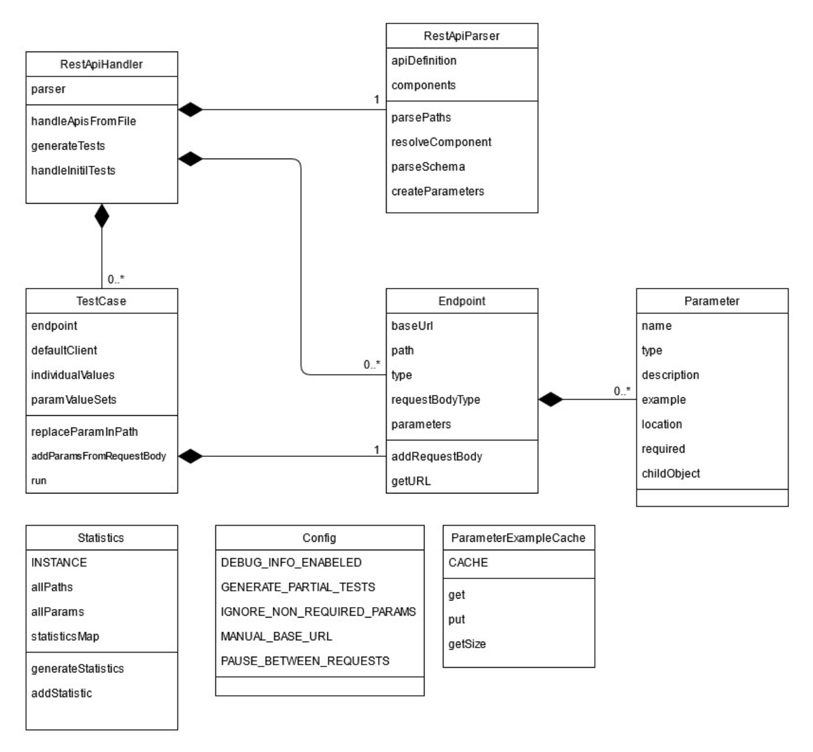

Класс `ApiHandler` получает URL или файл с определением API и затем запускает процесс, используя остальные классы. Класс `ApiParser` читает и разбирает определение API и по завершении выдаёт список объектов `Endpoint`, инкапсулирующих все сведения, которые понадобятся на последующих этапах реализации. Объект `Endpoint` представляет операцию. Для каждого объекта `Endpoint` создаётся объект `TestCase`, и все связанные с операцией тест-кейсы выполняются, после чего статистика рассчитывается и выводится.

Класс `ApiParser` получает на вход спецификацию API в формате JSON. Из этой спецификации он извлекает все данные, нужные для построения объектов `Endpoint` и `Parameter`, и сохраняет нужную статистику. Пример сохраняемых данных — общее число параметров и общее число операций. Для разбора сведений из файла JSON использовалась внешняя библиотека JSON-Simple (https://mvnrepository.com/artifact/com.googlecode.json-simple/json-simple, дата обращения: 6 августа 2021 г.).

И класс `Endpoint`, и класс `Parameter` хранят все данные, нужные для генерации и прогона тест-кейса для конкретной операции. Объект `Endpoint` содержит такие данные, как базовый URL, путь, тип операции, а также список всех параметров, нужных для этой конкретной операции. Каждый объект `Parameter` в этом списке содержит такие данные, как имя, тип параметра, местоположение и т. д.

Класс `TestCase` получает на вход объект `Endpoint`, для которого затем строит проверяемый сценарий. Первый шаг построения — назначить набор значений параметрам, входящим в соответствующий объект `Endpoint`. Параметрам назначаются как валидные, так и намеренно ошибочные значения, поскольку мы встраиваем подход тестирования на основе дефектов. На этот процесс влияет ряд факторов:

- в зависимости от выбранной конфигурации учитываются либо все параметры, либо только обязательные;
- тип данных каждого параметра определяет, какие валидные и невалидные значения по умолчанию назначаются параметрам;
- если параметр относится к числовому типу данных и в спецификации для него задан конкретный диапазон, назначаемые значения подчиняются принципам тестирования областей значений;
- если пример значения задан в спецификации или предоставлен пользователем (при выборе подходящей конфигурации), это значение имеет приоритет над валидным значением параметра по умолчанию.

После того как каждому параметру назначен набор значений, комбинаторная функция порождает все возможные комбинации (или их подмножество, если общее число выше заданного порога). Каждая из этих комбинаций представляет собой запрос, который будет отправлен к соответствующему эндпоинту API. Как только проверяемый сценарий сформирован, все запросы выполняются последовательно. Для их выполнения использовалась внешняя библиотека Jersey-Client (https://mvnrepository.com/artifact/org.glassfish.jersey.core/jersey-client, дата обращения: 6 августа 2021 г.). В ходе этого процесса и после него все существенные сведения сохраняются для статистики.

Класс `ParameterExampleCache` используется только тогда, когда от пользователя требуется ввод. Назначение этого класса — кэшировать значение параметра на случай, если параметр используется в нескольких запросах.

`Config` — статический класс, предоставляющий ранее заданные значения.

Класс `Statistics` предназначен для расчёта статистики по тестируемому API на основе всех данных, полученных при выполнении тест-кейсов.

Наша программа потребляет лишь малую часть ресурсов компьютера и может работать параллельно с другими программами. Расход ОЗУ составляет от 70 до 150 МБ (результаты могут отличаться в зависимости от сложности API и выбранной конфигурации), а пиковая загрузка процессора за прогон составила 7% (Intel i7). Наша программа автономна и обменивается данными только напрямую с API, поэтому она не может помешать другим программам.

Описанная выше реализация доступна на GitHub (https://github.com/RobertGyalai/RESTApiTester/, дата обращения: 6 августа 2021 г.); именно на ней проводилось тестирование, результаты которого разбираются в последующих разделах.

## 5. Результаты

В этом разделе приводятся два подробных исследования случая, показывающих, как работает наша программа. В первой части рассматривается сложный и показательный API, и по нему оцениваются разные типы критериев покрытия: покрытие путей, покрытие операций, покрытие параметров, покрытие значений параметров, покрытие типов содержимого, покрытие кодов состояния, покрытие свойств тела ответа и покрытие типов содержимого[^2]. Во второй части наш подход проверяется и анализируется на 30 API, что даёт обзор статистических результатов выполнения тест-кейсов.

### 5.1. Первое исследование случая: тестирование API *College Football Data*

API *College Football Data* (https://api.apis.guru/v2/specs/collegefootballdata.com/2.2.14/openapi.json, дата обращения: 6 августа 2021 г.) даёт доступ к разнообразным данным о студенческом футболе. Мы выбрали этот API для оценки нашего решения, потому что он предоставляет обширный набор данных, содержит 42 пути и 38 параметров, а также имеет чётко заданную и сложную спецификацию OpenAPI 3.0.

Предлагаемое решение оценивалось в четырёх различных конфигурациях:

1. *Стандартная* (`Standard`): минимальное число параметров (только те, которых требует API), без генерации частичных тест-кейсов.
2. *Максимальное покрытие параметров* (`Max Parameter Coverage`): использовались все параметры — как обязательные, так и необязательные, — без генерации частичных тест-кейсов.
3. *Генерация частичных тестов* (`Partial Test Generation`): минимальное число параметров, только обязательные, с генерацией частичных тест-кейсов.
4. *Максимальное покрытие параметров и частичные тесты* (`Max Parameter Coverage and Partial Tests`): все параметры (обязательные и необязательные) с генерацией частичных тест-кейсов.

Стоит отметить, что спецификация API задаёт несколько путей, у каждого из которых одна или несколько операций, таких как `GET` и `POST`; каждая операция представляет функцию API, и для каждой из них при выполнении запроса может потребоваться один или несколько параметров. При прогоне конфигурации *генерации частичных тестов* пользователю нужно было задать значения девяти параметров, а для конфигурации *максимального покрытия параметров и частичных тестов* потребовалось задать значения 37 параметров.

В четырёх названных конфигурациях сгенерировано такое число тест-кейсов: *стандартная* — 75; *максимальное покрытие параметров* — 250; *генерация частичных тестов* — 78; *максимальное покрытие параметров и частичные тесты* — 272.

В следующих подразделах мы разберём статистику, которую наша реализация даёт в соответствии с моделью покрытия (уровни и критерии) [[7]](#ref-7), кратко представленной на рисунке 2.

#### 5.1.1. Покрытие путей

Метрика покрытия путей отражает, сколько путей API учтено за прогон из общего числа путей, доступных по спецификации API. Эта метрика относится к уровню TCL1 [[7]](#ref-7), который, согласно рисунку 2, представляет самый низкий уровень покрытия. В выбранном нами примере API определено всего 42 пути (такие как `/plays`, `/teams`, `/venues`, `/games/teams` и т. д.). В нашем подходе важно различать параметры, у которых примеры значений есть, и параметры, у которых их нет, поэтому мы предлагаем разделить эту метрику на две категории: пути, покрытые с полными примерами, и пути, покрытые без полных примеров. Эти две категории различаются по тому, для всех ли параметров этого пути в описании API приведены примеры значений.

В нашем подходе мы покрываем все пути, даже если они попадают во вторую категорию. Благодаря этому нам удалось прогнать тест-кейсы для большинства путей из спецификации; исключение составили операции типа `DELETE` и `PATCH` — их протестировать не удалось, поскольку они требуют предварительного знания доступных данных API.

В конфигурации *стандартной* 27 путей из 42 покрыты с полными примерами, а остальные 15 — без полных примеров. В конфигурации *максимального покрытия параметров* в каждом пути использовалось больше параметров без примеров, чем в стандартной конфигурации, из-за чего общее число путей, покрытых с полными примерами, упало до 5 из 42. В двух последних конфигурациях, где включён режим частичных тестов, все параметры, ранее не имевшие примеров, получили нужные значения благодаря взаимодействию с пользователем. В итоге покрытие путей с полными примерами достигло 100%. Эта статистика приведена на рисунке 7.

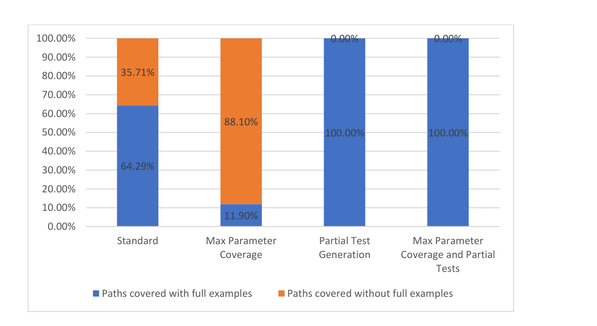

#### 5.1.2. Покрытие операций

Исходя из тех же соображений, что и выше, мы решили разделить метрику покрытия операций на две части в зависимости от того, содержат ли все их параметры примеры значений: операции, покрытые с полными примерами, и операции, покрытые без полных примеров. Метрика покрытия операций относится к уровню TCL2 [[7]](#ref-7) модели покрытия.

Как уже отмечалось, с путём API может быть связана одна операция или несколько. В настоящем исследовании случая у каждого пути была одна операция `GET`, так что всего рассмотрено 42 операции. Результаты на рисунке 8 совпадают с результатами по покрытию путей, поскольку на каждый путь приходится лишь одна операция.

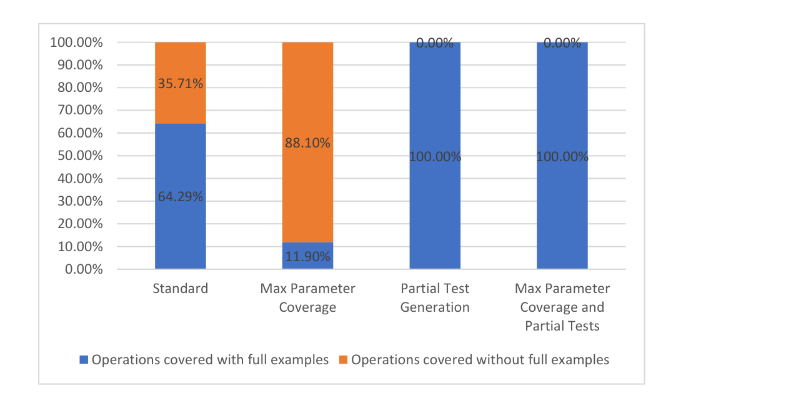

#### 5.1.3. Протестированные пути

Протестированные пути делятся на две категории: пути, протестированные успешно, и пути с непройденными тестами. При тестировании пути к API может быть выполнен один или несколько запросов — в зависимости от числа комбинаций параметров. У каждого из этих запросов будет результат, определяемый классом кода состояния. Запрос считается успешным, если получен ответ с кодом состояния 2xx (например, путь `/metrics/wp/pregame` возвращает успешный код 200 и тело ответа, содержащее вероятности победы в игре). Запрос считается непройденным, если получен ответ с кодом состояния не из класса 2xx (например, 404). При обработке тест-кейсов, в которых намеренно используются невалидные параметры (по принципу тестирования на основе дефектов), сравнение выполняется в обратную сторону: тест считается успешным, если API возвращает код состояния об ошибке, и непройденным, если API возвращает код состояния 2xx (то есть API принял невалидное значение).

У каждого набора комбинаций параметров есть ожидаемый исход соответствующего запроса. Путь считается протестированным успешно, если все ответы совпали с ожидаемыми. Иначе протестированный путь считается непройденным. Результаты по этой метрике приведены на рисунке 9.

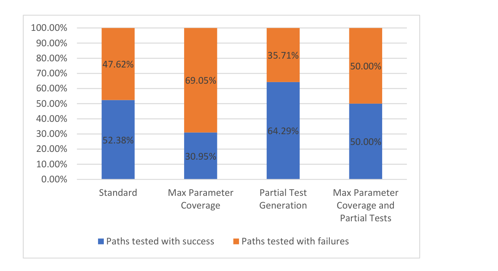

Видно, что по мере роста количества параметров число проходящих тест-кейсов снижается: выше вероятность ошибок и больше параметров без примеров. В рассматриваемой ситуации у операции `GET` для пути `/metrics/wp/pregame` четыре параметра, но ни один из них не обязателен. Поэтому в конфигурации *стандартной* запрос выполняется без параметров, тогда как в конфигурации *максимального покрытия параметров* значения были заданы всем параметрам.

В двух последних конфигурациях — *генерация частичных тестов* и *максимальное покрытие параметров и частичные тесты*, — где частичные тесты включены, мы наблюдаем растущее число успешных тест-кейсов: пользователь, взаимодействуя с программой, задаёт для запросов валидные параметры, опираясь на описание операции. Например, параметр `seasonType` операции `GET` имеет тип `String`, не содержит примера значения, но в описании у него указано `regular or postseason`. Такое описание пользователю нетрудно истолковать, и он введёт правильный пример, тогда как строковое значение по умолчанию, назначавшееся параметру в двух предыдущих конфигурациях, не было бы валидным.

#### 5.1.4. Протестированные операции

Метрика протестированных операций подчиняется тем же правилам, что и метрика протестированных путей, с той разницей, что учитываются только отдельные операции. Как отмечалось выше, у выбранного API на каждый путь приходится лишь одна операция, поэтому результаты на рисунке 10 совпадают с результатами по предыдущей метрике.

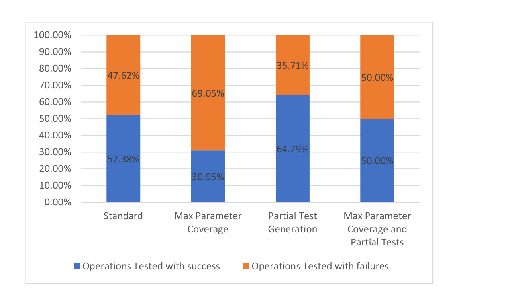

#### 5.1.5. Покрытие параметров

Чтобы параметр считался покрытым, он должен быть использован в одном или нескольких тест-кейсах. Покрытые параметры мы разделили на две группы по общим результатам тест-кейсов, сгенерированных для каждой операции. Первая группа — параметры, покрытые успешными тест-кейсами, вторая — параметры, покрытые непройденными тест-кейсами. Эти две группы и образуют метрику покрытия параметров, которая соответствует уровням TCL4–TCL6 [[7]](#ref-7), представленным на рисунке 2.

Результаты по метрике покрытия параметров приведены на рисунке 11.

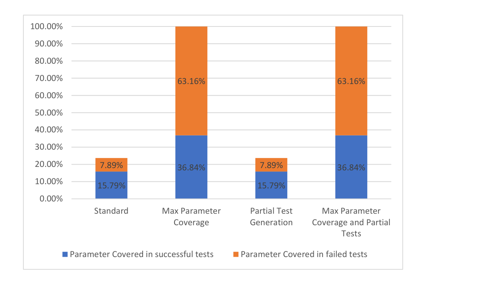

В конфигурации *стандартной* значения задавались только обязательным параметрам. У выбранного API было 9 обязательных параметров из 38. Во второй конфигурации *максимального покрытия параметров* использовались все 38 параметров, но лишь 14 из них присутствовали в успешных тестах.

Для API *College Football Data*[^4] мы отметили, что конфигурации с частичными тестами существенно на эту метрику покрытия не влияют, хотя включение частичных тестов увеличило число успешно протестированных операций. В этом случае дополнительные успешные операции не содержали параметров, ранее покрытых непройденными тестами. Даже если у параметра есть валидный пример, заданный пользователем, параметр всё равно может входить в операцию, у которой тест-кейсы не прошли по другим причинам, связанным с API. Соответственно, такой параметр по-прежнему не считается покрытым в успешных тестах.

#### 5.1.6. Покрытие кодов состояния

В спецификации API для операции может быть определён один возможный ответ или несколько. Один из атрибутов ответа такого рода — код состояния. Операция `GET` для `/metrics/wp/pregame` предусматривает два возможных кода ответа: 200 и 400. Соответственно, мы вычисляем процентную долю каждого возвращённого кода состояния. Полученная доля и есть метрика покрытия кодов состояния, которая соответствует уровню TCL5 [[7]](#ref-7), как показано на рисунке 12.

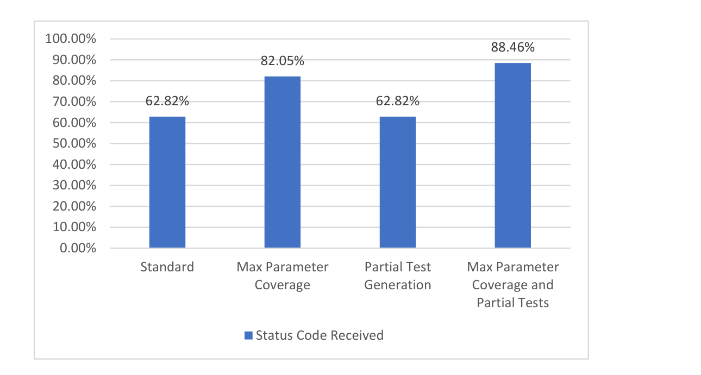

У выбранного API определено всего 78 возможных кодов состояния. В конфигурации *стандартной* покрыто 48 кодов состояния, а в конфигурации *максимального покрытия параметров* — 64 кода состояния. В третьей конфигурации видно, что доля по сравнению со *стандартной* не растёт: несколько дополнительных примеров значений параметров, которые даёт сам API, на эту метрику не влияют. В последней же конфигурации, где больше и параметров, и примеров (в том числе введённых пользователем), доля по этой метрике самая высокая из всех четырёх конфигураций.

#### 5.1.7. Покрытие типов содержимого

Спецификация API может включать один или несколько ответов на каждую операцию, и часть этих ответов может задавать ожидаемый тип содержимого (например, `application/json`, `text/plain`, `application/xml`). Получив ответ на запрос, можно проверить, совпадает ли тип содержимого ответа с тем, что задан в спецификации. Метрика покрытия типов содержимого измеряет, сколько валидных типов содержимого получено из числа заданных в спецификации, и представляет уровень покрытия TCL3 [[7]](#ref-7). Результаты, полученные для API *College Football Data*, приведены на рисунке 13.

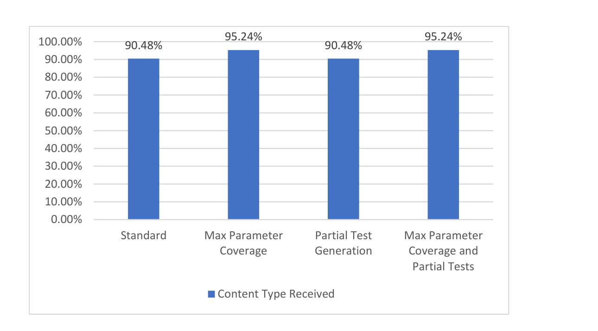

У выбранного API общее число заданных типов содержимого — 42. При использовании всех параметров (как в *максимальном покрытии параметров*, так и в *максимальном покрытии параметров и частичных тестах*) видно увеличение числа покрытых типов содержимого с 38 до 40. Включение генерации частичных тестов (*генерация частичных тестов* и *максимальное покрытие параметров и частичные тесты*) на метрику покрытия типов содержимого не влияет.

#### 5.1.8. Покрытие свойств тела ответа

В некоторых случаях определение API может включать структуру ожидаемого тела ответа исходя из типа содержимого в ответе операции. Например, у операции `GET` для пути `/metrics/wp/pregame` всего восемь свойств тела ответа: `gameId`, `season`, `homeTeam`, `week` и т. д.

Опираясь на эти сведения, можно вычислить, сколько из названных свойств тела ответа было фактически получено. Это и есть метрика покрытия свойств тела ответа (рисунок 14), которой соответствует самый строгий критерий покрытия выходов TCL6 [[7]](#ref-7), как определено на рисунке 2.

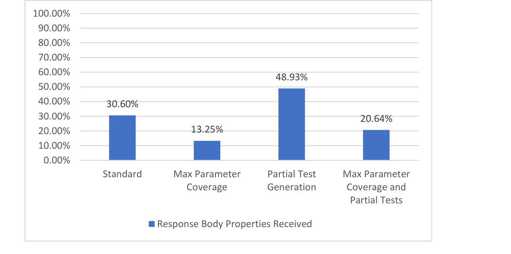

У выбранного API всего 562 свойства тела ответа. Конфигурации с частичными тестами (*генерация частичных тестов* и *максимальное покрытие параметров и частичные тесты*) ведут к росту числа полученных свойств тела ответа благодаря валидным примерам, заданным пользователем. Напротив, при использовании всех параметров (*максимальное покрытие параметров* и *максимальное покрытие параметров и частичные тесты*) видно снижение доли покрытых свойств тела ответа, и объясняется это тем, что большинство параметров участвует в фильтрации ответа. Иначе говоря, чем больше параметров используется, тем сильнее отфильтрован ответ и тем меньше в нём потенциальных свойств тела ответа.

Отметим, что некоторые API могут предоставлять или не предоставлять описание ответа для операции либо предоставлять лишь часть сведений. В таких случаях, в зависимости от доступных сведений, часть следующих метрик может оказаться невычислимой: покрытие кодов состояния, покрытие типов содержимого, покрытие свойств тела ответа.

#### 5.1.9. Метрика производительности

Для оценки производительности API мы предлагаем измерять среднее время получения ответа на каждый отправленный запрос. В нашем решении это среднее время ответа и представлено метрикой производительности, а полученные результаты приведены на рисунке 15.

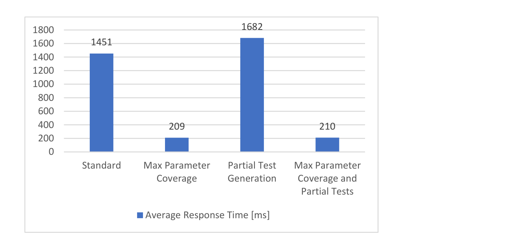

В конфигурациях, где используются все параметры (*максимальное покрытие параметров* и *максимальное покрытие параметров и частичные тесты*), наблюдалось заметное сокращение времени, необходимого для выполнения запроса. Причина в том, что многие параметры служат для фильтрации ответа: ответы становятся меньше по объёму, а среднее время ответа снижается. Конфигурации с частичными тестами существенных изменений в общей длительности выполнения не дают. Поскольку на метрику производительности могут влиять внешние факторы (сетевое соединение и задержки), в идеале её следовало бы измерять на стороне API.

### 5.2. Второе исследование случая: тестирование набора из 30 API

Чтобы оценить предлагаемое решение полнее, мы применили к 30 API ту же процедуру, что и в предыдущем исследовании случая. С помощью сервиса `APIs.guru` (https://apis.guru/browse-apis/, дата обращения: 6 августа 2021 г.) мы отсеяли все API, у которых не было OpenAPI версии 3.0 или выше, и получили около 800 API. Затем мы исключили API, требующие ключа безопасности, ключа API или аутентификации (любые API, у которых была та или иная защита и для тестирования которых нужны учётные данные), и получили около 100 API. Отсеяв те, у которых спецификации были некорректны, мы собрали в общей сложности 30 API — от простых (один-два пути) до сложных (30 путей и более). Ниже перечислены названия всех 30 рассмотренных API:

`papiNet API CWG`, `Corrently`, `Data & Search team at UK Parliament`, `JSON storage`, `XKCD`, `HackathonWatch`, `shipstation`, `topupsapi`, `Geomag`, `Gravity`, `NSIDC Web Service Documentation Index`, `BikeWise v2`, `ODWeather`, `WorkBC Job Posting`, `Atmosphere`, `Space Radiation`, `NeoWs—(Near Earth Object Web Service)`, `Domains RDAP`, `API Discovery Service`, `WikiPathways Webservice`, `httpbin.org`, `OSDB REST v1`, `RiteKit`, `Aviation Radiation`, `eNanoMapper database`, `Tweets and Users`, `RAWG Video Games Database`, `College Football Data`, `Rat Genome Database REST API`, `VocaDB`.

Метрики покрытия, названные в предыдущем разделе, вычислялись по всему набору из 30 API: предлагаемое решение прогонялось в четырёх конфигурациях. Общее число тест-кейсов, сгенерированных в каждой из четырёх конфигураций, таково: *стандартная* — 1222; *максимальное покрытие параметров* — 3785; *генерация частичных тестов* — 1225; *максимальное покрытие параметров и частичные тесты* — 3807.

На рисунке 16 представлены агрегированные результаты, полученные при оценке нашего решения на наборе из 30 API[^3]. Результаты приведены в виде медианы по каждой метрике, оценённой в описанных выше сценариях.

Судя по общим результатам на рисунке 16, наш подход, позволяющий пользователю вводить примеры значений, даёт существенный положительный эффект. Это видно по большинству оценённых метрик, если сравнить конфигурацию *стандартную* с конфигурацией *генерации частичных тестов* или конфигурацию *максимального покрытия параметров* с конфигурацией *максимального покрытия параметров и частичных тестов*.

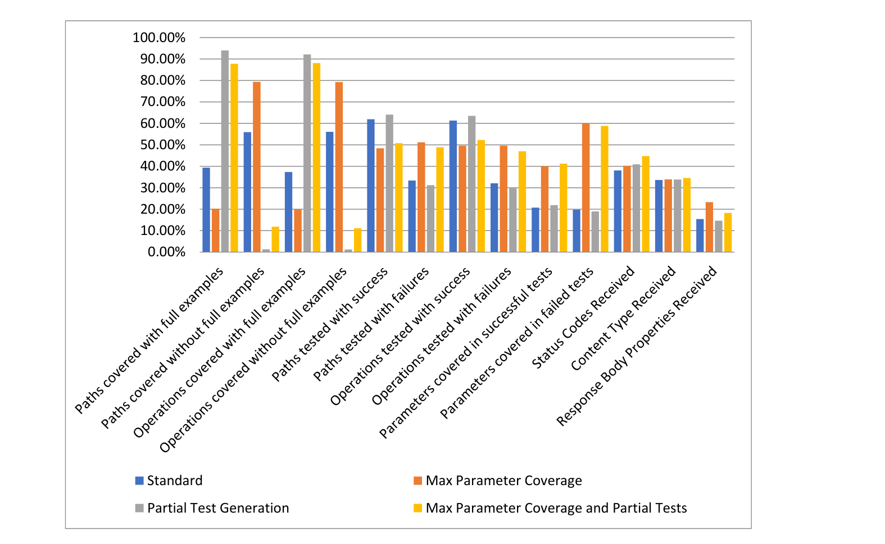

Видно также, что общее число запрошенных параметров за время тестирования всех 30 API сравнительно невелико. В нашем случае это в среднем от четырёх до двенадцати параметров на API, так что усилий от пользователя требуется немного.

## 6. Заключение

Главная цель нашего исследования — предложить новый метод автоматизации тестирования REST API только по их спецификации OpenAPI 3.x. Взяв за отправную точку метод, предложенный в [[4]](#ref-4), мы улучшаем процесс генерации тестов: он требует лишь минимального участия пользователя, который задаёт примеры значений для параметров операций API. Кроме того, мы расширяем набор статистических показателей, собираемых при тестировании API, чтобы глубже проанализировать каждый тестируемый API.

Одно из главных достоинств нашего подхода — простота применения. Для тестирования конкретного API нужны только URL или файл с его спецификацией API в формате OpenAPI 3.x и примеры значений параметров, задаваемые пользователем в зависимости от выбранного типа конфигурации. Как уже отмечалось, пользователь без труда меняет конфигурацию, которая определяет способ генерации тестов. Так, пользователь может выбрать, использовать ли все параметры API или только обязательные, а также указать, следует ли запрашивать у пользователя дополнительные примеры значений. Поскольку эти две настройки независимы друг от друга, получаются четыре возможные конфигурации, описанные в разделе 4. Полученные метрики покрытия дают полную картину аспектов API, охваченных проверкой, а помимо них наш подход предоставляет нефункциональную метрику производительности — среднее время, необходимое для прогона выбранной конфигурации на API.

Недостаток нашего подхода — и вообще подходов, порождающих тест-кейсы исключительно по спецификациям API, — в том, что в фактической реализации API есть взаимозависимости, которые нельзя вывести из одного лишь определения API. Пример: чтобы успешно выполнить над объектом операцию `PATCH`, нужно заранее знать о существовании этого объекта в базе данных API. Ещё один недостаток: из-за того, как вычисляется метрика производительности (среднее время), нельзя гарантировать, что внешние факторы на неё не влияют. В идеале такую метрику следовало бы вычислять прямо на серверной стороне API, чтобы исключить влияние сетевых задержек на результаты. К сожалению, без полного доступа к серверу это невозможно.

Поскольку в нынешней реализации разбор API отделён от генерации и выполнения тестов, к возможным будущим улучшениям относится расширение перечня поддерживаемых языков спецификаций. Опираясь на нынешнюю метрику производительности, мы могли бы дополнить реализацию нагрузочным тестированием. Эта новая функция должна одновременно выполнять серию запросов к API и следить за тем, заметно ли меняется время ответа. Ещё одним улучшением могла бы стать выгрузка сгенерированных тест-кейсов в формате, совместимом с одним или несколькими фреймворками тестирования, например, JUnit или Serenity.

В нашем подходе, помимо полностью автоматической генерации тест-кейсов, мы даём пользователю возможность направлять создание тест-кейсов, позволяя ему привнести собственный опыт и особенности того контекста, в котором тестируется API. Реализация программы модульна: разбор спецификации API отделён от генерации и выполнения тестов, а это позволяет в дальнейшем расширять перечень поддерживаемых языков спецификаций. Эксперименты подтвердили результативность и практическую применимость нашего метода, а широкий набор предоставляемых метрик покрытия и производительности облегчает глубокий анализ процесса тестирования API.

**Вклад авторов:** концептуализация — O.B., D.F., R.G. и D.-I.C.; методология — O.B., D.F., R.G. и D.-I.C.; программное обеспечение — R.G.; валидация — O.B., D.F., R.G. и D.-I.C.; формальный анализ — O.B., D.F., R.G. и D.-I.C.; проведение исследования — O.B., D.F., R.G. и D.-I.C.; ресурсы — O.B., D.F., R.G. и D.-I.C.; курирование данных — O.B., D.F., R.G. и D.-I.C.; написание текста, подготовка первоначального черновика — O.B., D.F., R.G. и D.-I.C.; написание текста, рецензирование и редактирование — O.B., D.F., R.G. и D.-I.C.; визуализация — O.B., D.F., R.G. и D.-I.C.; научное руководство — O.B. и D.-I.C. Все авторы прочитали опубликованную версию рукописи и согласны с ней.

**Финансирование:** исследование не получало внешнего финансирования.

**Заявление комитета по этике:** неприменимо.

**Заявление об информированном согласии:** неприменимо.

**Заявление о доступности данных:** неприменимо.

**Конфликт интересов:** авторы заявляют об отсутствии конфликта интересов.

---

[^1]: Примечание переводчика. В оригинале нумерация разделов в этом абзаце сдвинута: смежные работы отнесены к разделу 2, метод — к разделу 3, примеры — к разделу 4, а обсуждение и ограничения — к разделу 5. Здесь номера приведены в соответствие с фактической структурой статьи.

[^2]: Примечание переводчика. В оригинале в этом перечне дважды указано `content-type coverage` — покрытие типов содержимого. Перечень воспроизведён как в оригинале. Отдельного подраздела, посвящённого покрытию значений параметров, в оригинале также нет.

[^3]: Примечание переводчика. В оригинале — `Figure 15`. По смыслу и по подписи речь о рисунке 16 («Обзорная статистика»): рисунок 15 — метрика производительности из подраздела 5.1.9. В переводе номер исправлен.

[^4]: Примечание переводчика. В оригинале имя API записано непоследовательно: `College Football Data` в заголовке подраздела 5.1 и в перечне подраздела 5.2, `College football data` во вводном абзаце подраздела 5.1 и в подразделах 5.1.5 и 5.1.7. В переводе имя унифицировано по форме заголовка и перечня.

## Список литературы

1. Neumann, A.; Laranjeiro, N.; Bernardino, J. An Analysis of Public REST Web Service APIs. *IEEE Trans. Serv. Comput.* **2018**, *14*, 957–970. [[CrossRef](http://doi.org/10.1109/TSC.2018.2847344)]
2. Toman, S.H. Review of Web Service Technologies: REST over SOAP. *J. Al-Qadisiyah Comput. Sci. Math.* **2020**, *12*, 18–30.
3. Bülthoff, F.; Maleshkova, M. RESTful or RESTless—Current State of Today's Top Web APIs. In *Lecture Notes in Computer Science, Proceedings of the Semantic Web: ESWC 2014 Satellite Events, Crete, Greece, 25–29 May 2014*; Springer: Cham, Switzerland, 2014; pp. 64–74.
4. Ed-douibi, H.; Izquierdo, J.L.C.; Cabot, J. Automatic Generation of Test Cases for REST APIs: A Specification-Based Approach. In Proceedings of the 2018 IEEE 22nd International Enterprise Distributed Object Computing Conference, Stockholm, Sweden, 16–19 October 2018; Universitat Oberta de Catalunya: Barcelona, Spain, 2018.
5. Karlsson, A. Automatic Test Generation of REST API. Ph.D. Thesis, Linköping University, Linköping, Switzerland, 2020.
6. Ferreira, F.A.C. Automatic Tests Generation for RESTful APIs. Ph.D. Thesis, Universidade de Lisboa, Lisboa, Portugal, 2017.
7. Martin-Lopez, A.; Segura, S.; Ruiz-Cortes, A. Test Coverage Criteria for RESTful Web APIs. In Proceedings of the 10th ACM SIGSOFT International Workshop on Automating TEST Case Design, Selection, and Evaluation (A-TEST'19), Tallinn, Estonia, 26–27 August 2019; ACM: New York, NY, USA, 2019. 7p.
8. Fielding, R.T.; Taylor, R.N. *Architectural Styles and the Design of Network-Based Software Architectures*; University of California: Irvine, CA, USA, 2000; Volume 7.
9. OpenAPI Initiative. 15 February 2021. Available online: [http://spec.openapis.org/oas/v3.1.0#openapi-specification](http://spec.openapis.org/oas/v3.1.0#openapi-specification) (accessed on 28 February 2021).
10. Karlsson, S.; Causevic, A.; Sundmark, D. QuickREST: Property-based Test Generation of OpenAPI-Described RESTful APIs. In Proceedings of the 2020 IEEE 13th International Conference on Software Testing, Validation and Verification (ICST), Porto, Portugal, 24–28 October 2020; Malardalen University: Västerås, Sweden, 2020.
11. Martin-Lopez, A.; Segura, S.; Ruiz-Cortés, A. *A Catalogue of Interparameter Dependencies in Restful Web APIs*; International Conference on Service-Oriented Computing; Springer: Berlin/Heidelberg, Germany, 2019; pp. 399–414.
12. Subramanian, H.; Raj, P. *Hands-On RESTful API Design Patterns and Best Practices*; Packt Publishing: Birmingham, UK, January 2019.
13. Dencker, P.; Groenboom, R. *Methods for Testing Web Services*; Böttinger, S., Theuvsen, L., Rank, S., Morgenstern, M., Eds.; Software Engineering 2007—Beiträge zu den Workshops—Fachtagung des GI-Fachbereichs Softwaretechnik; Gesellschaft für Informatik e.V.: Bonn, Germany, 2007; pp. 137–142.
14. Magapu, A.K.; Yarlagadda, N. *Performance, Scalability, and Reliability (PSR) Challenges, Metrics and Tools for Web Testing*; Blekinge Institute of Technology, Faculty of Computing: Karlskrona, Sweden, 2016.
15. Bucaille, S.; Izquierdo, J.L.C.; Ed-Douibi, H.; Cabot, J. An OpenAPI-Based Testing Framework to Monitor Non-functional Properties of REST APIs. In *Lecture Notes in Computer Science, Proceedings of the International Conference on Web Engineering, ICWE 2020, LNCS 12128, Helsinki, Finland, 9–12 June 2020*; Springer: Cham, Switzerland, 2020; pp. 533–537.
16. Bai, X.; Dong, W.; We, T.; Chen, Y. WSDL-based Automatic Test Case Generation for Web Services Testing. In Proceedings of the International Workshop on Service-Oriented System Engineering, Beijing, China, 20–21 October 2005; pp. 207–212.
17. Hanna, S.; Munro, M. Fault-Based Web Services Testing. In Proceedings of the Fifth International Conference on Information Technology: New Generations (itng 2008), Las Vegas, NV, USA, 7–9 April 2008; pp. 471–476.
18. Arcuri, A. RESTful API Automated Test Case Generation with EvoMaster. *ACM Trans. Softw. Eng. Methodol. (TOSEM)* **2019**, *28*, 1–37. [[CrossRef](http://doi.org/10.1145/3293455)]
19. Zhang, M.; Marculescu, B.; Arcuri, A. Resource-based Test Case Generation for RESTful Web Services. In Proceedings of the Genetic and Evolutionary Computation Conference (GECCO'19), Prague, Czech Republic, 13–17 July 2019; ACM: New York, NY, USA, 2019.
20. Chakrabarti, S.K.; Kumar, P. Test-the-REST: An Approach to Testing RESTful Web-Services. In Proceedings of the International Conference on Advanced Service Computing, Athens, Greece, 15–20 November 2009; pp. 302–308.
21. Atlidakis, V.; Godefroid, P.; Polishchuk, M. Restler: Stateful rest api fuzzing. In Proceedings of the 41st International Conference on Software Engineering, ICSE'19, Montreal, QC, Canada, 25–31 May 2019; IEEE Press: Piscataway, NJ, USA, 2019; pp. 748–758.
