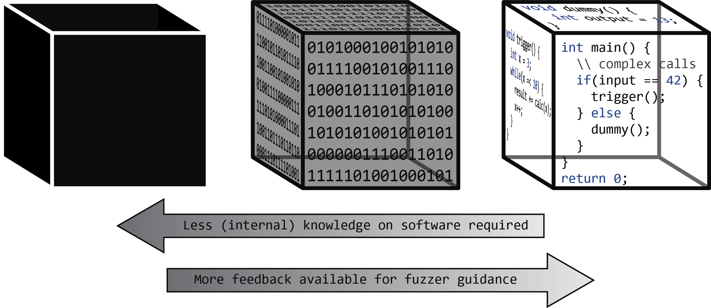
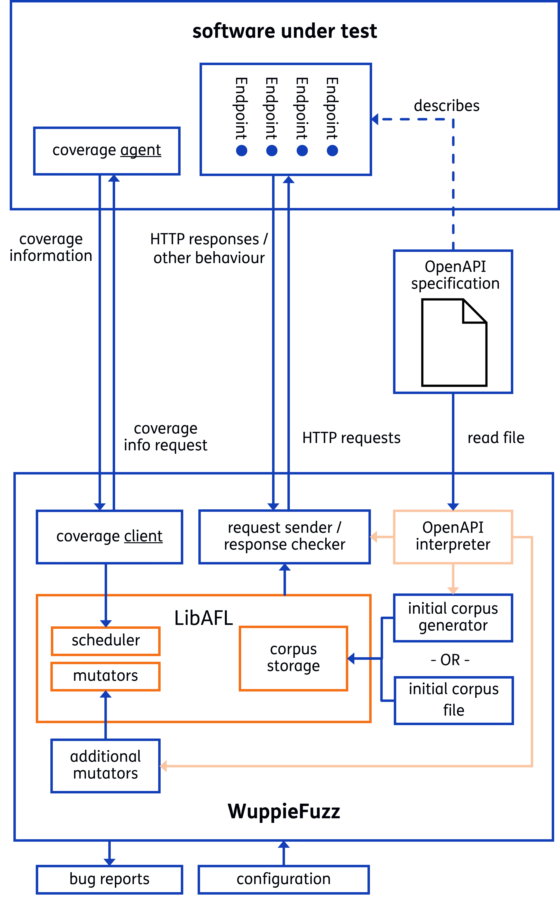
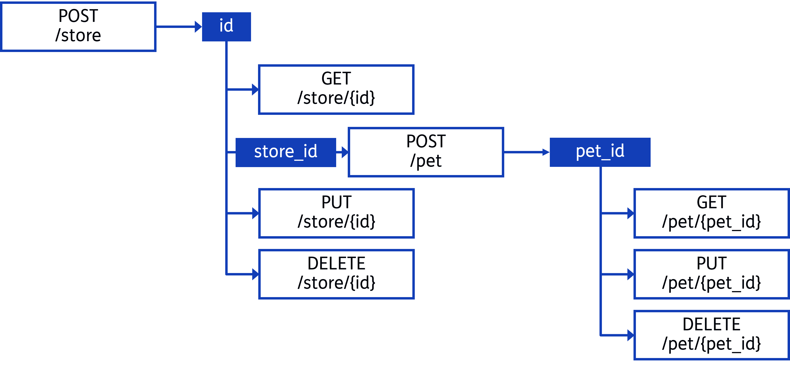
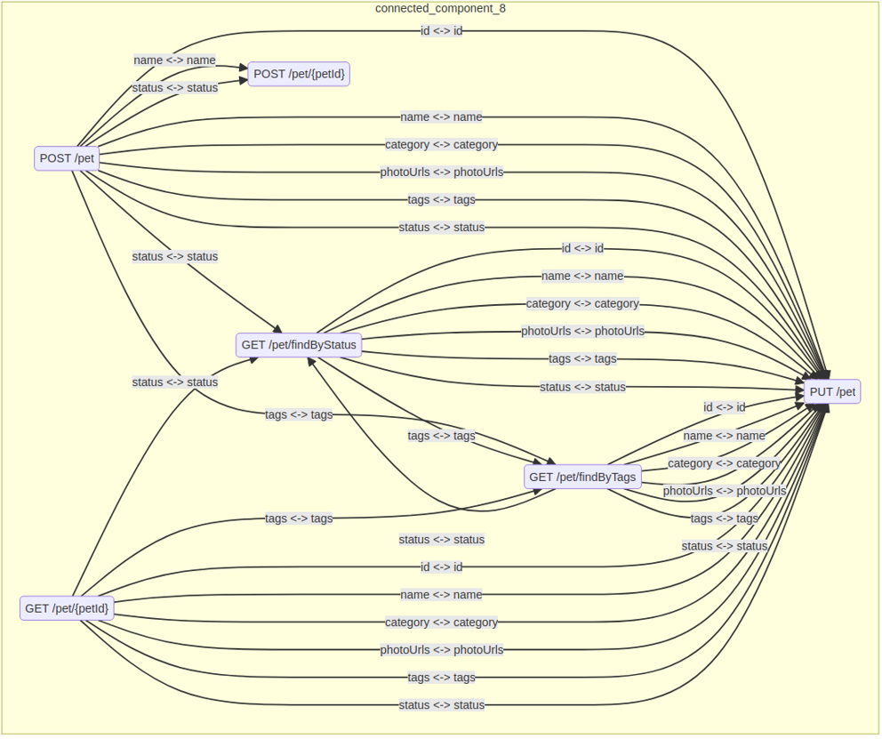
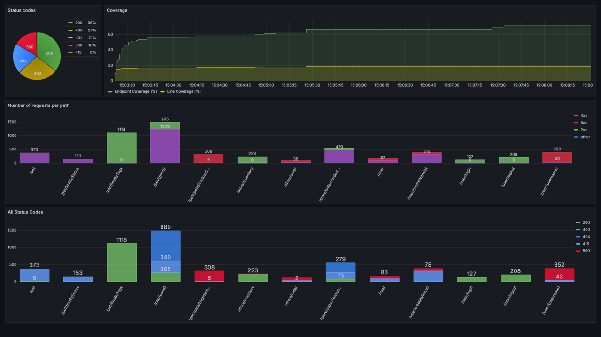
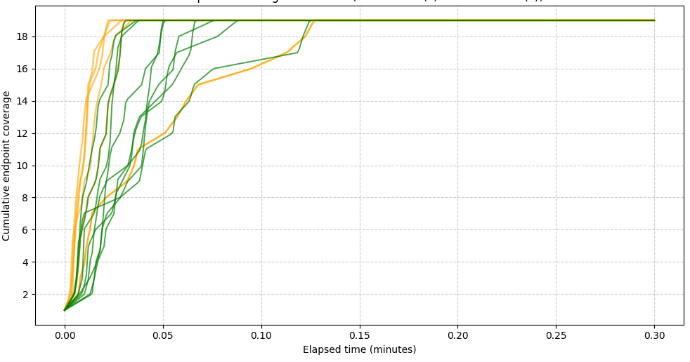
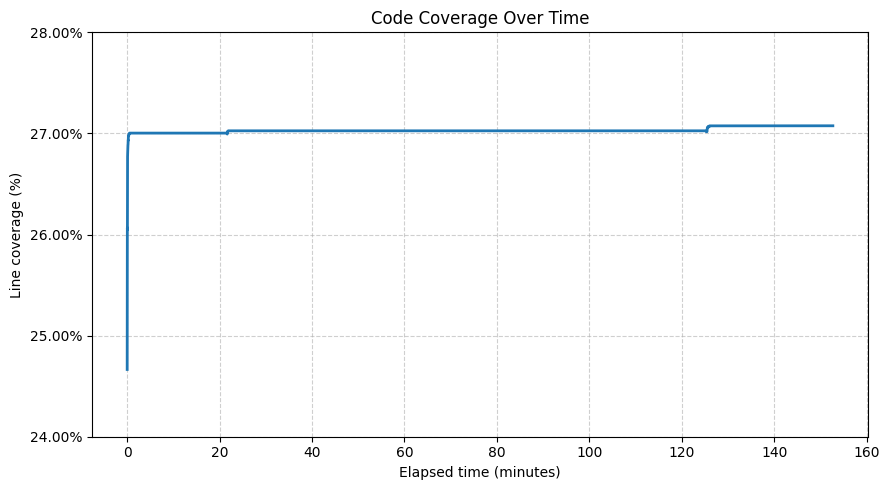

# WuppieFuzz: фаззинг REST API с учётом состояния, управляемый покрытием

**Перевод на русский язык:** А. Н. Сенников. Неофициальный перевод; при расхождениях с оригиналом приоритет имеет оригинал. Текст перевода распространяется по лицензии [CC BY 4.0](https://creativecommons.org/licenses/by/4.0/legalcode.ru).

**Оригинальное название:** *WuppieFuzz: Coverage-Guided, Stateful REST API Fuzzing*

**Публикация:** препринт arXiv:2512.15554v1 [cs.SE], 17.12.2025; 12 страниц  
**DOI:** [10.48550/arXiv.2512.15554](https://doi.org/10.48550/arXiv.2512.15554)  
**Лицензия оригинала:** [CC BY 4.0](https://creativecommons.org/licenses/by/4.0/legalcode.ru) (препринт arXiv)

**Thomas Rooijakkers ¹ᵃ, Anne Nijsten ¹ᵇ, Cristian Daniele ²ᶜ, Erieke Weitenberg ¹ᵈ, Ringo Groenewegen ¹ᵉ, Arthur Melissen ¹**

> ¹ The Netherlands Organisation for Applied Scientific Research (TNO), The Netherlands
> ² Radboud University, Nijmegen, The Netherlands
>
> Контакт: {thomas.rooijakkers, anne.nijsten, erieke.weitenberg, ringo.groenewegen, arthur.melissen}@tno.nl, christian.daniele@ru.nl
>
> ᵃ https://orcid.org/0000-0001-6930-0421  
> ᵇ https://orcid.org/0009-0004-5513-2948  
> ᶜ https://orcid.org/0000-0001-7435-4176  
> ᵈ https://orcid.org/0000-0001-7175-5791  
> ᵉ https://orcid.org/0009-0005-1837-1808

arXiv:2512.15554v1 [cs.SE] 17 Dec 2025

---

## Аннотация

Многие бизнес-процессы сегодня опираются на веб-сервисы, которые для обмена данными чаще всего используют REST API. REST API открывают доступ к функциям веб-сервиса через эндпоинты, позволяя клиенту без труда взаимодействовать с ним в интернете. Чтобы снизить риск для безопасности, возникающий из-за открытых вовне эндпоинтов, требуется тщательное тестирование. Поскольку эндпоинтов обычно очень много, интерес представляют методы автоматизированного тестирования — в частности фаззинг.

В статье представлен WuppieFuzz — опенсорс-фаззер REST API, построенный на LibAFL и поддерживающий фаззинг методами белого, серого и чёрного ящика. По спецификации OpenAPI он способен сформировать начальный входной корпус из последовательностей запросов. Эти последовательности изменяются мутаторами, специфичными для REST, и мутаторами из состава LibAFL, что позволяет исследовать различные пути выполнения кода в тестируемом программном обеспечении. Опираясь на измеренное покрытие, WuppieFuzz далее выбирает, какие последовательности запросов отправить следующими, чтобы достичь сложных состояний тестируемого программного обеспечения. В ходе этого процесса он автоматизирует создание обвязки, сокращая ручной труд, которого фаззинг обычно требует. Для помощи в исправлении дефектов фаззер формирует отчёты нескольких видов.

Инструмент оценён на API Petstore: проверены устойчивость подхода белого ящика и результативность различных стратегий распределения энергии. Кроме того, покрытие эндпоинтов и покрытие кода отслеживались во времени, что позволило измерить результативность подхода.

**Ключевые слова:** фаззинг, REST, генерация тестов, веб-API, безопасная разработка

---

## 1. Введение

Интерфейсы прикладного программирования (API) служат средством обмена данными между (микро)сервисами или программами, которые, например, обрабатывают данные или управляют бизнес-процессами. В современных программных архитектурах API — особенно важные компоненты как для внутреннего взаимодействия микросервисов, так и для приёма внешних входных данных: они открывают вовне так называемые эндпоинты API. Эндпоинты могут лежать в основе веб-приложения, и это делает обращение к API предпочтительным способом взаимодействия, поскольку правила такого обращения обычно чётко определены.

Веб-приложения дают организациям широкий по охвату и доступный способ предоставить услугу клиентам. Как правило, веб-API следуют архитектурному стилю передачи состояния представления (REpresentational State Transfer, REST) ([Fielding, 2000](#ref-fielding-2000)) и работают поверх протокола передачи гипертекста (Hypertext Transfer Protocol (Secure), HTTP(S)) ([Martin-Lopez et al., 2019](#ref-martin-lopez-2019)). Тем самым интерфейсы взаимодействия оказываются чётко определены, и сервисы становятся легко доступными без дополнительного программного обеспечения[^3]. Однако у этого преимущества есть оборотная сторона. Улучшая пользовательский опыт, открытые вовне веб-API создают и новую поверхность атаки. Поэтому крайне важно обнаруживать и устранять дефекты и проблемы безопасности как можно раньше — желательно до того, как они попадут в промышленную среду. Открытые эндпоинты представляют особый риск для безопасности: злоумышленнику легко выйти за пределы ожидаемого корректного ввода, пытаясь сломать эти сервисы и лежащие в их основе системы, вмешаться в их работу или нарушить её. Открытых вовне эндпоинтов в мире огромное число, и с каждым годом их становится больше, поэтому тщательный ручной поиск проблем практически невыполним. Отсюда потребность в автоматизированных решениях.

Фаззинг — это метод тестирования программного обеспечения, служащий для поиска изъянов в программе за счёт подачи на её вход данных, кажущихся случайными; тестируемую программу в этом контексте называют Program Under Test (PUT). За последние десятилетия область фаззинга и поиска уязвимостей достигла зрелости, причём внимание было сосредоточено прежде всего на фаззинге двоичных программ. Передовые двоичные фаззеры, управляемые покрытием, показали, что сведения о том, какие участки двоичного или исходного кода покрыты поданными входными данными, помогают исследовать более значительную часть SUT и тем самым обнаруживать больше программных изъянов за меньшее время ([Wang et al., 2019](#ref-wang-2019)). В отличие от двоичных программ, веб-приложениям часто нужны определённые последовательности входных сообщений, чтобы прийти в состояние, в котором проявляется дефект. Это, а также возможные связи между параметрами делают фаззинг REST API более трудной задачей, чем фаззинг двоичных программ. Несмотря на бурное развитие фаззинга двоичных программ в последние годы, исследовательскому сообществу не удавалось найти эффективный и простой в применении фаззер, приспособленный к системам с REST API.

В этой статье мы представляем WuppieFuzz — новый фаззер REST API, управляемый покрытием и работающий с учётом состояния; при его разработке упор делался на модульность, простоту применения и понятность отчётов об обнаруженных изъянах для конечного пользователя. WuppieFuzz поддерживает фаззинг REST API методами чёрного, серого и белого ящика. Он опирается на более ранние работы по фаззингу, так как построен поверх LibAFL, и, насколько известно авторам, это первый такой подход применительно к REST API. Направление поиска по покрытию кода доступно для JVM-языков, а также для Python и JavaScript, с возможностью расширения на другие языки. Чтобы инструмент можно было применять и развивать, он опубликован под лицензией Apache версии 2.0 в открытом репозитории GitHub[^1]. Инструмент испытан в различных конфигурациях; испытания показали, что тестирование методом белого ящика, несмотря на дополнительные затраты, быстрее приводит к получению новых ответов, чем при подходе чёрного ящика. Для оценки вводится метрика покрытия ответов, позволяющая сравнивать фаззеры REST API более детально.

## 2 Предпосылки

В этом разделе изложены предпосылки и терминология статьи. Кроме того, здесь представлены LibAFL — фреймворк, на котором построен WuppieFuzz, — и предшествующие работы по фаззингу REST API.

### 2.1 Фаззинг (двоичных программ)

Фаззинг — это метод тестирования программного обеспечения, служащий для поиска уязвимостей в программах ([OSS-Fuzz, 2023](#ref-oss-fuzz-2023)). При фаззинге на вход SUT подаются некорректно сформированные входные данные, чтобы вызвать неожиданное поведение системы. Затем фаззер сообщает аналитику, какие именно входные данные привели к проявлению дефекта. Заметим, что фаззеры обычно применяют сложные стратегии, направляющие генерацию входных данных к наиболее интересным вариантам: полностью случайные сообщения почти наверняка приведут к низкой эффективности фаззинга. По способу получения входных данных фаззеры делятся на две группы: работающие на основе мутаций и работающие на основе генерации.

**Фаззинг на основе мутаций.** Поначалу фаззеры порождали входные данные для подачи в SUT чисто случайным перебором. Как уже сказано, полностью случайный вход почти наверняка приводит к низкой эффективности. Случайная составляющая остаётся частью процесса фаззинга, но более совершенные фаззеры не создают входные данные с нуля. Вместо этого они получают их, применяя мутации к исходному набору входных данных, которые принято называть сидами. Сид — это (корректно сформированный) вход, служащий отправной точкой для мутационной генерации. Исходный набор может состоять из одного или нескольких сидов, а по ходу сеанса фаззинга он может пополняться в соответствии с находками фаззера. Такую совокупность сидов называют также корпусом сидов. Каждый фаззер применяет к файлам сидов свой набор мутаций. Примеры мутаций — инверсия битов и рекомбинация сидов или их частей, известная также как сплайсинг.

**Фаззинг на основе генерации.** Вместо набора сидов фаззеры на основе генерации используют некоторые сведения о структуре данных, которые SUT ожидает на входе.

Эти сведения (их часто выражают в виде грамматики и модели состояний) можно вывести из документации SUT или из анализа сетевого трафика. По такой грамматике порождаются новые входные данные. Они с большей вероятностью пройдут первичные проверки при разборе, что позволит фаззеру добраться до более глубоких участков программы. Однако этот подход требует детального знания используемого протокола, что может ограничивать его масштабируемость.

Ортогональная классификация фаззеров строится по объёму их знаний о SUT, как показано на рисунке 1.

**Фаззинг методом чёрного ящика.** Как следует из названия, при фаззинге методом чёрного ящика SUT рассматривается как чёрный ящик: фаззер подаёт в SUT входные данные, а SUT возвращает результат, который фаззер затем получает. Это соответствует природе многих веб-приложений, доступных пользователю только как чёрный ящик. В такой постановке учесть можно лишь то, что измеримо снаружи, — например время отклика и сами ответы.

**Фаззинг методом белого ящика.** Термин «белый ящик» связан с прозрачностью программного обеспечения. В такой постановке доступен большой объём сведений, которые можно использовать как обратную связь, направляющую работу фаззера. В частности, мы полностью видим внутреннее устройство программы — например благодаря доступу к исходному коду, из которого скомпилирован двоичный файл. Эти дополнительные сведения позволяют направлять фаззер, а также помогают выяснить, что именно вызвало неожиданное поведение; поэтому такая постановка интересна, когда исходный код доступен, — например разработчикам или тем, кто работает с опенсорс-кодом.

**Фаззинг методом серого ящика.** Промежуточное положение занимает фаззинг методом серого ящика — постановка, в которой нет ни полной прозрачности, ни непроницаемости чёрного ящика. Пример такой постановки — ситуация, когда исходный код недоступен, но есть полный доступ к скомпилированной программе. Этот доступ позволяет фаззеру, например, отслеживать поток управления SUT за счёт инструментации двоичного кода и тем самым получать обратную связь о том, какие участки двоичного кода посещены какими входными данными.

*Рисунок 1: Классификация возможных постановок по объёму знаний о внутреннем устройстве SUT.*

### 2.2 Фаззинг, управляемый покрытием

Сведения о том, какие строки кода были задействованы теми или иными входными данными, — то есть сведения о покрытии кода — можно использовать, чтобы разумнее выбирать очередные случайные входные данные и, например, способ их мутации. Такой фаззинг называют управляемым покрытием. О покрытии кода см. в разделе 2.4. Поскольку из одного входа можно построить множество мутаций, такое направление поиска помогает отдавать приоритет мутациям, дающим большее покрытие кода. Так удаётся находить дефекты, лежащие глубже в программе.

Инструментация, необходимая для фаззинга, управляемого покрытием, сопряжена с компромиссом. Сведения о покрытии кода способны улучшить результаты фаззинга, однако они же создают накладные расходы при настройке и во время выполнения. Напротив, фаззинг методом чёрного ящика не требует добавлять в SUT дополнительную инструментацию, а потому проводится проще и без замедления во время тестирования. Этот компромисс следует взвешивать в каждом случае применения фаззинга.

Например, если времени хватает лишь на короткий сеанс фаззинга, интереснее подход чёрного ящика, тогда как в среде CI/CD интерес может представлять фаззинг методом белого ящика, управляемый покрытием.

### 2.3 Трудности

При работе с разными фаззерами возникает ряд трудностей. Ниже приведён неполный их перечень. Во-первых, не всегда просто разработать обвязку, которая обеспечивает взаимодействие между SUT и фаззером — передачу входных данных и приём обратной связи. Во-вторых, трудно достичь состояний, в которых проявляются дефекты, возникающие лишь после подачи в SUT определённой последовательности входных данных (дефекты, зависящие от состояния). Применительно к REST API нужная грамматика должна учитывать сразу несколько факторов — структуру сообщений, их порядок и связи между параметрами, — что повышает сложность. В-третьих, не всегда понятно, как толковать выданные фаззером результаты, поскольку случайный вход способен привести к весьма неожиданному результату. Наконец, фаззер нужно настраивать так, чтобы его можно было при необходимости быстро запустить, а отчёты о дефектах получать в том же виде, что и по другим тест-кейсам SUT. WuppieFuzz позволяет справиться с этими трудностями, как показано в разделе 4 и обобщено в заключительном разделе 7.

### 2.4 Покрытие кода

Покрытие кода — широко известная метрика тестирования программного обеспечения, поэтому высокое покрытие желательно: о корректности непокрытых участков сказать нечего ([Hemmati, 2015](#ref-hemmati-2015)). Впрочем, стопроцентное покрытие кода ещё не означает ни того, что код свободен от уязвимостей, ни того, что он протестирован исчерпывающе ([Dijkstra, 1970](#ref-dijkstra-1970)). Существует множество наборов инструментации для измерения покрытия кода и построения отчётов о нём. Примеры — JaCoCo для Java (байт-код) ([EclEmma team, 2025](#ref-eclemma-2025)) и `coverage.py` для Python ([Batchelder and contributors to Coverage.py, 2025](#ref-batchelder-2025)). Если доступен исходный код, его можно инструментировать при компиляции, чтобы измерить, например, покрытие строк или покрытие операторов. Если доступен только двоичный файл, байт-код можно инструментировать динамически — во время выполнения — или статически, до запуска. Динамическая инструментация даёт более точный анализ, но и заметно снижает производительность ([Lou and Song, 2020](#ref-lou-2020)).

### 2.5 LibAFL

American Fuzzy Lop (AFL) — опенсорс-фаззер, управляемый покрытием, который какое-то время считался передовым. Многие улучшения этого фаззера вносились параллельно. LibAFL был представлен как проект, объединивший эти доработки в фреймворк для построения модульных и повторно используемых фаззеров ([Fioraldi et al., 2022](#ref-fioraldi-2022)). На этом фреймворке можно разработать собственный фаззер, который несложно расширять по мере появления новых наработок.

### 2.6 REST

REST — один из самых распространённых архитектурных стилей описания межмашинных интерфейсов; он часто применяется при разработке веб-приложений в модели «клиент — сервер» ([Martin-Lopez et al., 2019](#ref-martin-lopez-2019)). REST использует модель «запрос — ответ», как правило, по протоколу HTTP. Методы HTTP, например `POST`, `GET`, `PUT` и `DELETE`, служат для того, чтобы соответственно создавать, читать, обновлять и удалять ресурсы через эндпоинт API. Эти четыре базовые операции для постоянного хранения данных известны также под обозначением CRUD (Create Read Update and Delete). Тело запроса (как и тело ответа) обычно оформляется в виде простого текста, XML или JSON.

### 2.7 OpenAPI

Спецификация OpenAPI, ранее известная как спецификация Swagger, — широко применяемый стандарт описания модели «запрос — ответ» для REST API ([Di Martino et al., 2018](#ref-di-martino-2018); [Initiative, 2025](#ref-initiative-2025)). Спецификация OpenAPI задаёт поддерживаемые эндпоинты (пути), поддерживаемые методы HTTP, ожидаемые ответы, ожидаемые коды состояния ответа HTTP, а также форматы и примеры параметров и тел запросов.

## 3 Смежные работы

Работы по фаззингу двоичных программ за годы привели к появлению множества двоичных фаззеров, тогда как фаззинг веб-приложений набрал популярность заметно позднее. В этом разделе описаны некоторые фаззеры API; обзор не претендует ни на полноту, ни на охват всех применяемых ими методик. За более подробными и свежими обзорами читателя отсылаем к работам ([Dharmaadi et al., 2025](#ref-dharmaadi-2025); [Golmohammadi et al., 2023](#ref-golmohammadi-2023)). Фаззеры API доступны как бесплатно, так и на коммерческой основе, причём нередко публикуются как опенсорс. Одни фаззеры нацелены на обнаружение конкретных уязвимостей — например описанных в OWASP API Security Top 10 — другие носят более общий характер и ищут аварийные завершения или неожиданное поведение. Большая часть литературы посвящена фаззингу API методом чёрного ящика.

Известный пример — RESTler, фаззер REST API, разработанный в Microsoft: он работает методом чёрного ящика с учётом состояния и строит грамматику фаззинга по спецификациям OpenAPI ([Atlidakis et al., 2019](#ref-atlidakis-2019)). Дефекты он выявляет, проверяя наличие ошибок сервера и соответствие ответов спецификации.

Недавно было заявлено, что EvoMaster — единственный доступный фаззер API, управляемый покрытием и работающий методом белого ящика; при этом он предлагает режимы серого и чёрного ящика, хотя инструмент существует уже несколько лет, а публикуемые результаты многообещающи ([Arcuri et al., 2024](#ref-arcuri-2024); [Arcuri, 2017](#ref-arcuri-2017); [Zhang and Arcuri, 2023](#ref-zhang-2023)). Сейчас он поддерживает тестирование методом белого ящика только для API, скомпилированных под JVM, — например на Java и Kotlin — а ранее имел нестабильную поддержку C# и JavaScript/TypeScript ([EvoMaster, 2024](#ref-evomaster-2024)).

Доступны и фаззеры веб-API, работающие методом серого ящика, например BackREST ([Gauthier et al., 2022](#ref-gauthier-2022)). Ещё один ранний пример фаззинга методом серого ящика, нацеленного на обнаружение дефектов типа отражённого межсайтового скриптинга, — `webFuzz` ([van Rooy, 2020](#ref-van-rooy-2020)).

Компания Code Intelligence заявляет, что предлагает фаззинг REST API, управляемый покрытием, в составе своей коммерческой платформы CI Fuzz с упором на интеграцию с CI/CD ([Resch, 2025](#ref-resch-2025)).

Наконец, GitLab в платных тарифах предлагает фаззинг API с упором на CI/CD, а также фаззинг, управляемый покрытием, но не фаззинг API, управляемый покрытием ([GitLab, 2025](#ref-gitlab-2025)).

## 4 WuppieFuzz

В этом разделе представлена общая архитектура WuppieFuzz — фаззера REST API, управляемого покрытием и работающего с учётом состояния, — а также его компоненты и отдельные решения по реализации.

### 4.1 Обзор архитектуры

Обмен данными между WuppieFuzz и SUT идёт по двум основным каналам: во-первых, это запросы и ответы HTTP, во-вторых — запросы и ответы, несущие сведения о покрытии. В этом разделе описано, как фаззер и SUT взаимодействуют. Общая архитектура показана на рисунке 2.

*Рисунок 2: Взаимодействие SUT и WuppieFuzz, а также компоненты фаззера. Библиотека LibAFL показана оранжевым. Интерпретатор OpenAPI и места, где используются его результаты, показаны светло-оранжевым.*

#### 4.1.1 Спецификация OpenAPI

Необходима спецификация OpenAPI, описывающая SUT: WuppieFuzz интерпретирует её автоматически. Эти сведения используются в нескольких местах, отмеченных светло-оранжевым на рисунке 2.

Во-первых, модуль проверки ответов может по спецификации определить, нет ли неожиданных ответов. Если ожидаемые ответы не заданы, модуль проверки ответов можно настроить так, чтобы он помечал только коды состояния HTTP, указывающие на ошибку сервера.

Во-вторых, начальный корпус сидов либо порождается фаззером по спецификации, либо передаётся пользователем фаззера как входной файл.

В-третьих, спецификацию используют и некоторые мутаторы — чтобы вносить мутации в отправляемую в SUT последовательность запросов, например создавать и разрывать связи между параметрами запросов и ответами.

#### 4.1.2 Обвязка

В состав WuppieFuzz входит HTTP-клиент, который отправляет запросы HTTP к эндпоинтам SUT и принимает ответы HTTP. Помимо ответов, клиент обрабатывает и другие события — например тайм-ауты и сигналы закрытия соединения. Модуль проверки ответов сверяет полученные ответы со спецификацией API. Вместе HTTP-клиент и модуль проверки ответов образуют обвязку. Как сказано в предыдущем абзаце, построение этой обвязки автоматизировано.[^6] Очевидно, для этого SUT должна открывать вовне REST API.

Когда выбрана последовательность запросов (сид), структура сида и (или) отдельные запросы подвергаются мутации, чтобы получить тест-кейсы, подаваемые в SUT.

#### 4.1.3 Монитор покрытия

Приоритеты расставляет планировщик, опираясь на сведения о покрытии кода и (или) эндпоинтов, которые клиент покрытия фаззера получает от агента покрытия в SUT. Покрытие эндпоинта определяется здесь сочетанием пути, метода и возвращённого кода состояния. WuppieFuzz поддерживает агенты покрытия для нескольких языков программирования — Java, Python и JavaScript. Реализовано это по модульному принципу, поэтому набор легко расширить агентами покрытия для других языков. Если агента покрытия нет или расширение для неподдерживаемого агента не написано, тестирование методом чёрного ящика всё равно возможно — за счёт измерения одного лишь покрытия эндпоинтов. Однако обратная связь окажется менее подробной, чем та, которую даёт покрытие строк от агента покрытия, а значит, сеанс фаззинга может оказаться менее результативным.

#### 4.1.4 Отчёты и настройка

WuppieFuzz настраивается через файл конфигурации или аргументы командной строки. В числе прочего эти настройки позволяют выбрать агент покрытия и режим аутентификации. Передав фаззеру флаги, можно включить формирование отчётов нескольких видов для каждого сеанса фаззинга; отчёты содержат сведения о покрытии и подробности об отправленных запросах и полученных ответах.

### 4.2 Компоненты фаззера

В этом разделе подробно разбираются введённые выше внутренние компоненты WuppieFuzz. Далее описан и общий порядок работы с фаззером.

#### 4.2.1 Генератор корпуса сидов

Сиды — это, как правило, корректные входные данные для SUT (или их примеры); они служат отправной точкой, позволяющей фаззеру быстро выйти на успешные пути выполнения кода в SUT. Самостоятельно найти такой путь фаззеру было бы очень трудно, а для сложных REST API — почти невозможно. Составить сиды вручную возможно, но долго. Поэтому WuppieFuzz строит сиды автоматически, по спецификации OpenAPI тестируемой системы.

Сначала генератор корпуса сидов пытается выявить связи между эндпоинтами API тестируемой системы, порождая один или несколько графов. Для каждого ресурса, которым управляет эндпоинт, он находит другие эндпоинты, способные обратиться к этому ресурсу, и располагает их в порядке CRUD. На то, что к ресурсу могут обращаться разные эндпоинты, указывают одинаковые или схожие имена параметров. В зависимости от пути запроса контекст параметра может задаваться элементами, которые добавляются к началу или концу его имени. Благодаря так называемым шагам стемминга, в ходе которых генератор распределяет слова по категориям, схожие слова — например `store` и `stores` — соотносятся с одним и тем же контекстом. Пример приведён на рисунке 3. В этом примере зоомагазин создаётся запросом `POST /store`, и в ответе возвращается идентификатор `id`. Затем этот `id` можно передать как параметр пути, чтобы прочитать, обновить и удалить сведения о магазине запросами `GET`, `PUT` и `DELETE` соответственно. В графе запросы расположены в порядке CRUD. Кроме того, запрос `POST /pet`, которому нужен `store_id`, позволяет создать в магазине запись о животном. В ответе возвращается `pet_id`, который, в свою очередь, используется в соответствующих операциях чтения, обновления и удаления. Поскольку имя параметра `store_id`, нужного для `POST /pet`, схоже с `id` из ответа на `POST /store`, связь между `id` и `store_id` добавляется в граф. Если где-то в SUT встретится ещё один параметр с именем `stores_id`, в графе он будет связан с `store_id`, так как стемминг отнесёт их к одной категории.

*Рисунок 3: Пример графа: связи между эндпоинтами API через ресурсы (тёмные прямоугольники), созданные другими эндпоинтами.*

Опираясь на такое понимание связей, можно порождать запросы HTTP в осмысленном порядке. Если ответ на запрос содержит значение в поле, которому соответствует поле последующего запроса, это значение подставляется туда. Остальные поля заполняются примерами значений из спецификации OpenAPI, если они там есть; значениями, построенными по заданному шаблону; либо значениями по умолчанию для указанных типов данных.

Так порождаются последовательности запросов HTTP, которые SUT способна принять. Если спецификация OpenAPI охватывает всю функциональность API, получается корпус, включающий все доступные операции API. Пользователь может сохранить этот корпус и внести правки вручную, как описано в разделе 4.3.1.

#### 4.2.2 Мутаторы

Мутаторы служат для изменения сидов в корпусе, каждый из которых — последовательность запросов API. Если сеанс фаззинга начинается с корпуса корректных входных данных, предоставленного генератором корпуса или пользователем, то последующие мутации с большей вероятностью дадут достаточно корректные входные данные, чтобы с их помощью пройти по пути внутри SUT и тем самым увеличить покрытие кода. По той же причине мутации не применяются напрямую к значениям параметров, полученным из ответов, — только косвенно, например через BreakLinkMutator, описанный в таблице 3.

Применяется целый набор мутаторов, каждый из которых вносит изменения особого рода, что даёт широкий спектр мутаций. WuppieFuzz использует как мутаторы из состава LibAFL, так и дополнительные собственные мутаторы, специфичные для HTTP. Мутаторы LibAFL применяются главным образом для низкоуровневых изменений параметров запроса, тогда как собственные мутаторы в основном меняют структуру последовательности запросов, поскольку мутаторы LibAFL такой возможности не дают. Примеры мутаторов LibAFL и собственных мутаторов — соответственно вставка байтов и перестановка запросов. Подробнее об этих мутаторах см. в приложении (таблицы 2 и 3).[^5]

Из доступных последовательностей запросов фаззер выбирает интересную, как описано в следующих разделах. Затем он применяет случайно выбранные мутации из 31 доступного мутатора, получая последовательность запросов, которая будет отправлена в SUT.

#### 4.2.3 Планирование

Есть множество метрик, на основании которых одну последовательность запросов, полученную некоторыми мутациями, предпочитают другой. WuppieFuzz использует алгоритм распределения энергии FAST из состава LibAFL, который позволяет оценить, насколько вход «интересен» ([Fioraldi et al., 2022](#ref-fioraldi-2022)). Пример «интересного» входа — тот, что проходит по ещё не посещённым или редко посещаемым путям. Кроме того, в стратегии FAST более «интересен» вход, который выполняется быстрее. Стратегии распределения энергии, изначально разработанные для двоичных программ, подробно разобраны в работе ([Böhme et al., 2016](#ref-bohme-2016)). Среди метрик, по которым планировщик распределения энергии ранжирует входные данные, — сведения о покрытии, а также число запросов в последовательности.

#### 4.2.4 Сведения о покрытии

Желательно, чтобы фаззер давал высокое покрытие кода, проверяя как можно больше путей в коде. WuppieFuzz отслеживает, какое покрытие кода в SUT даёт каждый вход. Входные данные, дающие новое покрытие кода, получают приоритет при мутации.

Чтобы получить сведения о покрытии строк, SUT запускается с агентом покрытия, то есть инструментируется. Агент доступен как служба на отдельном порту: клиент покрытия фаззера забирает у него сведения и сбрасывает накопленное покрытие после каждой последовательности запросов. Заметим, что агент покрытия применим не ко всякой SUT — например когда её язык не поддерживается или когда встроить агент покрытия трудно. В таких случаях используется только покрытие эндпоинтов.

Сведения о покрытии переводятся в битовый вектор. Для покрытия строк это вектор, длина которого равна числу строк кода, а единицы обозначают покрытые строки. Для покрытия эндпоинтов вектор содержит по биту на каждый ожидаемый код состояния HTTP для каждого метода и пути API и расширяется, когда встречаются неожиданные коды состояния. При этом каждый полученный ответ отмечается в векторе ровно одним единичным битом, соответствующим определённому эндпоинту.

#### 4.2.5 Порядок работы

Здесь мы очерчиваем порядок событий при работе с WuppieFuzz на основе описанных выше компонентов. Сначала, когда WuppieFuzz настроен нужным образом, а SUT вместе со спецификацией OpenAPI развёрнута, формируется корпус сидов. Далее следует итеративный процесс. Последовательность запросов из корпуса изменяется мутаторами LibAFL и (или) собственными мутаторами. Средствами планирования LibAFL выбирается очередная последовательность запросов для отправки в SUT. После отправки запросов из последовательности принимаются ответы, которые сверяются со спецификацией OpenAPI. Кроме того, у SUT запрашиваются соответствующие сведения о покрытии, которые поступают при фаззинге методом белого ящика. Эти сведения о покрытии далее использует планировщик. Наконец, от WuppieFuzz можно получить отчётные сведения.

### 4.3 Реализация

Описанный фаззер реализован на Rust — ради производительности этого языка и единообразия с LibAFL, который также написан на Rust. Исходный код опубликован в открытом репозитории GitHub, чтобы им можно было пользоваться и вносить вклад в его развитие.

Для удобства применения предусмотрен ряд параметров отчётности и настройки инструмента. Здесь подробно разобраны параметры отчётности. Полный перечень параметров настройки приведён в документации фаззера.

#### 4.3.1 Отчётность

Фаззер способен формировать отчёты разных типов, и назначение у них двоякое. Во-первых, они дают представление о работе инструмента и его настройке. Во-вторых, отчётность помогает изучать и устранять найденные фаззером проблемы.

И граф зависимостей API, и начальный корпус, созданный генератором корпуса сидов (раздел 4.2.1), могут быть выданы в формате Markdown/Mermaid.

Граф зависимостей API можно построить как ориентированный: его узлы — сочетания доступных эндпоинтов и методов HTTP. Пример такого графа приведён на рисунке 4. Ребро направлено от узла *A* к узлу *B*, если сведения из ответа на запрос с методом и эндпоинтом, указанными в *A*, используются в запросе с методом и эндпоинтом, указанными в *B*. Метка на ребре указывает, какое именно значение инструмент распознал как пригодное к переносу из ответа на предыдущий запрос в следующий запрос. Между парой узлов может быть несколько рёбер — это означает перенос нескольких значений. По сведениям из графа можно проверить, сумел ли фаззер вывести из спецификации OpenAPI все интересные связи между ресурсами.

*Рисунок 4: Пример графа зависимостей эндпоинтов API в отчёте WuppieFuzz.*

Начальный корпус также может быть выдан в виде набора графов, изображающих последовательность запросов к SUT. По ним можно проверить, действительно ли начальный корпус содержит осмысленные значения. Если это не так или если пользователь хочет внести иные изменения, корпус правится вручную.

Можно построить отчёт о покрытии эндпоинтов, достигнутом фаззером на SUT: в нём перечислены эндпоинты и связанные с ними коды состояния — как заданные в спецификации OpenAPI, так и обнаруженные в ходе фаззинга. Галочка, крестик и предупреждающий знак означают соответственно, что заданный код состояния был получен, что заданный код состояния получен не был и что был получен код состояния, не описанный в спецификации. По щелчку на полученном коде состояния показывается пример вызвавшего его запроса.

Между последовательностями входных данных SUT не сбрасывается, поэтому найденный дефект может быть следствием состояния, созданного более ранним входом. Разобраться в таких дефектах может помочь сохранение ответов и выведенных значений вместе с данными о поведении SUT. Поскольку фаззер порождает огромное число запросов, предусмотрены база данных SQLite и панель мониторинга Grafana, делающие эти сведения наглядными. На панели показаны круговая диаграмма полученных кодов состояния, покрытие эндпоинтов и покрытие строк во времени, а также столбиковая диаграмма числа запросов и полученных кодов состояния по каждому эндпоинту — см. рисунок 5. Там же указано, где найти дополнительные сведения об этих запросах.

*Рисунок 5: Пример сведений, отображаемых на панели мониторинга.*

Наконец, фаззер умеет строить отчёт о покрытии кода — с указанием, какие строки были выполнены, — если исходный код SUT доступен и его язык поддерживается WuppieFuzz.

В совокупности эти сведения помогают, например, разработчикам или специалистам по тестированию на проникновение подробнее разобраться в неожиданном поведении, вызванном фаззером. Затем вызвавший это поведение дефект либо исправляют, либо изучают возможность его дальнейшей эксплуатации.

## 5 Экспериментальная оценка

Мы проверили WuppieFuzz на системе Petstore[^2] с REST API. Фаззинг системы выполнялся с разными планировщиками (при подходах белого и чёрного ящика), чтобы оценить разницу в возможностях. При оценке измеряются разные виды покрытия. *Покрытие эндпоинтов* показывает, сколько эндпоинтов было проверено и вернуло корректный код ответа (2xx). Эта метрика широко применяется в сообществе фаззинга REST API, но не отражает, сколько разных ответов было получено по каждому эндпоинту. Помимо покрытия эндпоинтов, WuppieFuzz отслеживает *покрытие ответов* — число различных ответов, полученных по разным эндпоинтам SUT; это даёт более детальный бенчмарк. Наконец, измерялось покрытие строк во времени.

### 5.1 Планировщики

Чтобы оценить влияние планировщика, мы запускали WuppieFuzz на программе Petstore с REST API для каждого из шести планировщиков, которые предлагает LibAFL. Как показано в таблице 1, в режиме чёрного ящика все планировщики дали сопоставимое покрытие эндпоинтов — от 18/58 до 20/58. Это позволяет предположить, что ни один из планировщиков не превосходит остальные. Однако планировщик *Fast* сформировал наибольшее число запросов (≈150 тыс.), тогда как Coe достиг такого же или более высокого покрытия примерно на 15% меньшим числом запросов. Можно предположить, что Coe разумнее сосредотачивается на наиболее интересных для фаззинга запросах.

*Таблица 1: Покрытие ответов при подходах чёрного и белого ящика для системы Pet Store с REST API после 10 минут фаззинга.*[^4]

| Планировщик | Покрытие, чёрный ящик | Отправлено запросов, чёрный ящик | Покрытие, белый ящик | Отправлено запросов, белый ящик |
|-------------|-----------------------|----------------------------------|----------------------|---------------------------------|
| Fast        | 19/58                 | 149 642                          | 19/58                | 13 250                          |
| Explore     | 19/58                 | 132 011                          | 18/58                | 15 454                          |
| Lin         | 19/58                 | 132 640                          | 18/58                | 12 967                          |
| Exploit     | 19/58                 | 134 129                          | 19/58                | 17 835                          |
| Quad        | 18/58                 | 127 761                          | 20/58                | 14 658                          |
| Coe         | 20/58                 | 126 680                          | 17/58                | 13 911                          |

В режиме белого ящика значения покрытия снова близки — от 17/58 до 20/58 — но требуемое число запросов различается. Так, планировщик Exploit, который делает упор на мутациях уже многообещающих входных данных, достиг покрытия, близкого к показателю Fast, но с существенно большим числом запросов (≈17,8 тыс.). Quad, напротив, дал наивысшее покрытие (20/58) при 14,6 тыс. запросов, показав хороший баланс между исследованием и использованием. Планировщик Coe в этом режиме показал себя несколько слабее (17/58); это указывает, что его эвристики, опирающиеся на покрытие, могут быть менее результативны при наличии обратной связи от инструментации — например от JaCoCo.

### 5.2 Сравнение подходов белого и чёрного ящика

На рисунке 6 показано накопленное покрытие эндпоинтов во времени для десяти прогонов фаззинга на целевой системе Petstore. Каждая кривая соответствует отдельному сеансу фаззинга. Оранжевые линии — прогоны методом белого ящика, направляемые инструментацией кода, зелёные — прогоны методом чёрного ящика.

*Рисунок 6: Покрытие ответов при подходе чёрного ящика (зелёным) и белого ящика (оранжевым).*[^4]

В постановке белого ящика эндпоинты обнаруживаются несколько быстрее, и кривая выходит на плато при 19 покрытых эндпоинтах. Все различные ответы, учтённые при измерении, получены в первые 10 секунд. Подход чёрного ящика показывает больший разброс между прогонами. Одни прогоны достигают покрытия почти так же быстро, как прогоны методом белого ящика, другие же оказываются чувствительнее к выбору начального сида или к случайному порядку исследования.

Покрытие, достигнутое обоими подходами, одинаково, а значит, для этой конкретной SUT подход белого ящика немного ускоряет обнаружение, но абсолютного покрытия эндпоинтов не увеличивает.

### 5.3 Покрытие кода во времени

На рисунке 7 показано покрытие кода, которого WuppieFuzz достигает во времени при фаззинге API Petstore в режиме белого ящика. Из рисунка видно, что начальное покрытие уже высоко (около 25%). Это означает, что фаззер достигает высокого покрытия уже в первых прогонах. Более того, за первые минуты покрытие достигает примерно 27%, после чего остаётся неизменным до конца эксперимента (более двух часов работы). Значит, фаззер сразу исследует большинство путей выполнения кода, но затем ему трудно найти другие интересные запросы.

*Рисунок 7: Покрытие кода во времени.*

## 6 Ограничения и дальнейшая работа

Опыт применения WuppieFuzz повысил интерес к другим функциональным возможностям и к результатам экспериментов, которые можно получить в дальнейшей работе.

Сейчас WuppieFuzz сообщает ту последовательность запросов и ответов, которая в итоге привела к неожиданному поведению SUT. Чтобы упростить анализ, интерес представляет автоматический вывод минимальной последовательности запросов, приводящей к тому же поведению. Один из способов это сделать описан создателями RESTler ([Atlidakis et al., 2019](#ref-atlidakis-2019)). Помогает аналитику и сокращение набора параметров до тех, которые вызывают неожиданное поведение.

Чтобы глубже проанализировать WuppieFuzz, полезны эксперименты в постановке белого ящика: они позволят точнее понять, насколько этот фаззер результативен по сравнению с другими.

## 7 Заключение

В статье разобраны некоторые трудности фаззинга применительно к REST API и соответствующие решения, реализованные в WuppieFuzz. Чтобы исключить ручной труд, обычно необходимый при создании обвязки для фаззинга, создан автоматический генератор обвязки, который осмысленно использует спецификации OpenAPI. Генератор корпуса порождает последовательности связанных запросов — также по спецификации OpenAPI. Кроме того, фаззер способен порождать интересные последовательности запросов и изменять как отдельные запросы, так и их последовательности.

Мы проверили наш подход с разными планировщиками, показав разные результаты работы в постановках белого и чёрного ящика. Через короткое время фаззинга покрытие ответов выходит на стабильный уровень. При подходе белого ящика различные ответы удаётся получить несколько быстрее, чем при подходе чёрного ящика.

Фаззер с самого начала задумывался как практичный инструмент. Отчёты разных видов и сохранение поданных фаззеру входных данных дают обширные сведения, помогающие толковать результаты. Благодаря набору параметров настройки и сопутствующей документации фаззер готов к применению. При этом простор для новых наработок остаётся широким. Приглашаем всех желающих внести вклад в развитие этого фаззера.

## ACKNOWLEDGEMENTS

The publication of WuppieFuzz would not have been possible without the contributions of Stefan van den Berg, Alexandra Garban, Victor Li, Jacinta Moons, Jelle Nauta and Bert Jan te Paske.

## Список литературы

Arcuri, A. (2017). RESTful API Automated Test Case Generation. In *2017 IEEE International Conference on Software Quality, Reliability and Security (QRS)*, pages 9–20.

Arcuri, A., Zhang, M., and Galeotti, J. (2024). Advanced White-Box Heuristics for Search-Based Fuzzing of REST APIs. *ACM Trans. Softw. Eng. Methodol.*, 33(6).

Atlidakis, V., Godefroid, P., and Polishchuk, M. (2019). RESTler: Stateful REST API Fuzzing. In *2019 IEEE/ACM 41st International Conference on Software Engineering (ICSE)*, pages 748–758.

Batchelder, N. and contributors to Coverage.py (2025). Coverage.py.

Böhme, M., Pham, V.-T., and Roychoudhury, A. (2016). Coverage-based Greybox Fuzzing as Markov Chain. In *Proceedings of the 2016 ACM SIGSAC Conference on Computer and Communications Security*, CCS '16, page 1032–1043, New York, NY, USA. Association for Computing Machinery.

Dharmaadi, I. P. A., Athanasopoulos, E., and Turkmen, F. (2025). Fuzzing frameworks for server-side web applications: a survey. *International Journal of Information Security*, 24.

Di Martino, B., Posillipo, A., Nacchia, S., and Maisto, S. A. (2018). A Q&A Tool to Produce an Ad-Hoc OpenAPI Specification to Identify Equivalent REST Api Services. In *2018 IEEE International Conference on Smart Computing (SMARTCOMP)*, pages 375–380.

Dijkstra, E. (1970). Notes on structured programming. EUT report. WSK, Dept. of Mathematics and Computing Science. Technische Hogeschool Eindhoven, 2nd ed. edition.

EclEmma team (2025). JaCoCo Java Code Coverage Library.

EvoMaster (2024). EvoMaster: A Tool For Automatically Generating System-Level Test Cases.

Fielding, R. T. (2000). Architectural styles and the design of network-based software architectures. Phd thesis, University of California, Irvine.

Fioraldi, A., Maier, D. C., Zhang, D., and Balzarotti, D. (2022). LibAFL: A Framework to Build Modular and Reusable Fuzzers. In *Proceedings of the 2022 ACM SIGSAC Conference on Computer and Communications Security*, CCS '22, page 1051–1065, New York, NY, USA. Association for Computing Machinery.

Gauthier, F., Hassanshahi, B., Selwyn-Smith, B., Mai, T. N., Schlüter, M., and Williams, M. (2022). Experience: Model-Based, Feedback-Driven, Greybox Web Fuzzing with BackREST. In Ali, K. and Vitek, J., editors, *36th European Conference on Object-Oriented Programming (ECOOP 2022)*, volume 222 of *Leibniz International Proceedings in Informatics (LIPIcs)*, pages 29:1–29:30, Dagstuhl, Germany. Schloss Dagstuhl – Leibniz-Zentrum für Informatik.

GitLab (2025). GitLab Docs.

Golmohammadi, A., Zhang, M., and Arcuri, A. (2023). Testing RESTful APIs: A Survey. *ACM Trans. Softw. Eng. Methodol.*, 33(1).

Hemmati, H. (2015). How Effective Are Code Coverage Criteria? In *2015 IEEE International Conference on Software Quality, Reliability and Security*, pages 151–156.

Initiative, O. (2025). OpenAPI.

LibAFL (2025). Trait libafl::mutators::Mutator.

Lou, B. and Song, J. (2020). A Study on Using Code Coverage Information Extracted from Binary to Guide Fuzzing. *International Journal of Computer Science and Security (IJCSS)*, 14(5):200–210.

Martin-Lopez, A., Segura, S., and Ruiz-Cortés, A. (2019). Test coverage criteria for RESTful web APIs. In *Proceedings of the 10th ACM SIGSOFT International Workshop on Automating TEST Case Design, Selection, and Evaluation*, A-TEST 2019, page 15–21, New York, NY, USA. Association for Computing Machinery.

OSS-Fuzz (2023). OSS-Fuzz.

Resch, S. (2025). Continuous REST API Testing With CI Fuzz.

van Rooy, O. (2020). *An Instrumentation Approach to Web Fuzzing*. PhD thesis, University of Cyprus.

Wang, J., Duan, Y., Song, W., Yin, H., and Song, C. (2019). Be Sensitive and Collaborative: Analyzing Impact of Coverage Metrics in Greybox Fuzzing. In *22nd International Symposium on Research in Attacks, Intrusions and Defenses (RAID 2019)*, pages 1–15, Chaoyang District, Beijing. USENIX Association.

Zhang, M. and Arcuri, A. (2023). Open Problems in Fuzzing RESTful APIs: A Comparison of Tools. *ACM Transactions on Software Engineering and Methodology*, 32(6).

## Приложение

В таблице 2 перечислены 22 использованных мутатора из LibAFL. За описанием их работы читателя отсылаем к документации LibAFL по мутаторам ([LibAFL, 2025](#ref-libafl-2025)).

*Таблица 2: Использованные мутаторы из LibAFL*

| | |
|---|---|
| BitFlipMutator          | BytesInsertCopyMutator   |
| ByteAddMutator          | BytesInsertMutator       |
| ByteDecMutator          | BytesRandInsertMutator   |
| ByteFlipMutator         | BytesRandSetMutator      |
| ByteIncMutator          | BytesSetMutator          |
| ByteInterestingMutator  | BytesSwapMutator         |
| ByteNegMutator          | DwordAddMutator          |
| ByteRandMutator         | DwordInterestingMutator  |
| BytesCopyMutator        | QwordAddMutator          |
| BytesDeleteMutator      | WordAddMutator           |
| BytesExpandMutator      | WordInterestingMutator   |

В таблице 3 перечислены девять дополнительных мутаторов WuppieFuzz с описанием их работы. Все они, кроме StringInterestingMutator, изменяют последовательности запросов.

*Таблица 3: Использованные мутаторы из WuppieFuzz*

| Название | Описание работы |
|------|----------------------|
| AddRequestMutator       | Дописывает в последовательность запрос к случайному эндпоинту из спецификации OpenAPI, заполняя параметры случайными байтами. |
| BreakLinkMutator        | Подставляет случайное значение вместо того значения параметра, которое переносится между запросами и ответами. |
| DifferentMethodMutator  | Меняет метод HTTP в существующем запросе последовательности на другой, заданный в спецификации OpenAPI или настроенный пользователем. |
| DifferentPathMutator    | Меняет запрос в последовательности так, чтобы использовались другой эндпоинт и другой метод из спецификации OpenAPI. |
| DuplicateRequestMutator | Дублирует запрос в последовательности и помещает копию сразу за оригиналом. |
| EstablishLinkMutator    | Проверяет наличие связей в запросах, сверяя имена входных и возвращаемых параметров, и создаёт связь, если её ещё не было. |
| RemoveRequestMutator    | Удаляет запрос из последовательности, если та содержит более одного запроса. |
| StringInterestingMutator | Изменяет строковый параметр, подставляя особые значения, рассчитанные на срабатывание определённых классов дефектов. |
| SwapRequestsMutator     | Меняет местами два запроса в последовательности. |

[^1]: https://github.com/TNO-S3/WuppieFuzz
[^2]: https://github.com/swagger-api/swagger-petstore
[^3]: Примечание переводчика. В оригинале предложение неполно: «making the services easily without the need for additional software» — после «easily» пропущено слово (по смыслу «accessible»). Перевод восстанавливает смысл по контексту; неполное предложение оригинала приведено в цитате.
[^4]: Примечание переводчика. В оригинале подписи к таблице 1 и к рисунку 6 говорят о *Response coverage* — «покрытии ответов». Тело раздела 5.1 и колонки таблицы при этом дают покрытие эндпоинтов (`17/58`–`20/58`), а тело раздела 5.2 — накопленное покрытие эндпоинтов. Раздел 5 определяет эти две метрики как разные. В подписи к таблице 1 система названа *Pet Store*, в теле статьи — *Petstore*. Оба расхождения есть в оригинале и сохранены как есть.
[^5]: Примечание переводчика. В оригинале — «Appendix 7», однако приложение в статье одно и не пронумеровано; мутаторы перечислены в таблицах 2 и 3.
[^6]: Примечание переводчика. В оригинале — «in the previous paragraph»; фактически об автоматизации создания обвязки говорится в аннотации и заключении.
